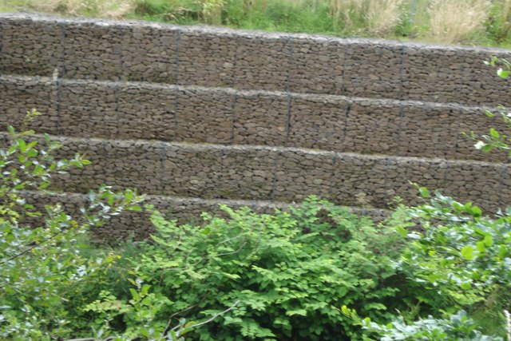
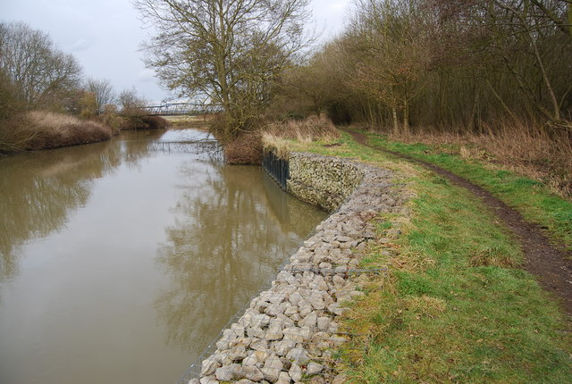
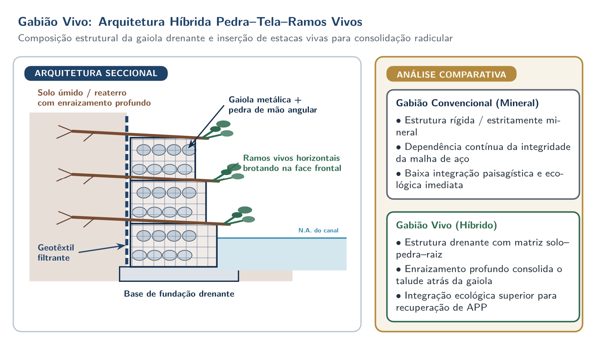
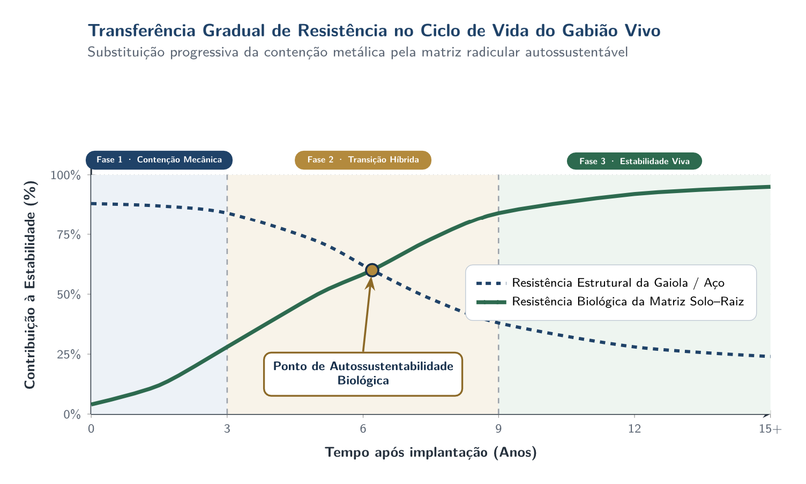

## [Abertura]{.pitch-tag} Visão Geral da Aula {#visao-geral .smaller-text .lesson-slide}

::: {.pitch-grid-50}
::: {.pitch-card}
[Roteiro da aula]{.pitch-card-index}
[Tópicos estruturantes]{.pitch-heading}

- [1]{.circle} O que é o gabião vivo?
- [2]{.circle} Gabião convencional × gabião vivo
- [3]{.circle} Materiais e componentes
- [4]{.circle} Projeto estrutural (empuxo e estabilidade)
- [5]{.circle} Intercalação de camadas vegetais
- [6]{.circle} Construção e implantação
- [7]{.circle} Transição arame → raízes
- [8]{.circle} Síntese e atividade
:::

::: {.pitch-stack-2}
::: {.pitch-card .pitch-card--forest}
[Objetivo da aula]{.pitch-card-index}
[Contenção híbrida evolutiva]{.pitch-heading}

Compreender o conceito de **gabião vivo** (*vegetated gabion* ou *green gabion*) como técnica de **estabilização estrutural** que combina a resistência imediata das **gaiolas de arame com pedra** e o reforço progressivo de **camadas de ramos vivos** intercalados, cujas raízes **substituem a função do arame** ao longo do tempo.
:::

::: {.pitch-pill-row}
[ABNT NBR 10514 · DNIT 082/2006]{.pitch-pill}
[EN 10223-3 · ASTM A975]{.pitch-pill .pitch-pill--gold}
[APP · PRAD]{.pitch-pill}
:::

::: {.pitch-band .pitch-band--teal}
Da contenção mineral imediata à matriz radicular autossustentável.
:::
:::
:::

# 1 · O que é o Gabião Vivo? {.section-header rotulo="Conceito"}

## [Conceito]{.pitch-tag .pitch-tag--forest} Definição e Princípio da Transição {#definicao-conceito .smaller-text .lesson-slide}

::: {.pitch-grid-55}
::: {.pitch-stack-2}
::: {.pitch-card}
[Composição híbrida]{.pitch-card-index}
[O que compõe o gabião vivo (*vegetated gabion*)]{.pitch-heading}

- **Gaiolas de arame** (tela de malha hexagonal ou soldada) preenchidas com **pedras**
- **Camadas horizontais de ramos vivos** intercaladas entre as fiadas de gabião
- **Solo fértil** ao redor dos ramos para facilitar o enraizamento
:::

::: {.pitch-card .pitch-card--gold}
[Ciclo de substituição]{.pitch-card-index}
[Inovação estrutural]{.pitch-heading}

O arame resiste de imediato (5–15 anos), mas inevitavelmente corrói. Nesse ínterim, as **raízes** crescem, entrelaçam as pedras e **assumem a função estrutural** que o arame deixa de cumprir.
:::
:::

::: {.pitch-table-box}
| Local | Função |
|-------|--------|
| Margens fluviais | Contenção + restauração ciliar |
| Base de taludes | Muro de arrimo ecológico |
| Saída de bueiros | Dissipação + revegetação |
| Ravinas profundas | Estabilização de fundo |
| Encostas urbanas | Muro verde paisagístico |
| Estradas rurais | Proteção de aterros |
:::
:::

::: {.pitch-flow-4}
::: {.pitch-card}
[Ano 0]{.pitch-card-index}
[100% arame · 0% raízes]{.pitch-heading}

Contenção puramente mecânica pela gaiola e peso das pedras.
:::

::: {.pitch-card .pitch-card--teal}
[Ano 5]{.pitch-card-index}
[70% arame · 40% raízes]{.pitch-heading}

Brotação consolidada e ancoragem inicial no maciço.
:::

::: {.pitch-card .pitch-card--forest}
[Ano 10]{.pitch-card-index}
[30% arame · 80% raízes]{.pitch-heading}

Matriz solo–pedra–raiz assume parcela dominante do esforço.
:::

::: {.pitch-card .pitch-card--gold}
[Ano 15+]{.pitch-card-index}
[0% arame · 100% raízes]{.pitch-heading}

Indicado em obras com exigência ambiental (APP, PRAD).
:::
:::

## [Campo]{.pitch-tag .pitch-tag--teal} Galeria: Gabiões em Margens Fluviais {#galeria-gabioes .smaller-text .lesson-slide}

::: {.pitch-grid-50}
::: {.pitch-media-card .pitch-media-card--photo .pitch-media-card--tall}

[Proteção de margem no Rio North Esk (Escócia)]{.pitch-caption}
[Foto: Morley Sewell · CC BY-SA 2.0 · Contenção longitudinal de margem fluvial]{.pitch-caption-sub}
:::

::: {.pitch-media-card .pitch-media-card--photo .pitch-media-card--tall}

[Reparo de margem no Rio Medway (Inglaterra)]{.pitch-caption}
[Foto: Nigel Chadwick · CC BY-SA 2.0 · Estabilização de base sujeita a solapamento]{.pitch-caption-sub}
:::
:::

::: {.pitch-band}
Em margens fluviais sob exigência de recuperação ecológica (APP, PRAD), a substituição de gabiões inertes por **gabiões vivos** mantém a estabilidade inicial e restaura o corredor ciliar.
:::

## [Histórico e Normas]{.pitch-tag .pitch-tag--gold} Evolução, Normas e Vantagens {#historico-normas .smaller-text .lesson-slide}

::: {.pitch-grid-50}
::: {.pitch-stack-2}
::: {.pitch-card}
[Linha do tempo]{.pitch-card-index}
[Evolução da técnica]{.pitch-heading}

- **1890s**: Gabiões de arame inventados na Itália (Maccaferri, 1894)
- **1950s**: Popularização global em obras hidráulicas
- **1980s**: Primeiras experiências de vegetação em gabiões na Áustria e Suíça
- **1990s**: Consolidação da técnica "gabião vivo" na bioengenharia europeia
- **2000s em diante**: Adoção em projetos de restauração no Brasil
:::

::: {.pitch-table-box}
| Norma | Escopo |
|-------|--------|
| EN 10223-3 | Tela de arame hexagonal |
| ASTM A975 | Gabiões e colchões Reno |
| ABNT NBR 10514 | Gabiões - Requisitos |
| DNIT 082/2006-ES | Gabião em obras rodoviárias |
:::
:::

::: {.pitch-stack-2}
::: {.pitch-table-box}
| Aspecto | Gabião convencional | Gabião vivo |
|---------|-------------------|-------------|
| Estabilidade imediata | ★★★★★ | ★★★★★ |
| Durabilidade do arame | 15–30 anos | **Irrelevante** (raízes assumem) |
| Custo de manutenção | Substituição de arame | **Zero** (autossustentável) |
| Impacto ambiental | Neutro | **Positivo** |
| Habitat para fauna | Mínimo | ★★★★★ |
| Estética/paisagismo | ★★☆☆☆ | ★★★★★ |
:::

::: {.pitch-band .pitch-band--teal}
A **durabilidade limitada do arame** (principal crítica ao gabião convencional) torna-se **irrelevante** quando as raízes substituem sua função antes da corrosão total.
:::
:::
:::

# 2 · Gabião Convencional × Gabião Vivo {.section-header rotulo="Comparação"}

## [Arquitetura]{.pitch-tag .pitch-tag--forest} Arquitetura Híbrida Pedra–Tela–Ramos Vivos {#arquitetura-gabiao-vivo .smaller-text .lesson-slide}

::: {.pitch-media-card .pitch-media-card--wide}

[Arquitetura Híbrida do Gabião Vivo: Gaiola Drenante, Geotêxtil Filtrante e Estacas Vivas]{.pitch-caption}
[Camadas horizontais de ramos vivos enraízam no reaterro e consolidam o maciço por trás da face pétrea]{.pitch-caption-sub}
:::

::: {.pitch-band .pitch-band--navy}
A intercalação de **camadas vegetais** é a única diferença construtiva, mas transforma uma estrutura **inerte** em um **ecossistema vivo** autorrenovável.
:::

## [Comparação]{.pitch-tag} Comparação Estrutural e Seção Transversal {#comparacao-estrutural .smaller-text .lesson-slide}

::: {.pitch-grid-50}
::: {.pitch-card}
[Modelo inerte]{.pitch-card-index}
[Gabião convencional]{.pitch-heading}

- Gaiolas: tela hexagonal dupla torção (galvanizada + PVC)
- Preenchimento: pedras britadas ($D > 1{,}5 \times$ malha)
- Função: **peso próprio** resiste ao empuxo do solo
- Vida útil: 30–50 anos (revestimento PVC)
- Sem componente biológico; flexível (adapta a recalques)
- **Seção:** Fiada 1 (pedras) → Fiada 2 (pedras) → Fiada 3 (pedras)
:::

::: {.pitch-card .pitch-card--forest}
[Modelo híbrido]{.pitch-card-index}
[Gabião vivo]{.pitch-heading}

- Mesma estrutura base do convencional
- **Camadas de ramos vivos** a cada 1–2 fiadas
- **Solo fértil** envolvendo os ramos (5–10 cm)
- Função: **peso próprio + coesão radicular**
- Vida útil: **ilimitada** (sistema vivo autorrenovável e autorreparável)
- **Seção:** Fiada 1 → 🌿 Ramos → Fiada 2 → 🌿 Ramos → Fiada 3
:::
:::

::: {.pitch-band}
Com o tempo, os ramos vivos enraízam no tardoz, germinam na face e entrelaçam as pedras, formando uma matriz monolítica permeável.
:::

# 3 · Materiais e Componentes {.section-header rotulo="Materiais"}

## [Especificações]{.pitch-tag .pitch-tag--gold} Componentes Estruturais e Biológicos {#especificacoes-tecnicas .smaller-text .lesson-slide}

::: {.pitch-grid-50}
::: {.pitch-stack-2}
::: {.pitch-table-box}
| Tela de arame | Especificação |
|---------------|--------------|
| Tipo | Hexagonal dupla torção |
| Fio | Ø 2,7 mm (alma) + revestimento |
| Revestimento | Galfan + PVC (5 mm externo) |
| Malha | 8 × 10 cm ou 6 × 8 cm |
| Resistência | 40–50 kN m⁻¹ |
:::

::: {.pitch-table-box}
| Pedras de preenchimento | Especificação |
|-------------------------|--------------|
| Dimensão mínima | 1,5 × abertura da malha |
| Dimensão típica | 10–25 cm |
| Dureza (Mohs) | > 5 |
| Absorção de água | < 5% |
| Resistência compressão | > 50 MPa |
:::
:::

::: {.pitch-stack-2}
::: {.pitch-table-box}
| Ramos vivos | Especificação |
|-------------|--------------|
| Diâmetro | 1–5 cm |
| Comprimento | 80–150 cm |
| Projeção externa | 20–30 cm além da face |
| Espécies | Propagação por estaquia |
| Coleta | Período de dormência |
:::

::: {.pitch-table-box}
| Solo de envolvimento | Especificação |
|----------------------|--------------|
| Tipo | Franco ou franco-argiloso |
| Matéria orgânica | > 3% |
| pH | 5,5 – 7,0 |
| Espessura da camada | 5–10 cm |
:::
:::
:::

::: {.pitch-band .pitch-band--teal}
Os ramos vivos devem **projetar-se 20–30 cm** além da face externa do gabião para garantir exposição ao sol e à chuva, favorecendo a brotação e o crescimento.
:::

# 4 · Projeto Estrutural {.section-header rotulo="Dimensionamento"}

## [Estabilidade]{.pitch-tag .pitch-tag--alert} Verificação como Muro de Gravidade {#verificacao-estabilidade .smaller-text .lesson-slide}

::: {.pitch-grid-55}
::: {.pitch-formula}
**1. Tombamento ($FS \geq 2{,}0$):**

$$FS_{tomb} = \frac{\sum M_{estab}}{\sum M_{tomb}} \geq 2{,}0$$

**2. Deslizamento ($FS \geq 1{,}5$):**

$$FS_{desl} = \frac{N \cdot \tan(\phi) + c \cdot B}{E_a} \geq 1{,}5$$

**3. Capacidade de carga ($FS \geq 3{,}0$):**

$$\sigma_{max} = \frac{N}{B}\left(1 + \frac{6e}{B}\right) \leq \sigma_{adm}$$
:::

::: {.pitch-stack-2}
::: {.pitch-card}
[Variáveis de projeto]{.pitch-card-index}
[Parâmetros do muro de gravidade]{.pitch-heading}

- $N$ = peso próprio do gabião ($\text{kN m}^{-1}$)
- $E_a$ = empuxo ativo do solo (Rankine ou Coulomb)
- $\phi$ = ângulo de atrito base–fundação
- $c$ = coesão do solo de fundação
- $B$ = largura da base; $e$ = excentricidade da resultante
:::

::: {.pitch-formula}
**Empuxo ativo (Rankine) e peso próprio:**

$$E_a = \frac{1}{2} \gamma H^2 K_a \qquad K_a = \tan^2\left(45° - \frac{\phi}{2}\right)$$

$$W = \gamma_{gab} \times V_{gab} \quad (\gamma_{gab} \approx 16\text{–}18 \text{ kN m}^{-3})$$
:::
:::
:::

::: {.pitch-grid-50}
::: {.pitch-table-box}
| Altura | Base mínima | Nº de fiadas |
|--------|-------------|--------------|
| 1,0 m | 0,5–1,0 m | 1 |
| 2,0 m | 1,0–1,5 m | 2 |
| 3,0 m | 1,5–2,5 m | 3 |
| 4,0 m | 2,0–3,0 m | 4 |
:::

::: {.pitch-band .pitch-band--teal}
As camadas vegetais **não alteram significativamente o peso próprio** ($\gamma_{gab}$ inclui pedra + vazios + solo), mas adicionam **coesão radicular** ($c_r$) ao longo do tempo, elevando a estabilidade global.
:::
:::

# 5 · Intercalação de Camadas Vegetais {.section-header rotulo="Vegetação"}

## [Ramos Vivos]{.pitch-tag .pitch-tag--forest} Disposição dos Ramos e Seleção de Espécies {#disposicao-ramos-vivos .smaller-text .lesson-slide}

::: {.pitch-grid-55}
::: {.pitch-stack-2}
::: {.pitch-milestones}
::: {.pitch-milestone-item}
**Fiada inferior (base em pedras):** recebe camada de solo + estacas vivas cujas **raízes penetram no solo natural** (ancoragem profunda).
:::

::: {.pitch-milestone-item}
**Fiada intermediária e camada de ramos:** camadas intercaladas **a cada 0,5–1,0 m** de altura, com **10–15 ramos/m linear** perpendiculares à face.
:::

::: {.pitch-milestone-item}
**Fiada superior e projeção externa:** pontas projetadas **20–30 cm** além da face externa promovem **brotação e cobertura**; envolvidas por **5–10 cm de solo fértil**.
:::
:::

::: {.pitch-card .pitch-card--alert}
[Cuidados na intercalação]{.pitch-card-index}
[Pontos críticos de campo]{.pitch-heading}

- Ramos **devem tocar o solo natural** no tardoz do gabião (não ficar somente sobre pedras)
- A camada de solo **não deve bloquear** a drenagem interna do gabião
- Irrigar nos primeiros **30 dias** se implantado em época seca
:::
:::

::: {.pitch-table-box}
| Espécie | Região | Enraizamento |
|---------|--------|--------------|
| *Salix humboldtiana* | S, SE, NE | Muito rápido |
| *Phyllanthus sellowianus* | S, SE | Rápido |
| *Calliandra brevipes* | SE, CO | Moderado |
| *Erythrina crista-galli* | S, SE | Rápido |
| *Gliricidia sepium* | NE | Muito rápido |
| *Schinus terebinthifolia* | Todo Brasil | Moderado |
:::
:::

# 6 · Construção e Implantação {.section-header rotulo="Execução"}

## [Execução]{.pitch-tag .pitch-tag--gold} Procedimento Construtivo, Cronograma e Equipe {#procedimento-construtivo .smaller-text .lesson-slide}

::: {.pitch-grid-55}
::: {.pitch-stack-2}
::: {.pitch-milestones}
::: {.pitch-milestone-item}
**1–3 · Fundação e 1ª fiada:** escavação + nivelamento → montagem da gaiola (tela + tirantes a cada **33 cm**) → preenchimento manual com pedras.
:::

::: {.pitch-milestone-item}
**4–7 · Camada vegetal e fiadas superiores:** solo fértil + ramos vivos inseridos **durante** a construção → costura da 2ª gaiola → preenchimento → repetir camada vegetal.
:::

::: {.pitch-milestone-item}
**8–9 · Fechamento e reaterro:** fechamento da tampa + amarração com arame galvanizado → reaterro do tardoz + drenagem.
:::
:::

::: {.pitch-card}
[Detalhes construtivos]{.pitch-card-index}
[Boas práticas de obra]{.pitch-heading}

- Pedras arrumadas **manualmente** (não despejadas) para minimizar vazios
- Tirantes internos a cada **33 cm** de altura; costura contínua entre gaiolas
- Plantio das camadas vegetais **preferencialmente na estação chuvosa**
:::
:::

::: {.pitch-stack-2}
::: {.pitch-table-box}
| Etapa (trecho de 10 m) | Tempo estimado |
|------------------------|----------------|
| Fundação (10 m) | 1 dia |
| Montagem + preenchimento (1 fiada, 10 m) | 1–2 dias |
| Camada vegetal (10 m) | 0,5 dia |
| Fechamento + reaterro (10 m) | 1 dia |
| **Total para muro 2 m × 10 m** | **5–7 dias** |
:::

::: {.pitch-table-box}
| Função na equipe típica | Quantidade |
|-------------------------|------------|
| Encarregado | 1 |
| Operários (gabião) | 4–6 |
| Técnico agrícola (vegetação) | 1 |
| Operador de máquina | 1 |
:::
:::
:::

# 7 · Transição Arame → Raízes {.section-header rotulo="Ciclo de Vida"}

## [Ciclo de Vida]{.pitch-tag .pitch-tag--forest} Transferência de Resistência no Gabião Vivo {#ciclo-vida-tikz .smaller-text .lesson-slide}

::: {.pitch-media-card .pitch-media-card--wide}

[Ciclo de Vida do Gabião Vivo: Da Contenção Mecânica à Estabilidade Viva]{.pitch-caption}
[Ponto de autossustentabilidade biológica ocorre quando a matriz solo–raiz compensa a perda gradual da malha metálica]{.pitch-caption-sub}
:::

::: {.pitch-band .pitch-band--navy}
Este é o princípio fundamental da **engenharia natural**: a estrutura construída é **temporária**, cumprindo sua função até que o **componente biológico** a substitua permanentemente.
:::

## [Reforço Radicular]{.pitch-tag .pitch-tag--teal} Fases do Sistema e Mecanismos de Coesão {#fases-mecanismos-radiculares .smaller-text .lesson-slide}

::: {.pitch-grid-50}
::: {.pitch-stack-2}
::: {.pitch-table-box}
| Fase | Período | Descrição |
|------|---------|-----------|
| **Estrutural** | 0–5 anos | Arame sustenta; raízes crescem |
| **Transição** | 5–15 anos | Arame corrói; raízes assumem |
| **Biológica** | 15+ anos | Raízes dominam; gabião "desaparece" |
:::

::: {.pitch-card .pitch-card--forest}
[Três formas de contribuição]{.pitch-card-index}
[Mecanismos de reforço radicular]{.pitch-heading}

1. **Coesão radicular ($c_r$):** raízes adicionam coesão ao solo intra e inter-pedras
2. **Ancoragem profunda:** raízes penetram o solo natural além do gabião
3. **Entrelaçamento:** raízes "costuram" fiadas e conectam pedras
:::
:::

::: {.pitch-stack-2}
::: {.pitch-formula}
**Critério de Mohr–Coulomb com reforço radicular:**

$$\tau_f = c + c_r + (\sigma - u) \tan \phi$$

Onde $c_r = 5\text{–}25 \text{ kPa}$ (depende da espécie e densidade de raízes).
:::

::: {.pitch-milestones}
::: {.pitch-milestone-item}
**Ano 0–2:** Arame 100% · Raízes 5%
:::

::: {.pitch-milestone-item}
**Ano 5:** Arame 85% · Raízes 40% (*Salix* atinge $c_r = 15\text{–}25$ kPa em 5 anos na Suíça — Böll et al., 2009)
:::

::: {.pitch-milestone-item}
**Ano 10–15:** Arame 50%→20% · Raízes 75%→95%
:::

::: {.pitch-milestone-item}
**Ano 20+:** Arame 0% · Raízes 100% (estrutura autossustentável)
:::
:::
:::
:::

# 8 · Síntese e Atividade {.section-header rotulo="Síntese"}

## [Síntese]{.pitch-tag .pitch-tag--forest} Fluxo Conceitual e Pontos Fundamentais {#resumo-conceitos .smaller-text .lesson-slide}

::: {.pitch-flow-4}
::: {.pitch-card}
[1 · Insumos]{.pitch-card-index}
[Estrutura + biologia]{.pitch-heading}

Gaiola de arame + pedras + ramos vivos intercalados + solo fértil de envolvimento.
:::

::: {.pitch-card .pitch-card--teal}
[2 · Implantação]{.pitch-card-index}
[Estabilidade imediata]{.pitch-heading}

Muro de gravidade garante contenção imediata e inicia o enraizamento progressivo.
:::

::: {.pitch-card .pitch-card--forest}
[3 · Transição]{.pitch-card-index}
[Coesão radicular]{.pitch-heading}

Raízes geram $c_r = 5\text{–}25$ kPa e tornam a corrosão futura do arame irrelevante.
:::

::: {.pitch-card .pitch-card--gold}
[4 · Maturidade]{.pitch-card-index}
[Ecossistema vivo]{.pitch-heading}

Estrutura evolui para ecossistema ciliar autossustentável.
:::
:::

::: {.pitch-cards-2}
::: {.pitch-card}
[Síntese técnica]{.pitch-card-index}
[Conceitos essenciais]{.pitch-heading}

1. **Gabião vivo** = gabião convencional + camadas de ramos vivos intercalados
2. O **arame** fornece resistência imediata; as **raízes** assumem a longo prazo
3. O **projeto estrutural** segue as verificações de muro de gravidade
:::

::: {.pitch-card .pitch-card--forest}
[Regras executivas]{.pitch-card-index}
[Parâmetros de campo]{.pitch-heading}

4. Ramos vivos projetam-se **20–30 cm** além da face externa
5. A **coesão radicular** ($c_r$) substitui a função do arame corroído
6. Resultado final: **ecossistema autossustentável** que integra engenharia e ecologia
:::
:::

## [Atividade]{.pitch-tag .pitch-tag--gold} Atividade Prática: Projeto de Gabião Vivo {#atividade-pratica .smaller-text .lesson-slide}

::: {.pitch-grid-55}
::: {.pitch-card}
[Exercício em grupo · 40 min + 10 min]{.pitch-card-index}
[Cenário em Feira de Santana (BA)]{.pitch-heading}

A margem esquerda de um córrego urbano em Feira de Santana (BA) apresenta erosão ativa com desbarrancamento de **2,5 m de altura**. Solo argiloso ($\gamma = 18 \text{ kN m}^{-3}$, $\phi = 25°$, $c = 10 \text{ kPa}$). O local está em **APP**.

**Projetem o gabião vivo:**

1. Calcule o **empuxo ativo** do solo ($E_a$)
2. Dimensione a **seção transversal** (largura de base necessária)
3. Verifique **tombamento** e **deslizamento** ($FS$)
4. Especifique a **tela de arame** e as **pedras**
5. Defina as **camadas vegetais** (espaçamento, espécies, nº de ramos)
6. Estime o **prazo de transição** arame → raízes
7. Elabore o **cronograma de execução e monitoramento**
:::

::: {.pitch-stack-2}
::: {.pitch-table-box}
| Critério de avaliação | Peso |
|-----------------------|------|
| Cálculo de empuxo | 20% |
| Verificação de estabilidade | 25% |
| Especificação de materiais | 15% |
| Projeto das camadas vegetais | 20% |
| Cronograma de obra | 20% |
:::

::: {.pitch-band .pitch-band--navy}
**Tempo:** 40 minutos para elaboração em grupo + 10 minutos para apresentação técnica por grupo.
:::
:::
:::

## [Referências]{.pitch-tag} Referências Bibliográficas {#referencias .smaller-text .lesson-slide}

::: {.pitch-cards-2}
::: {.pitch-card}
[Normas e manuais técnicos]{.pitch-card-index}
[Engenharia de gabiões e contenções]{.pitch-heading}

- ABNT (2018). NBR 10514:2018 - Gabiões e colchões Reno - Requisitos.
- DNIT (2006). DNIT 082/2006 - ES: Gabião. Departamento Nacional de Infraestrutura de Transportes.
- Gray, D. H. & Sotir, R. B. (1996). *Biotechnical and Soil Bioengineering Slope Stabilization*. John Wiley & Sons.
- Maccaferri (2019). *Gabiões e Muros de Solo Reforçado - Manual Técnico*. Officine Maccaferri S.p.A.
- Palmeira, E. M. & Tatto, J. (2015). Performance of gabiões as retaining structures. *Geotech. Geol. Engineering*, 33(4), 973-985.
:::

::: {.pitch-card .pitch-card--forest}
[Bioengenharia e reforço radicular]{.pitch-card-index}
[Literatura científica]{.pitch-heading}

- Böll, A. et al. (2009). Root reinforcement and slope stability - A practical review. *Swiss Federal Institute for Forest, Snow and Landscape Research WSL*.
- Norris, J. E. et al. (2008). *Slope Stability and Erosion Control: Ecotechnological Solutions*. Springer.
- Schiechtl, H. M. & Stern, R. (1996). *Ground Bioengineering Techniques*. Blackwell Science.
- Stokes, A. et al. (2009). Desirable plant root traits for protecting natural and engineered slopes. *Plant Soil*, 324, 1-30.
:::
:::

## {.obrigado-fit-text .center}

::: {.columns}
::: {.column style="text-align: center;"}

[Obrigado!]{.obrigado-fit-text}

**Prof. Luiz Diego Vidal Santos**

📧 luiz.diego@uefs.br

🌐 [ldvsantos.github.io/cv](https://ldvsantos.github.io/cv)

:::
:::
