## [Abertura]{.pitch-tag} Visão Geral da Aula {#visao-geral .smaller-text .lesson-slide}

::: {.pitch-grid-50}
::: {.pitch-card}
[Roteiro da aula]{.pitch-card-index}
[Tópicos estruturantes]{.pitch-heading}

- [1]{.circle} O que é a Parede Krainer?
- [2]{.circle} Histórico e aplicações
- [3]{.circle} Materiais: madeira e tratamento
- [4]{.circle} Projeto estrutural (empuxo e estabilidade)
- [5]{.circle} Geometria e detalhamento construtivo
- [6]{.circle} Integração com vegetação
- [7]{.circle} Acoplamento estrutural e proteção de base (Riprap)
- [8]{.circle} Construção e monitoramento
- [9]{.circle} Síntese e atividade
:::

::: {.pitch-stack-2}
::: {.pitch-card .pitch-card--forest}
[Objetivo da aula]{.pitch-card-index}
[Contenção em grelha viva + proteção basal]{.pitch-heading}

Compreender a **Parede Krainer** (*log-crib wall* ou *Krainer wall*) como estrutura de contenção em **grelha de troncos** preenchida com **terra e plantas**, apta a estabilizar **encostas muito íngremes** (> 45°) onde não há espaço para taludamento, integrando **engenharia estrutural**, **revegetação** e **riprap** (enrocamento) na proteção da base.
:::

::: {.pitch-pill-row}
[ABNT NBR 7190:2022]{.pitch-pill}
[Declividade > 45° · H = 2–6 m]{.pitch-pill .pitch-pill--gold}
[Krainer + Riprap]{.pitch-pill}
:::
:::
:::

# 1 · O que é a Parede Krainer? {.section-header rotulo="Conceito"}

## [Conceito]{.pitch-tag .pitch-tag--forest} Definição e Vista Tridimensional {#definicao-conceito .smaller-text .lesson-slide}

::: {.pitch-grid-55}
::: {.pitch-stack-2}
::: {.pitch-card}
[Estrutura em grelha]{.pitch-card-index}
[Componentes da Parede Krainer (*Krainerwand*)]{.pitch-heading}

- **Troncos longitudinais** (*stringers*): paralelos à face da parede
- **Troncos transversais** (*headers*): perpendiculares, penetram no solo natural
- **Preenchimento**: terra compactada + plantas vivas
- **Funcionamento**: atua como **muro de gravidade** permeável
:::

::: {.pitch-card .pitch-card--gold}
[Origem alpina e faixa de aplicação]{.pitch-card-index}
[Região de Krain (Eslovênia/Caríntia)]{.pitch-heading}

Desenvolvida nos Alpes para estabilizar encostas montanhosas com **madeira abundante** e **espécies resistentes**. Suporta alturas de **2–6 m** e é ideal para encostas com **declividade > 45°** sem espaço para taludamento.
:::
:::

::: {.pitch-media-card .pitch-media-card--photo .pitch-media-card--tall}

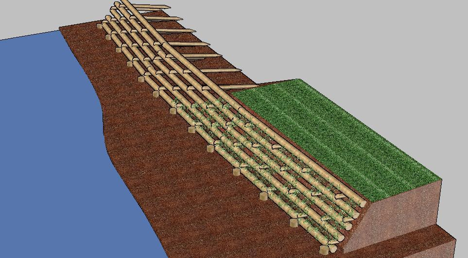

[Vista Tridimensional da Parede Krainer]{.pitch-caption}
[Grelha entrelaçada de troncos longitudinais e transversais com solo compactado e estacas vivas]{.pitch-caption-sub}
:::
:::

## [Anatomia]{.pitch-tag .pitch-tag--gold} Corte Transversal e Peças da Grelha {#anatomia-krainer .smaller-text .lesson-slide}

::: {.pitch-grid-50}
::: {.pitch-media-card .pitch-media-card--photo .pitch-media-card--tall}

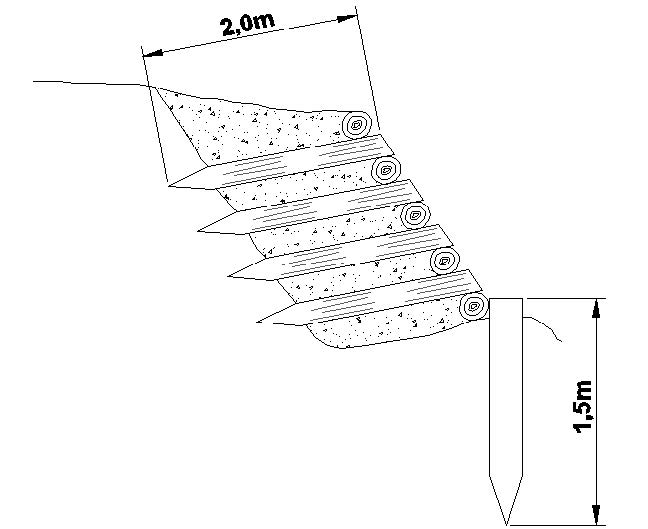

[Corte Transversal da Parede Krainer]{.pitch-caption}
[Troncos transversais (*headers*) ancoram no maciço natural; longitudinais (*stringers*) formam a face]{.pitch-caption-sub}
:::

::: {.pitch-media-card .pitch-media-card--photo .pitch-media-card--tall}

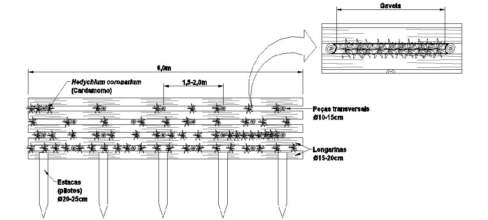

[Peças e Fixações Construtivas]{.pitch-caption}
[Troncos roliços, parafusos/barras roscadas e preenchimento com solo + estacas vivas]{.pitch-caption-sub}
:::
:::

## [Mecânica e Campo]{.pitch-tag .pitch-tag--teal} Cisalhamento Radicular e Parede em Campo {#krainer-estrutura-condicoes .smaller-text .lesson-slide}

::: {.pitch-grid-50}
::: {.pitch-media-card .pitch-media-card--tall}

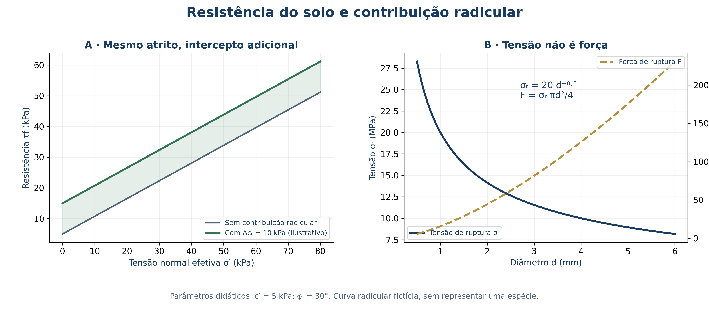

[Resistência ao Cisalhamento e Coesão Radicular ($\Delta c_r$)]{.pitch-caption}
[Esquema conceitual de Mohr–Coulomb: o dimensionamento exige geometria, fundação, água e estabelecimento vegetal]{.pitch-caption-sub}
:::

::: {.pitch-media-card .pitch-media-card--photo .pitch-media-card--tall}

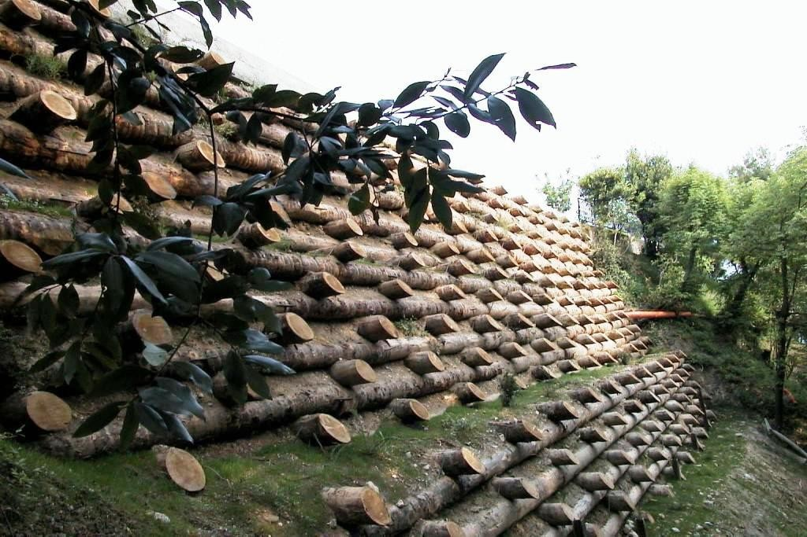

[Parede Krainer Estabelecida em Campo]{.pitch-caption}
[Vegetação integrada entre as camadas de troncos promovendo cobertura e ancoragem]{.pitch-caption-sub}
:::
:::

## [Galeria]{.pitch-tag .pitch-tag--teal} Exemplos de Aplicação e Integração Paisagística {#galeria-krainer .smaller-text .lesson-slide}

::: {.pitch-grid-50}
::: {.pitch-media-card .pitch-media-card--photo .pitch-media-card--tall}

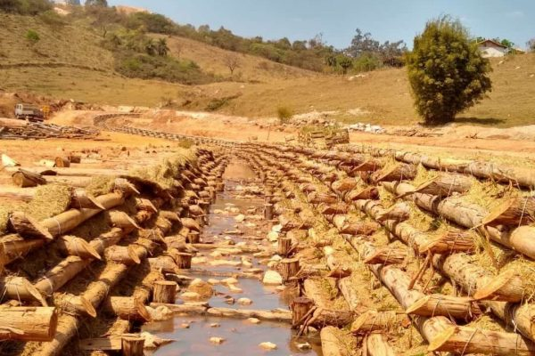

[Naturalização Progressiva da Face]{.pitch-caption}
[A vegetação assume gradualmente a face estrutural da contenção]{.pitch-caption-sub}
:::

::: {.pitch-media-card .pitch-media-card--photo .pitch-media-card--tall}

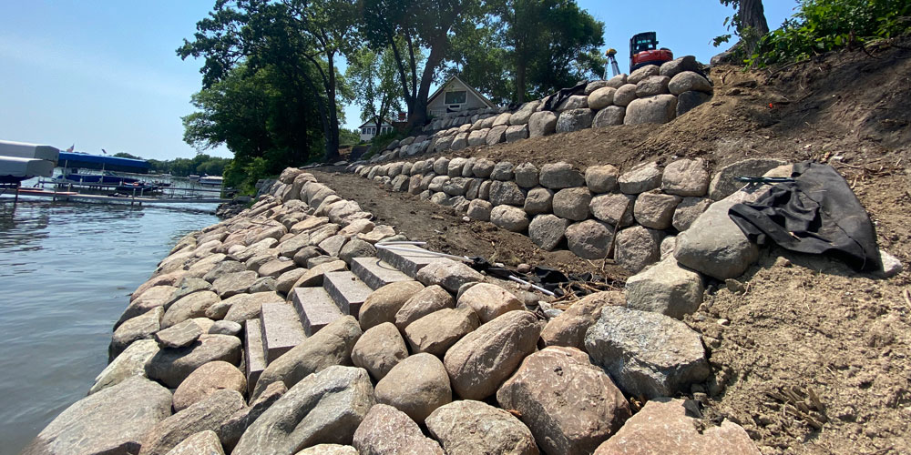

[Contenção Convencional × Solução Vegetada]{.pitch-caption}
[Comparação visual entre obras cinzas e sistemas integrados de bioengenharia]{.pitch-caption-sub}
:::
:::

## [Aplicabilidade]{.pitch-tag} Quando Usar a Parede Krainer? {#quando-usar-krainer .smaller-text .lesson-slide}

::: {.pitch-grid-50}
::: {.pitch-stack-2}
::: {.pitch-table-box}
| Situação | Adequação |
|----------|-----------|
| Encostas > 45° sem espaço para taludar | ★★★★★ |
| Contenção de ravinas profundas | ★★★★☆ |
| Margens de rios com desbarrancamento | ★★★★☆ |
| Base de aterros rodoviários | ★★★☆☆ |
| Áreas com madeira disponível | ★★★★★ |
:::

::: {.pitch-card .pitch-card--forest}
[Vantagens operacionais]{.pitch-card-index}
[Benefícios do sistema]{.pitch-heading}

- ✅ Material local (madeira) e obra sem equipamentos pesados
- ✅ Flexível (adapta a recalques) e permeável (sem poropressão)
- ✅ Integra vegetação nativamente e promove estética naturalizada
:::
:::

::: {.pitch-stack-2}
::: {.pitch-card .pitch-card--alert}
[Restrições de projeto]{.pitch-card-index}
[Limitações]{.pitch-heading}

- ❌ Madeira não tratada: vida útil 10–30 anos; exige volume elevado de toras
- ❌ Altura máxima isolada: 5–6 m (acima, combinar sistemas)
- ❌ Risco de incêndio em regiões secas; cupins e fungos exigem madeira resistente ou tratada
:::

::: {.pitch-table-box}
| Técnica | Altura máx. | Material | Revegetação |
|---------|-------------|----------|-------------|
| Gabião vivo | 4–6 m | Pedra + arame | Sim |
| **Krainer** | **5–6 m** | **Madeira** | **Sim** |
| Muro de concreto | 10+ m | Concreto | Não |
| Terra armada | 10+ m | Geogrelha + solo | Superficial |
:::
:::
:::

# 2 · Histórico e Aplicações {.section-header rotulo="Histórico"}

## [Difusão]{.pitch-tag .pitch-tag--gold} Origem Alpina e Aplicações no Brasil e no Mundo {#origem-difusao .smaller-text .lesson-slide}

::: {.pitch-grid-55}
::: {.pitch-stack-2}
::: {.pitch-card}
[Evolução histórica]{.pitch-card-index}
[Linha do tempo]{.pitch-heading}

- **Séc. XVI–XVIII**: Uso tradicional nos Alpes (Áustria, Eslovênia, Suíça) contra avalanches e encostas
- **Séc. XIX**: Documentação por engenheiros florestais austríacos
- **1930s**: Formalização na engenharia alpina (*Wildbachverbauung*)
- **1970s–1980s**: Renascimento com a bioengenharia (Schiechtl, 1980)
- **1990s–2000s**: Disseminação na América do Norte, Ásia e obras no Brasil
:::

::: {.pitch-card .pitch-card--forest}
[Contexto brasileiro]{.pitch-card-index}
[Principais frentes no país]{.pitch-heading}

- **Encostas urbanas** (RJ, SP, MG) — redução de risco geotécnico
- **Rodovias serranas** (contenção de cortes) e **APP fluviais** (margens)
- **Mineração** — contenção de bancadas e pilhas
:::
:::

::: {.pitch-stack-2}
::: {.pitch-table-box}
| País / Região | Aplicação principal |
|---------------|---------------------|
| Áustria / Suíça | Controle alpino, torrentes |
| Itália | Encostas montanhosas |
| Eslovênia | Rodovias, ferrovias |
| Estados Unidos | Parques nacionais, rodovias |
| Japão | Contenção de encostas sísmicas |
| Nepal | Estradas montanhosas |
| **Brasil** | **Encostas urbanas, APP** |
:::

::: {.pitch-band .pitch-band--navy}
A técnica mais **robusta** do repertório de bioengenharia: une capacidade de muro de gravidade e parede verde viva.
:::
:::
:::

# 3 · Materiais: Madeira e Tratamento {.section-header rotulo="Materiais"}

## [Madeira]{.pitch-tag .pitch-tag--gold} Seleção, Especificações e Preservação {#selecao-madeira .smaller-text .lesson-slide}

::: {.pitch-grid-50}
::: {.pitch-stack-2}
::: {.pitch-table-box}
| Espécie | Nome popular | Classe | Durab. (anos) |
|---------|-------------|--------|---------------|
| *Astronium lecointei* | Muiracatiara | I | 25–40 |
| *Manilkara huberi* | Maçaranduba | I | 25–40 |
| *Hymenaea courbaril* | Jatobá | II | 15–25 |
| *Eucalyptus cloeziana* | Eucalipto-cloez. | II | 15–25 |
| *Eucalyptus citriodora* | Euc. citriodora | II | 15–25 |
| *Corymbia maculata* | Euc. maculata | II | 10–20 |
:::

::: {.pitch-band .pitch-band--teal}
**Autoclave (CCA):** Eucalipto tratado dura **30+ anos**; Pinus tratado **20–25 anos**. Em restauração ecológica, priorize eucalipto de plantio ou reuso (sem pressão sobre matas nativas).
:::
:::

::: {.pitch-stack-2}
::: {.pitch-table-box}
| Parâmetro dos troncos | Valor |
|-----------------------|-------|
| Diâmetro mínimo / recomendado | 15–25 cm / 20–30 cm |
| Comprimento longitudinal | 2,0–4,0 m |
| Comprimento transversal | 1,0–2,5 m |
| Umidade máxima / Forma | < 30% (secagem parcial) · Roliça |
:::

::: {.pitch-cards}
::: {.pitch-card .pitch-card--forest}
[Opção 1]{.pitch-card-index}
[Durabilidade natural]{.pitch-heading}

Madeiras nativas Classe I/II de alta resistência biológica.
:::

::: {.pitch-card}
[Opção 2]{.pitch-card-index}
[Autoclave CCA/CCB]{.pitch-heading}

Eucalipto ou Pinus de plantio com preservação industrial.
:::

::: {.pitch-card .pitch-card--gold}
[Opção 3]{.pitch-card-index}
[Carbonização]{.pitch-heading}

Queima superficial tradicional como barreira biológica.
:::
:::
:::
:::

## [Mecânica da Madeira]{.pitch-tag} Propriedades Mecânicas e Verificação dos Nós {#propriedades-mecanicas .smaller-text .lesson-slide}

::: {.pitch-grid-50}
::: {.pitch-stack-2}
::: {.pitch-table-box}
| Propriedade | Eucalipto | Jatobá |
|-------------|-----------|--------|
| Compressão paralela ($f_{c0}$) | 40–65 MPa | 65–90 MPa |
| Flexão ($f_M$) | 70–100 MPa | 90–120 MPa |
| Cisalhamento ($f_v$) | 8–12 MPa | 12–16 MPa |
| Módulo de elasticidade ($E$) | 12–18 GPa | 15–22 GPa |
| Densidade aparente ($\rho$) | 600–850 kg m⁻³ | 800–1100 kg m⁻³ |
:::

::: {.pitch-card}
[Norma técnica]{.pitch-card-index}
[ABNT NBR 7190:2022]{.pitch-heading}

- Projeto de Estruturas de Madeira
- **Classe de umidade 4**: madeira submersa ou enterrada
:::
:::

::: {.pitch-stack-2}
::: {.pitch-formula}
**Compressão perpendicular nos nós de cruzamento:**

$$\sigma_{c90} = \frac{P}{A_{contato}} \leq f_{c90,d}$$

Onde $P$ = carga vertical por nó (kN), $A_{contato}$ = área de contato (cm²) e $f_{c90,d}$ = resistência de projeto à compressão perpendicular.

**Flexão do tronco longitudinal:**

$$M_{max} = \frac{w \cdot L^2}{8} \qquad \sigma_M = \frac{M_{max}}{W} \leq f_{M,d}$$
:::

::: {.pitch-band}
A verificação mais crítica é a **compressão perpendicular nos nós** de cruzamento, onde as toras se apoiam umas sobre as outras.
:::
:::
:::

# 4 · Projeto Estrutural {.section-header rotulo="Dimensionamento"}

## [Geometria e Estabilidade]{.pitch-tag .pitch-tag--alert} Parede Krainer como Muro de Gravidade {#krainer-muro-gravidade-tikz .smaller-text .lesson-slide}

::: {.pitch-media-card .pitch-media-card--wide}

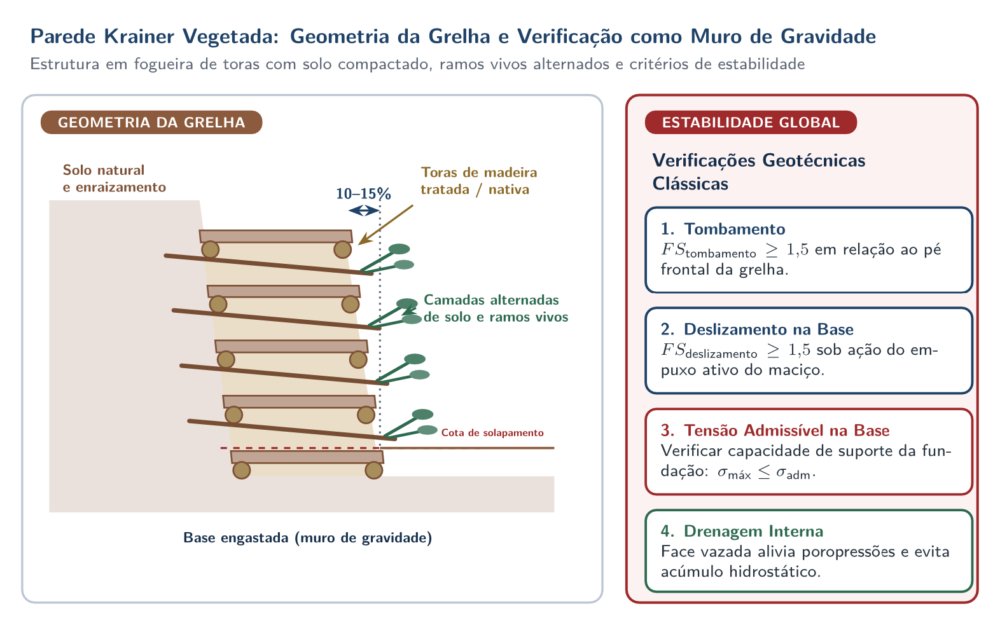

[Geometria da Grelha e Verificação como Muro de Gravidade]{.pitch-caption}
[Inclinação frontal de 10–15% para dentro, base engastada abaixo da cota de solapamento e drenagem interna pela face vazada]{.pitch-caption-sub}
:::

::: {.pitch-band .pitch-band--navy}
A face frontal inclinada **10°–15° para dentro** (frutamento) amplia o braço estabilizador e favorece a retenção de solo nos interstícios.
:::

## [Cálculo Geotécnico]{.pitch-tag .pitch-tag--alert} Verificações de Estabilidade e Geometria Típica {#verificacao-muro-gravidade .smaller-text .lesson-slide}

::: {.pitch-grid-55}
::: {.pitch-formula}
**Peso próprio da Parede Krainer** (75% solo compactado + 25% madeira):

$$\gamma_{Krainer} \approx 12\text{–}16 \text{ kN m}^{-3}$$

**1. Tombamento ($FS \geq 2{,}0$):** $\quad FS_{tomb} = \frac{W \cdot x_W}{E_a \cdot y_{Ea}} \geq 2{,}0$

**2. Deslizamento ($FS \geq 1{,}5$):** $\quad FS_{desl} = \frac{W \cdot \tan(\delta)}{E_a} \geq 1{,}5$

**3. Capacidade de carga ($FS \geq 3{,}0$):** $\quad \sigma_{max} \leq \sigma_{adm}$

Onde $\delta$ = ângulo de atrito base–fundação.
:::

::: {.pitch-stack-2}
::: {.pitch-table-box}
| Altura da parede | Base | Inclinação face |
|------------------|------|-----------------|
| 2,0 m | 1,5–2,0 m | 10°–15° |
| 3,0 m | 2,0–3,0 m | 10°–15° |
| 4,0 m | 3,0–4,0 m | 10°–15° |
| 5,0 m | 4,0–5,0 m | 10°–15° |
:::

::: {.pitch-milestones}
::: {.pitch-milestone-item}
**Regra prática:** Base $\approx 0{,}6 \times H$ a $1{,}0 \times H$
:::

::: {.pitch-milestone-item}
**Perfil escalonado:** Topo (mais estreito) → Corpo (grelha + solo + plantas) → Base (mais larga) → Fundação (enterrada **30–50 cm**)
:::
:::
:::
:::

# 5 · Geometria e Detalhamento Construtivo {.section-header rotulo="Detalhamento"}

## [Grelha e Nós]{.pitch-tag .pitch-tag--gold} Montagem da Grelha, Espaçamentos e Fixações {#detalhes-grelha .smaller-text .lesson-slide}

::: {.pitch-grid-55}
::: {.pitch-stack-2}
::: {.pitch-flow-4}
::: {.pitch-card}
[Camada 1]{.pitch-card-index}
[Transversais]{.pitch-heading}

Troncos transversais apoiados sobre a fundação nivelada.
:::

::: {.pitch-card .pitch-card--gold}
[Camada 2]{.pitch-card-index}
[Longitudinais]{.pitch-heading}

Troncos longitudinais sobre os transversais com fixação nos nós.
:::

::: {.pitch-card .pitch-card--forest}
[Enchimento]{.pitch-card-index}
[Solo + estacas]{.pitch-heading}

Solo compactado com estacas vivas inseridas entre camadas.
:::

::: {.pitch-card .pitch-card--teal}
[Camadas 3–n]{.pitch-card-index}
[Escalonamento]{.pitch-heading}

Alternância a 90° com recuo de 5–8 cm até a altura de projeto.
:::
:::

::: {.pitch-card}
[Interseções (nós)]{.pitch-card-index}
[Sistemas de conexão]{.pitch-heading}

- **Pregos/parafusos** de aço galvanizado (Ø 12–16 mm)
- **Entalhes** (meia-seção) para encaixe estável
- **Amarração** com arame (complementar)
:::
:::

::: {.pitch-stack-2}
::: {.pitch-table-box}
| Espaçamento entre troncos | Valor |
|---------------------------|-------|
| Espaçamento longitudinal | 1,0–1,5 m |
| Espaçamento transversal | 1,0–2,0 m |
| Altura por camada | 20–30 cm (Ø do tronco) |
| Recuo por camada (frutamento) | 5–8 cm |
:::

::: {.pitch-table-box}
| Método de fixação | Vantagem |
|-------------------|----------|
| Parafuso passante | Resistência ao cisalhamento |
| Entalhe meia-seção (50%) | Distribuição uniforme de carga |
| Prego longo (20 cm) | Rapidez, economia |
| Barra roscada | Maior resistência |
:::
:::
:::

# 6 · Integração com Vegetação {.section-header rotulo="Vegetação"}

## [Componente Vegetal]{.pitch-tag .pitch-tag--forest} Três Formas de Inserção e Espécies Indicadas {#componente-vegetal .smaller-text .lesson-slide}

::: {.pitch-grid-55}
::: {.pitch-cards}
::: {.pitch-card .pitch-card--forest}
[1 · Estacas vivas]{.pitch-card-index}
[Entre camadas]{.pitch-heading}

Inseridas horizontalmente entre camadas, projetando **20–30 cm** da face; espécies de estaquia.
:::

::: {.pitch-card .pitch-card--teal}
[2 · Mudas raiz nua]{.pitch-card-index}
[Nos interstícios]{.pitch-heading}

Arbustivas e herbáceas plantadas nos vãos entre troncos; raiz nua facilita adaptação.
:::

::: {.pitch-card .pitch-card--gold}
[3 · Semeadura]{.pitch-card-index}
[Face exposta]{.pitch-heading}

Hidrossemeadura de gramíneas + leguminosas para cobertura rápida e proteção superficial.
:::
:::

::: {.pitch-table-box}
| Posição / Espécie | Porte / Tipo | Desempenho |
|-------------------|--------------|------------|
| *Salix humboldtiana* (estaca) | Arbórea | Muito rápido |
| *Gliricidia sepium* (estaca) | Arbórea | Rápido |
| *Erythrina velutina* (estaca) | Arbórea | Rápido |
| *Lantana camara* / *Lippia alba* | Arbustos (interstício) | Cobertura lateral |
| *Vetiveria zizanioides* | Herbácea (interstício) | Ancoragem profunda |
| *Brachiaria decumbens* | Gramínea (face) | Proteção rápida |
| *Crotalaria juncea* / *Stylosanthes guianensis* | Leguminosas (face) | Fixação biológica |
:::
:::

::: {.pitch-cards-2}
::: {.pitch-card}
[Benefícios integrados]{.pitch-card-index}
[Funções da vegetação]{.pitch-heading}

**Raízes:** ancoragem e coesão radicular · **Copa:** sombreamento e proteção contra chuva · **Biodiversidade:** habitat · **Estética:** parede verde.
:::

::: {.pitch-band .pitch-band--teal}
Em **5–10 anos**, a vegetação domina a face e os interstícios; a madeira atua como **esqueleto temporário** e biodegrada sem perda de estabilidade.
:::
:::

# 7 · Acoplamento Estrutural e Proteção de Base {.section-header rotulo="Proteção de Base"}

## [Sistema Fluvial]{.pitch-tag .pitch-tag--teal} A Base da Krainer e o Acoplamento com Riprap {#base-krainer-sistema-fluvial .smaller-text .lesson-slide}

::: {.pitch-grid-50}
::: {.pitch-stack-2}
::: {.pitch-card}
[Conexão com a Aula 15]{.pitch-card-index}
[Proteção contra solapamento]{.pitch-heading}

Uma parede calculada contra empuxos pode falhar quando a água remove o apoio da sua base.

- Investigue erosão de fundo, solapamento, migração lateral e variação do N.A.
- Defina a **cota de fundação** a partir do mecanismo de erosão previsto.
- Verifique estabilidade global, deslizamento, tombamento e suporte.
- Compatibilize proteção de base, drenagem, vegetação e transições.
:::

::: {.pitch-table-box}
| Componente | Função no acoplamento | Verificação |
|---|---|---|
| Enrocamento | Proteger a base contra a solicitação hidráulica | Gradação, dimensão, espessura e estabilidade |
| Colchão Reno | Proteção flexível confinada por malha | Integridade da malha, enchimento, amarração e deformação |
| Filtro granular ou geotêxtil | Reter o solo e permitir drenagem | Compatibilidade de retenção, permeabilidade e execução |
| Transições | Evitar descontinuidades e erosão de contorno | Entrada, saída e ligação à margem |
:::
:::

::: {.pitch-stack-2}
::: {.pitch-media-card .pitch-media-card--compact}

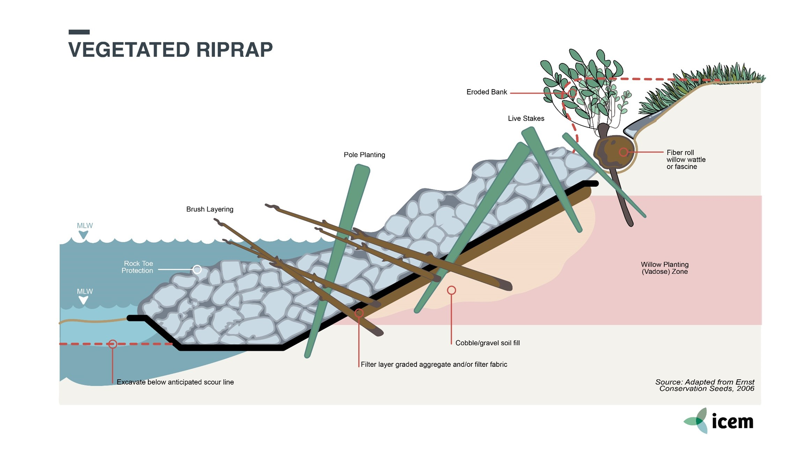

[Enrocamento Vegetado na Proteção de Base]{.pitch-caption}
[Escavação abaixo da linha de solapamento, filtro granular/geotêxtil, rocha de pé e estacas vivas]{.pitch-caption-sub}
:::

::: {.pitch-media-card .pitch-media-card--photo .pitch-media-card--compact}

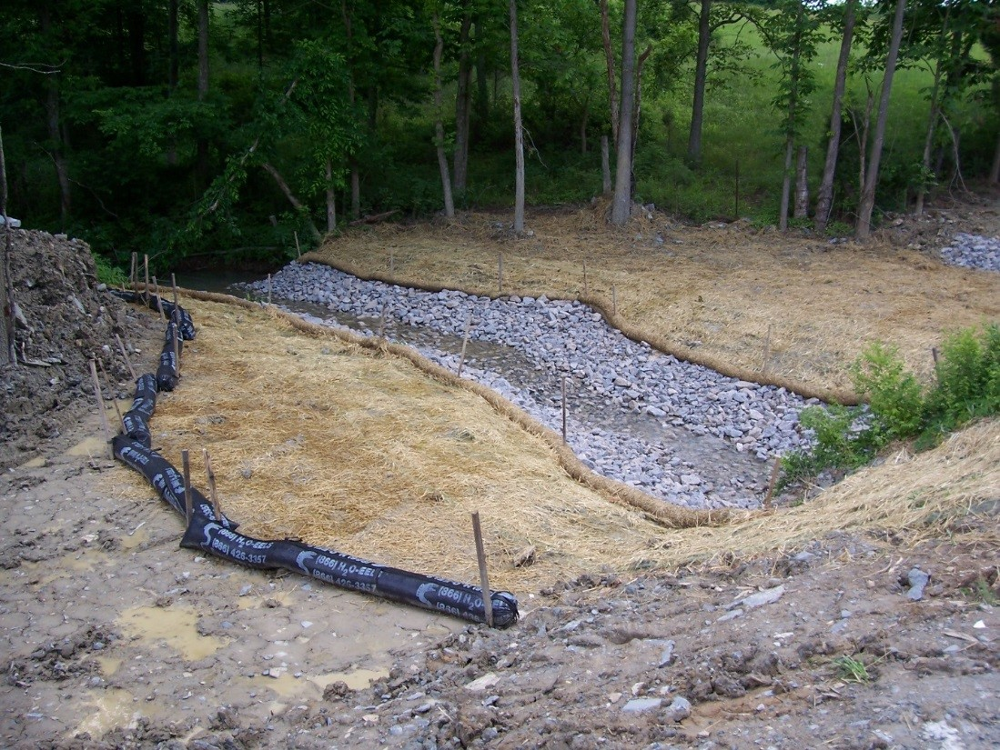

[Canal Protegido por Enrocamento (*Riprap*)]{.pitch-caption}
[Dissipação hidráulica em zonas de alta tensão cisalhante sem barrar a permeabilidade]{.pitch-caption-sub}
:::
:::
:::

## [Memorial e Execução]{.pitch-tag .pitch-tag--gold} Projeto, Execução e Monitoramento Pós-Cheia {#memorial-protecao-base .smaller-text .lesson-slide}

::: {.pitch-grid-50}
::: {.pitch-stack-2}
::: {.pitch-card}
[Memorial da proteção de base]{.pitch-card-index}
[6 passos de dimensionamento]{.pitch-heading}

1. Caracterize geometria, níveis, velocidades e tensões no trecho.
2. Estime a erosão de projeto e suas incertezas.
3. Escolha proteção e filtro compatíveis com o solo (colchão Reno não dispensa filtro).
4. Defina embutimento, largura de proteção e transições.
5. Verifique a parede com cenários de água e perda de suporte.
6. Detalhe a interface entre madeira, pedra, filtro e plantas ($D_{50}$ depende da solicitação local, não só da velocidade média).
:::

::: {.pitch-card .pitch-card--teal}
[Execução sem erosão interna]{.pitch-card-index}
[Cuidados construtivos e leitura]{.pitch-heading}

- Confira cotas; execute filtros sem perfurações e não lance pedras sobre geotêxteis.
- Conecte drenagem sem jatos sobre solo exposto; garanta contato vegetal com substrato e registre o *as-built*.
- Fonte: [USDA-NRCS (2007). NEH 654, supl. 14I: Streambank Soil Bioengineering](https://directives.nrcs.usda.gov/sites/default/files2/1720623369/Technical%20Supplement%2014%20I%20-%20Streambank%20Soil%20Bioengineering.pdf)
:::
:::

::: {.pitch-stack-2}
::: {.pitch-table-box}
| Sinal pós-cheia | Possível mecanismo | Ação de verificação |
|---|---|---|
| Vazio sob a base | Solapamento ou perda de finos | Levantar fundo, filtro e apoio |
| Deslocamento de pedras/malha | Solicitação além da resistência | Conferir hidráulica e integridade |
| Recalque ou inclinação | Suporte, erosão ou deformação | Medir deslocamentos e revisar estabilidade |
| Surgência turva | Transporte de finos | Verificar drenagem e filtro |
| Mortalidade concentrada | Falha de substrato, água ou plantio | Avaliar e repor conforme diagnóstico |
:::

::: {.pitch-band}
Inspecione o acoplamento após eventos relevantes; associe cada registro à chuva, ao nível do rio e às ações de manutenção.
:::
:::
:::

# 8 · Construção e Monitoramento {.section-header rotulo="Execução"}

## [Sequência em Campo]{.pitch-tag .pitch-tag--forest} Sequência Construtiva da Parede Krainer {#krainer-execucao-tikz .smaller-text .lesson-slide}

::: {.pitch-media-card .pitch-media-card--wide}

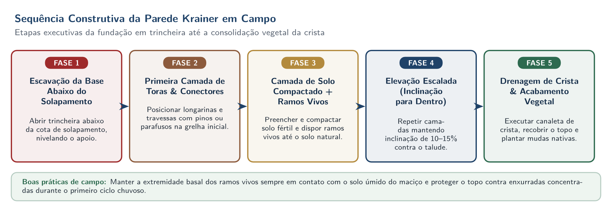

[Sequência Construtiva da Parede Krainer em Campo: Da Trincheira de Base ao Acabamento Vegetal]{.pitch-caption}
[Fases 1 a 5: fundação abaixo do solapamento, grelha inicial, solo + ramos vivos, elevação escalada (10–15%) e drenagem de crista]{.pitch-caption-sub}
:::

::: {.pitch-band .pitch-band--teal}
Mantenha a extremidade basal dos ramos vivos sempre em contato com o **solo úmido do maciço** e proteja a crista contra enxurradas concentradas no primeiro ciclo chuvoso.
:::

## [Obra e Controle]{.pitch-tag} Etapas, Ferramentas e Monitoramento {#procedimento-monitoramento .smaller-text .lesson-slide}

::: {.pitch-grid-50}
::: {.pitch-stack-2}
::: {.pitch-milestones}
::: {.pitch-milestone-item}
**1–2 · Fundação:** escavação (**30–50 cm**) + nivelamento com brita de regularização.
:::

::: {.pitch-milestone-item}
**3–4 · Grelha inicial:** 1ª camada transversal + 1ª longitudinal fixada com parafusos/entalhes.
:::

::: {.pitch-milestone-item}
**5–6 · Solo e vegetação:** preenchimento compactado manual + estacas vivas e mudas.
:::

::: {.pitch-milestone-item}
**7–8 · Elevação e topo:** repetir camadas com recuo (frutamento) até o coroamento + semeadura da face.
:::
:::

::: {.pitch-table-box}
| Ferramenta | Uso em obra |
|------------|-------------|
| Motosserra / Furadeira | Corte, entalhe e pré-furos |
| Nível de mangueira / Marreta | Nivelamento e cravação |
| Compactador manual | Compactação do solo interno |
:::
:::

::: {.pitch-stack-2}
::: {.pitch-table-box}
| Período | Verificação de monitoramento |
|---------|------------------------------|
| 7 dias | Estabilidade das camadas |
| 30 dias | Brotação das estacas + mudas |
| 90 dias | Integridade dos nós + drenagem |
| 6 meses | Cobertura vegetal na face |
| 1–2 anos | Enraizamento, recalques e estado da madeira |
| 5 anos | Transição madeira → raízes |
:::

::: {.pitch-card .pitch-card--forest}
[Indicadores de sucesso]{.pitch-card-index}
[Metas e prioridade de inspeção]{.pitch-heading}

- ✅ Recalque diferencial < 5 cm · Brotação > 60% · Cobertura > 50% (6 meses)
- ✅ Sem instabilidade, drenagem livre e madeira íntegra
- 🔍 **Prioridade:** inspecionar **nós de cruzamento** (fissuras/amolecimento)
:::
:::
:::

# 9 · Síntese e Atividade {.section-header rotulo="Síntese"}

## [Síntese]{.pitch-tag .pitch-tag--forest} Fluxo Conceitual Integrado e Pontos-Chave {#resumo-conceitos .smaller-text .lesson-slide}

::: {.pitch-flow-4}
::: {.pitch-card}
[1 · Estrutura]{.pitch-card-index}
[Grelha + solo]{.pitch-heading}

Troncos tratados/duráveis + solo fértil compactado = contenção imediata para encostas **> 45°**.
:::

::: {.pitch-card .pitch-card--forest}
[2 · Biologia]{.pitch-card-index}
[Estacas + mudas]{.pitch-heading}

Estacas vivas, mudas nos interstícios e semeadura na face promovem revegetação progressiva.
:::

::: {.pitch-card .pitch-card--teal}
[3 · Proteção basal]{.pitch-card-index}
[Riprap acoplado]{.pitch-heading}

Enrocamento ou riprap vegetado garante proteção mecânica e filtro contra solapamento hidráulico.
:::

::: {.pitch-card .pitch-card--gold}
[4 · Substituição]{.pitch-card-index}
[Parede verde viva]{.pitch-heading}

Em **5–10 anos**, as raízes assumem o papel estrutural e consolidam uma parede autossustentável.
:::
:::

::: {.pitch-cards-2}
::: {.pitch-card}
[Pontos fundamentais (1–4)]{.pitch-card-index}
[Parede Krainer]{.pitch-heading}

1. Grelha de troncos + solo + vegetação = muro de gravidade vivo
2. Indicada para encostas **> 45°** sem espaço para taludamento
3. **Madeira** de alta durabilidade natural ou tratada em autoclave
4. **Projeto** verifica tombamento, deslizamento e capacidade de carga
:::

::: {.pitch-card .pitch-card--teal}
[Pontos fundamentais (5–8)]{.pitch-card-index}
[Vegetação e Riprap]{.pitch-heading}

5. **Vegetação** integrada durante a construção (estacas + mudas + semeadura)
6. Em 5–10 anos, as **raízes substituem a madeira** como elemento estrutural
7. **Riprap** = enrocamento permanente para alta energia hidráulica
8. **Riprap vegetado** = ponte entre engenharia cinza e bioengenharia
:::
:::

## [Atividade]{.pitch-tag .pitch-tag--gold} Atividade Prática: Projeto de Parede Krainer + Riprap {#atividade-pratica .smaller-text .lesson-slide}

::: {.pitch-grid-55}
::: {.pitch-card}
[Exercício em grupo · 40 min + 10 min]{.pitch-card-index}
[Cenário em Feira de Santana (BA)]{.pitch-heading}

Encosta urbana com inclinação de **55°**, altura de **3,5 m**, solo argiloso ($\gamma = 17 \text{ kN m}^{-3}$, $\phi = 22°$, $c = 12 \text{ kPa}$), sem espaço para taludamento. Eucalipto tratado disponível; na base há canal de drenagem com velocidade de pico de **2,5 m/s**.

**Projetem a Parede Krainer + Riprap:**

1. Empuxo ativo e peso próprio · **2.** Base e inclinação da face · **3.** Verificar tombamento e deslizamento ($FS$) · **4.** Diâmetro, espaçamento e fixação dos troncos · **5.** Plano de vegetação (espécies, posição, quantidade) · **6.** Dimensionar riprap do canal (classe, $D_{50}$, filtro) · **7.** Justificar riprap puro ou vegetado · **8.** Volume de madeira ($\text{m}^3$) e custo · **9.** Cronograma de construção e monitoramento.
:::

::: {.pitch-stack-2}
::: {.pitch-table-box}
| Critério de avaliação | Peso |
|-----------------------|------|
| Cálculos de estabilidade | 20% |
| Geometria e detalhamento | 15% |
| Especificação da madeira | 10% |
| Plano de vegetação | 15% |
| Proteção de base e filtro | 20% |
| Cronograma e custos | 20% |
:::

::: {.pitch-band .pitch-band--navy}
**Tempo:** 40 minutos para projeto em grupo + 10 minutos para apresentação técnica por grupo.
:::
:::
:::

## [Referências]{.pitch-tag} Referências Bibliográficas {#referencias .smaller-text .lesson-slide}

::: {.pitch-cards-2}
::: {.pitch-card}
[Normas e manuais de contenção/riprap]{.pitch-card-index}
[Engenharia estrutural e hidráulica]{.pitch-heading}

- ABNT (2022). NBR 7190:2022 - Projeto de Estruturas de Madeira. Associação Brasileira de Normas Técnicas.
- MnDOT (2006). *Erosion Control Field Handbook II*. Minnesota Department of Transportation.
- MnDOT (2018). *Standard Specifications for Construction*. Specification 2511 - Riprap.
- MPCA (2018). Erosion prevention practices - Riprap. *Minnesota Stormwater Manual*.
- NY State (2016). *Standards and Specifications for Erosion and Sediment Control*. DEC.
- UNDP/ERMC (2013). *Resource Manual on Flash Flood Risk Management - Module 3: Structural Measures*. ICIMOD.
:::

::: {.pitch-card .pitch-card--forest}
[Bioengenharia de solos e Parede Krainer]{.pitch-card-index}
[Literatura clássica e contemporânea]{.pitch-heading}

- Florineth, F. (2004). *Pflanzen statt Beton - Handbuch zur Ingenieurbiologie und Vegetationstechnik*. Patzer Verlag.
- Gray, D. H. & Leiser, A. T. (1982). *Biotechnical Slope Protection and Erosion Control*. Van Nostrand Reinhold.
- Morgan, R. P. C. & Rickson, R. J. (1995). *Slope Stabilization and Erosion Control: A Bioengineering Approach*. E & FN Spon.
- Schiechtl, H. M. (1980). *Bioengineering for Land Reclamation and Conservation*. University of Alberta Press.
- Schiechtl, H. M. & Stern, R. (1996). *Ground Bioengineering Techniques*. Blackwell Science.
- Stokes, A. et al. (2014). Ecological mitigation of hillslope instability. *Plant Soil*, 377, 1-23.
- Zeh, H. (2007). *Soil Bioengineering Construction Type Manual*. EFIB/vdf Hochschulverlag.
:::
:::

## {.obrigado-fit-text .center}

::: {.columns}
::: {.column style="text-align: center;"}

[Obrigado!]{.obrigado-fit-text}

**Prof. Luiz Diego Vidal Santos**

📧 luiz.diego@uefs.br

🌐 [ldvsantos.github.io/cv](https://ldvsantos.github.io/cv)

:::
:::
