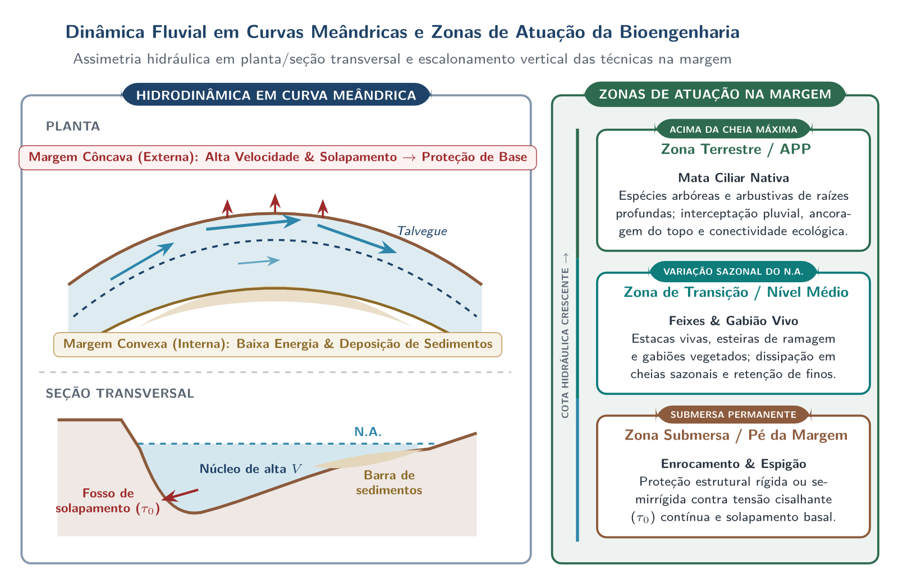
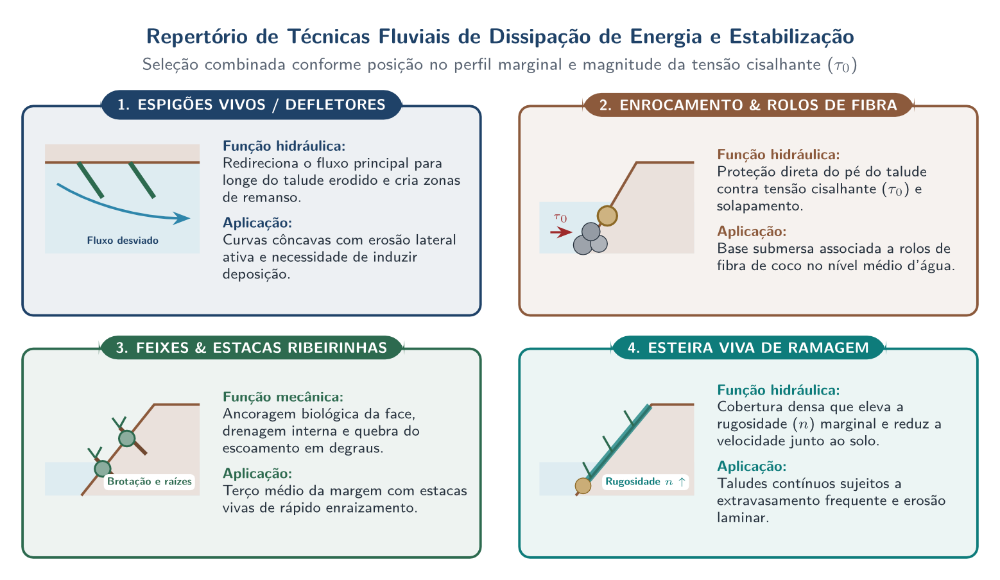
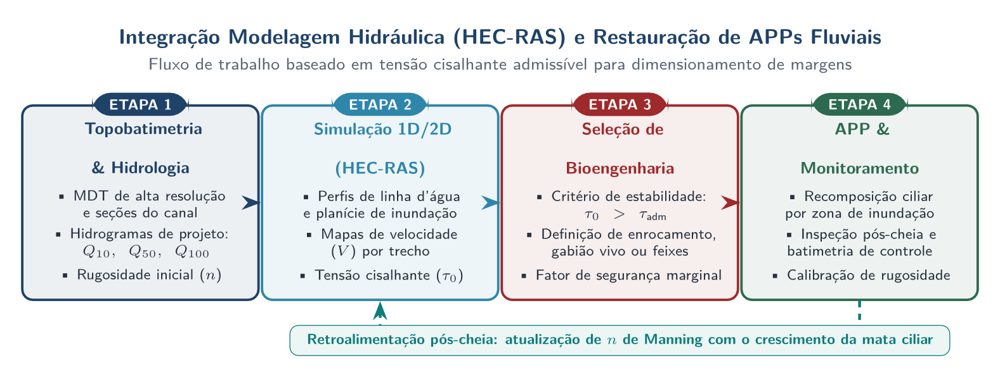

## [Abertura]{.pitch-tag} Visão Geral da Aula {#visao-geral .smaller-text .lesson-slide}

::: {.pitch-grid-50}
::: {.pitch-card}
[Roteiro da aula]{.pitch-card-index}
[Tópicos estruturantes]{.pitch-heading}

- [1]{.circle} Bioengenharia fluvial: conceitos
- [2]{.circle} Dinâmica fluvial e erosão de margens
- [3]{.circle} Defletores de troncos
- [4]{.circle} Leitos de ramos (*brushlayering*)
- [5]{.circle} Restauração de zonas úmidas e manguezais
- [6]{.circle} Restauração de matas ciliares
- [7]{.circle} Modelagem hidráulica aplicada
- [8]{.circle} Síntese e atividade
:::

::: {.pitch-stack-2}
::: {.pitch-card .pitch-card--teal}
[Objetivo da aula]{.pitch-card-index}
[Soluções Baseadas na Natureza em rios]{.pitch-heading}

Compreender as técnicas avançadas de **bioengenharia fluvial** para **proteção de margens**, **controle de erosão** em cursos d'água e **restauração de matas ciliares**, integrando **defletores de troncos**, **leitos de ramos** (*brushlayering*), restauração de **zonas úmidas/manguezais** e **modelagem hidráulica** (HEC-RAS / Iber).
:::

::: {.pitch-pill-row}
[Lei 12.651/2012 (APP)]{.pitch-pill}
[HEC-RAS · Iber · Shields]{.pitch-pill .pitch-pill--gold}
[SbN / NbS]{.pitch-pill}
:::
:::
:::

# 1 · Bioengenharia Fluvial: Conceitos {.section-header rotulo="Conceitos"}

## [Conceitos]{.pitch-tag .pitch-tag--teal} Definição, Escopo e Abordagem Integrada {#definicao-escopo .smaller-text .lesson-slide}

::: {.pitch-grid-55}
::: {.pitch-stack-2}
::: {.pitch-card}
[Engenharia com o rio]{.pitch-card-index}
[O que é bioengenharia fluvial?]{.pitch-heading}

Conjunto de técnicas que utiliza **materiais vivos** (plantas, ramos, estacas) e **materiais inertes naturais** (pedras, troncos, fibras) para:

- **Proteger margens** contra erosão e **controlar** a dinâmica do canal
- **Restaurar habitats** aquáticos e ripários e **melhorar** a qualidade da água
- **Recuperar** matas ciliares (**APP**)
:::

::: {.pitch-band .pitch-band--teal}
Diferente da engenharia hidráulica convencional (concreto, enrocamento isolado), busca **trabalhar com o rio**, respeitando processos naturais de erosão e deposição. Reconhecida pela **IUCN** e **Comissão Europeia** como estratégia prioritária de **Soluções Baseadas na Natureza (NbS)**.
:::
:::

::: {.pitch-milestones}
::: {.pitch-milestone-item}
**1. Diagnóstico do rio:** leitura integrada de processos, ecologia e hidráulica.
:::

::: {.pitch-milestone-item}
**2. Processos erosivos → Proteção de margem:** enrocamento, gabião vivo, *brushlayering*.
:::

::: {.pitch-milestone-item}
**3. Ecologia ripária → Mata ciliar:** recomposição de APP e conectividade.
:::

::: {.pitch-milestone-item}
**4. Hidráulica do canal → Manejo do fluxo:** defletores e dissipadores → **Bioengenharia Fluvial**.
:::
:::
:::

## [Diagnóstico e Repertório]{.pitch-tag .pitch-tag--gold} Diagnóstico de Margem e Zonas do Canal {#diagnostico-repertorio .smaller-text .lesson-slide}

::: {.pitch-grid-50}
::: {.pitch-stack-2}
::: {.pitch-table-box}
| Dimensão do diagnóstico | Informação necessária |
|---|---|
| Dinâmica fluvial | Cheias, mobilidade do canal, barras e transporte |
| Margem | Altura, material, estratificação, trincas e raízes |
| Pé do talude | Solapamento, profundidade e condições de fundação |
| Água no solo | Saturação, drenagem e rebaixamento do nível do rio |
| Ocupação | Pessoas, acessos, infraestrutura e usos a proteger |
:::

::: {.pitch-band}
Conter uma margem pode **deslocar o esforço erosivo**; verifique sempre os efeitos hidráulicos no trecho a montante e a jusante.
:::
:::

::: {.pitch-stack-2}
::: {.pitch-table-box}
| Objetivo | Técnica | Aula |
|----------|---------|------|
| Cobertura / Superfície | Hidrossemeadura / Biomanta | Aulas 13–14 |
| Estabilização de base | Enrocamento vegetado | Aula 15 |
| Controle de escoamento | Cordões vegetativos | Aula 16 |
| Contenção estrutural | Gabião vivo / Parede Krainer | Aulas 17–18 |
| **Proteção de margens & APP** | **Defletores, brushlayering, mata ciliar** | **Esta aula** |
:::

::: {.pitch-flow-4}
::: {.pitch-card}
[Leito]{.pitch-card-index}
[Submersa]{.pitch-heading}

Defletores de troncos e soleiras de fundo.
:::

::: {.pitch-card .pitch-card--teal}
[Base]{.pitch-card-index}
[Anfíbia]{.pitch-heading}

Enrocamento vegetado e gabião vivo.
:::

::: {.pitch-card .pitch-card--forest}
[Talude]{.pitch-card-index}
[Ripária]{.pitch-heading}

*Brushlayering* e fascinas vivas.
:::

::: {.pitch-card .pitch-card--gold}
[Planície]{.pitch-card-index}
[Terrestre]{.pitch-heading}

Mata ciliar e hidrossemeadura.
:::
:::
:::
:::

# 2 · Dinâmica Fluvial e Erosão de Margens {.section-header rotulo="Dinâmica Fluvial"}

## [Hidrogeomorfologia]{.pitch-tag .pitch-tag--teal} Dinâmica em Curvas Meândricas e Zonas de Atuação {#fluvial-processos-tikz .smaller-text .lesson-slide}

::: {.pitch-media-card .pitch-media-card--wide}

[Dinâmica Fluvial em Curvas Meândricas e Zoneamento de Bioengenharia]{.pitch-caption}
[Assimetria hidráulica entre margem côncava (solapamento) e convexa (deposição) e estratificação vertical por cota]{.pitch-caption-sub}
:::

::: {.pitch-band .pitch-band--navy}
A **curva externa (côncava)** concentra o núcleo de alta velocidade e o fosso de solapamento, recebendo $\sim 1{,}5\text{–}2{,}0\times$ a tensão cisalhante média do trecho reto.
:::

## [Erosão Marginal]{.pitch-tag .pitch-tag--alert} Processos Erosivos, Meandros e Tensão Crítica {#processos-erosivos .smaller-text .lesson-slide}

::: {.pitch-grid-55}
::: {.pitch-cards-2}
::: {.pitch-card .pitch-card--alert}
[1 · Erosão hidráulica]{.pitch-card-index}
[Arraste fluvial]{.pitch-heading}

Arraste de partículas pela corrente, mais intenso na curva externa; depende de velocidade, turbulência e material da margem.
:::

::: {.pitch-card .pitch-card--gold}
[2 · Solapamento]{.pitch-card-index}
[Undercutting]{.pitch-heading}

Água escava a base da margem criando nicho de erosão; a parte superior colapsa por gravidade.
:::

::: {.pitch-card}
[3 · Ataque por ondas]{.pitch-card-index}
[Wave attack]{.pitch-heading}

Ondas geradas por embarcações ou vento impactam margens desprotegidas de rios navegáveis e reservatórios.
:::

::: {.pitch-card .pitch-card--teal}
[4 · Saturação + flutuações]{.pitch-card-index}
[Ruptura pós-cheia]{.pitch-heading}

Elevação e rebaixamento rápido do nível geram pressão neutra positiva e ruptura planar ou rotacional.
:::
:::

::: {.pitch-stack-2}
::: {.pitch-formula}
**Tensão de cisalhamento no leito:**

$$\tau_0 = \gamma_w \cdot R \cdot S$$

- $\tau_0$ = tensão de cisalhamento no leito ($\text{Pa}$)
- $\gamma_w$ = peso específico da água ($9.810 \text{ N m}^{-3}$)
- $R$ = raio hidráulico ($\text{m}$); $S$ = declividade do canal ($\text{m m}^{-1}$)
:::

::: {.pitch-milestones}
::: {.pitch-milestone-item}
**Margem côncava (externa):** alta velocidade e cisalhamento → **solapamento + colapso**.
:::

::: {.pitch-milestone-item}
**Fluxo helicoidal:** transfere sedimentos da margem externa para a interna.
:::

::: {.pitch-milestone-item}
**Margem convexa (interna):** baixa velocidade e sedimentação → formação de **barra de ponto**.
:::
:::
:::
:::

# 3 · Defletores de Troncos {.section-header rotulo="Defletores"}

## [Repertório Técnico]{.pitch-tag .pitch-tag--teal} Técnicas Fluviais de Dissipação e Estabilização {#tecnicas-dissipacao-tikz .smaller-text .lesson-slide}

::: {.pitch-media-card .pitch-media-card--wide}

[Repertório de Técnicas Fluviais: Espigões, Enrocamento, Feixes e Esteira Viva]{.pitch-caption}
[Seleção combinada conforme posição no perfil marginal e magnitude da tensão cisalhante ($\tau_0$)]{.pitch-caption-sub}
:::

::: {.pitch-band .pitch-band--teal}
Cada técnica atua em uma faixa específica da margem: defletores desviam o talvegue, enrocamento protege o pé, feixes ancoram o terço médio e esteiras elevam a rugosidade ($n$).
:::

## [Defletores]{.pitch-tag} Conceito, Tipos e Efeito Hidráulico {#defletores-conceito .smaller-text .lesson-slide}

::: {.pitch-grid-55}
::: {.pitch-stack-2}
::: {.pitch-card}
[Log deflectors / Log vanes]{.pitch-card-index}
[Função hidráulica e ecológica]{.pitch-heading}

Estruturas de troncos instaladas na margem para **redirecionar** o fluxo ao centro do canal, **proteger** curvas externas erosionadas, **criar** zonas de remanso para deposição e **gerar** habitats aquáticos (*pools*).
:::

::: {.pitch-table-box}
| Tipo | Configuração | Uso principal |
|------|--------------|---------------|
| Vane (V) | Tronco inclinado 20°–30° rio adentro | Proteção margem côncava |
| Deflector simples | Tronco perpendicular à margem | Estreitamento do canal |
| Deflector duplo | Par de troncos opostos | Criação de *pool* |
| *Log jam* | Acúmulo estruturado | Habitat complexo |
:::
:::

::: {.pitch-stack-2}
::: {.pitch-table-box}
| Parâmetro de dimensionamento | Valor |
|------------------------------|-------|
| Comprimento | 1/4 a 1/3 da largura do canal |
| Diâmetro do tronco | 25–50 cm |
| Ângulo com margem | 20°–40° (apontando p/ montante) |
| Penetração na margem | ≥ 1/3 do comprimento total |
| Ancoragem | Enterrar + estacas + cabos |
:::

::: {.pitch-milestones}
::: {.pitch-milestone-item}
**Fluxo principal → Defletor:** redireciona a corrente para o **centro do canal** e cria **remanso** na margem.
:::

::: {.pitch-milestone-item}
**Regra de segurança:** nunca bloquear **> 1/3** da seção do canal para evitar sobre-elevação perigosa do nível d'água.
:::
:::
:::
:::

## [Ancoragem]{.pitch-tag .pitch-tag--gold} Força de Arrasto, Ancoragem e Instalação {#defletores-ancoragem .smaller-text .lesson-slide}

::: {.pitch-grid-50}
::: {.pitch-stack-2}
::: {.pitch-formula}
**Força de arrasto atuante no defletor:**

$$F_D = \frac{1}{2} C_D \rho A V^2$$

Onde $F_D$ = força de arrasto ($\text{N}$), $C_D = 1{,}0\text{–}1{,}5$ (troncos), $\rho = 1.000 \text{ kg m}^{-3}$, $A$ = área projetada ($\text{m}^2$) e $V$ = velocidade do fluxo ($\text{m s}^{-1}$).
:::

::: {.pitch-table-box}
| Método de ancoragem | Resistência | Custo |
|---------------------|-------------|-------|
| Enterramento na margem | Alta | Baixo |
| Estacas metálicas (*deadman*) | Muito alta | Médio |
| Cabos de aço + âncora | Muito alta | Alto |
| Parafusos em rocha | Máxima | Alto |
| Peso (pedras sobre o tronco) | Moderada | Baixo |
:::
:::

::: {.pitch-stack-2}
::: {.pitch-milestones}
::: {.pitch-milestone-item}
**1–2 · Seleção e escavação:** escolher tora adequada e escavar margem (**1/3** enterrado).
:::

::: {.pitch-milestone-item}
**3–4 · Posicionamento e ancoragem:** ângulo de **20°–30°** para montante + fixação com estacas e cabos.
:::

::: {.pitch-milestone-item}
**5–6 · Lastro e vegetação:** preenchimento com pedras na base + plantio de estacas vivas ao redor.
:::
:::

::: {.pitch-band .pitch-band--teal}
Defletores imitam depósitos naturais de madeira em rios (*large woody debris* – **LWD**), criando micro-habitats essenciais para ictiofauna e macroinvertebrados.
:::
:::
:::

# 4 · Leitos de Ramos (Brushlayering) {.section-header rotulo="Brushlayering"}

## [Brushlayering]{.pitch-tag .pitch-tag--forest} Conceito, Comparação e Dimensionamento {#brushlayering-conceito .smaller-text .lesson-slide}

::: {.pitch-grid-55}
::: {.pitch-stack-2}
::: {.pitch-card .pitch-card--forest}
[Branch layering]{.pitch-card-index}
[Camadas horizontais em terraços]{.pitch-heading}

Camadas horizontais de **ramos vivos** inseridas em **terraços escavados** na margem ou talude:

- Ramos **perpendiculares** à face do talude
- **20–30% do comprimento** projetado para fora (brotação e cobertura)
- **70–80%** enterrado no solo compactado (enraizamento profundo)
:::

::: {.pitch-table-box}
| Característica | *Brushlayering* | Cordões / fascinas |
|---------------|-----------------|-------------------|
| Disposição | Ramos individuais em camadas | Feixes amarrados |
| Profundidade | Profunda (50–100 cm) | Superficial (10–30 cm) |
| Estabilização | Profunda (reforço do solo) | Superficial (retenção) |
| Aplicação | Margens, aterros, taludes | Encostas, ravinas |
:::
:::

::: {.pitch-stack-2}
::: {.pitch-milestones}
::: {.pitch-milestone-item}
**Sequência:** Terraço escavado (degrau horizontal) → Ramos vivos horizontais → Solo compactado sobre os ramos → Repetir no próximo terraço.
:::
:::

::: {.pitch-table-box}
| Parâmetro de projeto | Valor |
|----------------------|-------|
| Espaçamento vertical | 0,5–1,5 m |
| Comprimento / Diâmetro | 1,0–2,0 m · Ø 1–5 cm |
| Densidade | 15–25 ramos m⁻¹ |
| Profundidade do terraço | 30–60 cm |
:::

::: {.pitch-band}
Excelente para **aterros e margens de reservatórios**: a rede densa de raízes resiste à saturação e à flutuação do nível d'água.
:::
:::
:::

# 5 · Restauração de Zonas Úmidas e Manguezais {.section-header rotulo="Manguezais"}

## [Dissipação de Ondas]{.pitch-tag .pitch-tag--teal} Cercas de Dissipação e Espécies Costeiras {#zonas-umidas-manguezais .smaller-text .lesson-slide}

::: {.pitch-grid-55}
::: {.pitch-stack-2}
::: {.pitch-card}
[Wave breakers]{.pitch-card-index}
[Cercas de dissipação de energia]{.pitch-heading}

Cercas de bambu ou madeira em manguezais e zonas úmidas atuam como "berçário" temporário para: **dissipar** ondas, **reter** sedimentos, **permitir** colonização de propágulos e **proteger** mudas jovens.
:::

::: {.pitch-table-box}
| Tipo de cerca | Material | Durabilidade |
|---------------|----------|--------------|
| Cerca de bambu | *Bambusa* spp. | 2–5 anos |
| Cerca de madeira | Estacas de mangue/eucalipto | 5–10 anos |
| Cercas de galhos | Material local | 1–3 anos |
| Cercas de geotêxtil | Fibra de coco + estacas | 3–8 anos |
:::
:::

::: {.pitch-stack-2}
::: {.pitch-milestones}
::: {.pitch-milestone-item}
**Fluxo funcional:** Ondas (alta energia) → Cerca de bambu (dissipação) → Zona protegida → Deposição de sedimento → Substrato formado → Plantio/colonização → **Manguezal restaurado**.
:::
:::

::: {.pitch-table-box}
| Ecossistema | Espécie | Função |
|-------------|---------|--------|
| Manguezal | *Rhizophora mangle* | Sustentação |
| Manguezal | *Avicennia schaueriana* | Pioneira |
| Manguezal | *Laguncularia racemosa* | Cobertura |
| Zona úmida | *Typha domingensis* | Filtragem |
| Zona úmida | *Schoenoplectus* spp. | Estabilização |
| Zona úmida | *Cyperus* spp. | Cobertura |
:::
:::
:::

# 6 · Restauração de Matas Ciliares {.section-header rotulo="Matas Ciliares"}

## [APP e Restauração]{.pitch-tag .pitch-tag--forest} Estratégias, Integração e Código Florestal {#restauracao-app .smaller-text .lesson-slide}

::: {.pitch-grid-55}
::: {.pitch-cards}
::: {.pitch-card .pitch-card--forest}
[1 · Plantio total]{.pitch-card-index}
[Área degradada]{.pitch-heading}

Alta diversidade (**40–80 espécies**), espaçamento **3 × 2 m** ($1.667 \text{ mudas ha}^{-1}$), grupos de preenchimento/diversidade e manejo de daninhas por 2–3 anos.
:::

::: {.pitch-card .pitch-card--teal}
[2 · Enriquecimento]{.pitch-card-index}
[Com regeneração]{.pitch-heading}

Plantio de espécies sub-representadas em bordas e clareiras (**200–600 mudas ha⁻¹**).
:::

::: {.pitch-card .pitch-card--gold}
[3 · Condução]{.pitch-card-index}
[Regeneração natural]{.pitch-heading}

Isolamento de fatores de degradação, nucleação (poleiros, transposição de solo) e controle de invasoras; menor custo.
:::
:::

::: {.pitch-stack-2}
::: {.pitch-table-box}
| Largura do rio (Lei 12.651/2012) | Faixa mínima de APP |
|----------------------------------|---------------------|
| < 10 m | 30 m |
| 10–50 m | 50 m |
| 50–200 m | 100 m |
| 200–600 m | 200 m |
| > 600 m | 500 m |
:::

::: {.pitch-band .pitch-band--navy}
**Ordem crítica:** estabilizar a margem **primeiro** (Zona 1 defletores → Zona 2 enrocamento/gabião → Zona 3 *brushlayering*/fascinas) e depois plantar a **Zona 4 (APP)**; sem estabilização prévia, as cheias arrancam as mudas.
:::
:::
:::

# 7 · Modelagem Hidráulica Aplicada {.section-header rotulo="Modelagem"}

## [Fluxo Integrado]{.pitch-tag .pitch-tag--teal} Modelagem Hidráulica (HEC-RAS) e APPs Fluviais {#modelagem-app-tikz .smaller-text .lesson-slide}

::: {.pitch-media-card .pitch-media-card--wide}

[Fluxo Integrado de Modelagem Hidráulica e Restauração de APPs Fluviais]{.pitch-caption}
[Da topobatimétrica e hidrogramas ($Q_{10}, Q_{50}, Q_{100}$) à verificação de $\tau_0 > \tau_{adm}$ e retroalimentação pós-cheia do $n$ de Manning]{.pitch-caption-sub}
:::

::: {.pitch-band .pitch-band--teal}
Um modelo hidráulico bem calibrado reduz em **20–40%** os custos de obra ao evitar superdimensionamento e focar os trechos críticos.
:::

## [Ferramentas]{.pitch-tag} HEC-RAS, Iber e Fluxo de Trabalho {#ferramentas-modelagem .smaller-text .lesson-slide}

::: {.pitch-grid-50}
::: {.pitch-stack-2}
::: {.pitch-card}
[USACE (gratuito)]{.pitch-card-index}
[HEC-RAS (1D e 2D)]{.pitch-heading}

- Velocidades e tensões cisalhantes na margem
- Simulação de cheias por tempo de recorrência ($TR$)
- Efeito hidráulico de defletores e mancha de inundação para APP
:::

::: {.pitch-card .pitch-card--teal}
[Universidade da Coruña (open source)]{.pitch-card-index}
[Iber (2D rios e estuários)]{.pitch-heading}

- Mapeamento bidimensional de velocidades na margem
- Simulação de transporte de sedimentos
- Comparação direta de cenários com e sem intervenção
:::
:::

::: {.pitch-stack-2}
::: {.pitch-milestones}
::: {.pitch-milestone-item}
**1–4 · Base e calibração:** topobatimetria + dados hidrológicos ($Q$, $TR$) → construção do modelo → calibração com nível observado.
:::

::: {.pitch-milestone-item}
**5–8 · Cenários e projeto:** cenário atual vs. projetado (com bioengenharia) → comparação de velocidades/tensões → dimensionamento final.
:::
:::

::: {.pitch-band}
A modelagem quantifica redução de velocidade com defletores, cota de galgamento dos gabiões na cheia decenal e segurança frente a $\tau_0$.
:::
:::
:::

## [Parâmetros]{.pitch-tag .pitch-tag--gold} Rugosidade de Manning, Shields e Saídas do Modelo {#parametros-modelagem .smaller-text .lesson-slide}

::: {.pitch-grid-50}
::: {.pitch-stack-2}
::: {.pitch-table-box}
| Superfície | $n$ (Manning) |
|------------|---------------|
| Concreto liso | 0,013 |
| Enrocamento | 0,035–0,050 |
| **Gabião vivo** | **0,030–0,040** |
| **Brushlayering** | **0,040–0,060** |
| Vegetação arbustiva | 0,050–0,080 |
| **Mata ciliar densa** | **0,080–0,120** |
| Canal natural com detrito | 0,050–0,080 |
:::

::: {.pitch-formula}
**Parâmetro de Shields (mobilização de partículas):**

$$\tau^* = \frac{\tau_0}{(\gamma_s - \gamma_w) \cdot d}$$
:::
:::

::: {.pitch-table-box}
| Resultado do modelo | Aplicação direta em projeto |
|---------------------|-----------------------------|
| Velocidade na margem | Dimensionar enrocamento (Isbash) |
| Tensão de cisalhamento | Verificar estabilidade da margem |
| Profundidade de fluxo | Definir cota de topo do gabião |
| Mancha de inundação | Delimitar APP / zona ripária |
| Regime de fluxo | Subcrítico / supercrítico → seleção técnica |
| Sedimento | Deficit / superávit → geomorfologia |
:::
:::

# 8 · Síntese e Atividade {.section-header rotulo="Síntese"}

## [Síntese]{.pitch-tag .pitch-tag--forest} Fluxo Integrado e Pontos Fundamentais {#resumo-conceitos .smaller-text .lesson-slide}

::: {.pitch-flow-4}
::: {.pitch-card}
[1 · Diagnóstico]{.pitch-card-index}
[Leitura do rio]{.pitch-heading}

Levantamento de dinâmica fluvial, margem, pé do talude e saturação.
:::

::: {.pitch-card .pitch-card--teal}
[2 · Modelagem]{.pitch-card-index}
[HEC-RAS / Iber]{.pitch-heading}

Identificação dos trechos críticos de $\tau_0$ e velocidade marginal.
:::

::: {.pitch-card .pitch-card--forest}
[3 · Intervenção]{.pitch-card-index}
[Leito · Margem · APP]{.pitch-heading}

Defletores no leito + enrocamento/gabião/*brushlayering* + mata ciliar na APP.
:::

::: {.pitch-card .pitch-card--gold}
[4 · Resultado]{.pitch-card-index}
[Rio restaurado]{.pitch-heading}

Estabilidade física integrada à recomposição ecológica do corredor ripário.
:::
:::

::: {.pitch-cards-2}
::: {.pitch-card}
[Conceitos essenciais (1–3)]{.pitch-card-index}
[Hidráulica e estruturas]{.pitch-heading}

1. **Bioengenharia fluvial** trabalha COM o rio usando materiais vivos e naturais
2. **Defletores de troncos** redirecionam o fluxo e protegem margens côncavas
3. **Brushlayering** estabiliza margens e aterros com ramos em camadas profundas
:::

::: {.pitch-card .pitch-card--forest}
[Conceitos essenciais (4–6)]{.pitch-card-index}
[Ecologia e modelagem]{.pitch-heading}

4. **Cercas de dissipação** viabilizam a restauração de manguezais e zonas úmidas
5. **Restauração de mata ciliar** exige estabilização prévia da margem
6. **Modelagem hidráulica** (HEC-RAS/Iber) dimensiona e justifica as intervenções
:::
:::

## [Atividade]{.pitch-tag .pitch-tag--gold} Atividade Prática: Restauração no Rio Subaé {#atividade-pratica .smaller-text .lesson-slide}

::: {.pitch-grid-55}
::: {.pitch-card}
[Exercício em grupo · 40 min + 10 min]{.pitch-card-index}
[Cenário: Rio Subaé (BA) — 100 m]{.pitch-heading}

Margem esquerda (curva externa) com erosão ativa e desbarrancamento de **2 m**; margem direita (curva interna) com barra de sedimento; largura **15 m**; velocidade na cheia ($TR = 10$ anos): **2,5 m s⁻¹**; solo **argiloso**.

**Projetem a restauração integrada:**

1. **Técnica(s) de proteção** para a margem esquerda
2. **Defletores de troncos** (comprimento, ângulo, ancoragem)
3. **Brushlayering** na porção superior da margem
4. **Restauração da mata ciliar** (espécies, espaçamento, faixa APP)
5. **Coeficiente de Manning** adotado no modelo
6. **Redução de velocidade** estimada na margem
7. **Cronograma** de execução e monitoramento (2 anos)
:::

::: {.pitch-stack-2}
::: {.pitch-table-box}
| Critério de avaliação | Peso |
|-----------------------|------|
| Seleção de técnicas | 20% |
| Dimensionamento dos defletores | 20% |
| Projeto de *brushlayering* | 15% |
| Plano de restauração ciliar | 20% |
| Integração das técnicas | 15% |
| Cronograma | 10% |
:::

::: {.pitch-band .pitch-band--navy}
**Tempo:** 40 minutos para elaboração em grupo + 10 minutos para apresentação técnica por grupo.
:::
:::
:::

## [Referências]{.pitch-tag} Referências Bibliográficas {#referencias .smaller-text .lesson-slide}

::: {.pitch-cards-2}
::: {.pitch-card}
[Hidráulica fluvial e modelagem]{.pitch-card-index}
[Dinâmica de canais e HEC-RAS]{.pitch-heading}

- Abbe, T. B. & Montgomery, D. R. (2003). Patterns and processes of wood debris accumulation in rivers. *Geomorphology*, 51(1-3), 81-107.
- HEC (2022). *HEC-RAS 6.3 - Hydraulic Reference Manual*. U.S. Army Corps of Engineers.
- Shields Jr, F. D. et al. (2003). Use of acoustic doppler current profilers to describe velocity distributions at the reach scale. *JAWRA*, 39(6), 1397-1408.
- Van Rijn, L. C. (1993). *Principles of Sediment Transport in Rivers, Estuaries and Coastal Seas*. Aqua Publications.
:::

::: {.pitch-card .pitch-card--forest}
[Bioengenharia fluvial e restauração ciliar]{.pitch-card-index}
[Literatura de referência]{.pitch-heading}

- Evette, A. et al. (2009). History of Bioengineering Techniques for Erosion Control in Rivers. *Env. Management*, 43(6), 972-984.
- Li, M. H. & Eddleman, K. E. (2002). Biotechnical engineering as an alternative. *Landscape Urban Planning*, 60(4), 225-242.
- Rodrigues, R. R. et al. (2009). On the restoration of high diversity forests. *Forest Ecol. Management*, 261(10), 1578-1585.
- Schiechtl, H. M. & Stern, R. (1996). *Ground Bioengineering Techniques*. Blackwell Science.
:::
:::

## {.obrigado-fit-text .center}

::: {.columns}
::: {.column style="text-align: center;"}

[Obrigado!]{.obrigado-fit-text}

**Prof. Luiz Diego Vidal Santos**

📧 luiz.diego@uefs.br

🌐 [ldvsantos.github.io/cv](https://ldvsantos.github.io/cv)

:::
:::
