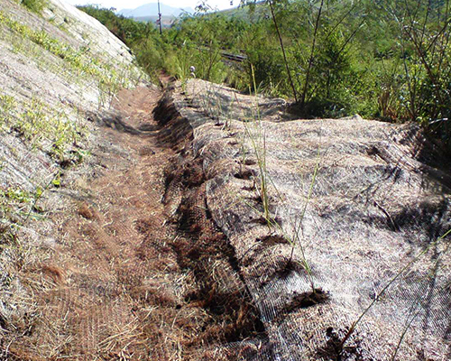
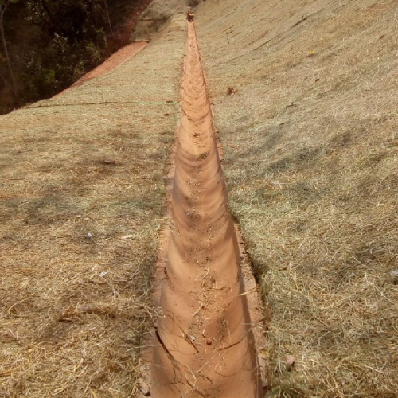
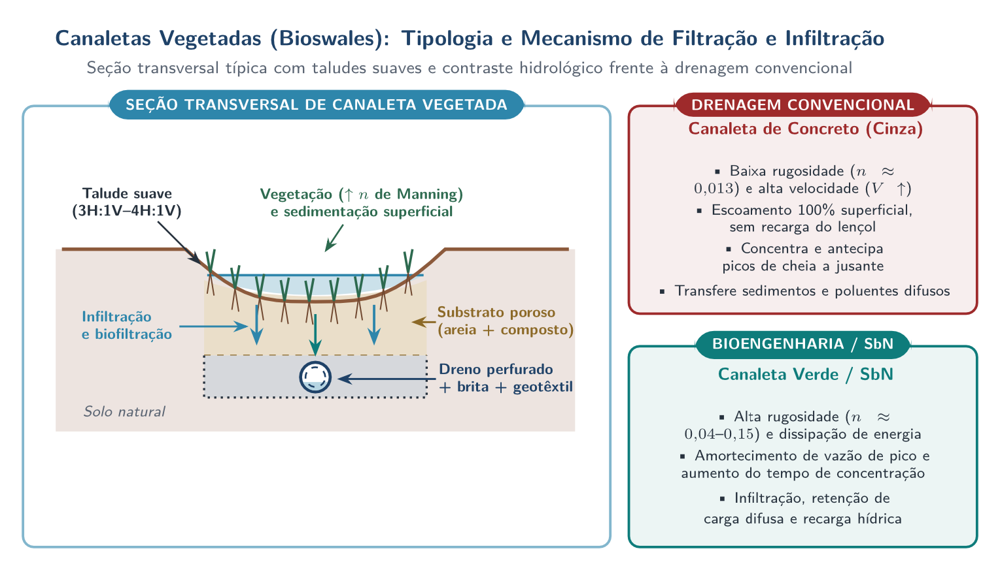
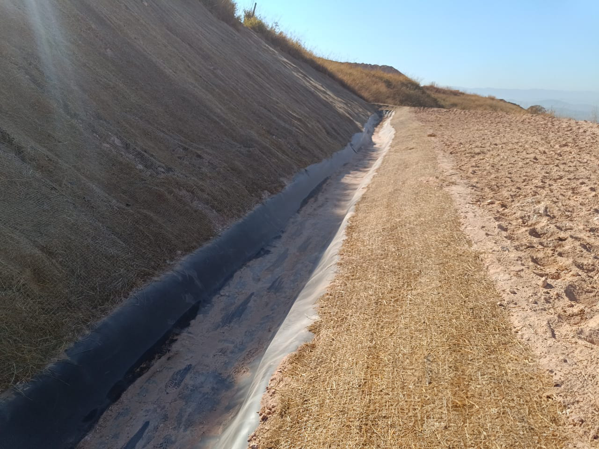
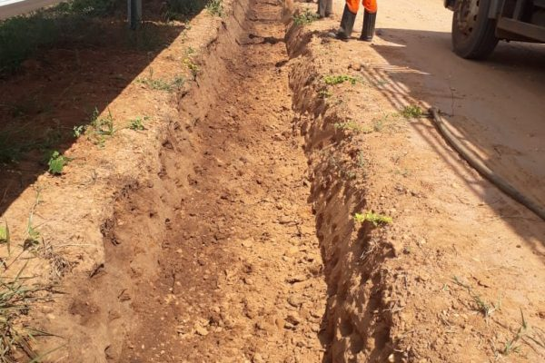
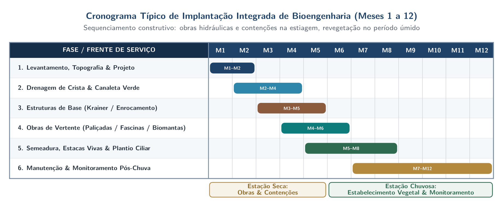
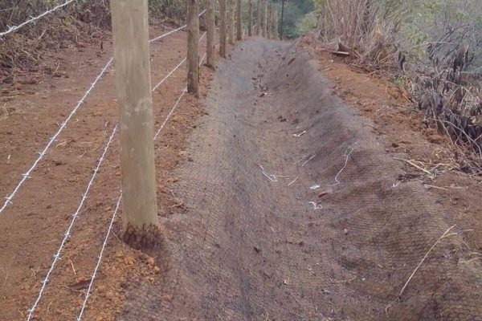

## [Abertura]{.pitch-tag} Visão Geral da Aula {#visao-geral .smaller-text .lesson-slide}

::: {.pitch-grid-50}
::: {.pitch-card}
[Roteiro da aula]{.pitch-card-index}
[Tópicos estruturantes]{.pitch-heading}

- [1]{.circle} O que é uma canaleta verde?
- [2]{.circle} Princípios hidráulicos e sedimentológicos
- [3]{.circle} Seções transversais e materiais
- [4]{.circle} Dimensionamento hidráulico (Manning)
- [5]{.circle} Projeto e implantação em campo
- [6]{.circle} Combinação com hidrossemeadura e biomanta
- [7]{.circle} Monitoramento e manutenção
- [8]{.circle} Síntese e atividade
:::

::: {.pitch-stack-2}
::: {.pitch-card .pitch-card--forest}
[Objetivo da aula]{.pitch-card-index}
[Infraestrutura verde de drenagem]{.pitch-heading}

Compreender o conceito de **canaleta verde** (*vegetated swale / bioswale*) como sistema de drenagem vegetada para **condução controlada de escoamento superficial**, dominar o **dimensionamento hidráulico** pela equação de Manning, os critérios de **implantação** e os protocolos de **monitoramento**.
:::

::: {.pitch-pill-row}
[Manning · Froude · Stokes]{.pitch-pill}
[SuDS · Vetiver · Biomanta]{.pitch-pill .pitch-pill--gold}
[Infiltração & Filtração]{.pitch-pill}
:::
:::
:::

# 1 · O que é uma Canaleta Verde? {.section-header rotulo="Conceito"}

## [Definição]{.pitch-tag .pitch-tag--forest} Conceito e Funções da Canaleta Verde {#definicao-contexto .smaller-text .lesson-slide}

::: {.pitch-grid-55}
::: {.pitch-stack-2}
::: {.pitch-card .pitch-card--forest}
[Infraestrutura verde]{.pitch-card-index}
[Bioswale / Grassed Waterway]{.pitch-heading}

Canal de drenagem raso e largo com leito e taludes revestidos com **vegetação viva** e, na fase inicial, **biomanta antierosiva**. Atua simultaneamente na:

- **Condução** pluvial com velocidade controlada e **dissipação de energia**
- **Infiltração** no perfil do solo e **filtração** de sedimentos e poluentes
- **Estabilização do solo** pelo sistema radicular
:::

::: {.pitch-band .pitch-band--teal}
Substitui canais rígidos de concreto convencionais, usando a vegetação como elemento estrutural antierosivo e promotor da recarga hídrica subterrânea.
:::
:::

::: {.pitch-media-card .pitch-media-card--photo .pitch-media-card--tall}

[Canaleta Verde Implantada em Talude]{.pitch-caption}
[Revestimento contínuo combinando biomanta antierosiva e cobertura herbácea densa]{.pitch-caption-sub}
:::
:::

## [Comparação]{.pitch-tag .pitch-tag--gold} Canaleta Verde vs. Canal Convencional {#canaleta-vs-convencional .smaller-text .lesson-slide}

::: {.pitch-grid-60}
::: {.pitch-table-box}
| Aspecto | Canal Convencional | Canaleta Verde |
|---------|-------------------|----------------|
| Revestimento | Concreto, gabião, pedra | Vegetação viva + biomanta |
| Infiltração | Nula (impermeável) | Alta (permeável) |
| Rugosidade ($n$) | 0,012–0,015 | 0,030–0,150 |
| Velocidade de fluxo | Alta (rápida) | Baixa (controlada) |
| Custo de implantação | Alto | Baixo a moderado |
| Manutenção | Baixa | Periódica (poda, replantio) |
| Impacto ambiental | Elevado | Reduzido |
| Vida útil | > 30 anos | Permanente (com manejo) |
| Qualidade da água | Sem melhoria | Filtra sedimentos e poluentes |
| Recarga de aquífero | Não contribui | Contribui significativamente |
:::

::: {.pitch-stack-2}
::: {.pitch-card}
[Indicações principais]{.pitch-card-index}
[Onde empregar]{.pitch-heading}

- Saída de terraços em gradiente (canal escoadouro)
- Drenagem de taludes rodoviários/ferroviários e áreas mineradas
- Descarga pluvial, áreas agrícolas e sistemas **SuDS** urbanos
:::

::: {.pitch-band}
A rugosidade vegetal ($n = 0{,}030\text{–}0{,}150$) é até **10× maior** que a do concreto ($n = 0{,}012$), reduzindo velocidade e tensão cisalhante.
:::
:::
:::

## [Tipologia]{.pitch-tag} Geometrias e Funções das Canaletas Vegetadas {#tipologia-canaletas .smaller-text .lesson-slide}

::: {.pitch-grid-55}
::: {.pitch-stack-2}
::: {.pitch-cards}
::: {.pitch-card}
[1 · Trapezoidal]{.pitch-card-index}
[Mais comum]{.pitch-heading}

Maior capacidade hidráulica, taludes geotécnicos estáveis e fácil mecanização.
:::

::: {.pitch-card .pitch-card--forest}
[2 · Parabólica]{.pitch-card-index}
[Forma natural]{.pitch-heading}

Aproxima canais naturais, favorece paisagismo e autoconformação.
:::

::: {.pitch-card .pitch-card--gold}
[3 · Triangular (V)]{.pitch-card-index}
[Pequenas vazões]{.pitch-heading}

Valeta rodoviária de menor seção para áreas com escoamento reduzido.
:::
:::

::: {.pitch-table-box}
| Tipo funcional | Função dominante | Aplicação |
|----------------|------------------|-----------|
| **Canal escoadouro** | Condução de vazão de terraços | Áreas agrícolas |
| **Biovaleta (*bioswale*)** | Infiltração + filtração | Áreas urbanas / SuDS |
| **Faixa de filtração** | Remoção de poluentes | Margens de rodovias |
| **Canaleta de meia-cana** | Proteção de base de talude | Cortes rodoviários |
:::
:::

::: {.pitch-media-card .pitch-media-card--photo .pitch-media-card--tall}

[Canaleta de Meia-Cana em Base de Talude]{.pitch-caption}
[Proteção longitudinal associada a biomanta para coleta de enxurrada na base do corte]{.pitch-caption-sub}
:::
:::

# 2 · Princípios Hidráulicos e Sedimentológicos {.section-header rotulo="Hidráulica"}

## [Hidráulica]{.pitch-tag .pitch-tag--teal} Regime Subcrítico, Tensão Cisalhante e $V_{max}$ {#hidraulica-escoamento .smaller-text .lesson-slide}

::: {.pitch-grid-50}
::: {.pitch-stack-2}
::: {.pitch-formula}
**Número de Froude** (desejável $Fr < 1$ — regime subcrítico):

$$Fr = \frac{V}{\sqrt{g \cdot y_m}}$$

Onde $V$ = velocidade média ($\text{m/s}$), $g = 9{,}81 \text{ m/s}^2$ e $y_m$ = profundidade média ($\text{m}$).

**Tensão cisalhante no leito:**

$$\tau_0 = \gamma \cdot R_h \cdot S$$

Onde $\gamma = 9.810 \text{ N/m}^3$, $R_h$ = raio hidráulico ($\text{m}$) e $S$ = declividade ($\text{m/m}$).
:::

::: {.pitch-band .pitch-band--alert}
$V_{max}$ é o **parâmetro mais restritivo**: se $V > V_{max}$, ampliar a seção, reduzir $S$ ou instalar dissipadores (cordões vegetativos, enrocamento).
:::
:::

::: {.pitch-stack-2}
::: {.pitch-table-box}
| Tipo de revestimento | $V_{max}$ (m/s) | $\tau_{max}$ (N/m²) |
|----------------------|:---------------:|:-------------------:|
| Grama baixa (< 5 cm) | 1,2 | 28 |
| Grama média (5–15 cm) | 1,5 | 47 |
| Grama densa (> 15 cm) | 1,8 | 96 |
| **Capim-vetiver** | **3,0–5,0** | **300–600** |
| Solo exposto | 0,3–0,6 | 3–5 |
| Biomanta + grama jovem | 1,0 | 20 |
:::

::: {.pitch-card .pitch-card--forest}
[Espécie de referência tropical]{.pitch-card-index}
[Capim-vetiver (*Chrysopogon zizanioides*)]{.pitch-heading}

Suporta até **5 m/s** graças ao sistema radicular fasciculado que alcança **3 m** de profundidade (Truong, Loch & Cook, 2008).
:::
:::
:::

## [Biofiltração]{.pitch-tag .pitch-tag--teal} Mecanismo de Filtração e Infiltração (Seção Típica) {#canaleta-filtracao-tikz .smaller-text .lesson-slide}

::: {.pitch-media-card .pitch-media-card--wide}

[Canaletas Vegetadas (Bioswales): Seção Transversal, Biofiltração e Contraste Hidrológico]{.pitch-caption}
[Taludes suaves (3H:1V–4H:1V), substrato poroso, dreno perfurado e amortecimento da vazão de pico vs. concreto cinza]{.pitch-caption-sub}
:::

::: {.pitch-band .pitch-band--navy}
A eficiência de remoção cresce com o **comprimento do canal** (tempo de residência), a **densidade vegetal** e a **permeabilidade do solo de fundação**.
:::

## [Sedimentologia]{.pitch-tag} Lei de Stokes e Eficiência de Remoção {#mecanismo-filtracao .smaller-text .lesson-slide}

::: {.pitch-grid-50}
::: {.pitch-stack-2}
::: {.pitch-formula}
**1. Sedimentação gravitacional (Lei de Stokes, $d > 62{,}5 \ \mu\text{m}$):**

$$v_s = \frac{(\rho_s - \rho_w) \cdot g \cdot d^2}{18 \cdot \mu}$$

Onde $v_s$ = velocidade de sedimentação ($\text{m/s}$), $\rho_s,\rho_w$ = densidades ($\text{kg/m}^3$), $d$ = diâmetro ($\text{m}$) e $\mu$ = viscosidade dinâmica ($\text{Pa}\cdot\text{s}$).
:::

::: {.pitch-card .pitch-card--forest}
[Biofiltro linear]{.pitch-card-index}
[Filtração mecânica e infiltração]{.pitch-heading}

- **2. Filtração mecânica:** colmos, folhas e raízes interceptam sólidos em suspensão.
- **3. Infiltração no solo:** promove recarga do lençol freático e amortecimento do hidrograma a jusante.
:::
:::

::: {.pitch-stack-2}
::: {.pitch-table-box}
| Parâmetro | Eficiência (%) | Mecanismo dominante |
|-----------|:--------------:|---------------------|
| Sedimentos totais (SST) | 60–90 | Sedimentação + filtração |
| Fósforo particulado | 40–70 | Sedimentação + adsorção |
| Nitrogênio total | 20–50 | Infiltração + absorção |
| Óleos e graxas | 50–80 | Filtração + biodegradação |
| Metais pesados | 30–60 | Adsorção + complexação |
:::

::: {.pitch-flow-4}
::: {.pitch-card}
[Entrada]{.pitch-card-index}
[Escoamento]{.pitch-heading}

Fluxo com carga difusa.
:::

::: {.pitch-card .pitch-card--gold}
[Sedimentação]{.pitch-card-index}
[Grosseiros]{.pitch-heading}

Decantação de areia/silte.
:::

::: {.pitch-card .pitch-card--forest}
[Filtração]{.pitch-card-index}
[Finos + N/P]{.pitch-heading}

Retenção na massa vegetal.
:::

::: {.pitch-card .pitch-card--teal}
[Infiltração]{.pitch-card-index}
[Água limpa]{.pitch-heading}

Recarga e saída controlada.
:::
:::
:::
:::

# 3 · Seções Transversais e Materiais {.section-header rotulo="Seções e Materiais"}

## [Geometria]{.pitch-tag} Parâmetros da Seção Trapezoidal {#geometria-trapezoidal .smaller-text .lesson-slide}

::: {.pitch-grid-55}
::: {.pitch-stack-2}
::: {.pitch-formula}
**Área ($A$), Perímetro Molhado ($P$), Raio Hidráulico ($R_h$) e Largura ($T$):**

$$A = \left(\frac{B + b}{2}\right) \cdot h = (b + Z \cdot h) \cdot h \qquad P = b + 2h\sqrt{1 + Z^2}$$

$$R_h = \frac{A}{P} \qquad T = b + 2 \cdot Z \cdot h \qquad h_{total} = h_{projeto} + h_{borda\,livre}$$
:::

::: {.pitch-band .pitch-band--teal}
Adotar $Z \geq 3$ (**3H:1V ou mais suave**) para viabilizar poda mecanizada, acesso de manutenção e estabilidade geotécnica; acrescentar **10–15 cm** de borda livre (*freeboard*).
:::
:::

::: {.pitch-stack-2}
::: {.pitch-table-box}
| Parâmetro | Faixa recomendada |
|-----------|:-----------------:|
| Base menor ($b$) | 0,30 – 2,00 m |
| Profundidade máxima ($h$) | 0,15 – 0,60 m |
| Talude ($Z$) | 3:1 a 6:1 |
| Borda livre (*freeboard*) | 0,10 – 0,15 m |
| Declividade longitudinal ($S$) | 0,5% – 5,0% |
| Comprimento máximo | 60 – 200 m |
:::

::: {.pitch-card}
[Esquema da seção]{.pitch-card-index}
[Relações geométricas ($Z = Y/h$)]{.pitch-heading}

Base menor $b$ no fundo, taludes laterais inclinados em $Z:1$ até a lâmina $h$, borda livre de $0{,}10\text{–}0{,}15$ m acima de $B$ e largura superficial $T$ no coroamento.
:::
:::
:::

## [Revestimento]{.pitch-tag .pitch-tag--forest} Espécies Vegetais e Biomanta Antierosiva {#materiais-vegetacao .smaller-text .lesson-slide}

::: {.pitch-grid-55}
::: {.pitch-stack-2}
::: {.pitch-table-box}
| Espécie | Nome popular | Características |
|---------|--------------|-----------------|
| *Chrysopogon zizanioides* | Capim-vetiver | Raiz profunda (3 m), $V_{max}$ até 5 m/s |
| *Paspalum notatum* | Grama-batatais | Rizomatosa, rústica, cobertura densa |
| *Cynodon dactylon* | Grama-bermuda | Crescimento rápido, tolera tráfego |
| *Axonopus compressus* | Grama São Carlos | Adaptada a solos úmidos e sombreados |
| *Brachiaria decumbens* | Braquiária | Alta agressividade, rápido recobrimento |
| *Arachis pintoi* | Amendoim-forrageiro | Leguminosa, fixa N₂, cobertura rasteira |
:::

::: {.pitch-table-box}
| Biomanta (0–6 meses) | Material | Durabilidade |
|----------------------|----------|:------------:|
| BM1 (leve) / BM2 (média) | Palha+juta / Fibra coco+PP | 6–12 / 12–24 meses |
| BM3 (pesada) / Permanente | Coco dupla / PP+PET sintética | 24–36 meses / > 5 anos |
:::
:::

::: {.pitch-stack-2}
::: {.pitch-media-card .pitch-media-card--photo .pitch-media-card--compact}

[Biomanta + Hidrossemeadura em Canaleta]{.pitch-caption}
[Desenrolar topo → base; sobrepor 15 cm (lateral) e 20 cm (longitudinal); grampos U a cada 0,5–1,0 m (prof. ≥ 15 cm)]{.pitch-caption-sub}
:::

::: {.pitch-band}
Escolha da espécie depende do regime hidráulico ($V_{max}$, $\tau_{max}$), disponibilidade regional e frequência de poda.
:::
:::
:::

# 4 · Dimensionamento Hidráulico (Manning) {.section-header rotulo="Manning"}

## [Equação de Manning]{.pitch-tag .pitch-tag--gold} Formulação e Coeficientes de Rugosidade {#equacao-manning .smaller-text .lesson-slide}

::: {.pitch-grid-50}
::: {.pitch-stack-2}
::: {.pitch-formula}
**Vazão ($Q$) e velocidade média ($V$) em regime uniforme:**

$$Q = \frac{1}{n} \cdot A \cdot R_h^{2/3} \cdot S^{1/2} \qquad V = \frac{R_h^{2/3} \cdot S^{1/2}}{n}$$

Onde $Q$ ($\text{m}^3/\text{s}$), $n$ = rugosidade de Manning, $A$ ($\text{m}^2$), $R_h$ ($\text{m}$) e $S$ ($\text{m/m}$).
:::

::: {.pitch-card}
[Comportamento de $n$]{.pitch-card-index}
[Efeito da submersão (*bending effect*)]{.pitch-heading}

Quando a lâmina d'água ultrapassa a altura da vegetação, os colmos dobram reduzindo $n$. Para projeto simplificado, adota-se $n$ da **vegetação estabelecida** (conservador); métodos avançados incluem Kouwen & Unny (1973) e Temple (1987).
:::
:::

::: {.pitch-table-box}
| Condição de revestimento | $n$ (mín.) | $n$ (normal) | $n$ (máx.) |
|--------------------------|:----------:|:------------:|:----------:|
| Grama curta, ceifada (< 5 cm) | 0,025 | 0,030 | 0,035 |
| Grama média (5–15 cm) | 0,030 | 0,040 | 0,050 |
| Grama densa alta (> 15 cm) | 0,040 | 0,060 | 0,100 |
| Capim-vetiver (estande jovem) | 0,035 | 0,050 | 0,070 |
| Capim-vetiver (estande maduro) | 0,060 | 0,100 | 0,150 |
| Biomanta + grama em formação | 0,030 | 0,045 | 0,060 |
| Solo exposto (sem proteção) | 0,016 | 0,020 | 0,025 |
:::
:::

## [Exemplo Numérico]{.pitch-tag .pitch-tag--gold} Dimensionamento: Passos 1 a 3 {#exemplo-dimensionamento-1 .smaller-text .lesson-slide}

::: {.pitch-grid-55}
::: {.pitch-stack-2}
::: {.pitch-card}
[Dados do problema]{.pitch-card-index}
[Descarga de 6 terraços em gradiente (4,5 ha)]{.pitch-heading}

- Enxurrada: $C = 0{,}55$ · Chuva ($TR = 10$ anos): $I = 180 \text{ mm/h}$
- Área: $A_{bacia} = 4{,}5 \text{ ha}$ · Declividade: $S = 3\% = 0{,}03 \text{ m/m}$
- Grama densa: $n = 0{,}060$ · $V_{max} = 1{,}5 \text{ m/s}$ · Talude: $Z = 3$
:::

::: {.pitch-formula}
**1° Passo — Vazão de projeto (Método Racional):**

$$Q = \frac{C \cdot I \cdot A}{360} = \frac{0{,}55 \times 180 \times 4{,}5}{360} = 1{,}24 \text{ m}^3/\text{s}$$
:::
:::

::: {.pitch-formula}
**2° Passo — Área mínima da seção:**

$$A_{min} = \frac{Q}{V_{max}} = \frac{1{,}24}{1{,}5} = 0{,}83 \text{ m}^2$$

**3° Passo — Dimensões iniciais (adotando $h = 0{,}40 \text{ m}$):**

$$0{,}83 = (b + 3 \times 0{,}40) \times 0{,}40 \implies b = \frac{0{,}83}{0{,}40} - 1{,}20 = 0{,}88 \text{ m} \rightarrow b = 0{,}90 \text{ m}$$

$$A = (0{,}90 + 1{,}20) \times 0{,}40 = 0{,}84 \text{ m}^2 \qquad B = 0{,}90 + 2{,}40 = 3{,}30 \text{ m}$$
:::
:::

## [Verificação]{.pitch-tag .pitch-tag--gold} Raio Hidráulico, Ajuste e Regime de Froude {#exemplo-dimensionamento-2 .smaller-text .lesson-slide}

::: {.pitch-grid-55}
::: {.pitch-formula}
**4° e 5° Passos ($h = 0{,}40 \text{ m}$):** $P = 0{,}90 + 2(0{,}40)\sqrt{10} = 3{,}43 \text{ m}$ · $R_h = \frac{0{,}84}{3{,}43} = 0{,}245 \text{ m}$

$$V = \frac{(0{,}245)^{2/3} \cdot (0{,}03)^{1/2}}{0{,}060} = \frac{0{,}391 \times 0{,}1732}{0{,}060} = 1{,}13 \text{ m/s} < 1{,}5 \text{ m/s ✓}$$

**6° Passo — Vazão:** $Q_{calc} = 1{,}13 \times 0{,}84 = 0{,}95 \text{ m}^3/\text{s} < 1{,}24 \text{ m}^3/\text{s}$ ❌ (aumentar para $h = 0{,}50 \text{ m}$!)

**Ajuste ($h = 0{,}50 \text{ m}$):** $A = 1{,}20 \text{ m}^2$ · $P = 4{,}06 \text{ m}$ · $R_h = 0{,}296 \text{ m}$

$$V = \frac{(0{,}296)^{2/3} \times 0{,}1732}{0{,}060} = 1{,}29 \text{ m/s} \qquad Q_{calc} = 1{,}29 \times 1{,}20 = 1{,}55 \text{ m}^3/\text{s} > 1{,}24 \text{ m}^3/\text{s ✓}$$

**Froude:** $D_m = \frac{1{,}20}{3{,}90} = 0{,}308 \text{ m} \implies Fr = \frac{1{,}29}{\sqrt{9{,}81 \times 0{,}308}} = 0{,}74 < 1{,}0$ (**Subcrítico** ✓)
:::

::: {.pitch-stack-2}
::: {.pitch-table-box}
| Parâmetro final adotado | Valor |
|-------------------------|:-----:|
| Base menor ($b$) / Base maior ($B$) | 0,90 m / 3,90 m |
| Profundidade útil ($h$) + borda livre (0,15 m) | 0,50 m ($h_t = 0{,}65$ m) |
| Talude ($Z$) / Área ($A$) / $R_h$ | 3:1 / 1,20 m² / 0,296 m |
| Velocidade ($V$) / Vazão ($Q_{calc}$) | 1,29 m/s / 1,55 m³/s |
| Número de Froude ($Fr$) | 0,74 (Subcrítico) |
:::

::: {.pitch-band .pitch-band--teal}
Folga hidráulica $Q_{calc}/Q_{projeto} = 1{,}25$ (**+25% de segurança** para variações de $n$ e declividade).
:::
:::
:::

# 5 · Projeto e Implantação em Campo {.section-header rotulo="Implantação"}

## [Execução]{.pitch-tag .pitch-tag--forest} Sequência Executiva em Campo (Etapas 1 a 7) {#etapas-implantacao .smaller-text .lesson-slide}

::: {.pitch-grid-55}
::: {.pitch-milestones}
::: {.pitch-milestone-item}
**1. Levantamento planialtimétrico:** drone (GNSS-RTK) ou estação total; perfil longitudinal e seções a cada 10–20 m.
:::

::: {.pitch-milestone-item}
**2–3. Locação, escavação e perfilamento:** nível laser/mangueira, compactação leve (**90% Proctor Normal**) e talude mínimo **3H:1V** liso.
:::

::: {.pitch-milestone-item}
**4–5. Biomanta e hidrossemeadura:** coco (BM2/BM3), grampos U (0,5–1,0 m), sobreposição 20/15 cm + sementes (**30–50 g/m²**), fertilizante, mulch e ligante.
:::

::: {.pitch-milestone-item}
**6–7. Irrigação e inspeção:** irrigação inicial (15–30 dias se seco) + inspeção pós-primeira chuva significativa.
:::
:::

::: {.pitch-media-card .pitch-media-card--photo .pitch-media-card--tall}

[Conformação da Seção Escavada em Campo]{.pitch-caption}
[Preparo geométrico do leito e taludes previamente à regularização e instalação da biomanta]{.pitch-caption-sub}
:::
:::

## [Dissipação e Transições]{.pitch-tag .pitch-tag--gold} Dissipadores Internos e Transição Entrada/Saída {#detalhes-construtivos .smaller-text .lesson-slide}

::: {.pitch-grid-50}
::: {.pitch-stack-2}
::: {.pitch-table-box}
| Tipo de dissipador | Declividade | Espaçamento |
|--------------------|:-----------:|:-----------:|
| Cordão de vetiver | 3–5% | 5–10 m |
| Enrocamento pontual | 5–8% | 3–5 m |
| Degrau revestido | > 8% | 2–3 m |
| Paliçada interna (bambu) | > 5% | 3–8 m |
:::

::: {.pitch-card .pitch-card--forest}
[Micro-barragens permeáveis]{.pitch-card-index}
[Cordões transversais de vetiver]{.pitch-heading}

Em $S > 3\%$, cordões transversais reduzem a velocidade combinando resistência dos colmos e ancoragem radicular, sem impedir a passagem da água.
:::
:::

::: {.pitch-stack-2}
::: {.pitch-card}
[Transição entrada / saída]{.pitch-card-index}
[Proteção das extremidades]{.pitch-heading}

- **Entrada:** trecho curto (1–2 m) em enrocamento ou concreto ciclópico para dissipar energia de chegada.
- **Saída:** bacia de amortecimento, enrocamento ou talude revestido contra erosão remontante.
:::

::: {.pitch-formula}
**Espaçamento entre cordões internos:**

$$L_{cord} = \frac{h_{cord}}{\tan(\alpha)} \xrightarrow{\alpha = 3\%, \; h_{cord} = 0{,}30 \text{ m}} L_{cord} = \frac{0{,}30}{0{,}03} = 10{,}0 \text{ m}$$

A base do cordão a montante fica em nível com o topo do cordão a jusante.
:::
:::
:::

# 6 · Combinação com Hidrossemeadura e Biomanta {.section-header rotulo="Sistema Integrado"}

## [Cronograma de Proteção]{.pitch-tag .pitch-tag--forest} Transição Funcional: Biomanta → Vegetação {#gantt-bioengenharia-tikz .smaller-text .lesson-slide}

::: {.pitch-media-card .pitch-media-card--wide}

[Cronograma Integrado de Bioengenharia (Meses 1 a 12)]{.pitch-caption}
[Obras hidráulicas e contenções concentradas na estiagem (M1–M6); estabelecimento vegetal, biomanta e monitoramento no período úmido (M5–M12)]{.pitch-caption-sub}
:::

::: {.pitch-band .pitch-band--teal}
**Ponto de cruzamento (6–12 meses):** a cobertura vegetal ultrapassa **80%**, assumindo a proteção enquanto a biomanta (6–36 meses) se biodegrada naturalmente.
:::

## [Tripé e Hidrossemeadura]{.pitch-tag} Sistema Integrado e Mistura de Sementes {#composicao-hidrossemeadura .smaller-text .lesson-slide}

::: {.pitch-grid-55}
::: {.pitch-stack-2}
::: {.pitch-cards}
::: {.pitch-card .pitch-card--gold}
[1 · Biomanta]{.pitch-card-index}
[0–6 meses]{.pitch-heading}

Reduz $\tau_{efetivo} = \tau_0 - \tau_{biomanta}$, absorve *splash* e retém umidade.
:::

::: {.pitch-card .pitch-card--teal}
[2 · Hidrossemeadura]{.pitch-card-index}
[70–90% germinação]{.pitch-heading}

Tanque **1.000–8.000 L**, **200–400 kPa**, rendimento até **2.000 m²/h**.
:::

::: {.pitch-card .pitch-card--forest}
[3 · Vegetação]{.pitch-card-index}
[Permanente]{.pitch-heading}

Eleva coesão ($c' = c'_{solo} + \Delta c'_{raiz}$) e rugosidade hidráulica.
:::
:::

::: {.pitch-table-box}
| Componente da mistura (por m²) | Dose | Função |
|--------------------------------|:----:|--------|
| *Brachiaria decumbens* / *Paspalum notatum* | 8–10 g / 5–8 g | Cobertura rápida e densa |
| *Arachis pintoi* / *C. zizanioides* (mudas 15–20 cm) | 3–5 g / 2–3 g | Fixação N₂ / ancoragem |
| NPK (10-10-10) / Calcário dolomítico | 30–50 g / 50–100 g | Nutrição e correção de pH |
| Mulch celulose / Ligante (*tackifier*) | 100–200 g / 5–10 g | Umidade e aderência |
:::
:::

::: {.pitch-media-card .pitch-media-card--photo .pitch-media-card--tall}

[Canaleta Verde Após Hidrossemeadura]{.pitch-caption}
[Aplicação pressurizada sobre biomanta garante contato semente–substrato e cobertura uniforme]{.pitch-caption-sub}
:::
:::

# 7 · Monitoramento e Manutenção {.section-header rotulo="Monitoramento"}

## [Monitoramento]{.pitch-tag .pitch-tag--teal} Protocolo Hidráulico, Vegetacional e Geomorfológico {#protocolo-monitoramento .smaller-text .lesson-slide}

::: {.pitch-grid-50}
::: {.pitch-cards}
::: {.pitch-card}
[Hidráulico]{.pitch-card-index}
[$\Delta Q$]{.pitch-heading}

Vazão entrada/saída (calha Parshall ou vertedouro) avalia infiltração efetiva ($\Delta Q = Q_{ent} - Q_{saí}$).
:::

::: {.pitch-card .pitch-card--forest}
[Vegetacional]{.pitch-card-index}
[Quadrante 1 m²]{.pitch-heading}

Cobertura (%), altura e diversidade funcional (mensal até 6 meses; depois trimestral).
:::

::: {.pitch-card .pitch-card--gold}
[Geomorfológico]{.pitch-card-index}
[Pinos + Drone]{.pitch-heading}

Pinos de ferro (30 cm, cravados 10 cm a cada 5 m) e MDT diferencial por fotogrametria.
:::
:::

::: {.pitch-stack-2}
::: {.pitch-table-box}
| Indicador | Meta | Frequência |
|-----------|:----:|:----------:|
| Cobertura vegetal | > 80% em 6 meses | Mensal / trimestral |
| Velocidade de fluxo | $< V_{max}$ adotada | Eventos de chuva |
| Erosão no leito (pinos) | < 1 cm/ano | Mensal |
| Integridade da biomanta | Sem rasgos/deslocamentos | Após chuvas |
| Sedimentos retidos | Pinos / batimetria | Semestral |
| Taxa de infiltração | > 50% do escoamento | Semestral |
:::

::: {.pitch-band .pitch-band--teal}
Após estabelecimento pleno (**12–24 meses**), o monitoramento passa a **semestral**, focado em manutenção preventiva.
:::
:::
:::

## [Manutenção]{.pitch-tag .pitch-tag--alert} Manutenção Periódica e Modos de Falha {#manutencao-periodica .smaller-text .lesson-slide}

::: {.pitch-grid-50}
::: {.pitch-stack-2}
::: {.pitch-table-box}
| Atividade | Frequência | Período |
|-----------|:----------:|:-------:|
| Poda (manter 10–20 cm) / Controle invasoras | Trimestral | Ano todo |
| Replantio (< 80%) / Reparo erosão | Sob demanda | Estação chuvosa / pós-evento |
| Limpeza de sedimentos / Fertilização | Semestral / Anual | Pós-chuvas / início chuvas |
| Inspeção da biomanta | Mensal (1º ano) | Estação chuvosa |
:::

::: {.pitch-band}
Manter poda entre **10–20 cm**: vegetação > 30 cm tomba e forma *thatch* morto que reduz infiltração e cria caminhos preferenciais.
:::
:::

::: {.pitch-stack-2}
::: {.pitch-table-box}
| Modo de falha | Causa provável | Ação corretiva |
|---------------|----------------|----------------|
| Incisão no leito | $V > V_{max}$, falha vegetal | Dissipadores, replantio |
| Erosão lateral | Talude íngreme | Reperfilar ($Z \geq 3$), biomanta |
| *Bypass* | Seção pequena / obstrução | Desobstruir, ampliar seção |
| Assoreamento | Fonte de sedimento a montante | Controlar nascente, limpar |
| Mortalidade vegetal | Seca, herbicida, sombra | Replantio, irrigação |
| *Piping* | Solo dispersivo, má compactação | Recompactar (95%), drenar, filtro |
:::

::: {.pitch-band .pitch-band--alert}
Em solos dispersivos (Neossolos/Planossolos com horizonte B solódico), usar **filtro geotêxtil** sob a biomanta e compactação a **95% Proctor Normal**.
:::
:::
:::

# 8 · Síntese e Atividade {.section-header rotulo="Síntese"}

## [Síntese]{.pitch-tag .pitch-tag--forest} Fluxo de Projeto e Pontos-Chave {#resumo-pontos-chave .smaller-text .lesson-slide}

::: {.pitch-flow-4}
::: {.pitch-card}
[1 · Hidrologia]{.pitch-card-index}
[Topografia + Racional]{.pitch-heading}

Levantamento topográfico e cálculo da vazão de projeto ($Q$).
:::

::: {.pitch-card .pitch-card--gold}
[2 · Manning]{.pitch-card-index}
[Iteração $V \leq V_{max}$]{.pitch-heading}

Se $V > V_{max}$, ampliar seção ou inserir dissipadores internos.
:::

::: {.pitch-card .pitch-card--teal}
[3 · Segurança]{.pitch-card-index}
[Borda livre + $Fr < 1$]{.pitch-heading}

Definir borda livre (10–15 cm) e confirmar regime subcrítico.
:::

::: {.pitch-card .pitch-card--forest}
[4 · Campo]{.pitch-card-index}
[Biomanta + Monitorar]{.pitch-heading}

Especificar biomanta/hidrossemeadura, escavar, revestir e monitorar.
:::
:::

::: {.pitch-cards-2}
::: {.pitch-card}
[O que aprendemos (1–4)]{.pitch-card-index}
[Hidráulica e dimensionamento]{.pitch-heading}

1. Substitui concreto, promovendo condução, infiltração e biofiltração
2. Dimensionamento via Manning ($n = 0{,}030\text{–}0{,}150$)
3. $V_{max}$ é a restrição principal do projeto
4. Tripé biomanta + hidrossemeadura + vegetação garante proteção contínua
:::

::: {.pitch-card .pitch-card--forest}
[O que aprendemos (5–7)]{.pitch-card-index}
[Espécies e gestão]{.pitch-heading}

5. Capim-vetiver (*C. zizanioides*) resiste até **5 m/s** em clima tropical
6. Monitoramento hidráulico, vegetacional e geomorfológico detecta falhas cedo
7. Manutenção periódica (poda, replantio, limpeza) garante longevidade
:::
:::

## [Atividade]{.pitch-tag .pitch-tag--gold} Atividade Proposta: Canaleta em Talude de Mineração {#atividade-proposta .smaller-text .lesson-slide}

::: {.pitch-grid-55}
::: {.pitch-card}
[Exercício em grupo]{.pitch-card-index}
[Cenário: base de talude de corte]{.pitch-heading}

Talude de **120 m**, área de contribuição **2,8 ha**, $C = 0{,}65$, chuva ($TR = 25$ anos) $I = 210 \text{ mm/h}$, $S = 2{,}5\%$, **Latossolo Vermelho-Amarelo**, revestimento com *Chrysopogon zizanioides* (vetiver).

**Entregar:** **1.** Vazão ($Q$) · **2.** Seção trapezoidal ($b, h, Z, B$) · **3.** Verificação Manning + Froude · **4.** Biomanta e mistura de hidrossemeadura · **5.** Protocolo de monitoramento · **6.** Cronograma de manutenção (2 anos).
:::

::: {.pitch-stack-2}
::: {.pitch-table-box}
| Critério de avaliação | Peso |
|-----------------------|:----:|
| Dimensionamento hidráulico correto | 30% |
| Verificação de velocidade e regime | 20% |
| Especificação (biomanta + hidrossemeadura) | 20% |
| Protocolo de monitoramento | 15% |
| Apresentação e coerência técnica | 15% |
:::

::: {.pitch-formula}
**Formulário resumido:**

$$Q = \frac{C \cdot I \cdot A}{360} \qquad V = \frac{R_h^{2/3} \cdot S^{1/2}}{n} \qquad Fr = \frac{V}{\sqrt{g \cdot D_m}}$$
:::
:::
:::

## [Referências]{.pitch-tag} Referências Sugeridas {#referencias .smaller-text .lesson-slide}

::: {.pitch-cards-2}
::: {.pitch-card}
[Hidráulica de canais vegetados]{.pitch-card-index}
[Manuais e artigos clássicos]{.pitch-heading}

- Kouwen, N. & Unny, T. E. (1973). *Flexible roughness in open channels*.
- Temple, D. M. (1987). *Closure of "Stability Design of Grass-Lined Open Channels"*.
- Truong, P., Loch, R. & Cook, D. (2008). *Vetiver System Applications*.
- USDA-NRCS (2007). *Grassed Waterway Design*.
:::

::: {.pitch-card .pitch-card--forest}
[Conservação de solos e bioengenharia]{.pitch-card-index}
[Literatura técnica]{.pitch-heading}

- Florineth, F. (2004). *Pflanzen statt Beton*.
- GreenBrasil Bioengenharia — greenbrasil.eco.br.
- Menezes & Sampaio (2021). Bioengenharia de Solos no Nordeste.
- Morgan, R. P. C. (2005). *Soil Erosion and Conservation*.
:::
:::

## {.obrigado-fit-text .center}

::: {.columns}
::: {.column style="text-align: center;"}

[Obrigado!]{.obrigado-fit-text}

**Prof. Luiz Diego Vidal Santos**

📧 luiz.diego@uefs.br

🌐 [ldvsantos.github.io/cv](https://ldvsantos.github.io/cv)

:::
:::
