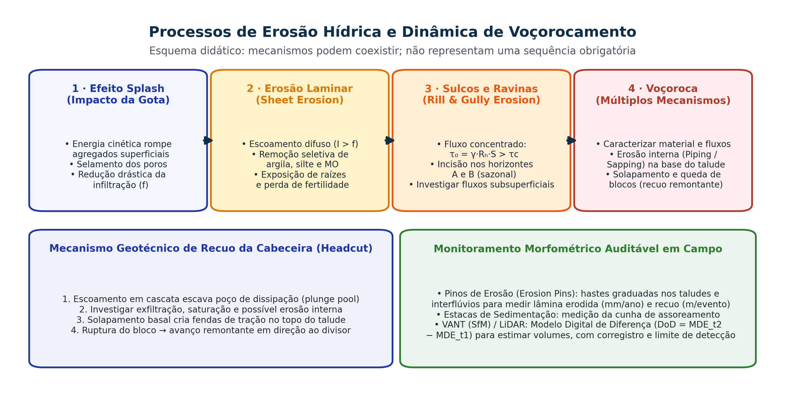
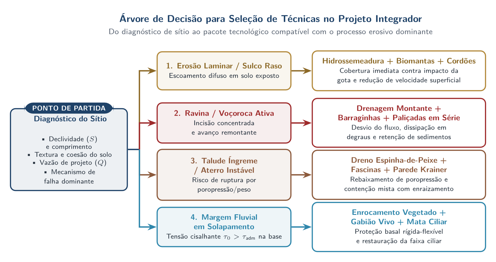
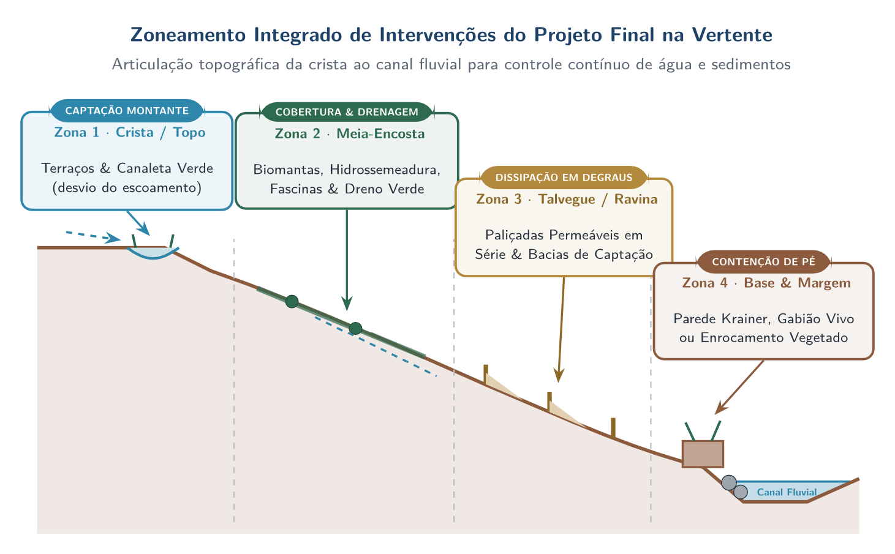

## [Abertura]{.pitch-tag} Visão Geral da Aula {#visao-geral .smaller-text .lesson-slide}

::: {.pitch-grid-50}
::: {.pitch-card}
[Roteiro da aula]{.pitch-card-index}
[Tópicos estruturantes]{.pitch-heading}

- [1]{.circle} Integração de técnicas: visão sistêmica
- [2]{.circle} Diagnóstico geotécnico e ambiental
- [3]{.circle} Árvore de decisão: seleção de técnicas
- [4]{.circle} Combinação de técnicas por zonas
- [5]{.circle} Cronograma e orçamento
- [6]{.circle} Memorial descritivo e peças gráficas
- [7]{.circle} Apresentação do cenário final
- [8]{.circle} Briefing e início do projeto
:::

::: {.pitch-stack-2}
::: {.pitch-card .pitch-card--forest}
[Objetivo da aula]{.pitch-card-index}
[Plano de Estabilização de Talude Complexo]{.pitch-heading}

Aplicar o repertório completo de **bioengenharia de solos** a um caso complexo, integrando diagnóstico geotécnico, seleção fundamentada de técnicas, cronograma de execução, estimativa orçamentária e memorial técnico — simulando a atuação profissional de consultoria ambiental e geotécnica.
:::

::: {.pitch-pill-row}
[Aulas 01–20 Integradas]{.pitch-pill}
[Memorial · Plantas · Pitch]{.pitch-pill .pitch-pill--gold}
[Caso Rio Subaé (BA)]{.pitch-pill}
:::
:::
:::

# 1 · Integração de Técnicas: Visão Sistêmica {.section-header rotulo="Visão Sistêmica"}

## [Repertório]{.pitch-tag .pitch-tag--teal} Repertório Completo e Analogia Sistêmica {#repertorio-completo .smaller-text .lesson-slide}

::: {.pitch-grid-55}
::: {.pitch-cards}
::: {.pitch-card .pitch-card--gold}
[Revestimento]{.pitch-card-index}
[Aulas 13–14]{.pitch-heading}

Hidrossemeadura e biomantas antierosivas na superfície exposta.
:::

::: {.pitch-card}
[Contenção]{.pitch-card-index}
[Aulas 15, 17, 18]{.pitch-heading}

Enrocamento vegetado, gabião vivo e Parede Krainer na base.
:::

::: {.pitch-card .pitch-card--teal}
[Escoamento & Fluvial]{.pitch-card-index}
[Aulas 10–12, 16, 19–20]{.pitch-heading}

Paliçadas, barraginhas, cordões, feixes vivos, defletores, *brushlayering* e canaleta verde.
:::
:::

::: {.pitch-table-box}
| Zona do talude | Técnica | Analogia |
|----------------|---------|----------|
| Base (pé) | Gabião vivo / Enrocamento | Fundação — "esqueleto" |
| Corpo | Cordões + Feixes | Musculatura — "contenção" |
| Superfície | Biomanta + Hidrossemeadura | Pele — "proteção" |
| Drenagem | Espinha de peixe | Sistema circulatório |
:::
:::

::: {.pitch-band .pitch-band--navy}
**Nenhuma técnica isolada** resolve uma encosta complexa: a solução eficaz articula **base** (contenção), **corpo** (controle de escoamento), **superfície** (revestimento) e **drenagem** contínua.
:::

# 2 · Diagnóstico Geotécnico e Ambiental {.section-header rotulo="Diagnóstico"}

## [Mecanismos]{.pitch-tag .pitch-tag--alert} Reconhecer os Processos para Integrar as Técnicas {#mecanismos-erosivos .smaller-text .lesson-slide}

::: {.pitch-media-card .pitch-media-card--wide}

[Evolução de Processos Erosivos Profundos e Monitoramento]{.pitch-caption}
[O esquema apoia a formulação de hipóteses; o projeto executivo exige evidências de campo, geometria, água no solo e ensaios]{.pitch-caption-sub}
:::

::: {.pitch-band}
Diagnóstico rigoroso evita tratar apenas o sintoma superficial quando há **solapamento basal**, **piping** ou **escoamento concentrado** a montante.
:::

## [Levantamentos]{.pitch-tag} Etapa de Diagnóstico e Checklist de Campo {#etapa-diagnostico .smaller-text .lesson-slide}

::: {.pitch-grid-55}
::: {.pitch-cards-2}
::: {.pitch-card}
[1 · Geotécnico]{.pitch-card-index}
[Solo e água]{.pitch-heading}

Sondagem a trado/SPT, granulometria, Atterberg, cisalhamento direto ($\gamma, \phi, c, k$) e piezometria (N.A.).
:::

::: {.pitch-card .pitch-card--teal}
[2 · Topográfico]{.pitch-card-index}
[Geometria]{.pitch-heading}

Levantamento planialtimétrico (drone RTK / estação total), MDT, declividades e perfis transversais.
:::

::: {.pitch-card .pitch-card--gold}
[3 · Hidrológico]{.pitch-card-index}
[Chuva e vazão]{.pitch-heading}

Precipitação (ANA, INMET), tempo de concentração, $TR = 10, 25, 50$ anos e SCS-CN.
:::

::: {.pitch-card .pitch-card--forest}
[4 · Ambiental]{.pitch-card-index}
[Meio físico e legal]{.pitch-heading}

Cobertura vegetal, processos erosivos ativos, **APP / APA / UC** e fauna/flora sensíveis.
:::
:::

::: {.pitch-stack-2}
::: {.pitch-milestones}
::: {.pitch-milestone-item}
**Fluxo:** Reconhecimento → Topobatimetria → Geotecnia → Hidrologia → Ambiental → **Relatório de Diagnóstico** → Seleção das técnicas.
:::
:::

::: {.pitch-table-box}
| Checklist de campo | Verificado |
|--------------------|:----------:|
| Fotos panorâmicas + detalhes / Acesso máquinas | ☐ |
| Declividade (clinômetro) + amostras de solo | ☐ |
| Processos erosivos + N.A. (poço/nascente) | ☐ |
| Vegetação existente (%) + infraestrutura no entorno | ☐ |
:::
:::
:::

# 3 · Árvore de Decisão: Seleção de Técnicas {.section-header rotulo="Seleção"}

## [Fluxograma]{.pitch-tag .pitch-tag--gold} Árvore de Decisão para Seleção de Técnicas {#fluxograma-selecao-tikz .smaller-text .lesson-slide}

::: {.pitch-media-card .pitch-media-card--wide}

[Árvore de Decisão: Do Diagnóstico de Sítio ao Pacote Tecnológico]{.pitch-caption}
[Seleção integrada conforme tipo de erosão (laminar, ravina/voçoroca, talude íngreme ou margem fluvial)]{.pitch-caption-sub}
:::

::: {.pitch-band .pitch-band--navy}
**Regra prática:** comece pela **base** (contenção), suba pelo **corpo** (controle de escoamento) e finalize na **superfície** (revestimento), com **drenagem** em todas as zonas.
:::

## [Critérios]{.pitch-tag} Matriz de Seleção por Processo Erosivo {#criterios-selecao .smaller-text .lesson-slide}

::: {.pitch-grid-55}
::: {.pitch-cards-2}
::: {.pitch-card .pitch-card--gold}
[Erosão superficial]{.pitch-card-index}
[Laminar vs. Sulcos]{.pitch-heading}

- **Laminar:** Biomanta + Hidrossemeadura
- **Em sulcos:** Cordões vegetativos + Hidrossemeadura
:::

::: {.pitch-card .pitch-card--alert}
[Erosão em ravinas]{.pitch-card-index}
[Rasa vs. Profunda]{.pitch-heading}

- **Rasa:** Paliçadas + Feixes vivos
- **Profunda:** Gabião vivo + Paliçadas
:::

::: {.pitch-card .pitch-card--forest}
[Instabilidade de encosta]{.pitch-card-index}
[Declividade < ou > 45°]{.pitch-heading}

- **< 45°:** Cordões + Feixes + Biomanta
- **> 45°:** Parede Krainer ou Gabião vivo
:::

::: {.pitch-card .pitch-card--teal}
[Margem fluvial]{.pitch-card-index}
[Baixa vs. Alta]{.pitch-heading}

- **Baixa:** Enrocamento vegetado + *Brushlayering*
- **Alta:** Gabião vivo + Defletores
:::
:::

::: {.pitch-table-box}
| Fator de decisão | Peso |
|------------------|------|
| Declividade | ★★★★★ |
| Tipo de erosão | ★★★★★ |
| Exigência ambiental (APP) | ★★★★★ |
| Tipo de solo / Orçamento / Urgência | ★★★★☆ |
| Disponibilidade de materiais / Acesso | ★★★☆☆ |
:::
:::

# 4 · Combinação de Técnicas por Zonas {.section-header rotulo="Zoneamento"}

## [Zoneamento]{.pitch-tag .pitch-tag--forest} Zoneamento Integrado de Intervenções na Vertente {#zoneamento-talude-tikz .smaller-text .lesson-slide}

::: {.pitch-media-card .pitch-media-card--wide}

[Zoneamento Topográfico Integrado: Da Crista / Topo ao Canal Fluvial]{.pitch-caption}
[Zona 1 (Crista) → Zona 2 (Meia-Encosta) → Zona 3 (Talvegue / Ravina) → Zona 4 (Base & Margem)]{.pitch-caption-sub}
:::

::: {.pitch-band .pitch-band--alert}
**Sempre comece pela drenagem e pela base:** estabilizar o pé do talude é a ação mais urgente; sem base firme, qualquer intervenção no corpo será comprometida.
:::

## [Prioridade]{.pitch-tag .pitch-tag--teal} Tabela de Combinação e Ordem Executiva {#tabela-combinacao-zonas .smaller-text .lesson-slide}

::: {.pitch-table-box}
| Zona do perfil | Técnica primária | Técnica complementar |
|----------------|------------------|----------------------|
| **A · Crista** | Hidrossemeadura | Biomanta, canaleta de crista |
| **B · Corpo superior** | Cordões vegetativos | Biomanta entre cordões |
| **C · Corpo inferior** | Feixes vivos (espinha de peixe) | Paliçadas (se houver ravinas) |
| **D · Pé / Base** | Gabião vivo ou Parede Krainer | Enrocamento na fundação |
| **E · Margem / Canal** | Enrocamento vegetado | Defletores, *brushlayering* |
:::

::: {.pitch-flow-4}
::: {.pitch-card}
[1ª · Drenagem]{.pitch-card-index}
[Desvio montante]{.pitch-heading}

Interceptar enxurrada antes de atingir o talude.
:::

::: {.pitch-card .pitch-card--alert}
[2ª · Base / Pé]{.pitch-card-index}
[Fundação segura]{.pitch-heading}

Executar gabião, Krainer ou enrocamento de pé.
:::

::: {.pitch-card .pitch-card--teal}
[3ª · Corpo]{.pitch-card-index}
[Dissipação]{.pitch-heading}

Instalar paliçadas, cordões e drenos feixes vivos.
:::

::: {.pitch-card .pitch-card--forest}
[4ª–5ª · Pele & APP]{.pitch-card-index}
[Cobertura final]{.pitch-heading}

Biomanta, hidrossemeadura e restauração da mata ciliar.
:::
:::

# 5 · Cronograma e Orçamento {.section-header rotulo="Gestão"}

## [Planejamento]{.pitch-tag .pitch-tag--gold} Cronograma de Execução e Modelo Orçamentário {#modelo-cronograma-orcamento .smaller-text .lesson-slide}

::: {.pitch-grid-50}
::: {.pitch-stack-2}
::: {.pitch-table-box}
| Mês | Atividade de implantação |
|-----|--------------------------|
| 1 | Diagnóstico, projeto e mobilização |
| 2 | Drenagem superficial + escavação fundação |
| 3 | Gabião vivo / Krainer (base) |
| 4 | Cordões vegetativos + feixes vivos (corpo) |
| 5 | Hidrossemeadura + biomanta (superfície) |
| 6 | Plantio complementar + mata ciliar |
| 7–12 / 13–24 | Monitoramento mensal (1º sem.) / bimestral |
:::

::: {.pitch-card}
[Fatores críticos de prazo]{.pitch-card-index}
[Sazonalidade e logística]{.pitch-heading}

**Estação seca:** obras estruturais · **Estação chuvosa:** plantio de espécies vivas · **Acesso** e **licenciamento** ambiental.
:::
:::

::: {.pitch-stack-2}
::: {.pitch-table-box}
| Item de orçamento | Unid. | Custo típico (R$) |
|-------------------|-------|-------------------|
| Hidrossemeadura / Biomanta de coco | m² | 8–15 / 12–25 |
| Enrocamento vegetado / Parede Krainer | m³ | 150–350 / 200–500 |
| Cordão vegetativo / Feixes vivos / Paliçada | m | 30–60 / 50–100 / 20–50 |
| Gabião vivo (1×1×2 m) / Defletores tronco | un. | 800–1.500 / 500–2.000 |
| Mata ciliar (muda + plantio) | un. | 15–30 |
:::

::: {.pitch-band .pitch-band--forest}
A bioengenharia custa tipicamente **30–60%** de uma obra convencional equivalente em concreto e gera externalidades valoráveis em **carbono e PSA**.
:::
:::
:::

# 6 · Memorial Descritivo e Peças Gráficas {.section-header rotulo="Documentação"}

## [Relatório Técnico]{.pitch-tag} Estrutura do Memorial, Peças Gráficas e Softwares {#estrutura-relatorio .smaller-text .lesson-slide}

::: {.pitch-grid-50}
::: {.pitch-card}
[Sumário modelo do projeto]{.pitch-card-index}
[8 seções obrigatórias do Memorial]{.pitch-heading}

1. **Introdução e objetivos** (localização, problema, meta)
2. **Diagnóstico** (geotécnico, hidrológico, ambiental)
3. **Seleção de técnicas** (árvore de decisão, zoneamento)
4. **Projeto executivo** (memorial de cálculo, especificações, peças gráficas)
5. **Cronograma de execução**
6. **Estimativa orçamentária**
7. **Plano de monitoramento**
8. **Referências e anexos**
:::

::: {.pitch-stack-2}
::: {.pitch-table-box}
| Peça gráfica obrigatória | Conteúdo principal |
|--------------------------|--------------------|
| Situação / Intervenção | Acessos, entorno e zoneamento |
| Perfis / Detalhe construtivo | Seções e detalhes (gabião, Krainer, cordão) |
| Plantio / Drenagem | Espécies, espaçamentos, canaletas e drenos |
:::

::: {.pitch-table-box}
| Software recomendado | Aplicação |
|----------------------|-----------|
| QGIS / ArcGIS · AutoCAD / Civil 3D | MDT, mapas, plantas e perfis |
| HEC-RAS / Iber · GeoStudio (SLOPE/W) | Hidráulica e estabilidade de taludes |
| Excel / R / Python | Cálculos e gráficos |
:::
:::
:::

# 7 · Cenário do Projeto Integrador {.section-header rotulo="Caso Real"}

## [Caso Complexo]{.pitch-tag .pitch-tag--alert} Estudo de Caso: Encosta Adjacente ao Rio Subaé {#cenario-projeto .smaller-text .lesson-slide}

::: {.pitch-grid-55}
::: {.pitch-table-box}
| Parâmetro (Feira de Santana – BA) | Valor |
|-----------------------------------|-------|
| Comprimento / Altura total | 80 m / 15 m |
| Declividade média | 35° (porções > 50°) |
| Solo | Argilo-siltoso laterítico |
| Parâmetros ($\gamma$, $\phi$, $c$) | $17{,}5 \text{ kN m}^{-3}$ · $24°$ · $8 \text{ kPa}$ |
| Nível d'água (N.A.) / Precipitação | 3 m de profundidade / 850 mm/ano |
| Uso atual / Legislação | Pastagem degradada + ravinas / **APP 30 m** |
| Rio Subaé na base | Largura 12 m · $V_{cheia} = 2{,}2 \text{ m/s}$ |
:::

::: {.pitch-stack-2}
::: {.pitch-card .pitch-card--alert}
[Problemas identificados]{.pitch-card-index}
[Condições críticas e favoráveis]{.pitch-heading}

- 🔴 **2 ravinas** ativas (prof. 1,5 m) + **desbarrancamento** na margem
- 🟡 **Erosão laminar** severa (terço sup.), **70% solo exposto**, **APP** sem mata ciliar
- 🟢 Acesso pelo topo, eucalipto regional e espécies de estaquia disponíveis
:::

::: {.pitch-milestones}
::: {.pitch-milestone-item}
**Perfil esquemático:** Crista (estrada) → Zona Sup. (laminar/exposto) → Zona Média (2 ravinas, > 45°) → Zona Inf. (35°) → Base (desbarrancamento) → **Rio Subaé (12 m)**.
:::
:::
:::
:::

# 8 · Briefing e Início do Projeto {.section-header rotulo="Briefing"}

## [Orientações]{.pitch-tag .pitch-tag--gold} Entregáveis, Critérios de Avaliação e Prazos {#orientacoes-trabalho .smaller-text .lesson-slide}

::: {.pitch-grid-55}
::: {.pitch-cards}
::: {.pitch-card}
[1 · Memorial (PDF)]{.pitch-card-index}
[15–25 páginas]{.pitch-heading}

Diagnóstico, árvore de decisão, zoneamento, memorial de cálculo (empuxo, FS), materiais, Gantt, orçamento e monitoramento (2 anos).
:::

::: {.pitch-card .pitch-card--teal}
[2 · Peças gráficas]{.pitch-card-index}
[A3 ou A2 (DWG/QGIS)]{.pitch-heading}

Planta de intervenção com zoneamento, **2 perfis transversais** com detalhes e **1 detalhe construtivo** ampliado.
:::

::: {.pitch-card .pitch-card--gold}
[3 · Defesa oral]{.pitch-card-index}
[15 minutos]{.pitch-heading}

Pitch estilo consultoria técnica e defesa do projeto perante a banca.
:::
:::

::: {.pitch-stack-2}
::: {.pitch-table-box}
| Critério de avaliação | Peso |
|-----------------------|------|
| Diagnóstico e fundamentação | 15% |
| Seleção e combinação de técnicas | 20% |
| Memorial de cálculo | 20% |
| Peças gráficas | 15% |
| Cronograma, orçamento, monitoramento e oral | 10% + 10% + 10% |
:::

::: {.pitch-table-box}
| Sem. | Etapa (Grupos 3–5 · Entrega 1 sem. antes) |
|:----:|-------------------------------------------|
| 1–2 | Grupos + diagnóstico → Técnicas + zoneamento |
| 3–4 | Cálculos + especificações → Peças + memorial |
| 5 | **Apresentação final** |
:::
:::
:::

## [Dicas e Síntese]{.pitch-tag .pitch-tag--forest} O Que a Banca Valoriza e Síntese do Curso {#dicas-bom-projeto .smaller-text .lesson-slide}

::: {.pitch-grid-50}
::: {.pitch-stack-2}
::: {.pitch-card .pitch-card--forest}
[6 pilares de qualidade]{.pitch-card-index}
[O que a banca valoriza]{.pitch-heading}

1. **Coerência** com dados · **2. Integração** em sistema (não lista) · **3. Fundamentação** (normas/fórmulas) · **4. Viabilidade** (prazo/custo) · **5. Sustentabilidade** (materiais/nativas) · **6. Monitoramento** com indicadores claros.
:::

::: {.pitch-table-box}
| Erro comum | Como evitar |
|------------|-------------|
| Técnica isolada / Sem cálculos | Integrar por zonas + memorial mínimo |
| Espécies não regionais | Consultar flora Caatinga / Cerrado |
| Cronograma sem chuva / Orçamento irreal | Plantar março–junho · Referência SINAPI |
:::
:::

::: {.pitch-stack-2}
::: {.pitch-milestones}
::: {.pitch-milestone-item}
**Aulas 1–9:** Solo, erosão, topografia, terraços, canais e modelagem 3D.
:::

::: {.pitch-milestone-item}
**Aulas 10–14:** Paliçadas, barraginhas, feixes vivos, hidrossemeadura e biomantas.
:::

::: {.pitch-milestone-item}
**Aulas 15–18:** Enrocamento, cordões vegetativos, gabião vivo e Parede Krainer.
:::

::: {.pitch-milestone-item}
**Aulas 19–21:** Bioengenharia fluvial, canaleta verde e **Projeto Integrador**.
:::
:::

::: {.pitch-band .pitch-band--navy}
Este projeto é a **síntese do curso**: apliquem tudo dos fundamentos (Aulas 01–04) à bioengenharia fluvial e canaleta verde (Aulas 19–20). **Bom trabalho!**
:::
:::
:::

## [Referências]{.pitch-tag} Referências Gerais do Curso {#referencias .smaller-text .lesson-slide}

::: {.pitch-cards-2}
::: {.pitch-card}
[Normas e literatura fundamental]{.pitch-card-index}
[Padronização e geotécnica]{.pitch-heading}

- ABNT. Normas NBR 7190, NBR 10514, NBR 16757. Associação Brasileira de Normas Técnicas.
- DNIT (2006). Normas 071/2006-ES (Revegetação) e 082/2006-ES (Gabiões). DNIT.
- Florineth, F. (2004). *Pflanzen statt Beton*. Patzer Verlag.
- Gray, D. H. & Sotir, R. B. (1996). *Biotechnical and Soil Bioengineering Slope Stabilization*. Wiley.
- Morgan, R. P. C. & Rickson, R. J. (1995). *Slope Stabilization and Erosion Control*. Spon.
:::

::: {.pitch-card .pitch-card--forest}
[Bioengenharia contemporânea]{.pitch-card-index}
[Referências científicas e manuais]{.pitch-heading}

- Norris, J. E. et al. (2008). *Slope Stability and Erosion Control: Ecotechnological Solutions*. Springer.
- Rey, F. et al. (2019). Soil and water bioengineering. *Science Total Env.*, 648, 1210-1218.
- Schiechtl, H. M. & Stern, R. (1996). *Ground Bioengineering Techniques*. Blackwell Science.
- Stokes, A. et al. (2014). Ecological mitigation of hillslope instability. *Plant Soil*, 377, 1-23.
- Zeh, H. (2007). *Soil Bioengineering Construction Type Manual*. EFIB/vdf.
:::
:::

## {.obrigado-fit-text .center}

::: {.columns}
::: {.column style="text-align: center;"}

[Obrigado!]{.obrigado-fit-text}

**Prof. Luiz Diego Vidal Santos**

📧 luiz.diego@uefs.br

🌐 [ldvsantos.github.io/cv](https://ldvsantos.github.io/cv)

:::
:::
