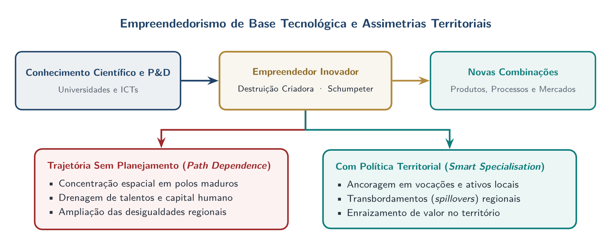
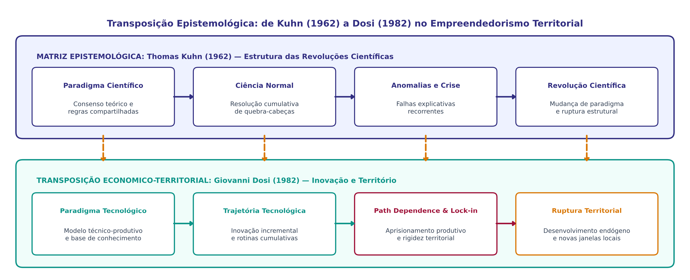

## [Unidade I]{.pitch-tag} Visão geral da aula {#visao-geral .smaller-text .lesson-slide}

::: {.pitch-grid-55}
::: {.pitch-milestones}
::: {.pitch-milestone-item}
**01 · Arquitetura:** Contrato didático, ementa e avaliação (60 h).
:::

::: {.pitch-milestone-item}
**02 · Conceito de EBT:** Empreendedorismo de base tecnológica e critérios distintivos.
:::

::: {.pitch-milestone-item}
**03 · Schumpeter e Dosi:** *Mark I* e *II* vs. paradigmas, trajetórias e Estado Empreendedor.
:::

::: {.pitch-milestone-item}
**04 · Espaço e assimetrias:** Concentração espacial da inovação e Milton Santos.
:::

::: {.pitch-milestone-item}
**05 · Periferias e Brasil:** Janelas de especialização inteligente e desafios regionais.
:::

::: {.pitch-milestone-item}
**06 · Oficina inicial:** Mapeamento de demandas territoriais em duplas.
:::
:::

::: {.pitch-stack-2}
::: {.pitch-card .pitch-card--gold}
[Propósito formativo]{.pitch-card-index}
[Objetivo da aula]{.pitch-heading}

Apresentar a estrutura do componente curricular e fundamentar teoricamente o **empreendedorismo de base tecnológica** (EBT), articulando a tradição schumpeteriana da inovação às dinâmicas de concentração e desigualdade espacial no planejamento territorial.
:::

::: {.pitch-pill-row}
[Schumpeter & Dosi]{.pitch-pill}
[Mazzucato & Santos]{.pitch-pill .pitch-pill--gold}
[Território & CT&I]{.pitch-pill}
:::

::: {.pitch-band}
**Questão condutora:** Como converter conhecimento científico-tecnológico em valor enraizado no território, evitando que a inovação amplie desigualdades regionais?
:::
:::
:::

# 1 · Arquitetura da Disciplina {.section-header rotulo="Disciplina"}

## [Unidade I]{.pitch-tag} Ementa, unidades e avaliação {#ementa-avaliacao .smaller-text .lesson-slide}

::: {.pitch-grid-55}
::: {.pitch-stack-2}
::: {.pitch-table-box}
| Unidade | Foco | Carga |
|---------|------|:-----:|
| **I. Território e Ecossistemas** | EBT, barreiras, SRI, Hélice, Emp. Social | 24 h |
| **II. Processo e Estratégia** | Oportunidades, Canvas, Planos, *Spin-offs* | 20 h |
| **III. Projetos e Viabilidade** | Localização, VPL/TIR, *Valuation* | 12 h |
| **IV. Síntese Territorial** | Seminário Final Integrador | 4 h |
:::

::: {.pitch-band .pitch-band--teal}
**Organização:** 60 horas distribuídas em 15 encontros, conectando teoria territorial, estratégia empreendedora e viabilidade econômico-locacional.
:::
:::

::: {.pitch-stack-2}
::: {.pitch-card}
[Composição da nota]{.pitch-card-index}
[Sistema avaliativo]{.pitch-heading}

- **AV1 (30%):** Seminário e fichamento crítico (Unidade I).
- **AV2 (20%):** Estudo dirigido quantitativo e locacional (Unidade III).
- **AV3 (50%):** Trabalho final aplicado + defesa oral (20 min).
:::

::: {.pitch-band .pitch-band--navy}
**Produto final esperado:** Diagnóstico de um ecossistema territorial ou proposta de empreendimento tecnológico/de impacto com viabilidade locacional e econômico-financeira.
:::
:::
:::

# 2 · Empreendedorismo de Base Tecnológica {.section-header rotulo="Conceito"}

## [Conceito]{.pitch-tag} O que define uma Empresa de Base Tecnológica? {#definicao-ebt .smaller-text .lesson-slide}

::: {.pitch-grid-55}
::: {.pitch-stack-2}
::: {.pitch-card}
[Critérios (Bailetti, 2012; Storey & Tether, 1998)]{.pitch-card-index}
[Conversão de conhecimento sob alta incerteza]{.pitch-heading}

- Não se reduz a "abrir qualquer empresa": depende da **conversão de conhecimento científico-tecnológico** em soluções sob alta incerteza.
- **Ativos intangíveis centrais:** P&D, propriedade intelectual (patentes, *software*, cultivares), capital humano altamente qualificado e *know-how*.
- **Ciclo de maturação longo:** prova de conceito $\rightarrow$ protótipo $\rightarrow$ validação regulatória/de campo $\rightarrow$ escala comercial.
:::

::: {.pitch-band .pitch-band--teal}
**Diferença-chave:** Enquanto o empreendedorismo por necessidade replica modelos existentes com baixa barreira técnica, o EBT cria novos mercados ou redefine fronteiras de produtividade.
:::
:::

::: {.pitch-table-box}
| Tipo | Base de Conhecimento | Risco Principal |
|------|----------------------|-----------------|
| ***Deep Tech*** | Ciência de fronteira (biotec, materiais, IA) | Risco tecnológico e regulatório |
| **Base Digital** | *Software*, plataformas, dados | Risco de adoção e escala |
| ***Spin-off* Acadêmica** | Pesquisa universitária / ICT | Transição bancada $\rightarrow$ mercado |
| **Tec. Social / Agro** | Tecnologia adaptada ao território | Apropriação local e governança |
:::
:::

## [Síntese]{.pitch-tag .pitch-tag--teal} Inovação e assimetrias territoriais {#esquema-inovacao-territorio .smaller-text .lesson-slide}

::: {.pitch-media-card .pitch-media-card--tall}

[Empreendedorismo de base tecnológica e bifurcação territorial]{.pitch-caption}
[Conversão de P&D em novas combinações (Schumpeter) entre concentração (path dependence) e especialização inteligente]{.pitch-caption-sub}
:::

::: {.pitch-band}
Sem política territorial deliberada de CT&I, o circuito da inovação tende a drenar talentos e ampliar assimetrias em favor dos polos já consolidados.
:::

## [Conceito]{.pitch-tag} Schumpeter e a destruição criadora {#schumpeter-destruicao-criadora .smaller-text .lesson-slide}

::: {.pitch-cards-2}
::: {.pitch-card}
[Schumpeter (1911; 1942)]{.pitch-card-index}
[Os 5 tipos de inovação e os dois regimes]{.pitch-heading}

1. Introdução de um **novo bem** ou nova qualidade.
2. Novo **método de produção** ou processo.
3. Abertura de um **novo mercado**.
4. Nova fonte de **matérias-primas** ou insumos.
5. Nova **organização da indústria** (quebra ou formação de monopólio).

- **Mark I (1911):** empreendedor individual rompe o equilíbrio estacionário.
- **Mark II (1942):** P&D institucionalizado em grandes corporações.
:::

::: {.pitch-stack-2}
::: {.pitch-card .pitch-card--gold}
[Evolucionismo econômico]{.pitch-card-index}
[Trajetórias tecnológicas (Dosi, 1982)]{.pitch-heading}

- A inovação não ocorre no vazio: segue **paradigmas** e **trajetórias tecnológicas** cumulativas.
- **Dependência de trajetória (*Path Dependence*):** territórios que acumulam infraestrutura de P&D e rotinas produtivas atraem mais EBT.
:::

::: {.pitch-band .pitch-band--navy}
**Implicação territorial:** Sem política deliberada de CT&I e planejamento, a destruição criadora tende a **ampliar** a concentração de renda e talento nos polos já consolidados.
:::
:::
:::

## [Conceito]{.pitch-tag} De Thomas Kuhn (1962) a Giovanni Dosi (1982) {#kuhn-dosi-paradigma .smaller-text .lesson-slide}

::: {.pitch-grid-50}
::: {.pitch-card}
[1 · Filosofia da ciência (Kuhn, 1962)]{.pitch-card-index}
[Paradigmas, ciência normal e rupturas]{.pitch-heading}

- Em *A Estrutura das Revoluções Científicas*, **Thomas Kuhn** mostrou que a ciência evolui por **paradigmas** e rupturas, não de modo linear.
- **Ciência normal:** a comunidade resolve "quebra-cabeças" dentro de um modelo compartilhado (ex.: mecânica de Newton).
- Anomalias insolúveis disparam uma **revolução científica** e um novo paradigma (ex.: relatividade e mecânica quântica).
- **Transposição de Dosi (1982):** engenheiros, centros de P&D e firmas inovam na economia como os cientistas de Kuhn.
:::

::: {.pitch-stack-2}
::: {.pitch-formula}
*"Um **modelo e padrão de solução** de problemas tecnológicos selecionados com base em **princípios da ciência natural**..."* (Dosi, 1982)
:::

::: {.pitch-table-box}
| Problema Prático | Princípio da Ciência Natural | Paradigma Resultante |
|---|---|---|
| **Transporte** | Termodinâmica de hidrocarbonetos | Motor a combustão interna |
| **Cálculo e Dados** | Física dos semicondutores | Microeletrônica (silício/transistor) |
| **Iluminação** | Incandescência $\rightarrow$ Eletroluminescência | Filamento de tungstênio $\rightarrow$ LED |
:::
:::
:::

## [Síntese]{.pitch-tag .pitch-tag--teal} Transposição epistemológica: de Kuhn a Dosi {#esquema-kuhn-dosi .smaller-text .lesson-slide}

::: {.pitch-media-card .pitch-media-card--tall}

[De Kuhn (1962) a Dosi (1982) no empreendedorismo territorial]{.pitch-caption}
[Da matriz científica (paradigma, ciência normal, anomalias, revolução) à dinâmica econômica (trajetória, path dependence, lock-in e ruptura territorial)]{.pitch-caption-sub}
:::

::: {.pitch-band .pitch-band--teal}
A leitura kuhniana explica por que a transição para novas bases produtivas exige mudança de paradigma científico-tecnológico, e não apenas incentivo incremental.
:::

## [Território]{.pitch-tag .pitch-tag--gold} Trajetória tecnológica, path dependence e lock-in {#trajetoria-path-dependence-lockin .smaller-text .lesson-slide}

::: {.pitch-cards-2}
::: {.pitch-card}
[Dinâmica tecnológica]{.pitch-card-index}
[O desdobramento prático do paradigma]{.pitch-heading}

- **Trajetória tecnológica ("ciência normal" da engenharia):** empresas passam décadas aperfeiçoando o mesmo princípio (injeção eletrônica e catalisadores; Lei de Moore no chip de silício).
- ***Path Dependence* e *Lock-in*:** refinarias, autopeças, rodovias, currículos de engenharia e marcos regulatórios moldam-se ao paradigma dominante.
- O sistema produtivo fica **aprisionado (*locked-in*)**, tornando custosa a mudança mesmo diante de crise ecológica ou obsolescência.
:::

::: {.pitch-card .pitch-card--gold}
[Leitura PLANTERR]{.pitch-card-index}
[Por que isso decide o planejamento territorial?]{.pitch-heading}

- Um planejador regional não pode supor que um decreto ou incentivo fiscal isolado reconverte automaticamente a economia local.
- **Inércia territorial na Bahia:** polos maduros (como o polo petroquímico ou bacias agroindustriais convencionais) sofrem de **inércia cognitiva e dependência de trajetória**.
- **Transição (Bioeconomia / Renováveis):** exige **mudança de paradigma tecnológico**, alterando a base científica, universidades/ICTs e redes locais de aprendizado.
:::
:::

## [Crítica]{.pitch-tag .pitch-tag--alert} Limites do modelo schumpeteriano {#critica-schumpeter .smaller-text .lesson-slide}

::: {.pitch-cards-2}
::: {.pitch-card .pitch-card--alert}
[1 · Determinismo e rotinização]{.pitch-card-index}
[Dosi, Perez e Teece vs. Mark II]{.pitch-heading}

- Schumpeter (*Mark II*) previu a obsolescência do empreendedor individual pela burocratização do P&D em megacorporações.
- **Ruptura empírica:** revoluções em TICs, biotecnologia e IA mostraram que grandes corporações sofrem de **inércia cognitiva** e aprisionamento em trajetórias estabelecidas (*path dependence*).
- Novas firmas tecnológicas e redes abertas rompem paradigmas justamente onde o oligopólio é conservador.
:::

::: {.pitch-card .pitch-card--alert}
[2 · Mito do empreendedor isolado]{.pitch-card-index}
[Mazzucato (2014) e o risco estatal]{.pitch-heading}

- Confronta a narrativa heroica de que o capital privado e o *venture capital* movem sozinhos a fronteira tecnológica.
- **Evidência histórica:** o capital privado só entra quando as incertezas radicais já foram absorvidas por décadas de **investimento público estatal de alto risco** e capital paciente (universidades, laboratórios públicos e encomendas estatais).
:::
:::

::: {.pitch-band}
**Tensão para a AV1:** Quem assume o risco tecnológico fundacional no território e quem apropria os retornos privados?
:::

# 3 · Espaço, Assimetrias e Território {.section-header rotulo="Território"}

## [Território]{.pitch-tag .pitch-tag--gold} Por que o EBT se concentra no espaço? {#concentracao-espacial .smaller-text .lesson-slide}

::: {.pitch-cards-2}
::: {.pitch-card}
[Audretsch & Feldman (1996)]{.pitch-card-index}
[Fatores de aglomeração]{.pitch-heading}

- ***Knowledge spillovers*:** conhecimento tácito exige interação face a face e proximidade geográfica.
- **Mercado de trabalho especializado:** concentração de engenheiros, pesquisadores e gestores.
- **Infraestrutura científica e financeira:** universidades, laboratórios, investidores-anjo e *venture capital*.
- **Urbanização vs. especialização:** diversidade metropolitana (Jacobs) *versus* densidade setorial (Marshall-Arrow-Romer).
:::

::: {.pitch-card .pitch-card--gold}
[Geografia desigual]{.pitch-card-index}
[O Brasil no mapa da inovação]{.pitch-heading}

- Forte concentração regional de dispêndio em P&D, patentes e *startups* no eixo **Sul–Sudeste** (com polos pontuais no Nordeste, como Recife/Porto Digital e Salvador/Camaçari).
- **Desafio do planejamento territorial:** conectar ativos locais (biodiversidade, agroecossistemas, energias renováveis, universidades estaduais e federais) a cadeias de valor tecnológico.
:::
:::

::: {.pitch-band .pitch-band--navy}
**Referência-chave (Milton Santos):** A difusão desigual do *meio técnico-científico-informacional* cria “luminosidades” e “opacidades” no território nacional.
:::

## [Território]{.pitch-tag .pitch-tag--gold} Empreendedorismo fora dos grandes centros {#ebt-fora-grandes-centros .smaller-text .lesson-slide}

::: {.pitch-cards-2}
::: {.pitch-card .pitch-card--teal}
[Especialização Inteligente (Foray, 2015)]{.pitch-card-index}
[Janelas de oportunidade territorial]{.pitch-heading}

- **Smart Specialisation:** priorizar nichos onde o território possui vantagem comparativa latente.
- **Exemplos no Nordeste / Bahia:**
  - *Agtechs* e bioeconomia do Semiárido (recursos hídricos, caatinga, fruticultura irrigada).
  - Energias renováveis (cadeia eólica e solar) e serviços tecnológicos associados.
  - Tecnologias ambientais e restauração produtiva.
:::

::: {.pitch-card .pitch-card--gold}
[Critérios de análise]{.pitch-card-index}
[Perguntas orientadoras para o planejador]{.pitch-heading}

1. O empreendimento tecnológico **enraíza** valor no território ou apenas extrai dados e recursos?
2. Há massa crítica institucional (universidades, IFs, prefeituras, associações) para sustentar a aprendizagem coletiva?
3. Quais barreiras infraestruturais (logística, conectividade, crédito) bloqueiam a escala local?
:::
:::

# 4 · Oficina Prática e Síntese {.section-header rotulo="Oficina"}

## [Método]{.pitch-tag .pitch-tag--teal} Oficina diagnóstica e leituras (Eixos 1 e 2) {#oficina-leituras .smaller-text .lesson-slide}

::: {.pitch-grid-50}
::: {.pitch-stack-2}
::: {.pitch-band .pitch-band--teal}
**Oficina diagnóstica (45 min):** Em duplas, escolha um **território de referência** (município, bacia ou território de identidade da Bahia) e responda:
:::

::: {.pitch-milestones}
::: {.pitch-milestone-item}
**01 · Gargalo territorial:** Qual é o principal gargalo produtivo ou socioambiental desse território?
:::

::: {.pitch-milestone-item}
**02 · Base científica local:** Que base de conhecimento existente (UEFS, UFRB, IFBA, Embrapa etc.) poderia endereçar esse gargalo?
:::

::: {.pitch-milestone-item}
**03 · Tipologia do negócio:** O eventual empreendimento seria *deep tech*, digital, *spin-off* ou tecnologia social?
:::
:::
:::

::: {.pitch-card}
[Bibliografia fundamental]{.pitch-card-index}
[Leituras da Aula 01 e próxima aula (Eixos 1 e 2)]{.pitch-heading}

- **KUHN, T. S.** *A estrutura das revoluções científicas*. Perspectiva, 1962; **DOSI, G.** *Technological paradigms and technological trajectories*. Research Policy, 1982.
- **BAILETTI, T.** *Technology entrepreneurship: overview, definition, and distinctive aspects*. TIM Review, 2012.
- **SANTOS, M.** *A Natureza do Espaço: Técnica e Tempo, Razão e Emoção*. Hucitec, 1996.
- **PORTER, M. E.** *Estratégia competitiva* (Cap. 1) e *Clusters and the new economics of competition* (HBR, 1998).
- **CASSIOLATO, J. E.; LASTRES, H. M. M.** *Sistemas de inovação e desenvolvimento: as implicações de política*. São Paulo em Perspectiva, 2005.
:::
:::
