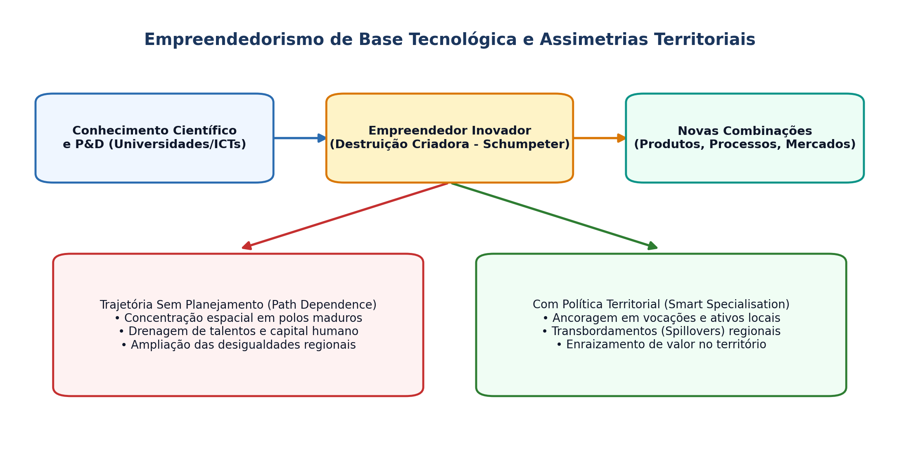

## Visão Geral da Aula {.smaller-text .lesson-slide}

::: {.columns}
::: {.column width="50%"}
### Tópicos

- [1]{.circle} Contrato didático, ementa e avaliação (60 h)
- [2]{.circle} Empreendedorismo de base tecnológica: conceito e especificidades
- [3]{.circle} Schumpeter, destruição criadora e trajetórias tecnológicas
- [4]{.circle} Por que a inovação concentra-se no espaço? Assimetrias territoriais
- [5]{.circle} Empreendedorismo tecnológico em regiões periféricas e no Brasil
- [6]{.circle} Oficina inicial: mapeamento de demandas territoriais
:::

::: {.column width="50%"}
::: {.info-box}
**Objetivo da Aula**

Apresentar a estrutura do componente curricular e fundamentar teoricamente o **empreendedorismo de base tecnológica** (EBT), articulando a tradição schumpeteriana da inovação às dinâmicas de concentração e desigualdade espacial no planejamento territorial.
:::
:::
:::

# 1 · Arquitetura da Disciplina {.section-header rotulo="Disciplina"}

## Ementa, Unidades e Avaliação {.smaller-text .lesson-slide}

::: {.columns}
::: {.column width="50%"}
### Organização (60 h · 15 encontros)

| Unidade | Foco | Carga |
|---------|------|:-----:|
| **I. Território e Ecossistemas** | EBT, barreiras, SRI, Hélice, Emp. Social | 24 h |
| **II. Processo e Estratégia** | Oportunidades, Canvas, Planos, Spin-offs | 20 h |
| **III. Projetos e Viabilidade** | Localização, VPL/TIR, Valuation | 12 h |
| **IV. Síntese Territorial** | Seminário Final Integrador | 4 h |
:::

::: {.column width="50%"}
### Sistema Avaliativo

- **AV1 (30%)**: Seminário e fichamento crítico (Unidade I)
- **AV2 (20%)**: Estudo dirigido quantitativo e locacional (Unidade III)
- **AV3 (50%)**: Trabalho final aplicado + defesa oral (20 min)

::: {.highlight-box}
**Produto Final Esperado:** Diagnóstico de um ecossistema territorial ou proposta de empreendimento tecnológico/de impacto com viabilidade locacional e econômico-financeira.
:::
:::
:::

# 2 · Empreendedorismo de Base Tecnológica {.section-header rotulo="Conceito"}

## O que define uma Empresa de Base Tecnológica? {.smaller-text .lesson-slide}

::: {.columns}
::: {.column width="55%"}
### Conceito e Critérios (Bailetti, 2012; Storey & Tether, 1998)

- Não se reduz a "abrir qualquer empresa": depende da **conversão de conhecimento científico-tecnológico** em soluções sob alta incerteza.
- **Ativos intangíveis centrais:** P&D, propriedade intelectual (patentes, *software*, cultivares), capital humano altamente qualificado e *know-how*.
- **Ciclo de maturação longo:** prova de conceito $\rightarrow$ protótipo $\rightarrow$ validação regulatória/de campo $\rightarrow$ escala comercial.

::: {.info-box}
**Diferença-chave:** Enquanto o empreendedorismo por necessidade replica modelos existentes com baixa barreira técnica, o EBT cria novos mercados ou redefine fronteiras de produtividade.
:::
:::

::: {.column width="45%"}
### Tipologia de Empreendimentos

| Tipo | Base de Conhecimento | Risco Principal |
|------|----------------------|-----------------|
| ***Deep Tech*** | Ciência de fronteira (biotec, materiais, IA) | Risco tecnológico e regulatório |
| **Base Digital** | *Software*, plataformas, dados | Risco de adoção e escala |
| ***Spin-off* Acadêmica** | Pesquisa universitária / ICT | Transição bancada $\rightarrow$ mercado |
| **Tec. Social / Agro** | Tecnologia adaptada ao território | Apropriação local e governança |
:::
:::

## Esquema Síntese: Inovação e Assimetrias Territoriais {.smaller-text .lesson-slide}

{.fig-full}

## Schumpeter e a Destruição Criadora {.smaller-text .lesson-slide}

::: {.columns}
::: {.column width="50%"}
### Os 5 Tipos de Inovação (Schumpeter, 1911; 1942)

1. Introdução de um **novo bem** ou nova qualidade.
2. Novo **método de produção** ou processo.
3. Abertura de um **novo mercado**.
4. Nova fonte de **matérias-primas** ou insumos.
5. Nova **organização da indústria** (ex.: quebra ou formação de monopólio).

- **Mark I (1911):** o empreendedor individual rompe o equilíbrio estacionário.
- **Mark II (1942):** P&D institucionalizado em grandes corporações.
:::

::: {.column width="50%"}
### Trajetórias Tecnológicas (Dosi, 1982)

- A inovação não ocorre no vazio: segue **paradigmas** e **trajetórias tecnológicas** cumulativas.
- **Dependência de trajetória (*Path Dependence*):** territórios que acumulam infraestrutura de P&D e rotinas produtivas atraem mais EBT.

::: {.highlight-box}
**Implicação Territorial:** Sem política deliberada de CT&I e planejamento, a destruição criadora tende a **ampliar** a concentração de renda e talento nos polos já consolidados.
:::
:::
:::

# 3 · Espaço, Assimetrias e Território {.section-header rotulo="Território"}

## Por que o Empreendedorismo Tecnológico Concentra-se no Espaço? {.smaller-text .lesson-slide}

::: {.columns}
::: {.column width="50%"}
### Fatores de Aglomeração (Audretsch & Feldman, 1996)

- **Transbordamentos de conhecimento (*Knowledge Spillovers*):** conhecimento tácito exige interação face a face e proximidade geográfica.
- **Mercado de trabalho especializado:** concentração de engenheiros, pesquisadores e gestores.
- **Infraestrutura científica e financeira:** universidades, laboratórios, investidores-anjo e *venture capital*.
- **Economias de urbanização vs. especialização:** diversidade metropolitana (Jacobs) *versus* densidade setorial (Marshall-Arrow-Romer).
:::

::: {.column width="50%"}
### O Brasil no Mapa da Inovação

- Forte concentração regional de dispêndio em P&D, patentes e *startups* no eixo **Sul–Sudeste** (com polos pontuais no Nordeste, como Recife/Porto Digital e Salvador/Camaçari).
- **Desafio do Planejamento Territorial:** como conectar ativos locais (biodiversidade, agroecossistemas, energias renováveis, universidades estaduais/federais) a cadeias de valor tecnológico?

::: {.info-box}
**Referência-chave:** Milton Santos — a difusão desigual do *meio técnico-científico-informacional* cria "luminosidades" e "opacidades" no território nacional.
:::
:::
:::

## Empreendedorismo Tecnológico fora dos Grandes Centros {.smaller-text .lesson-slide}

::: {.columns}
::: {.column width="50%"}
### Janelas de Oportunidade Territorial

- **Especialização Inteligente (*Smart Specialisation*):** priorizar nichos onde o território possui vantagem comparativa latente (Foray, 2015).
- **Exemplos no Nordeste / Bahia:**
  - *Agtechs* e bioeconomia do Semiárido (recursos hídricos, caatinga, fruticultura irrigada).
  - Energias renováveis (cadeia eólica e solar) e serviços tecnológicos associados.
  - Tecnologias ambientais e restauração produtiva.
:::

::: {.column width="50%"}
### Perguntas Orientadoras para o Planejador

1. O empreendimento tecnológico **enraíza** valor no território ou apenas extrai dados/recursos?
2. Há massa crítica institucional (universidades, IFs, prefeituras, associações) para sustentar a aprendizagem coletiva?
3. Quais barreiras infraestruturais (logística, conectividade, crédito) bloqueiam a escala local?
:::
:::

# 4 · Oficina Prática e Síntese {.section-header rotulo="Oficina"}

## Atividade em Sala e Leituras {.smaller-text .lesson-slide}

::: {.columns}
::: {.column width="50%"}
### Oficina Diagnóstica (45 min)

Em duplas, escolha um **território de referência** (município, bacia ou território de identidade da Bahia) e responda:

1. Qual é o principal gargalo produtivo ou socioambiental desse território?
2. Que base de conhecimento científico-tecnológico existente (UEFS, UFRB, IFBA, Embrapa etc.) poderia endereçar esse gargalo?
3. O eventual negócio seria *deep tech*, digital, *spin-off* ou tecnologia social?
:::

::: {.column width="50%"}
### Leituras para a Próxima Aula

- **PORTER, M. E.** *Estratégia competitiva* (Cap. 1: Análise Estrutural de Indústrias).
- **PORTER, M. E.** *Clusters and the new economics of competition*. HBR, 1998.
- **CASSIOLATO, J. E.; LASTRES, H. M. M.** *Sistemas de inovação e desenvolvimento*. São Paulo em Perspectiva, 2005.
:::
:::
