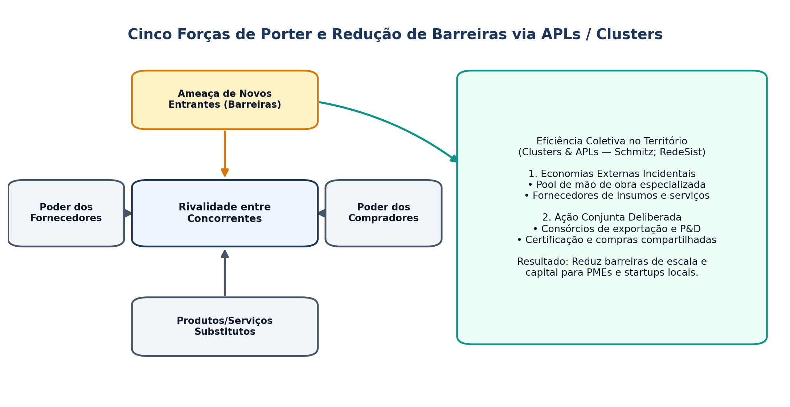

## Visão Geral da Aula {.smaller-text .lesson-slide}

::: {.columns}
::: {.column width="50%"}
### Tópicos

- [1]{.circle} Estruturas de mercado e poder de mercado
- [2]{.circle} As Cinco Forças Competitivas de Porter
- [3]{.circle} Barreiras à entrada, barreiras à saída e custo de mudança
- [4]{.circle} Aglomerações produtivas: Distritos Industriais, *Clusters* e APLs
- [5]{.circle} Estratégia competitiva e inserção de PMEs e *startups* territoriais
:::

::: {.column width="50%"}
::: {.info-box}
**Objetivo da Aula**

Analisar como as **estruturas de mercado** e as **barreiras de entrada** condicionam a sobrevivência de novos empreendimentos tecnológicos, e compreender como *clusters* e Arranjos Produtivos Locais (APLs) reduzem custos de entrada no território.
:::
:::
:::

# 1 · Estruturas de Mercado {.section-header rotulo="Mercados"}

## Tipologia Clássica e Dinâmica Concorrencial {.smaller-text .lesson-slide}

::: {.columns}
::: {.column width="60%"}
### Comparativo das Estruturas

| Estrutura | Nº de Firmas | Produto | Barreira à Entrada | Poder de Preço |
|-----------|:------------:|---------|:------------------:|:--------------:|
| **Concorrência Perfeita** | Muitas | Homogêneo | Nula | Nulo (tomadora) |
| **Concorrência Monopolística** | Muitas | Diferenciado | Baixa | Limitado |
| **Oligopólio** | Poucas | Homog. ou Difer. | Alta | Elevado (interdependente) |
| **Monopólio** | Uma | Único (sem subst.) | Muito Alta / Legal | Máximo (regulado ou não) |
:::

::: {.column width="40%"}
### Leitura para Base Tecnológica

- *Startups* frequentemente buscam criar um **monopólio temporário** via inovação/PI (Thiel; Schumpeter) antes que imitadores entrem.
- Em cadeias tradicionais (agro, energia, construção), novos entrantes enfrentam **oligopólios** consolidados.

::: {.highlight-box}
**Efeito Territorial:** Mercados oligopolizados tendem a concentrar margem fora do território produtor (ex.: *commodities* sem beneficiamento local).
:::
:::
:::

# 2 · Cinco Forças e Barreiras de Entrada {.section-header rotulo="Porter"}

## O Modelo das Cinco Forças (Porter, 1979; 1980) {.smaller-text .lesson-slide}

::: {.columns}
::: {.column width="50%"}
### Pressões Estruturais sobre a Rentabilidade

1. **Rivalidade entre concorrentes existentes** (crescimento do setor, custos fixos, diferenciação).
2. **Ameaça de novos entrantes** (altura das barreiras à entrada e retaliação esperada).
3. **Ameaça de produtos ou serviços substitutos** (razão preço–desempenho).
4. **Poder de barganha dos compradores** (concentração, sensibilidade a preço, integração para trás).
5. **Poder de barganha dos fornecedores** (concentração, insumos críticos, custo de troca).
:::

::: {.column width="50%"}
### As 6 Principais Barreiras à Entrada

- **Economias de escala:** custo unitário cai com volume (exige entrada em larga escala ou desvantagem de custo).
- **Diferenciação de produto e lealdade à marca:** exige alto gasto em posicionamento.
- **Necessidades de capital:** investimento inicial elevado em P&D ou ativos fixos.
- **Custos de mudança (*Switching Costs*):** custo técnico/operacional para o cliente trocar de fornecedor.
- **Acesso a canais de distribuição** e insumos críticos.
- **Desvantagens de custo independentes de escala:** patentes, curva de aprendizagem, **localização favorável** e subsídios/regulação.
:::
:::

## Esquema: Cinco Forças e Eficiência Coletiva {.smaller-text .lesson-slide}

{.fig-full}

## Barreiras à Saída e Estratégias Genéricas {.smaller-text .lesson-slide}

::: {.columns}
::: {.column width="50%"}
### Matriz Entrada × Saída

| | **Barreiras de Saída Baixas** | **Barreiras de Saída Altas** |
|---|---|---|
| **Entrada Baixa** | Retornos baixos e estáveis | Retornos baixos e arriscados |
| **Entrada Alta** | Retornos altos e estáveis | Retornos altos e arriscados |

- **Barreiras à saída:** ativos altamente especializados, custos trabalhistas/ambientais de desmobilização, inter-relações estratégicas e barreiras emocionais/políticas.
:::

::: {.column width="50%"}
### Estratégias Genéricas (Porter, 1980)

1. **Liderança em Custo Total:** escala, eficiência operacional e controle rígido.
2. **Diferenciação:** atributo único valorizado (tecnologia proprietária, origem territorial, qualidade).
3. **Enfoque (Nicho):** foco em segmento, linha ou **território específico** (por custo ou diferenciação).

::: {.info-box}
**Armadilha do "Meio-Termo" (*Stuck in the Middle*):** PMEs territoriais que não têm escala para competir em custo nem diferenciação clara perdem margem.
:::
:::
:::

# 3 · Clusters, Distritos e APLs no Território {.section-header rotulo="Aglomerações"}

## Da Firma Isolada à Eficiência Coletiva {.smaller-text .lesson-slide}

::: {.columns}
::: {.column width="50%"}
### Por que Aglomerações Reduzem Barreiras?

- **Distritos Industriais (Marshall, 1890):** externalidades pecuniárias e tecnológicas (*pool* de mão de obra, fornecedores especializados, *spillovers*).
- **Eficiência Coletiva (Schmitz, 1995):** soma de **economias externas incidentais** + **ação conjunta deliberada** (consórcios, feiras, centros tecnológicos).
- ***Clusters* (Porter, 1998):** concentrações geográficas de empresas interconectadas, fornecedores e instituições em um campo específico.
:::

::: {.column width="50%"}
### Arranjos Produtivos Locais (APLs — RedeSist/IE-UFRJ)

- Abordagem brasileira (Cassiolato & Lastres, 2005): enfatiza **enraizamento territorial**, aprendizado interativo e redução de assimetrias para PMEs.
- **Diferença crítica:** Um *cluster* pode existir apenas por aglomeração de mercado; um **APL** pressupõe articulação institucional e governança local para inovação.

::: {.highlight-box}
**Conexão Edital + Território:** Em APLs bem estruturados, barreiras de entrada individuais (P&D, certificação, canais de exportação) são **compartilhadas** entre pequenos produtores e empresas.
:::
:::
:::

## Estudo de Caso e Oficina Aplicada {.smaller-text .lesson-slide}

::: {.columns}
::: {.column width="55%"}
### Análise Estrutural Aplicada (45 min)

Escolha uma cadeia produtiva regional (ex.: **fruticultura irrigada do São Francisco**, **cadeia de sisal/fibras naturais**, **software/serviços digitais**, **energia solar distribuída**) e elabore:

1. **Mapa das 5 Forças de Porter** para uma *startup* ou PME entrante nesse setor.
2. Identificação das **2 maiores barreiras à entrada** existentes.
3. Proposta de **ação coletiva (APL/Cluster)** para reduzir essas barreiras no território.
:::

::: {.column width="45%"}
### Leituras para a Próxima Aula

- **STAM, E.** *Entrepreneurial ecosystems and regional policy: a sympathetic critique*. European Planning Studies, 2015.
- **ISENBERG, D.** *How to start an entrepreneurial revolution*. HBR, 2010.
- **ETZKOWITZ, H.; LEYDESDORFF, L.** *The dynamics of innovation: Triple Helix*. Research Policy, 2000.
:::
:::
