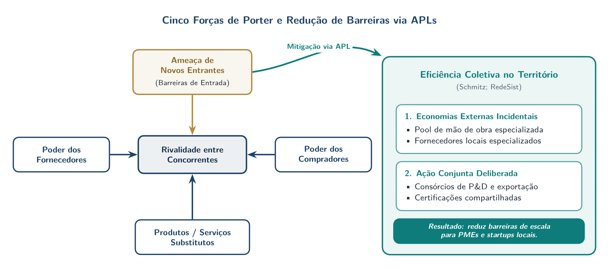

## [Unidade I]{.pitch-tag} Visão geral da aula {#visao-geral .smaller-text .lesson-slide}

::: {.pitch-grid-55}
::: {.pitch-milestones}
::: {.pitch-milestone-item}
**01 · Estruturas de mercado:** Concorrência, oligopólio, monopólio e poder de mercado.
:::

::: {.pitch-milestone-item}
**02 · Cinco Forças:** Modelo estrutural de competitividade setorial de Porter.
:::

::: {.pitch-milestone-item}
**03 · Barreiras:** Entrada, saída, custos de mudança e estratégias genéricas.
:::

::: {.pitch-milestone-item}
**04 · Espaço vs. território:** Dos *clusters* de Porter aos APLs (RedeSist).
:::

::: {.pitch-milestone-item}
**05 · Competitividade:** Espúria vs. autêntica e inserção de PMEs e *startups*.
:::
:::

::: {.pitch-stack-2}
::: {.pitch-card .pitch-card--gold}
[Propósito formativo]{.pitch-card-index}
[Objetivo da aula]{.pitch-heading}

Analisar como as **estruturas de mercado** e as **barreiras de entrada** condicionam a sobrevivência de novos empreendimentos tecnológicos, e compreender como *clusters* e Arranjos Produtivos Locais (APLs) reduzem custos de entrada no território.
:::

::: {.pitch-pill-row}
[5 Forças de Porter]{.pitch-pill}
[Barreiras de Entrada]{.pitch-pill .pitch-pill--gold}
[APLs & RedeSist]{.pitch-pill}
:::

::: {.pitch-band}
**Fio condutor:** Como pequenos empreendimentos territoriais superam escalas oligopolistas por meio de diferenciação e eficiência coletiva?
:::
:::
:::

# 1 · Estruturas de Mercado {.section-header rotulo="Mercados"}

## [Conceito]{.pitch-tag} Tipologia clássica e dinâmica concorrencial {#tipologia-mercados .smaller-text .lesson-slide}

::: {.pitch-grid-60}
::: {.pitch-table-box}
| Estrutura | Nº de Firmas | Produto | Barreira à Entrada | Poder de Preço |
|-----------|:------------:|---------|:------------------:|:--------------:|
| **Concorrência Perfeita** | Muitas | Homogêneo | Nula | Nulo (tomadora) |
| **Concorrência Monopolística** | Muitas | Diferenciado | Baixa | Limitado |
| **Oligopólio** | Poucas | Homog. ou Difer. | Alta | Elevado (interdependente) |
| **Monopólio** | Uma | Único (sem subst.) | Muito Alta / Legal | Máximo (regulado ou não) |
:::

::: {.pitch-stack-2}
::: {.pitch-card}
[Estratégia tecnológica]{.pitch-card-index}
[Leitura para base tecnológica]{.pitch-heading}

- *Startups* frequentemente buscam criar um **monopólio temporário** via inovação/PI (Thiel; Schumpeter) antes que imitadores entrem.
- Em cadeias tradicionais (agro, energia, construção), novos entrantes enfrentam **oligopólios** consolidados.
:::

::: {.pitch-band .pitch-band--navy}
**Efeito territorial:** Mercados oligopolizados tendem a concentrar margem fora do território produtor (ex.: *commodities* sem beneficiamento local).
:::
:::
:::

# 2 · Cinco Forças e Barreiras de Entrada {.section-header rotulo="Porter"}

## [Conceito]{.pitch-tag} O modelo das Cinco Forças (Porter, 1979; 1980) {#cinco-forcas-porter .smaller-text .lesson-slide}

::: {.pitch-cards-2}
::: {.pitch-card}
[Pressões estruturais]{.pitch-card-index}
[As Cinco Forças competitivas]{.pitch-heading}

1. **Rivalidade entre concorrentes existentes** (crescimento do setor, custos fixos, diferenciação).
2. **Ameaça de novos entrantes** (altura das barreiras à entrada e retaliação esperada).
3. **Ameaça de produtos ou serviços substitutos** (razão preço–desempenho).
4. **Poder de barganha dos compradores** (concentração, sensibilidade a preço, integração para trás).
5. **Poder de barganha dos fornecedores** (concentração, insumos críticos, custo de troca).
:::

::: {.pitch-card .pitch-card--gold}
[Fatores de proteção]{.pitch-card-index}
[As 6 principais barreiras à entrada]{.pitch-heading}

- **Economias de escala:** custo unitário cai com volume (exige entrada em larga escala ou desvantagem de custo).
- **Diferenciação e lealdade à marca:** exige alto gasto em posicionamento.
- **Necessidades de capital:** investimento inicial elevado em P&D ou ativos fixos.
- **Custos de mudança (*Switching Costs*):** custo técnico/operacional para trocar de fornecedor.
- **Acesso a canais de distribuição** e insumos críticos.
- **Desvantagens independentes de escala:** patentes, curva de aprendizagem, **localização favorável** e subsídios/regulação.
:::
:::

## [Síntese]{.pitch-tag .pitch-tag--teal} Cinco Forças e eficiência coletiva {#esquema-cinco-forcas-apl .smaller-text .lesson-slide}

::: {.pitch-media-card .pitch-media-card--tall}

[Cinco Forças de Porter e mitigação de barreiras via APLs]{.pitch-caption}
[Economias externas incidentais e ação conjunta deliberada (Schmitz; RedeSist) reduzem barreiras de escala para PMEs e startups locais]{.pitch-caption-sub}
:::

::: {.pitch-band .pitch-band--teal}
A eficiência coletiva atua diretamente sobre as barreiras de escala, capital e acesso a mercados que bloqueariam firmas isoladas.
:::

## [Método]{.pitch-tag .pitch-tag--teal} Barreiras à saída e estratégias genéricas {#barreiras-saida-estrategias .smaller-text .lesson-slide}

::: {.pitch-grid-50}
::: {.pitch-stack-2}
::: {.pitch-table-box}
| | **Barreiras de Saída Baixas** | **Barreiras de Saída Altas** |
|---|---|---|
| **Entrada Baixa** | Retornos baixos e estáveis | Retornos baixos e arriscados |
| **Entrada Alta** | Retornos altos e estáveis | Retornos altos e arriscados |
:::

::: {.pitch-card}
[Rigidez estrutural]{.pitch-card-index}
[Barreiras à saída]{.pitch-heading}

Ativos altamente especializados, custos trabalhistas e ambientais de desmobilização, inter-relações estratégicas e barreiras emocionais ou políticas.
:::
:::

::: {.pitch-stack-2}
::: {.pitch-card .pitch-card--gold}
[Posicionamento (Porter, 1980)]{.pitch-card-index}
[Estratégias genéricas]{.pitch-heading}

1. **Liderança em Custo Total:** escala, eficiência operacional e controle rígido.
2. **Diferenciação:** atributo único valorizado (tecnologia proprietária, origem territorial, qualidade).
3. **Enfoque (Nicho):** foco em segmento, linha ou **território específico** (por custo ou diferenciação).
:::

::: {.pitch-band .pitch-band--navy}
**Armadilha do “Meio-Termo” (*Stuck in the Middle*):** PMEs territoriais sem escala para competir em custo nem diferenciação clara perdem margem.
:::
:::
:::

# 3 · Clusters, Distritos e APLs no Território {.section-header rotulo="Aglomerações"}

## [Território]{.pitch-tag .pitch-tag--gold} Da firma isolada à eficiência coletiva {#eficiencia-coletiva-apls .smaller-text .lesson-slide}

::: {.pitch-cards-2}
::: {.pitch-card}
[Economia da aglomeração]{.pitch-card-index}
[Por que aglomerações reduzem barreiras?]{.pitch-heading}

- **Distritos Industriais (Marshall, 1890):** externalidades pecuniárias e tecnológicas (*pool* de mão de obra, fornecedores especializados, *spillovers*).
- **Eficiência Coletiva (Schmitz, 1995):** soma de **economias externas incidentais** + **ação conjunta deliberada** (consórcios, feiras, centros tecnológicos).
- ***Clusters* (Porter, 1998):** concentrações geográficas de empresas interconectadas, fornecedores e instituições em um campo específico.
:::

::: {.pitch-card .pitch-card--teal}
[RedeSist / IE-UFRJ]{.pitch-card-index}
[Arranjos Produtivos Locais (Cassiolato & Lastres, 2005)]{.pitch-heading}

- Enfatiza **enraizamento territorial**, aprendizado interativo e redução de assimetrias para PMEs.
- **Diferença crítica:** Um *cluster* pode existir apenas por aglomeração de mercado; um **APL** pressupõe articulação institucional e governança local para inovação.
:::
:::

::: {.pitch-band}
**Conexão Edital + Território:** Em APLs bem estruturados, barreiras de entrada individuais (P&D, certificação, canais de exportação) são **compartilhadas** entre pequenos produtores e empresas.
:::

## [Caso]{.pitch-tag .pitch-tag--gold} Ativos territoriais e APLs: cacau cabruca no Sul da Bahia {#caso-cacau-cabruca .smaller-text .lesson-slide}

::: {.pitch-grid-55}
::: {.pitch-stack-2}
::: {.pitch-card .pitch-card--gold}
[Ativo territorial específico]{.pitch-card-index}
[Agroecossistema cacau-cabruca (Ilhéus / Sul da Bahia)]{.pitch-heading}

O cultivo sombreado sob remanescentes da Mata Atlântica articula conservação florestal, saber-fazer tradicional e identidade de origem — convertendo um ativo socioecológico em **diferenciação não facilmente imitável**.
:::

::: {.pitch-card .pitch-card--teal}
[Ação conjunta no APL]{.pitch-card-index}
[Superando barreiras de escala e margem]{.pitch-heading}

Quando produtores, cooperativas e ICTs atuam em rede — compartilhando P&D, fermentação de qualidade, certificações e agroindústria local — rompem a dependência da venda de *commodity* bruta.
:::
:::

::: {.pitch-media-card .pitch-media-card--photo .pitch-media-card--tall}

[Agroecossistema cacau-cabruca (Ilhéus / Sul da Bahia)]{.pitch-caption}
[Ativo territorial para diferenciação produtiva e governança em APL]{.pitch-caption-sub}
:::
:::

## [Crítica]{.pitch-tag .pitch-tag--alert} Espaço neutro vs. território social {#critica-espaco-territorio .smaller-text .lesson-slide}

::: {.pitch-cards-2}
::: {.pitch-card .pitch-card--alert}
[Porter (1998) e Barney (1991)]{.pitch-card-index}
[Limites da visão mercadológica]{.pitch-heading}

- **Porter (*Clusters*):** trata a aglomeração prioritariamente como mecanismo de redução de custos de transação e ganho de poder de barganha mercadológico.
- **Barney (RBV / VRIO):** foca em recursos internos da firma protegidos por ambiguidade causal e complexidade social, subestimando a construção coletiva de capacidades no território.
:::

::: {.pitch-card .pitch-card--teal}
[Cassiolato & Lastres / RedeSist]{.pitch-card-index}
[A crítica latino-americana]{.pitch-heading}

- O território **não é um palco físico neutro**: é uma construção histórica, institucional e política marcada por assimetrias de poder.
- **Competitividade espúria vs. autêntica:** aglomerações baseadas em baixos salários, precarização ou exaustão ambiental não geram desenvolvimento regional.
- Nos **APLs**, a vantagem duradoura depende de **cooperação institucional**, confiança tácita, aprendizado interativo e inclusão produtiva.
:::
:::

## [Método]{.pitch-tag .pitch-tag--teal} Oficina aplicada e leituras (Eixo 2) {#oficina-leituras .smaller-text .lesson-slide}

::: {.pitch-grid-55}
::: {.pitch-stack-2}
::: {.pitch-band .pitch-band--teal}
**Análise estrutural aplicada (45 min):** Escolha uma cadeia regional (fruticultura irrigada do São Francisco, sisal/fibras naturais, *software*/serviços digitais ou energia solar distribuída) e elabore:
:::

::: {.pitch-milestones}
::: {.pitch-milestone-item}
**01 · Mapa das 5 Forças de Porter** para uma *startup* ou PME entrante nesse setor.
:::

::: {.pitch-milestone-item}
**02 · Gargalos competitivos:** Identificação das **2 maiores barreiras à entrada** existentes.
:::

::: {.pitch-milestone-item}
**03 · Eficiência coletiva:** Proposta de **ação conjunta (APL/*Cluster*)** para reduzir essas barreiras no território.
:::
:::
:::

::: {.pitch-card}
[Bibliografia fundamental]{.pitch-card-index}
[Leituras da Aula 02 e próxima aula (Eixo 2)]{.pitch-heading}

- **PORTER, M. E.** *Clusters and the new economics of competition*. HBR, 1998; *Estratégia competitiva*. Elsevier, 2004.
- **BARNEY, J.** *Firm resources and sustained competitive advantage*. Journal of Management, 1991.
- **CASSIOLATO, J. E.; LASTRES, H. M. M.** *Sistemas de inovação e desenvolvimento* (RedeSist/APLs). São Paulo em Perspectiva, 2005.
- **STAM, E.** *Entrepreneurial ecosystems and regional policy: a sympathetic critique*. European Planning Studies, 2015.
- **BOSCHMA, R.** *Proximity and innovation: a critical assessment*. Regional Studies, 2005.
:::
:::
