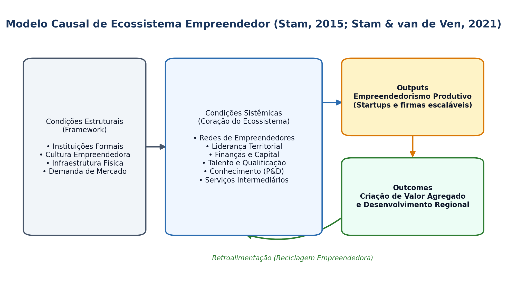

## Visão Geral da Aula {.smaller-text .lesson-slide}

::: {.columns}
::: {.column width="50%"}
### Tópicos

- [1]{.circle} Dos Sistemas de Inovação (SNI/SRI) aos Ecossistemas Empreendedores
- [2]{.circle} Os 6 domínios de Isenberg (2010; 2011)
- [3]{.circle} O modelo causal de Stam (2015) e Stam & van de Ven (2021)
- [4]{.circle} Proximidade geográfica, cognitiva e institucional (Boschma, 2005)
- [5]{.circle} Diagnóstico de ecossistemas em regiões não metropolitanas
:::

::: {.column width="50%"}
::: {.info-box}
**Objetivo da Aula**

Compreender a arquitetura conceitual e empírica dos **ecossistemas empreendedores** e dos **Sistemas Regionais de Inovação (SRI)**, diferenciando seus elementos estruturais, mecanismos de retroalimentação e implicações para políticas territoriais.
:::
:::
:::

# 1 · Evolução Conceitual {.section-header rotulo="Conceito"}

## Sistemas de Inovação vs. Ecossistemas Empreendedores {.smaller-text .lesson-slide}

::: {.columns}
::: {.column width="50%"}
### Sistemas Regionais de Inovação (Cooke et al., 1997)

- Foco nas **instituições de P&D, firmas estabelecidas e políticas tecnológicas**.
- Ênfase na geração e difusão de conhecimento em rede.
- O empreendedor aparece muitas vezes como ator secundário diante de grandes empresas e laboratórios.
:::

::: {.column width="50%"}
### Ecossistemas Empreendedores (Spigel, 2017; Stam, 2015)

- Coloca o **empreendedor inovador no centro** do sistema, não apenas como resultado, mas como agente construtor.
- Conjunto de atores interdependentes e fatores coordenados de modo a permitir o **empreendedorismo produtivo** (*ambitious entrepreneurship*) em um território específico.

::: {.highlight-box}
**Síntese:** Enquanto o SRI explica a capacidade de *produzir conhecimento*, o Ecossistema Empreendedor explica a capacidade do território de *transformar conhecimento em novos negócios escaláveis*.
:::
:::
:::

# 2 · Modelos Analíticos de Ecossistemas {.section-header rotulo="Modelos"}

## Os 6 Domínios de Isenberg (2011) {.smaller-text .lesson-slide}

::: {.columns}
::: {.column width="55%"}
### Babson Entrepreneurship Ecosystem Project

1. **Políticas (*Policy*):** liderança governamental e marco regulatório.
2. **Finanças (*Finance*):** microcrédito, anjos, *venture capital*, fomento.
3. **Cultura (*Culture*):** tolerância ao risco/erro, histórias de sucesso, status social.
4. **Suporte (*Supports*):** infraestrutura, incubadoras, serviços jurídicos/contábeis.
5. **Capital Humano (*Human Capital*):** universidades, formação técnica, empreendedores seriais.
6. **Mercados (*Markets*):** redes de clientes iniciais (*early adopters*) e canais de distribuição.
:::

::: {.column width="45%"}
### Princípios de Intervenção (Isenberg, 2010)

- **Pare de tentar copiar o Vale do Silício:** cada território deve construir sobre suas vocações locais.
- **Não crie "elefantes brancos":** infraestrutura física sem demanda empreendedora real fracassa.
- **Reciclagem empreendedora:** empreendedores bem-sucedidos reinvestem capital, mentoria e reputação no próprio território.
:::
:::

## Esquema: Modelo Causal de Ecossistema Empreendedor {.smaller-text .lesson-slide}

{.fig-full}

## O Modelo Integrativo de Stam (2015) e Stam & van de Ven (2021) {.smaller-text .lesson-slide}

::: {.columns}
::: {.column width="50%"}
### Condições Estruturais × Condições Sistêmicas

- **Condições Estruturais (Framework):** instituições formais, cultura, infraestrutura física, demanda de mercado.
- **Condições Sistêmicas (Coração do Ecossistema):**
  1. Redes de empreendedores;
  2. Liderança;
  3. Finanças;
  4. Talento;
  5. Conhecimento;
  6. Serviços intermediários.
:::

::: {.column width="50%"}
### Saídas (*Outputs*) e Resultados (*Outcomes*)

- ***Outputs*:** empreendedorismo produtivo (novas firmas inovadoras, de alto crescimento ou alto impacto).
- ***Outcomes*:** criação agregada de valor, produtividade e desenvolvimento econômico regional.
- **Causalidade ascendente e descendente:** retroalimentação contínua entre resultados e condições sistêmicas.

::: {.info-box}
**Vantagem Metodológica:** O modelo de Stam permite construir **índices compostos comparativos** entre municípios ou regiões (ex.: Índice de Ecossistemas Empreendedores).
:::
:::
:::

# 3 · Proximidade e Território {.section-header rotulo="Proximidade"}

## As 5 Dimensões da Proximidade (Boschma, 2005) {.smaller-text .lesson-slide}

::: {.columns}
::: {.column width="60%"}
### Proximidade Geográfica Não Basta Sozinha

| Dimensão | O que significa | Risco do Excesso (*Lock-in*) |
|----------|-----------------|------------------------------|
| **Geográfica** | Distância física entre atores | Isolamento de fluxos externos |
| **Cognitiva** | Base de conhecimento compartilhada | Falta de diversidade / novidade |
| **Organizacional** | Vínculos hierárquicos ou em rede | Burocratização e dependência |
| **Social** | Relações de confiança e amizade | Endogamia e fechamento |
| **Institucional** | Regras formais e informais comuns | Inércia institucional |
:::

::: {.column width="40%"}
### Implicação para o Planejamento

- A proximidade geográfica facilita o encontro, mas a cooperação tecnológica exige **proximidade cognitiva e institucional** mínima.
- Políticas territoriais devem construir **"pontes externas"** (*pipelines* globais) para evitar o aprisionamento regional (*regional lock-in*).
:::
:::

# 4 · Oficina de Diagnóstico {.section-header rotulo="Oficina"}

## Mapeamento Rápido de Ecossistema (45 min) {.smaller-text .lesson-slide}

::: {.columns}
::: {.column width="55%"}
### Roteiro Prático — Feira de Santana / Território Portal do Sertão

Em grupos, avaliem de **1 a 5** os 6 elementos sistêmicos de Stam (2021) para o território escolhido:

1. Redes e eventos empreendedores;
2. Liderança articuladora;
3. Acesso a financiamento e fomento;
4. Talento e formação superior/técnica;
5. Produção de conhecimento (P&D/PI);
6. Serviços de suporte (incubadoras, contabilidade, NITs).

**Entregável:** Identificar o **principal gargalo sistêmico** e propor 1 ação de governança territorial.
:::

::: {.column width="45%"}
### Leituras para a Próxima Aula

- **ETZKOWITZ, H.; LEYDESDORFF, L.** *The dynamics of innovation: Triple Helix*. Research Policy, 2000.
- **MAZZUCATO, M.** *O Estado empreendedor* (Caps. 1 e 3).
- **Marco Legal de CT&I** (Lei nº 13.243/2016 — visão geral).
:::
:::
