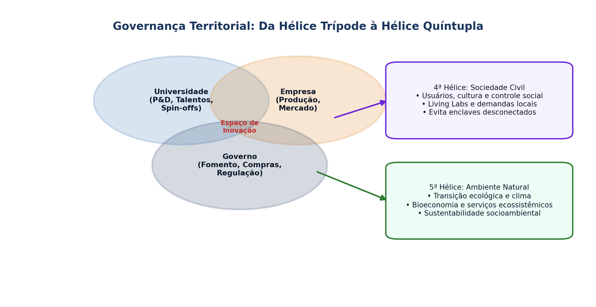

## Visão Geral da Aula {.smaller-text .lesson-slide}

::: {.columns}
::: {.column width="50%"}
### Tópicos

- [1]{.circle} Hélice Trípode, Quádrupla e Quíntupla no território
- [2]{.circle} O Estado Empreendedor (Mazzucato): risco, missão e financiamento
- [3]{.circle} Infraestruturas de suporte: parques tecnológicos, incubadoras e NITs
- [4]{.circle} Cidades inteligentes, territórios criativos e governança multinível
- [5]{.circle} Marco Legal de CT&I no Brasil e instrumentos regionais
:::

::: {.column width="50%"}
::: {.info-box}
**Objetivo da Aula**

Examinar os mecanismos de **governança territorial da inovação**, o papel do Estado e das universidades na criação de mercados e a efetividade de parques tecnológicos, incubadoras e políticas públicas de CT&I.
:::
:::
:::

# 1 · Modelos em Hélice {.section-header rotulo="Hélices"}

## Da Hélice Trípode à Hélice Quádrupla/Quíntupla {.smaller-text .lesson-slide}

::: {.columns}
::: {.column width="50%"}
### Hélice Trípode (Etzkowitz & Leydesdorff, 2000)

- **Universidade:** geração de conhecimento, talento e *spin-offs* (Universidade Empreendedora).
- **Empresa:** produção, absorção tecnológica e escala de mercado.
- **Governo:** regulação, compras públicas, fomento e infraestrutura.
- **Espaços de consenso e inovação:** zonas híbridas onde as três esferas assumem papéis umas das outras.
:::

::: {.column width="50%"}
### Hélice Quádrupla e Quíntupla (Carayannis & Campbell, 2009; 2010)

- **4ª Hélice:** **Sociedade civil / usuários / mídia e cultura** — legitima demandas sociais e cocria soluções (*Living Labs*).
- **5ª Hélice:** **Ambiente natural e sustentabilidade socioecológica** — orienta a inovação para a transição ecológica.

::: {.highlight-box}
**Leitura PPGPT:** Sem a 4ª e a 5ª hélices, parques e polos tecnológicos correm o risco de se tornarem **enclaves desconectados** do território onde estão instalados.
:::
:::
:::

## Esquema: Da Hélice Trípode à Hélice Quíntupla {.smaller-text .lesson-slide}

{.fig-full}

# 2 · O Estado Empreendedor {.section-header rotulo="Estado"}

## Financiamento de Risco e Políticas Orientadas por Missões {.smaller-text .lesson-slide}

::: {.columns}
::: {.column width="50%"}
### A Tese de Mariana Mazzucato (2014)

- O Estado não apenas "corrige falhas de mercado": ele **cria e molda mercados** assumindo o risco tecnológico inicial que o capital privado evita.
- **Exemplos históricos:** internet, GPS, telas sensíveis ao toque, biotecnologia inicial e transição energética.
- **Problema da assimetria:** socialização dos riscos na fase de P&D e privatização dos retornos na fase comercial.
:::

::: {.column width="50%"}
### Políticas Orientadas por Missões (*Missions*)

- Em vez de subsídios genéricos, definir **missões territoriais claras** (ex.: descarbonização de cadeias locais, segurança hídrica no Semiárido, bioeconomia florestal).
- **Instrumentos:**
  - Compras públicas de inovação (Encomenda Tecnológica — ETEC);
  - Subvenção econômica direta a empresas (FINEP, EMBRAPII, FAPs);
  - Crédito direcionado e fundos de garantia.
:::
:::

# 3 · Parques Tecnológicos, Incubadoras e NITs {.section-header rotulo="Infraestrutura"}

## Habitats de Inovação e Marco Legal Brasileiro {.smaller-text .lesson-slide}

::: {.columns}
::: {.column width="55%"}
### Tipologia de Habitats de Inovação

| Habitat | Público-Alvo | Função Territorial |
|---------|--------------|--------------------|
| **Pré-incubadora** | Ideias, projetos acadêmicos | Validação inicial e modelagem |
| **Incubadora** | *Startups* nascentes | Mentoria, espaço, redução de mortalidade |
| **Aceleradora** | Negócios validados | Tração rápida e acesso a capital |
| **Parque Tecnológico** | Empresas de P&D, ICTs, *spin-offs* | Adensamento de P&D e atração de talentos |
:::

::: {.column width="45%"}
### Marco Legal de CT&I (Lei 10.973/2004 e Lei 13.243/2016)

- Institucionaliza os **Núcleos de Inovação Tecnológica (NITs)** nas universidades e ICTs.
- Permite compartilhamento de laboratórios com empresas, prestação de serviços de P&D e participação minoritária em *spin-offs*.
- Facilita convênios e encomendas tecnológicas no setor público.
:::
:::

# 4 · Debate e Caso Comparado {.section-header rotulo="Debate"}

## Parques Tecnológicos: Sucesso vs. "Catedrais no Deserto" {.smaller-text .lesson-slide}

::: {.columns}
::: {.column width="50%"}
### Condições de Sucesso Territorial

1. Ancoragem em **competências científicas reais** da região.
2. Articulação orgânica com cadeias produtivas locais (não apenas aluguel de salas).
3. Governança autônoma e estabilidade além de ciclos eleitorais de 4 anos.
4. Fluxo contínuo de projetos vindos de universidades e empresas locais.
:::

::: {.column width="50%"}
### Leituras para a Próxima Aula

- **AUSTIN, J.; STEVENSON, H.; WEI-SKILLERN, J.** *Social and commercial entrepreneurship: same, different, or both?* ETP, 2006.
- **MAIR, J.; MARTÍ, I.** *Social entrepreneurship research*. Journal of World Business, 2006.
- **YUNUS, M.** *Building Social Business* (Cap. 1).
:::
:::
