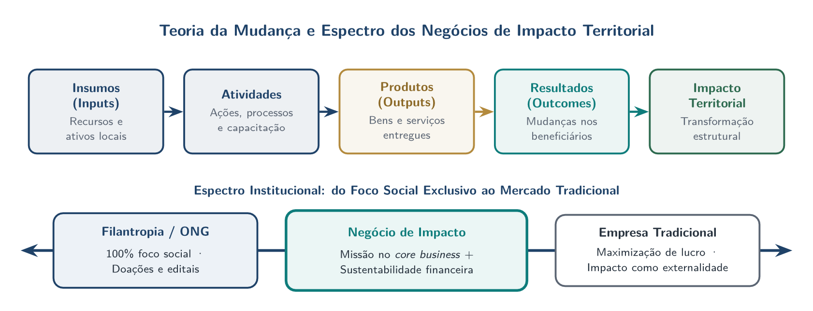
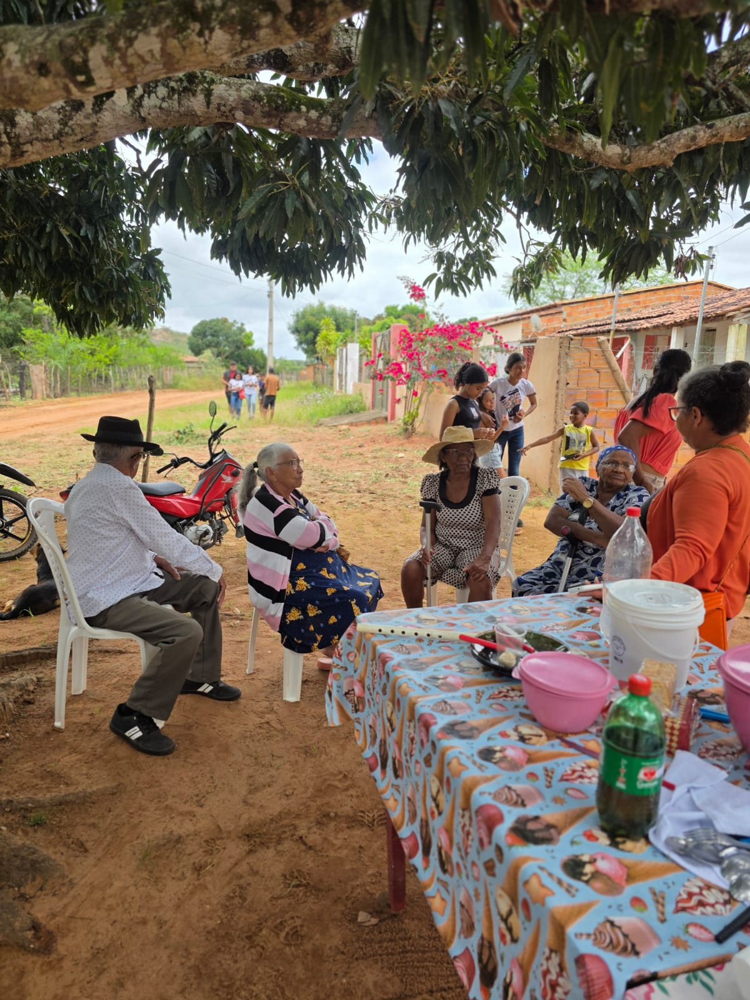

## [Unidade I]{.pitch-tag} Visão geral da aula {#visao-geral .smaller-text .lesson-slide}

::: {.pitch-grid-55}
::: {.pitch-milestones}
::: {.pitch-milestone-item}
**01 · Quadro PCDO:** Empreendedorismo comercial vs. social (Austin et al., 2006).
:::

::: {.pitch-milestone-item}
**02 · Negócios de impacto:** Pilares socioambientais e organizações híbridas.
:::

::: {.pitch-milestone-item}
**03 · Teoria da Mudança:** Cadeia causal e mensuração de impacto territorial.
:::

::: {.pitch-milestone-item}
**04 · Finanças sociais:** Capital paciente, *grants*, *blended finance* e SIBs.
:::

::: {.pitch-milestone-item}
**05 · Crítica territorial:** Financeirização do social, *mission drift* e políticas públicas.
:::
:::

::: {.pitch-stack-2}
::: {.pitch-card .pitch-card--gold}
[Propósito formativo]{.pitch-card-index}
[Objetivo da aula]{.pitch-heading}

Diferenciar conceitualmente **empreendedorismo social**, **negócios de impacto** e **empreendedorismo comercial**, analisando o papel das organizações híbridas na geração de valor socioambiental e inclusão produtiva no território.
:::

::: {.pitch-pill-row}
[Austin · Mair & Martí]{.pitch-pill}
[Teoria da Mudança]{.pitch-pill .pitch-pill--gold}
[Mission Drift]{.pitch-pill}
:::

::: {.pitch-band}
**Tensão central:** Como combinar sustentabilidade financeira e missão socioambiental sem mercantilizar direitos essenciais nem perder o público vulnerável?
:::
:::
:::

# 1 · Fundamentos do Empreendedorismo Social {.section-header rotulo="Conceito"}

## [Conceito]{.pitch-tag} Quadro PCDO: comercial vs. social (Austin et al., 2006) {#quadro-pcdo .smaller-text .lesson-slide}

::: {.pitch-grid-60}
::: {.pitch-table-box}
| Dimensão | Empreendedorismo Comercial | Empreendedorismo Social |
|----------|---------------------------|-------------------------|
| **Falha de Mercado** | Cria oportunidade de lucro privado | Cria oportunidade de **valor social** |
| **Missão Central** | Captura de valor econômico | Criação de **valor social/ambiental** |
| **Mobilização de Recursos** | Retorno financeiro atrai capital | Combina receitas, doações, editais e voluntariado |
| **Mensuração de Desempenho** | Lucro, ROI, *market share* | Indicadores de impacto social (mais complexos) |
:::

::: {.pitch-stack-2}
::: {.pitch-card}
[Mair & Martí (2006)]{.pitch-card-index}
[Catalisação de mudança social]{.pitch-heading}

Processo que envolve o uso inovador e a combinação de recursos para **catalisar mudança social** e atender necessidades humanas básicas não supridas pelo mercado ou pelo Estado.
:::

::: {.pitch-band .pitch-band--teal}
**Organizações híbridas:** operam na fronteira entre a lógica de mercado (sustentabilidade financeira) e a lógica social (missão pública).
:::
:::
:::

# 2 · Negócios de Impacto e Teoria da Mudança {.section-header rotulo="Impacto"}

## [Método]{.pitch-tag .pitch-tag--teal} Pilares dos negócios de impacto e Teoria da Mudança {#pilares-teoria-mudanca .smaller-text .lesson-slide}

::: {.pitch-cards-2}
::: {.pitch-card}
[Aliança pelos Investimentos e Negócios de Impacto]{.pitch-card-index}
[Os 4 pilares constitutivos]{.pitch-heading}

1. **Intencionalidade:** missão explícita de resolver um problema socioambiental.
2. **Solução no *core business*:** o impacto decorre da atividade principal (não é filantropia lateral).
3. **Sustentabilidade financeira:** modelo de receita próprio (venda de produtos/serviços).
4. **Mensuração de impacto:** compromisso com monitoramento e transparência de resultados.
:::

::: {.pitch-stack-2}
::: {.pitch-formula}
**Insumos (*Inputs*)** $\rightarrow$ **Atividades** $\rightarrow$ **Produtos (*Outputs*)** $\rightarrow$ **Resultados (*Outcomes*)** $\rightarrow$ **Impacto Territorial (*Impact*)**
:::

::: {.pitch-card .pitch-card--alert}
[Alerta metodológico]{.pitch-card-index}
[Risco do Impact Washing]{.pitch-heading}

Uso retórico do discurso de impacto socioambiental sem evidência causal verificável nem mudança estrutural efetiva no território.
:::
:::
:::

## [Síntese]{.pitch-tag .pitch-tag--teal} Teoria da Mudança e espectro de impacto {#esquema-teoria-mudanca .smaller-text .lesson-slide}

::: {.pitch-media-card .pitch-media-card--tall}

[Teoria da Mudança e espectro dos negócios de impacto territorial]{.pitch-caption}
[Da cadeia causal (Insumos a Impacto Territorial) ao posicionamento entre filantropia pura e empresa tradicional]{.pitch-caption-sub}
:::

::: {.pitch-band}
A validade de um negócio de impacto depende da coerência causal entre entregas operacionais e transformação estrutural mensurável.
:::

# 3 · Finanças Sociais e Tensões Territoriais {.section-header rotulo="Finanças"}

## [Conceito]{.pitch-tag} Instrumentos financeiros e risco de mission drift {#instrumentos-mission-drift .smaller-text .lesson-slide}

::: {.pitch-cards-2}
::: {.pitch-card}
[Finanças sociais]{.pitch-card-index}
[Espectro de capital de impacto]{.pitch-heading}

- **Fomentos não reembolsáveis (*grants*):** fase de validação e P&D social.
- ***Blended Finance*:** combinação de capital filantrópico/público (assume maior risco) com capital privado.
- **Títulos de Impacto Social (SIBs):** pagamento por resultado alcançado junto ao poder público.
:::

::: {.pitch-card .pitch-card--alert}
[Tensão de governança]{.pitch-card-index}
[Desvio de missão (Mission Drift)]{.pitch-heading}

Ocorre quando a pressão por retorno financeiro e escala leva o negócio a excluir os públicos ou territórios mais vulneráveis que motivaram sua criação.
:::
:::

::: {.pitch-band .pitch-band--navy}
**Questão para o PLANTERR:** Negócios de impacto substituem políticas públicas universais ou devem atuar de forma complementar a elas?
:::

## [Crítica]{.pitch-tag .pitch-tag--alert} Financeirização do social e limites do hibridismo {#critica-financeirizacao-hibridismo .smaller-text .lesson-slide}

::: {.pitch-cards-2}
::: {.pitch-card .pitch-card--alert}
[1 · Pressão institucional]{.pitch-card-index}
[O risco estrutural do mission drift]{.pitch-heading}

- Organizações híbridas operam sob **dupla pressão institucional**: a lógica mercantil de rentabilidade/escala e a lógica pública/comunitária de inclusão.
- Quando dependem de fundos de investimento que exigem taxas de retorno de mercado, tendem a migrar para clientes de maior renda ou cobrar tarifas excludentes (*mission drift*).
:::

::: {.pitch-card .pitch-card--alert}
[2 · Crítica sociológica]{.pitch-card-index}
[Mercantilização vs. direitos sociais no território]{.pitch-heading}

- Transformar serviços essenciais (água, educação, saúde básica, assistência técnica rural) apenas em "oportunidades de negócios na base da pirâmide" pode legitimar a retração do Estado.
- No planejamento territorial, negócios de impacto devem **articular-se às políticas públicas estruturantes**, e não substituí-las.
:::
:::

## [Território]{.pitch-tag .pitch-tag--gold} Comunidades tradicionais, tecnologia social e economia solidária {#territorio-quilombo-impacto .smaller-text .lesson-slide}

::: {.pitch-grid-60}
::: {.pitch-stack-2}
::: {.pitch-card .pitch-card--gold}
[Enraizamento comunitário]{.pitch-card-index}
[Tecnologia Social em territórios quilombolas (Dagnino, 2014)]{.pitch-heading}

Em comunidades quilombolas e povos tradicionais, soluções sociotécnicas partem da autogestão, dos saberes locais e da governança coletiva, evitando a imposição de pacotes tecnológicos exógenos.
:::

::: {.pitch-card .pitch-card--teal}
[Economia Solidária e políticas públicas]{.pitch-card-index}
[Autonomia produtiva sem substituição de direitos (Singer, 2002)]{.pitch-heading}

Redes solidárias e cooperativas territoriais fortalecem a retenção de renda local quando articuladas a políticas estruturantes de regularização fundiária, água, saúde, educação e assistência técnica.
:::
:::

::: {.pitch-media-card .pitch-media-card--photo .pitch-media-card--tall}

[Organização comunitária em território quilombola]{.pitch-caption}
[Governança participativa, saberes locais e tecnologia social no território]{.pitch-caption-sub}
:::
:::

# 4 · Oficina e Leituras {.section-header rotulo="Oficina"}

## [Método]{.pitch-tag .pitch-tag--teal} Construção da Teoria da Mudança e leituras {#oficina-leituras .smaller-text .lesson-slide}

::: {.pitch-grid-55}
::: {.pitch-stack-2}
::: {.pitch-band .pitch-band--teal}
**Exercício aplicado (40 min):** Escolha um desafio territorial (acesso à água no semiárido, resíduos sólidos urbanos, conectividade rural ou restauração florestal produtiva) e desenhe:
:::

::: {.pitch-milestones}
::: {.pitch-milestone-item}
**01 · Problema raiz:** O desafio socioambiental e o público-alvo territorial delimitados.
:::

::: {.pitch-milestone-item}
**02 · Solução:** A resposta tecnológica ou organizacional proposta para o contexto local.
:::

::: {.pitch-milestone-item}
**03 · Cadeia causal:** Insumos $\rightarrow$ Produtos $\rightarrow$ Resultados $\rightarrow$ Impacto Territorial.
:::

::: {.pitch-milestone-item}
**04 · Sustentabilidade:** Como gerar receita sem *mission drift* e em articulação com políticas públicas.
:::
:::
:::

::: {.pitch-card}
[Bibliografia fundamental]{.pitch-card-index}
[Leituras da Aula 05 e próxima aula (Eixo 4 — AV1)]{.pitch-heading}

- **AUSTIN, J.; STEVENSON, H.; WEI-SKILLERN, J.** *Social and commercial entrepreneurship: same, different, or both?* ETP, 2006.
- **MAIR, J.; MARTÍ, I.** *Social entrepreneurship research*. Journal of World Business, 2006.
- **DAGNINO, R.** *Tecnologia Social: contribuições conceituais e metodológicas*. EDUEPB / SciELO Livros, 2014.
- **SINGER, P.** *Introdução à Economia Solidária*. Fundação Perseu Abramo, 2002.
- **BRASIL.** *Lei da Propriedade Industrial* (Lei nº 9.279/1996 — Indicações Geográficas).
:::
:::
