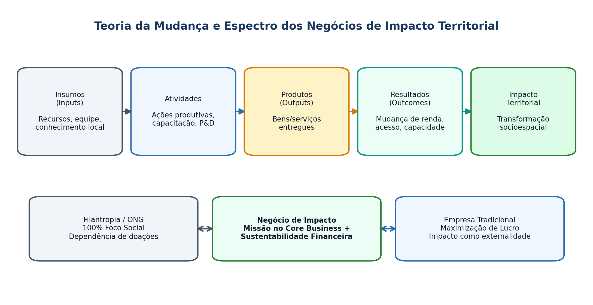

## Visão Geral da Aula {.smaller-text .lesson-slide}

::: {.columns}
::: {.column width="50%"}
### Tópicos

- [1]{.circle} Empreendedorismo comercial vs. social (Austin et al., 2006)
- [2]{.circle} Negócios de impacto socioambiental e organizações híbridas
- [3]{.circle} Teoria da Mudança e mensuração de impacto territorial
- [4]{.circle} Finanças sociais e capital paciente
- [5]{.circle} Limites críticos e tensões entre missão social e escala
:::

::: {.column width="50%"}
::: {.info-box}
**Objetivo da Aula**

Diferenciar conceitualmente **empreendedorismo social**, **negócios de impacto** e **empreendedorismo comercial**, analisando o papel das organizações híbridas na geração de valor socioambiental e inclusão produtiva no território.
:::
:::
:::

# 1 · Fundamentos do Empreendedorismo Social {.section-header rotulo="Conceito"}

## O Quadro PCDO: Comercial vs. Social (Austin et al., 2006) {.smaller-text .lesson-slide}

::: {.columns}
::: {.column width="60%"}
### Comparação Estrutural

| Dimensão | Empreendedorismo Comercial | Empreendedorismo Social |
|----------|---------------------------|-------------------------|
| **Falha de Mercado** | Cria oportunidade de lucro privado | Cria oportunidade de **valor social** |
| **Missão Central** | Captura de valor econômico | Criação de **valor social/ambiental** |
| **Mobilização de Recursos** | Retorno financeiro atrai capital | Combina receitas, doações, editais e voluntariado |
| **Mensuração de Desempenho** | Lucro, ROI, *market share* | Indicadores de impacto social (mais complexos) |
:::

::: {.column width="40%"}
### Definição de Mair & Martí (2006)

- Processo que envolve o uso inovador e a combinação de recursos para **catalisar mudança social** e atender necessidades humanas básicas não supridas pelo mercado ou pelo Estado.

::: {.highlight-box}
**Organizações Híbridas:** operam na fronteira entre a lógica de mercado (sustentabilidade financeira) e a lógica social (missão pública).
:::
:::
:::

# 2 · Negócios de Impacto e Teoria da Mudança {.section-header rotulo="Impacto"}

## Critérios dos Negócios de Impacto (Aliança pelos Investimentos e Negócios de Impacto) {.smaller-text .lesson-slide}

::: {.columns}
::: {.column width="50%"}
### Os 4 Pilares

1. **Intencionalidade:** missão explícita de resolver um problema socioambiental.
2. **Solução no *core business*:** o impacto decorre da atividade principal (não é filantropia lateral).
3. **Sustentabilidade financeira:** modelo de receita próprio (venda de produtos/serviços).
4. **Mensuração de impacto:** compromisso com monitoramento e transparência de resultados.
:::

::: {.column width="50%"}
### Cadeia da Teoria da Mudança

- **Insumos (*Inputs*)** $\rightarrow$ **Atividades** $\rightarrow$ **Produtos (*Outputs*)** $\rightarrow$ **Resultados (*Outcomes*)** $\rightarrow$ **Impacto Territorial (*Impact*)**.
- **Risco do *Impact Washing*:** uso retórico de impacto socioambiental sem evidência causal ou mudança estrutural no território.
:::
:::

## Esquema: Teoria da Mudança e Espectro de Impacto {.smaller-text .lesson-slide}

{.fig-full}

# 3 · Finanças Sociais e Tensões Territoriais {.section-header rotulo="Finanças"}

## Instrumentos Financeiros e Risco de *Mission Drift* {.smaller-text .lesson-slide}

::: {.columns}
::: {.column width="50%"}
### Espectro de Capital de Impacto

- **Fomentos não reembolsáveis (*grants*):** fase de validação e P&D social.
- ***Blended Finance*:** combinação de capital filantrópico/público (assume maior risco) com capital privado.
- **Títulos de Impacto Social (SIBs):** pagamento por resultado alcançado junto ao poder público.
:::

::: {.column width="50%"}
### Tensões Críticas (*Mission Drift*)

- **Desvio de missão (*Mission Drift*):** quando a pressão por retorno financeiro leva o negócio a excluir os públicos ou territórios mais vulneráveis.
- **Questão para o PPGPT:** negócios de impacto substituem políticas públicas universais ou devem atuar de forma complementar a elas?
:::
:::

# 4 · Oficina e Leituras {.section-header rotulo="Oficina"}

## Construção da Teoria da Mudança (40 min) {.smaller-text .lesson-slide}

::: {.columns}
::: {.column width="55%"}
### Exercício Aplicado

Escolha um desafio territorial concreto (ex.: **acesso à água no semiárido**, **gestão de resíduos sólidos urbanos**, **conectividade rural** ou **restauração florestal produtiva**) e desenhe:

1. O problema socioambiental raiz e o público-alvo territorial;
2. A solução tecnológica/organizacional proposta;
3. A cadeia **Insumos $\rightarrow$ Produtos $\rightarrow$ Resultados $\rightarrow$ Impacto**;
4. Como o negócio gera receita sem perder a missão social.
:::

::: {.column width="45%"}
### Leituras para a Próxima Aula

- **DAGNINO, R.** *Tecnologia Social: contribuições conceituais e metodológicas*. EDUEPB, 2014.
- **SINGER, P.** *Introdução à Economia Solidária*. Fundação Perseu Abramo, 2002.
- Literatura sobre **Indicações Geográficas (IGs)** e desenvolvimento territorial no Brasil.
:::
:::
