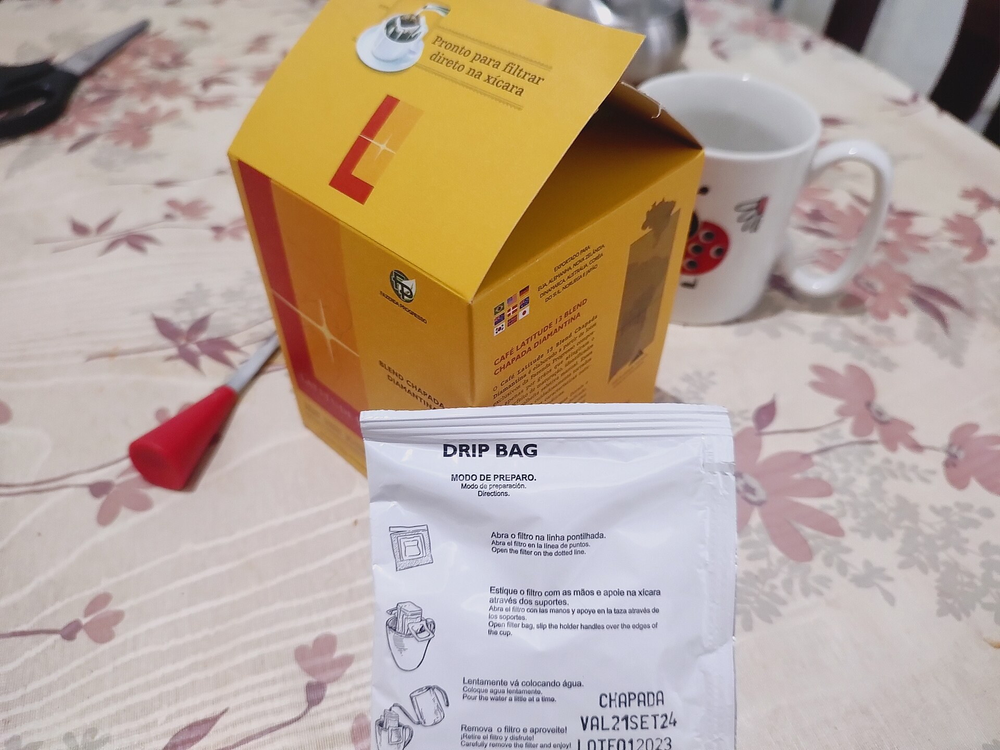
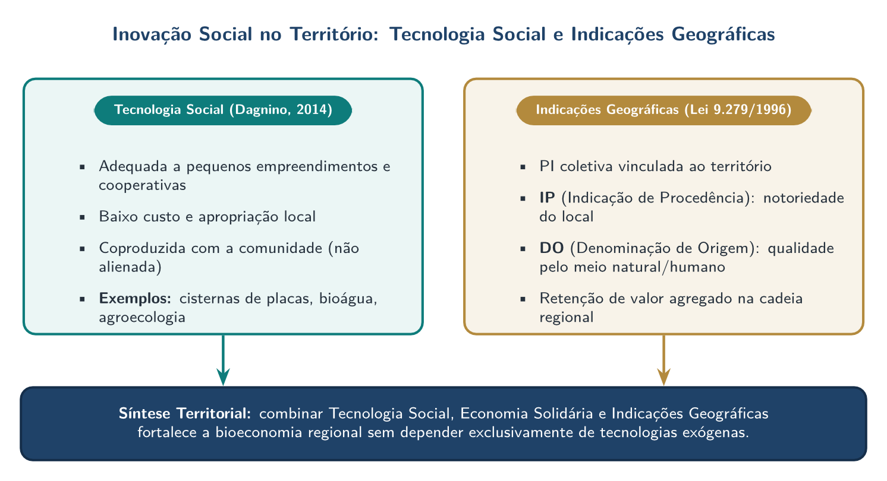

## [Unidade I]{.pitch-tag} Visão Geral da Aula {#visao-geral .smaller-text .lesson-slide}

::: {.pitch-grid-55}
::: {.pitch-card}
[Roteiro da aula · 4 horas]{.pitch-card-index}
[Tópicos estruturantes]{.pitch-heading}

1. Crítica à tecnologia convencional vs. Tecnologia Social emancipatória (Dagnino, 2014).
2. Maximização de lucro vs. autogestão e Economia Solidária (Singer, 2002).
3. Apropriação privada vs. ativos coletivos territoriais: Indicações Geográficas (IGs).
4. Bioeconomia territorial e valorização da sociobiodiversidade.
5. Matriz de Debate Crítico da Unidade I e orientações para Seminário/Fichamento (AV1).
:::

::: {.pitch-stack-2}
::: {.pitch-card .pitch-card--gold}
[Objetivo central]{.pitch-card-index}
[Inovação social e valor distribuído]{.pitch-heading}

Aprofundar a dimensão territorial da inovação social, analisando como **tecnologias sociais**, **empreendimentos econômicos solidários**, **indicações geográficas** e a **bioeconomia** convertem saberes e recursos locais em valor distribuído no território.
:::

::: {.pitch-band .pitch-band--teal}
**Fechamento da Unidade I:** articulação dos marcos teóricos territoriais para a avaliação AV1.
:::
:::
:::

## [Território]{.pitch-tag .pitch-tag--gold} Por que nem toda tecnologia funciona em todo território? {#ponto-partida .smaller-text .lesson-slide}

::: {.pitch-cards-2}
::: {.pitch-card .pitch-card--alert}
[01 · Assimetria]{.pitch-card-index}
[O problema da transferência cega]{.pitch-heading}

- Um equipamento projetado para grandes escalas industriais costuma exigir capital alto, peças importadas e mão de obra escassa localmente.
- Quando instalado sem adaptação em cooperativas ou comunidades rurais, tende a gerar dependência técnica e baixa apropriação de renda.
:::

::: {.pitch-card .pitch-card--teal}
[02 · Enraizamento]{.pitch-card-index}
[A resposta pela inovação territorial]{.pitch-heading}

- **Tecnologia Social:** soluções cocriadas com a comunidade, de baixo custo e reaplicáveis (como cisternas de placas e sistemas de reúso de água).
- **Ativos Territoriais Protegidos:** transformar saberes, clima e biodiversidade locais em valor reconhecido (Indicações Geográficas e bioeconomia).
:::
:::

::: {.pitch-band .pitch-band--navy}
Inovar no território exige adequação sociotécnica: tecnologia não é neutra e precisa dialogar com a organização social local.
:::

# 1 · Tecnologia Social e Economia Solidária {.section-header rotulo="Tecnologia Social"}

## [Crítica]{.pitch-tag .pitch-tag--alert} Tecnologia Convencional vs. Tecnologia Social (Dagnino, 2014) {#ts-economia-solidaria .smaller-text .lesson-slide}

::: {.pitch-cards-2}
::: {.pitch-card}
[01 · Adequação sociotécnica]{.pitch-card-index}
[Crítica à neutralidade tecnológica]{.pitch-heading}

- A **tecnologia convencional** é desenhada para escalas industriais, poupando mão de obra e concentrando renda.
- A **Tecnologia Social (TS)** envolve produtos, técnicas ou metodologias **reaplicáveis**, desenvolvidas na interação com a comunidade e voltadas à transformação social.
- **Exemplos no Brasil:** cisternas de placas (ASA), biodigestores rurais, bancos comunitários de desenvolvimento e sistemas agroflorestais.
:::

::: {.pitch-card .pitch-card--gold}
[02 · Autogestão]{.pitch-card-index}
[Economia Solidária (Singer, 2002)]{.pitch-heading}

- Baseada em **autogestão**, propriedade coletiva dos meios de produção e repartição equitativa de excedentes.
- **Desafio de gestão:** conciliar democracia interna (cooperativas e associações) com eficiência operacional e acesso a mercados dinâmicos.
:::
:::

::: {.pitch-band}
**Síntese Territorial:** a articulação entre **tecnologia social + organização solidária + assessoria técnica universitária** reduz a dependência de pacotes tecnológicos exógenos.
:::

# 2 · Indicações Geográficas e Bioeconomia {.section-header rotulo="Ativos Territoriais"}

## [Conceito]{.pitch-tag} Indicações Geográficas e Bioeconomia Territorial {#igs-bioeconomia .smaller-text .lesson-slide}

::: {.pitch-cards-2}
::: {.pitch-card .pitch-card--gold}
[Lei nº 9.279/1996]{.pitch-card-index}
[PI coletiva e valorização do *terroir*]{.pitch-heading}

- **Indicação de Procedência (IP):** nome geográfico conhecido como centro de extração, produção ou fabricação de determinado produto/serviço.
- **Denominação de Origem (DO):** qualidades ou características devem-se exclusiva ou essencialmente ao **meio geográfico** (fatores naturais + humanos).
- **Efeito econômico:** cria **diferenciação protegida** que impede apropriação por concorrentes externos e retém margem na região produtora.
:::

::: {.pitch-card .pitch-card--teal}
[Lei nº 13.123/2015]{.pitch-card-index}
[Bioeconomia e sociobiodiversidade]{.pitch-heading}

- Uso intensivo de conhecimento científico aliado a saberes tradicionais para gerar bioprodutos, bioinsumos e serviços ecossistêmicos.
- **Cuidado crítico:** evitar a "biopirataria" ou cadeias extrativistas onde apenas a matéria-prima bruta sai do território e o valor agregado fica fora.
- **Instrumento-chave:** repartição de benefícios (Lei da Biodiversidade).
:::
:::

::: {.pitch-band .pitch-band--navy}
Ativos territoriais coletivos convertem identidade, clima, solo e saber-fazer regional em barreiras legítimas à comoditização.
:::

## [Caso]{.pitch-tag .pitch-tag--gold} Ativos territoriais na prática: Café da Chapada Diamantina {#caso-chapada .smaller-text .lesson-slide}

::: {.pitch-grid-55}
::: {.pitch-media-card .pitch-media-card--photo .pitch-media-card--wide}

[Café Latitude 13 · Blend Chapada Diamantina (BA)]{.pitch-caption}
[Registro empírico de produto territorial com indicação de origem, lote e formato de alto valor agregado]{.pitch-caption-sub}
:::

::: {.pitch-stack-2}
::: {.pitch-card .pitch-card--gold}
[Diferenciação no território]{.pitch-card-index}
[Do grão *commodity* ao ativo de origem]{.pitch-heading}

- **Identidade geográfica:** associação explícita à **Chapada Diamantina**, vinculando altitude, manejo e colheita seletiva ao perfil sensorial.
- **Agregação tecnológica de formato:** uso de *drip bag* individual, elevando conveniência e preço por dose frente ao café torrado convencional.
:::

::: {.pitch-card .pitch-card--teal}
[Rastreabilidade e mercado]{.pitch-card-index}
[Acesso a nichos globais]{.pitch-heading}

- Identificação de lote, validade e origem permite inserção direta em mercados internacionais exigentes (EUA, Europa e Ásia), retendo marca e valor na região produtora.
:::
:::
:::

## [Síntese]{.pitch-tag .pitch-tag--teal} Tecnologia Social e Indicações Geográficas no território {#esquema-ts-ig .smaller-text .lesson-slide}

::: {.pitch-media-card .pitch-media-card--tall}

[Convergência entre Tecnologia Social (Dagnino, 2014) e Indicações Geográficas (Lei nº 9.279/1996)]{.pitch-caption}
[Estratégia combinada de apropriação local de conhecimento e retenção de valor na bioeconomia regional]{.pitch-caption-sub}
:::

::: {.pitch-band .pitch-band--navy}
Enquanto a **Tecnologia Social** democratiza os meios técnicos de produção, as **Indicações Geográficas** protegem coletivamente o valor simbólico e econômico no mercado.
:::

# 3 · Fechamento da Unidade I {.section-header rotulo="Fechamento"}

## [Crítica]{.pitch-tag .pitch-tag--alert} Matriz de Debate Crítico para Seminário e Fichamento (AV1) {#matriz-av1 .smaller-text .lesson-slide}

::: {.pitch-table-box}
| Tema em Disputa | Abordagem Tradicional / Canônica | Contraponto Crítico Sociológico e Territorial |
| :--- | :--- | :--- |
| **Origem da Inovação** | Empreendedor individual privado (*Schumpeter I*) ou laboratório corporativo (*Schumpeter II*). | Estado como investidor de primeiro risco (Mazzucato) e redes coletivas de aprendizado (Lundvall; Dosi). |
| **Papel do Território** | Espaço físico neutro para economias externas de custo e transação (*Clusters* de Porter). | Construção social e institucional; risco de *lock-in* e dependência de trajetória (Boschma; Cassiolato & Lastres; Santos). |
| **Modelo de Ecossistema** | Transplante de modelos hegemônicos ("Vales do Silício" locais via parques padronizados). | Especialização Inteligente (Foray), APLs enraizados e Hélice Quádrupla/Quíntupla orientada por missões públicas. |
| **Objetivo do Empreendimento** | Escalar *startups* para maximização de valor privado de saída (*exit*) a fundos de capital de risco. | Valor territorial compartilhado, Tecnologias Sociais emancipatórias (Dagnino), Economia Solidária (Singer) e IGs. |
:::

::: {.pitch-band}
**Uso na AV1:** selecione um caso territorial empírico e posicione-o criticamente nos quatro eixos da matriz.
:::

## [Síntese]{.pitch-tag .pitch-tag--teal} Leituras, AV1 e transição para a Unidade II {#leituras-av1 .smaller-text .lesson-slide}

::: {.pitch-cards-2}
::: {.pitch-card}
[Fechamento da Unidade I]{.pitch-card-index}
[Síntese (Pontos 1, 7, 10 e 12)]{.pitch-heading}

- Revisamos a base territorial do empreendedorismo: assimetrias espaciais, barreiras de entrada/APLs, ecossistemas/SRI/Hélices e inovação social/impacto.
- **AV1 (30%):** Seminários temáticos e entrega do fichamento crítico articulando um caso territorial aos autores da Unidade I.
:::

::: {.pitch-card .pitch-card--teal}
[Referências da Aula 06 e Aula 07]{.pitch-card-index}
[Leituras obrigatórias]{.pitch-heading}

- **DAGNINO, R.** *Tecnologia Social: contribuições conceituais e metodológicas*. EDUEPB / SciELO, 2014.
- **SINGER, P.** *Introdução à Economia Solidária*. Fundação Perseu Abramo, 2002.
- **BRASIL.** *Lei nº 9.279/1996* (IGs — IP e DO) e *Lei nº 13.123/2015* (Sociobiodiversidade).
- **SHANE & VENKATARAMAN** (*AMR*, 2000); **SARASVATHY** (*AMR*, 2001); **BYERS; DORF; NELSON** (2015) — *Aula 07*.
:::
:::
