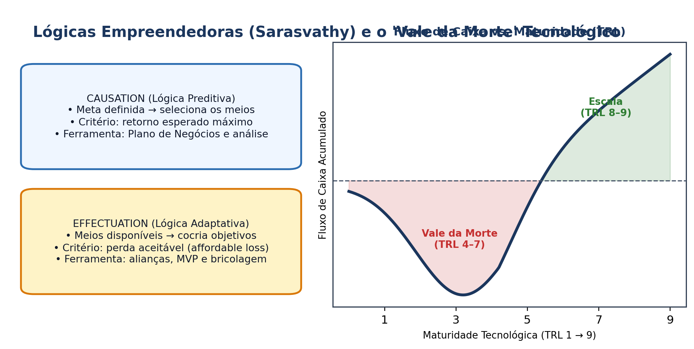

## Visão Geral da Aula {.smaller-text .lesson-slide}

::: {.columns}
::: {.column width="50%"}
### Tópicos

- [1]{.circle} O campo científico do empreendedorismo (Shane & Venkataraman, 2000)
- [2]{.circle} *Causation* vs. *Effectuation* (Sarasvathy, 2001)
- [3]{.circle} *Bricolagem* empreendedora em contextos de escassez (Baker & Nelson, 2005)
- [4]{.circle} Estágios de criação de novos negócios tecnológicos e "Vale da Morte"
- [5]{.circle} Equipes fundadoras e capital social no território
:::

::: {.column width="50%"}
::: {.info-box}
**Objetivo da Aula**

Examinar o **processo empreendedor** sob a ótica teórica contemporânea, contrapondo modelos preditivos (*causation*) a lógicas adaptativas (*effectuation* e bricolagem) na criação de novos negócios em ambientes de incerteza e restrição de recursos.
:::
:::
:::

# 1 · O Nexo Indivíduo–Oportunidade {.section-header rotulo="Teoria"}

## Shane & Venkataraman (2000) {.smaller-text .lesson-slide}

::: {.columns}
::: {.column width="50%"}
### Definição do Campo

- Empreendedorismo não é apenas "traço de personalidade" nem apenas "gestão de pequenas empresas".
- É o estudo acadêmico de **como, por quem e com que efeitos** as oportunidades para criar novos bens e serviços são **descobertas, avaliadas e exploradas**.
- **Dois elementos inseparáveis:** a existência de **oportunidades lucrativas/de valor** e a presença de **indivíduos empreendedores** capazes de percebê-las e agir.
:::

::: {.column width="50%"}
### Modos de Exploração da Oportunidade

1. **Criação de uma nova firma** (foco clássico de *startups* e *spin-offs*).
2. **Venda/licenciamento da oportunidade** a firmas existentes (comum quando ativos complementares de manufatura/distribuição são caros).

::: {.info-box}
**Questão Territorial:** Em regiões com baixa densidade de grandes empresas locais, a criação de novas firmas exige maior suporte institucional inicial.
:::
:::
:::

# 2 · Causation vs. Effectuation e Bricolagem {.section-header rotulo="Lógicas"}

## Lógicas de Tomada de Decisão (Sarasvathy, 2001) {.smaller-text .lesson-slide}

::: {.columns}
::: {.column width="60%"}
### Comparação Analítica

| Dimensão | *Causation* (Causal) | *Effectuation* (Efetual) |
|----------|----------------------|--------------------------|
| **Ponto de partida** | Um objetivo/meta dado | Os **meios disponíveis** (*quem sou, o que sei, quem conheço*) |
| **Critério de decisão** | Retorno esperado máximo | **Perda aceitável** (*affordable loss*) |
| **Relação com atores** | Análise competitiva | **Alianças estratégicas** e pré-compromissos |
| **Visão de futuro** | Previsão (*predizer*) | **Controle** do imprevisível (*cocriar*) |
| **Contingências** | Evitar surpresas | Alavancar surpresas |
:::

::: {.column width="40%"}
### Bricolagem (Baker & Nelson, 2005)

- **"Fazer com o que está à mão"**: recombinar recursos subutilizados, locais ou descartados para resolver novos problemas.
- Extremamente relevante para empreendedores tecnológicos e sociais em **territórios periféricos** com escassez de *venture capital*.
:::
:::

## Esquema: Lógicas Empreendedoras e o Vale da Morte {.smaller-text .lesson-slide}

{.fig-full}

# 3 · Ciclo de Vida e "Vale da Morte" {.section-header rotulo="Ciclo"}

## Da Pesquisa ao Mercado: O "Vale da Morte" Tecnológico {.smaller-text .lesson-slide}

::: {.columns}
::: {.column width="50%"}
### Etapas do Processo Empreendedor

1. **Ideação e Descoberta:** pesquisa, observação de mercado ou problema territorial.
2. **Prova de Conceito e Prototipagem (TRL 1–4):** alto risco técnico; financiamento público/acadêmico.
3. **Validação e Tração Inicial (TRL 5–7):** **Vale da Morte** — recursos de pesquisa acabam antes de haver receita recorrente.
4. **Escala e Crescimento (TRL 8–9):** expansão comercial, padronização e governança corporativa.
:::

::: {.column width="50%"}
### Equipes e Capital Social

- Negócios de base tecnológica raramente sobrevivem com fundador solo: exigem **complementaridade técnica + comercial/gestão**.
- **Laços fortes vs. laços fracos (Granovetter):** laços locais garantem confiança inicial; laços externos conectam a mercados e tecnologia de fronteira.
:::
:::

# 4 · Oficina e Leituras {.section-header rotulo="Oficina"}

## Exercício: Inventário Efetual (35 min) {.smaller-text .lesson-slide}

::: {.columns}
::: {.column width="55%"}
### Aplicação ao Projeto da Disciplina

Partindo da lógica **efetual**, mapeie para o seu projeto ou caso territorial:

1. **Quem somos / O que sabemos:** competências técnicas e acadêmicas disponíveis;
2. **Quem conhecemos:** redes locais (universidades, cooperativas, prefeituras, empresas);
3. **Perda aceitável:** qual o mínimo viável de recursos e tempo para testar a ideia em 60 dias?
:::

::: {.column width="45%"}
### Leituras para a Próxima Aula

- **SHANE, S.** *Prior knowledge and the discovery of entrepreneurial opportunities*. Organization Science, 2000.
- **BARON, R. A.** *Opportunity recognition as pattern recognition*. AMP, 2006.
- **JUNGMANN, D. M.; BONETTI, E. A.** *A caminho da inovação* (IEL, 2010 — Caps. sobre PI).
:::
:::
