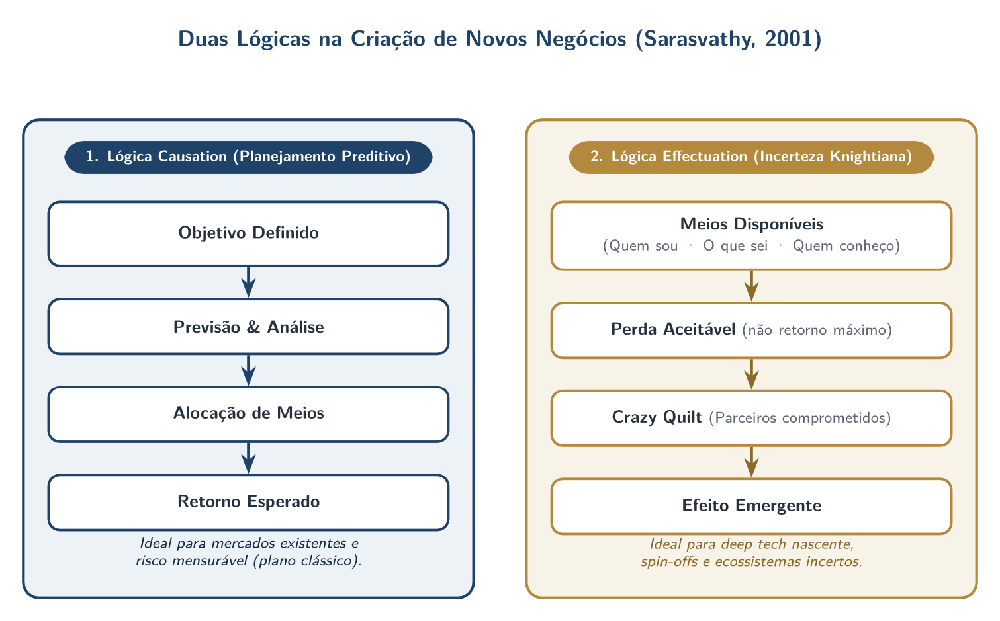
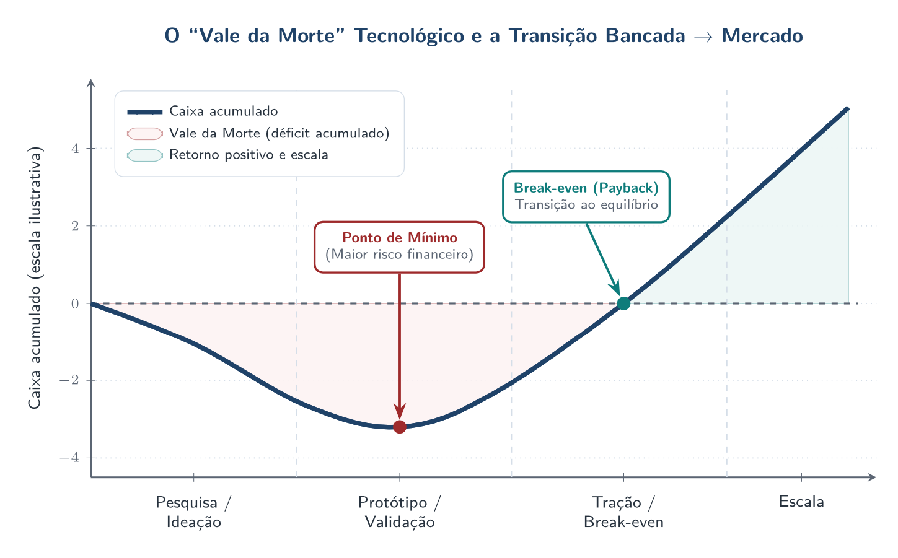

## [Unidade II]{.pitch-tag} Visão Geral da Aula {#visao-geral .smaller-text .lesson-slide}

::: {.pitch-grid-55}
::: {.pitch-card}
[Roteiro da aula · 4 horas]{.pitch-card-index}
[Tópicos estruturantes]{.pitch-heading}

1. O campo científico do empreendedorismo (Shane & Venkataraman, 2000).
2. *Causation* vs. *Effectuation* (Sarasvathy, 2001).
3. *Bricolagem* empreendedora em contextos de escassez (Baker & Nelson, 2005).
4. Estágios de criação de novos negócios tecnológicos e "Vale da Morte".
5. Equipes fundadoras e capital social no território.
:::

::: {.pitch-stack-2}
::: {.pitch-card .pitch-card--gold}
[Objetivo central]{.pitch-card-index}
[Decisão sob incerteza]{.pitch-heading}

Examinar o **processo empreendedor** sob a ótica teórica contemporânea, contrapondo modelos preditivos (*causation*) a lógicas adaptativas (*effectuation* e bricolagem) na criação de novos negócios em ambientes de incerteza e restrição de recursos.
:::

::: {.pitch-band .pitch-band--teal}
**Foco da Unidade II:** da teoria da oportunidade à execução prática em territórios com restrição de capital.
:::
:::
:::

# 1 · O Nexo Indivíduo–Oportunidade {.section-header rotulo="Teoria"}

## [Conceito]{.pitch-tag} O campo científico em Shane & Venkataraman (2000) {#shane-venkataraman .smaller-text .lesson-slide}

::: {.pitch-cards-2}
::: {.pitch-card}
[Fundamento epistemológico]{.pitch-card-index}
[Definição do campo]{.pitch-heading}

- Empreendedorismo não é apenas "traço de personalidade" nem apenas "gestão de pequenas empresas".
- É o estudo acadêmico de **como, por quem e com que efeitos** as oportunidades para criar novos bens e serviços são **descobertas, avaliadas e exploradas**.
- **Dois elementos inseparáveis:** a existência de **oportunidades lucrativas/de valor** e a presença de **indivíduos empreendedores** capazes de percebê-las e agir.
:::

::: {.pitch-card .pitch-card--gold}
[Formas organizacionais]{.pitch-card-index}
[Modos de exploração da oportunidade]{.pitch-heading}

1. **Criação de uma nova firma** (foco clássico de *startups* e *spin-offs*).
2. **Venda/licenciamento da oportunidade** a firmas existentes (comum quando ativos complementares de manufatura e distribuição são caros).
:::
:::

::: {.pitch-band .pitch-band--navy}
**Questão Territorial:** em regiões com baixa densidade de grandes empresas locais, a criação de novas firmas exige maior suporte institucional inicial.
:::

# 2 · Causation vs. Effectuation e Bricolagem {.section-header rotulo="Lógicas"}

## [Método]{.pitch-tag .pitch-tag--teal} Lógicas de decisão: Sarasvathy (2001) e Bricolagem {#logicas-decisao .smaller-text .lesson-slide}

::: {.pitch-grid-60}
::: {.pitch-table-box}
| Dimensão | *Causation* (Causal) | *Effectuation* (Efetual) |
|---|---|---|
| **Ponto de partida** | Um objetivo/meta dado | Os **meios disponíveis** (*quem sou, o que sei, quem conheço*) |
| **Critério de decisão** | Retorno esperado máximo | **Perda aceitável** (*affordable loss*) |
| **Relação com atores** | Análise competitiva | **Alianças estratégicas** e pré-compromissos |
| **Visão de futuro** | Previsão (*predizer*) | **Controle** do imprevisível (*cocriar*) |
| **Contingências** | Evitar surpresas | Alavancar surpresas |
:::

::: {.pitch-card .pitch-card--gold}
[Baker & Nelson, 2005]{.pitch-card-index}
[Bricolagem empreendedora]{.pitch-heading}

- **"Fazer com o que está à mão"**: recombinar recursos subutilizados, locais ou descartados para resolver novos problemas.
- Extremamente relevante para empreendedores tecnológicos e sociais em **territórios periféricos** com escassez de *venture capital*.
:::
:::

::: {.pitch-band}
*Causation* pressupõe mercados previsíveis; *Effectuation* e *Bricolagem* viabilizam ação sob incerteza knightiana e restrição de recursos.
:::

## [Síntese]{.pitch-tag .pitch-tag--teal} Esquema: Causation vs. Effectuation (Sarasvathy, 2001) {#esquema-causation-effectuation .smaller-text .lesson-slide}

::: {.pitch-media-card .pitch-media-card--tall}

[Arquitetura decisória na criação de novos negócios (Sarasvathy, 2001)]{.pitch-caption}
[Da lógica preditiva baseada em metas à construção emergente com parceiros comprometidos]{.pitch-caption-sub}
:::

::: {.pitch-band .pitch-band--navy}
Em projetos de *deep tech* nascente e *spin-offs* acadêmicas, a lógica efetual reduz o risco de imobilizar recursos em planos rígidos antes da validação.
:::

# 3 · Ciclo de Vida e "Vale da Morte" {.section-header rotulo="Ciclo"}

## [Território]{.pitch-tag .pitch-tag--gold} Da pesquisa ao mercado: etapas e capital social {#etapas-equipe .smaller-text .lesson-slide}

::: {.pitch-cards-2}
::: {.pitch-card}
[Maturação TRL 1–9]{.pitch-card-index}
[Etapas do processo empreendedor]{.pitch-heading}

1. **Ideação e Descoberta:** pesquisa, observação de mercado ou problema territorial.
2. **Prova de Conceito e Prototipagem (TRL 1–4):** alto risco técnico; financiamento público e acadêmico.
3. **Validação e Tração Inicial (TRL 5–7):** **Vale da Morte** — recursos de pesquisa acabam antes de haver receita recorrente.
4. **Escala e Crescimento (TRL 8–9):** expansão comercial, padronização e governança corporativa.
:::

::: {.pitch-card .pitch-card--teal}
[Granovetter · Redes]{.pitch-card-index}
[Equipes e capital social]{.pitch-heading}

- Negócios de base tecnológica raramente sobrevivem com fundador solo: exigem **complementaridade técnica + comercial/gestão**.
- **Laços fortes vs. laços fracos (Granovetter):** laços locais garantem confiança inicial; laços externos conectam o empreendimento a mercados e tecnologia de fronteira.
:::
:::

::: {.pitch-band}
A travessia do **Vale da Morte** depende tanto de engenharia financeira quanto da densidade de laços institucionais e comerciais da equipe.
:::

## [Crítica]{.pitch-tag .pitch-tag--alert} O "Vale da Morte" tecnológico e o fluxo de caixa {#vale-da-morte .smaller-text .lesson-slide}

::: {.pitch-media-card .pitch-media-card--tall}

[Transição bancada → mercado e déficit acumulado de caixa]{.pitch-caption}
[Ponto de mínimo financeiro entre TRL 4–7 antes de atingir o equilíbrio operacional (break-even)]{.pitch-caption-sub}
:::

::: {.pitch-band .pitch-band--navy}
Sem subvenção pública (FINEP, FAPs), infraestrutura de incubação ou clientes-piloto, projetos promissores sucumbem no ponto de mínimo antes da escala.
:::

# 4 · Oficina e Leituras {.section-header rotulo="Oficina"}

## [Método]{.pitch-tag .pitch-tag--teal} Exercício: Inventário Efetual (35 min) e Leituras {#oficina-efetual .smaller-text .lesson-slide}

::: {.pitch-grid-55}
::: {.pitch-milestones}
::: {.pitch-milestone-item}
**01 · Quem somos / O que sabemos:** mapeie as competências técnicas, laboratoriais e acadêmicas já disponíveis na equipe.
:::

::: {.pitch-milestone-item}
**02 · Quem conhecemos:** identifique redes locais mobilizáveis (universidades, cooperativas, prefeituras, empresas e ICTs).
:::

::: {.pitch-milestone-item}
**03 · Perda aceitável (60 dias):** defina o mínimo viável de recursos financeiros, horas e materiais para testar a ideia em campo.
:::
:::

::: {.pitch-card .pitch-card--teal}
[Preparação · Aula 08]{.pitch-card-index}
[Leituras para a próxima aula]{.pitch-heading}

- **SHANE, S.** *Prior knowledge and the discovery of entrepreneurial opportunities*. Organization Science, 2000.
- **BARON, R. A.** *Opportunity recognition as pattern recognition*. AMP, 2006.
- **JUNGMANN, D. M.; BONETTI, E. A.** *A caminho da inovação* (IEL, 2010 — Caps. sobre PI).
:::
:::
