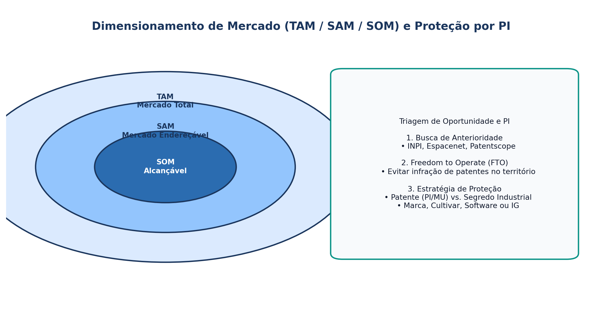

## Visão Geral da Aula {.smaller-text .lesson-slide}

::: {.columns}
::: {.column width="50%"}
### Tópicos

- [1]{.circle} Descoberta vs. Criação de oportunidades (Alvarez & Barney, 2007)
- [2]{.circle} Conhecimento prévio e reconhecimento de padrões (Shane, 2000; Baron, 2006)
- [3]{.circle} Fontes de oportunidades tecnológicas e territoriais (Drucker, 1985)
- [4]{.circle} Critérios de avaliação e triagem de oportunidades (TAM/SAM/SOM)
- [5]{.circle} Propriedade Intelectual e liberdade de operação (*Freedom to Operate*)
:::

::: {.column width="50%"}
::: {.info-box}
**Objetivo da Aula**

Compreender os mecanismos cognitivos, informacionais e institucionais pelos quais **oportunidades de novos negócios** são identificadas ou criadas, e aplicar ferramentas de avaliação de atratividade mercadológica e proteção tecnológica.
:::
:::
:::

# 1 · Natureza das Oportunidades {.section-header rotulo="Oportunidades"}

## Teoria da Descoberta vs. Teoria da Criação (Alvarez & Barney, 2007) {.smaller-text .lesson-slide}

::: {.columns}
::: {.column width="55%"}
### Dois Paradigmas Epistemológicos

| Dimensão | Teoria da Descoberta | Teoria da Criação |
|---|---|---|
| **Natureza da oportunidade** | Existe objetivamente no mercado (choques exógenos) | É construída endogenamente pela ação do empreendedor |
| **Informação** | Assimétrica, mas passível de pesquisa | Incerta; emerge apenas na interação |
| **Estratégia** | Planejamento e análise de risco | Experimentação iterativa e aprendizado |
:::

::: {.column width="45%"}
### Por que pessoas diferentes veem oportunidades diferentes?

- **Conhecimento Prévio (Shane, 2000):** experiências anteriores em mercados, formas de atender clientes e problemas específicos criam **corredores informacionais**.
- **Reconhecimento de Padrões (Baron, 2006):** empreendedores conectam "pontos" aparentemente dispersos (tendências demográficas, regulação ambiental, avanços técnicos).
:::
:::

# 2 · Fontes e Triagem de Oportunidades {.section-header rotulo="Triagem"}

## As 7 Fontes de Inovação (Drucker, 1985) + Sinais Territoriais {.smaller-text .lesson-slide}

::: {.columns}
::: {.column width="50%"}
### Fontes Internas e Externas

1. O **inesperado** (sucesso ou fracasso imprevisto);
2. **Incongruências** entre realidade e expectativa;
3. **Necessidades de processo** (gargalos técnicos);
4. **Mudanças na estrutura** da indústria ou mercado;
5. **Demografia** (envelhecimento, urbanização, migração);
6. **Mudanças de percepção** (ex.: sustentabilidade, rastreabilidade);
7. **Novo conhecimento** científico e não científico.
:::

::: {.column width="50%"}
### Dimensionamento de Mercado: TAM, SAM, SOM

- **TAM (*Total Addressable Market*):** demanda total teórica da solução.
- **SAM (*Serviceable Available Market*):** parcela alcançável pelo modelo de negócio e geografia.
- **SOM (*Serviceable Obtainable Market*):** parcela realista capturável no curto/médio prazo.

::: {.highlight-box}
**Erro Clássico:** Confundir o TAM global com o mercado acessível (SOM) de uma *startup* regional nos primeiros 3 anos.
:::
:::
:::

## Esquema: TAM / SAM / SOM e Proteção por PI {.smaller-text .lesson-slide}

{.fig-full}

# 3 · Proteção e Liberdade de Operação {.section-header rotulo="PI"}

## Propriedade Intelectual na Avaliação de Oportunidades {.smaller-text .lesson-slide}

::: {.columns}
::: {.column width="50%"}
### Ativos Intangíveis Estratégicos

- **Patentes (PI e MU):** exclusividade temporária (20 / 15 anos) mediante divulgação técnica.
- **Segredo Industrial:** proteção sem divulgação enquanto mantido sob sigilo.
- **Cultivares, Marcas, *Software* e Desenho Industrial.**
- **Indicações Geográficas:** proteção coletiva territorial.
:::

::: {.column width="50%"}
### Busca de Anterioridade e FTO

- **Estado da Técnica:** verificar no INPI / Espacenet / Patentscope se a solução já existe antes de investir em P&D.
- **Liberdade de Operação (*Freedom to Operate — FTO*):** garantir que a tecnologia não infringe patentes vigentes de terceiros no território de comercialização.
:::
:::

# 4 · Oficina e Leituras {.section-header rotulo="Oficina"}

## Matriz de Atratividade da Oportunidade (40 min) {.smaller-text .lesson-slide}

::: {.columns}
::: {.column width="55%"}
### Checklist de Avaliação

Para a oportunidade territorial selecionada pelo grupo, pontue de **1 a 5**:

1. Dor do cliente / urgência do problema territorial;
2. Tamanho e crescimento do mercado acessível (SAM/SOM);
3. Vantagem tecnológica ou barreiras de imitação (PI / *know-how*);
4. Viabilidade regulatória e ambiental;
5. Alinhamento com competências da equipe e do ecossistema local.
:::

::: {.column width="45%"}
### Leituras para a Próxima Aula

- **OSTERWALDER, A.; PIGNEUR, Y.** *Business Model Generation* (Parte 1: O Canvas).
- **RIES, E.** *A Startup Enxuta* (Caps. sobre MVP e Aprendizado Validado).
- **BLANK, S.** *Why the Lean Start-Up Changes Everything*. HBR, 2013.
:::
:::
