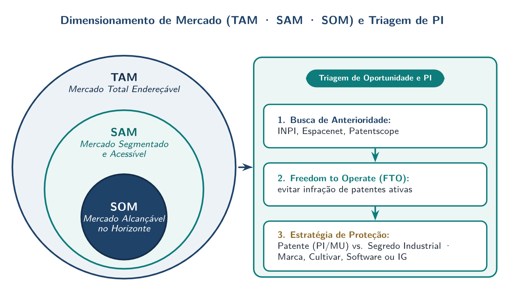

## [Unidade II]{.pitch-tag} Visão Geral da Aula {#visao-geral .smaller-text .lesson-slide}

::: {.pitch-grid-55}
::: {.pitch-card}
[Roteiro da aula · 4 horas]{.pitch-card-index}
[Tópicos estruturantes]{.pitch-heading}

1. Descoberta vs. Criação de oportunidades (Alvarez & Barney, 2007).
2. Conhecimento prévio e reconhecimento de padrões (Shane, 2000; Baron, 2006).
3. Fontes de oportunidades tecnológicas e territoriais (Drucker, 1985).
4. Critérios de avaliação e triagem de oportunidades (TAM/SAM/SOM).
5. Propriedade Intelectual e liberdade de operação (*Freedom to Operate*).
:::

::: {.pitch-stack-2}
::: {.pitch-card .pitch-card--gold}
[Objetivo central]{.pitch-card-index}
[Identificação e triagem]{.pitch-heading}

Compreender os mecanismos cognitivos, informacionais e institucionais pelos quais **oportunidades de novos negócios** são identificadas ou criadas, e aplicar ferramentas de avaliação de atratividade mercadológica e proteção tecnológica.
:::

::: {.pitch-band .pitch-band--teal}
**Critério territorial:** transformar sinais locais e conhecimento científico em oportunidades verificáveis e protegidas.
:::
:::
:::

# 1 · Natureza das Oportunidades {.section-header rotulo="Oportunidades"}

## [Conceito]{.pitch-tag} Descoberta vs. Criação (Alvarez & Barney, 2007) {#descoberta-criacao .smaller-text .lesson-slide}

::: {.pitch-grid-55}
::: {.pitch-table-box}
| Dimensão | Teoria da Descoberta | Teoria da Criação |
|---|---|---|
| **Natureza da oportunidade** | Existe objetivamente no mercado (choques exógenos) | É construída endogenamente pela ação do empreendedor |
| **Informação** | Assimétrica, mas passível de pesquisa | Incerta; emerge apenas na interação |
| **Estratégia** | Planejamento e análise de risco | Experimentação iterativa e aprendizado |
:::

::: {.pitch-stack-2}
::: {.pitch-card .pitch-card--gold}
[Corredores informacionais]{.pitch-card-index}
[Conhecimento Prévio (Shane, 2000)]{.pitch-heading}

Experiências anteriores em mercados, formas de atender clientes e problemas específicos explicam por que atores diferentes veem oportunidades distintas.
:::

::: {.pitch-card .pitch-card--teal}
[Cognição empreendedora]{.pitch-card-index}
[Reconhecimento de Padrões (Baron, 2006)]{.pitch-heading}

Empreendedores conectam "pontos" aparentemente dispersos: tendências demográficas, regulação ambiental e avanços técnicos.
:::
:::
:::

# 2 · Fontes e Triagem de Oportunidades {.section-header rotulo="Triagem"}

## [Método]{.pitch-tag .pitch-tag--teal} As 7 Fontes de Inovação (Drucker) e TAM/SAM/SOM {#fontes-mercado .smaller-text .lesson-slide}

::: {.pitch-grid-50}
::: {.pitch-card}
[Drucker, 1985]{.pitch-card-index}
[Fontes internas e externas de sinais]{.pitch-heading}

1. O **inesperado** (sucesso ou fracasso imprevisto);
2. **Incongruências** entre realidade e expectativa;
3. **Necessidades de processo** (gargalos técnicos);
4. **Mudanças na estrutura** da indústria ou mercado;
5. **Demografia** (envelhecimento, urbanização, migração);
6. **Mudanças de percepção** (sustentabilidade, rastreabilidade);
7. **Novo conhecimento** científico e não científico.
:::

::: {.pitch-stack-2}
::: {.pitch-card .pitch-card--gold}
[Dimensionamento]{.pitch-card-index}
[Funil TAM · SAM · SOM]{.pitch-heading}

- **TAM (*Total Addressable Market*):** demanda total teórica da solução.
- **SAM (*Serviceable Available Market*):** parcela alcançável pelo modelo de negócio e geografia.
- **SOM (*Serviceable Obtainable Market*):** parcela realista capturável no curto e médio prazo.
:::

::: {.pitch-band}
**Erro Clássico:** confundir o TAM global com o mercado acessível (SOM) de uma *startup* regional nos primeiros 3 anos.
:::
:::
:::

## [Síntese]{.pitch-tag .pitch-tag--teal} Esquema: TAM / SAM / SOM e Triagem de PI {#esquema-tam-pi .smaller-text .lesson-slide}

::: {.pitch-media-card .pitch-media-card--tall}

[Do funil de mercado à estratégia de Propriedade Intelectual]{.pitch-caption}
[Integração entre recorte realista de demanda (SOM) e verificação prévia de anterioridade e FTO]{.pitch-caption-sub}
:::

::: {.pitch-band .pitch-band--navy}
A atratividade de uma oportunidade territorial exige convergência entre mercado acessível comprovável e liberdade jurídica para operar.
:::

# 3 · Proteção e Liberdade de Operação {.section-header rotulo="PI"}

## [Conceito]{.pitch-tag} Propriedade Intelectual na Avaliação de Oportunidades {#propriedade-intelectual .smaller-text .lesson-slide}

::: {.pitch-cards-2}
::: {.pitch-card}
[Apropriabilidade tecnológica]{.pitch-card-index}
[Ativos intangíveis estratégicos]{.pitch-heading}

- **Patentes (PI e MU):** exclusividade temporária (20 / 15 anos) mediante divulgação técnica.
- **Segredo Industrial:** proteção sem divulgação enquanto mantido sob sigilo.
- **Cultivares, Marcas, *Software* e Desenho Industrial.**
- **Indicações Geográficas:** proteção coletiva territorial.
:::

::: {.pitch-card .pitch-card--gold}
[Due diligence técnica]{.pitch-card-index}
[Busca de anterioridade e FTO]{.pitch-heading}

- **Estado da Técnica:** verificar no INPI, Espacenet e Patentscope se a solução já existe antes de investir em P&D.
- **Liberdade de Operação (*Freedom to Operate — FTO*):** garantir que a tecnologia não infringe patentes vigentes de terceiros no território de comercialização.
:::
:::

::: {.pitch-band .pitch-band--teal}
**Atenção prática:** publicar artigo ou apresentar protótipo antes do depósito pode destruir o requisito de novidade da patente.
:::

# 4 · Oficina e Leituras {.section-header rotulo="Oficina"}

## [Método]{.pitch-tag .pitch-tag--teal} Matriz de Atratividade da Oportunidade (40 min) {#oficina-atratividade .smaller-text .lesson-slide}

::: {.pitch-grid-55}
::: {.pitch-card}
[Checklist de avaliação · escala 1 a 5]{.pitch-card-index}
[Critérios para a oportunidade territorial]{.pitch-heading}

1. **Dor do cliente:** urgência real do problema territorial;
2. **Mercado acessível:** tamanho e crescimento do SAM/SOM;
3. **Vantagem técnica:** barreiras de imitação (PI ou *know-how*);
4. **Viabilidade:** aderência regulatória e ambiental;
5. **Alinhamento:** aderência às competências da equipe e do ecossistema local.
:::

::: {.pitch-card .pitch-card--teal}
[Preparação · Aula 09]{.pitch-card-index}
[Leituras para a próxima aula]{.pitch-heading}

- **OSTERWALDER, A.; PIGNEUR, Y.** *Business Model Generation* (Parte 1: O Canvas).
- **RIES, E.** *A Startup Enxuta* (Caps. sobre MVP e Aprendizado Validado).
- **BLANK, S.** *Why the Lean Start-Up Changes Everything*. HBR, 2013.
:::
:::
