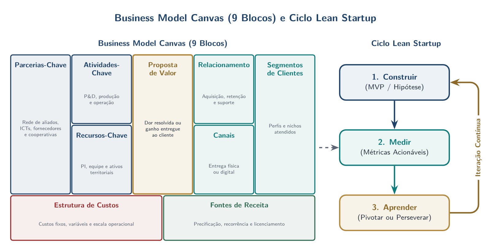

## [Unidade II]{.pitch-tag} Visão Geral da Aula {#visao-geral .smaller-text .lesson-slide}

::: {.pitch-grid-55}
::: {.pitch-card}
[Roteiro da aula · 4 horas]{.pitch-card-index}
[Tópicos estruturantes]{.pitch-heading}

1. Conceito de Modelo de Negócio (Chesbrough & Rosenbloom; Teece, 2010).
2. *Business Model Canvas* (Osterwalder & Pigneur, 2010).
3. Proposta de Valor e ajuste produto–mercado (*Value Proposition Canvas*).
4. *Lean Startup*, MVP e *Customer Development* (Blank; Ries).
5. Adaptações para negócios de impacto e base tecnológica territorial.
:::

::: {.pitch-stack-2}
::: {.pitch-card .pitch-card--gold}
[Objetivo central]{.pitch-card-index}
[Arquitetura de valor]{.pitch-heading}

Estruturar a lógica de **criação, entrega e captura de valor** em empreendimentos tecnológicos e de impacto, articulando o *Business Model Canvas* aos métodos ágeis de validação de hipóteses no território.
:::

::: {.pitch-band .pitch-band--teal}
**Desdobramento prático:** articulada à oficina complementar [09a · Pitch Canvas](../09a_pitch_canvas/09a_pitch_canvas.html).
:::
:::
:::

# 1 · Arquitetura do Modelo de Negócio {.section-header rotulo="Conceito"}

## [Conceito]{.pitch-tag} Tecnologia não gera valor sozinha (Chesbrough & Rosenbloom, 2002) {#modelo-negocio-conceito .smaller-text .lesson-slide}

::: {.pitch-cards-2}
::: {.pitch-card}
[Teece, 2010]{.pitch-card-index}
[O papel mediador do modelo de negócio]{.pitch-heading}

- Uma mesma tecnologia gera resultados distintos conforme o **modelo de negócio** (venda de equipamento vs. *Software as a Service* — SaaS vs. licenciamento de PI).
- **Três funções centrais:**
  1. **Criar valor** para segmentos de clientes definidos;
  2. **Entregar valor** via canais, parceiros e operações;
  3. **Capturar valor** convertendo benefícios em receitas sustentáveis.
:::

::: {.pitch-card .pitch-card--gold}
[Arquétipos tecnológicos]{.pitch-card-index}
[Padrões de captura de valor]{.pitch-heading}

- **Plataformas multilaterais:** conectam produtores locais e compradores (ex.: *marketplaces* agrícolas).
- ***Freemium* / Assinatura (SaaS):** receita recorrente e baixo custo marginal.
- **Isca e anzol (*Razor and Blade*):** equipamento subsidiado + insumo ou serviço recorrente.
- **Licenciamento de PI:** captura de *royalties* sem imobilizar capital em fábrica.
:::
:::

::: {.pitch-band .pitch-band--navy}
Inovação tecnológica sem desenho consistente de modelo de negócio permanece presa ao laboratório como invenção sem adoção.
:::

# 2 · Canvas e Proposta de Valor {.section-header rotulo="Canvas"}

## [Método]{.pitch-tag .pitch-tag--teal} Os 9 Blocos do Canvas e o Ajuste ao Cliente {#canvas-vpc .smaller-text .lesson-slide}

::: {.pitch-grid-55}
::: {.pitch-stack-2}
::: {.pitch-table-box}
| Lado da Eficiência | Centro | Lado do Valor |
|---|---|---|
| Parcerias-Chave | **Proposta de Valor** | Relacionamento |
| Atividades-Chave | | Canais |
| Recursos-Chave | | Segmentos de Clientes |
| **Estrutura de Custos** | | **Fontes de Receita** |
:::

::: {.pitch-band .pitch-band--teal}
**Canvas Social / B:** para negócios de impacto territorial, acrescentam-se **Impacto Socioambiental Gerado** e distinção entre **Beneficiários vs. Pagadores**.
:::
:::

::: {.pitch-card .pitch-card--gold}
[Value Proposition Canvas]{.pitch-card-index}
[Encaixe produto–mercado (*Fit*)]{.pitch-heading}

- **Perfil do Cliente:** Tarefas (*Jobs*), Dores (*Pains*) e Ganhos (*Gains*).
- **Mapa de Valor:** Produtos/Serviços, Analgésicos (*Pain Relievers*) e Criadores de Ganho (*Gain Creators*).
- **Encaixe (*Fit*):** ocorre quando os atributos técnicos da solução resolvem dores reais e mensuráveis no território.
:::
:::

## [Síntese]{.pitch-tag .pitch-tag--teal} Esquema: Business Model Canvas e Ciclo Lean {#esquema-canvas-lean .smaller-text .lesson-slide}

::: {.pitch-media-card .pitch-media-card--tall}

[Arquitetura dos 9 blocos integrada ao ciclo Construir–Medir–Aprender]{.pitch-caption}
[Eficiência interna, proposta de valor e mercado testados continuamente em campo]{.pitch-caption-sub}
:::

::: {.pitch-band .pitch-band--navy}
O Canvas organiza as hipóteses iniciais do negócio; o ciclo *Lean Startup* submete cada bloco ao teste empírico com usuários reais.
:::

# 3 · Validação Enxuta (Lean Startup) {.section-header rotulo="Validação"}

## [Território]{.pitch-tag .pitch-tag--gold} Customer Development e Ciclo Construir–Medir–Aprender {#lean-startup .smaller-text .lesson-slide}

::: {.pitch-cards-2}
::: {.pitch-card}
[Blank, 2013 · Ries]{.pitch-card-index}
[Princípios da validação enxuta]{.pitch-heading}

- *"Nenhum plano de negócios sobrevive ao primeiro contato com o cliente"* (Blank, 2013).
- **Sair do prédio (*Get Out of the Building*):** testar hipóteses críticas antes de construir a solução definitiva.
- **MVP (Produto Mínimo Viável):** menor versão do produto que permite percorrer o ciclo **Construir $\rightarrow$ Medir $\rightarrow$ Aprender** com mínimo esforço.
:::

::: {.pitch-card .pitch-card--teal}
[Critério de decisão]{.pitch-card-index}
[Pivotar ou perseverar?]{.pitch-heading}

- **Aprendizado validado:** métricas acionáveis (taxa de conversão, retenção, disposição a pagar) em vez de "métricas de vaidade" (curtidas, visitas).
- **Cuidado em *Deep Tech*:** quando a tecnologia exige validação laboratorial ou regulatória prévia, o MVP começa pela **validação do problema e da disposição a pagar** com clientes-piloto.
:::
:::

::: {.pitch-band}
No contexto territorial, *sair do prédio* significa dialogar com associações, gestores públicos, produtores e compradores antes da imobilização de capital.
:::

# 4 · Oficina e Leituras {.section-header rotulo="Oficina"}

## [Método]{.pitch-tag .pitch-tag--teal} Oficina de Canvas + Plano de Validação (45 min) {#oficina-canvas .smaller-text .lesson-slide}

::: {.pitch-grid-55}
::: {.pitch-milestones}
::: {.pitch-milestone-item}
**01 · Quadro inicial:** preencha os 9 blocos do **Canvas** para o seu empreendimento territorial distinguindo fatos de suposições.
:::

::: {.pitch-milestone-item}
**02 · Hipótese mais arriscada:** identifique qual premissa, se falhar, invalida toda a lógica de valor ou de receita.
:::

::: {.pitch-milestone-item}
**03 · MVP em 15 dias e métrica:** defina um teste de baixo custo no território e o critério objetivo que confirmará ou refutará a hipótese.
:::
:::

::: {.pitch-card .pitch-card--teal}
[Preparação · Aula 10]{.pitch-card-index}
[Leituras para a próxima aula]{.pitch-heading}

- **DORNELAS, J. C. A.** *Empreendedorismo: transformando ideias em negócios* (Caps. sobre Plano de Negócios).
- **BYERS, T.; DORF, R.; NELSON, A.** *Technology ventures* (Caps. 18 e 19: Fontes de Financiamento).
- Editais vigentes de subvenção econômica (**FINEP / FAPESB**).
:::
:::
