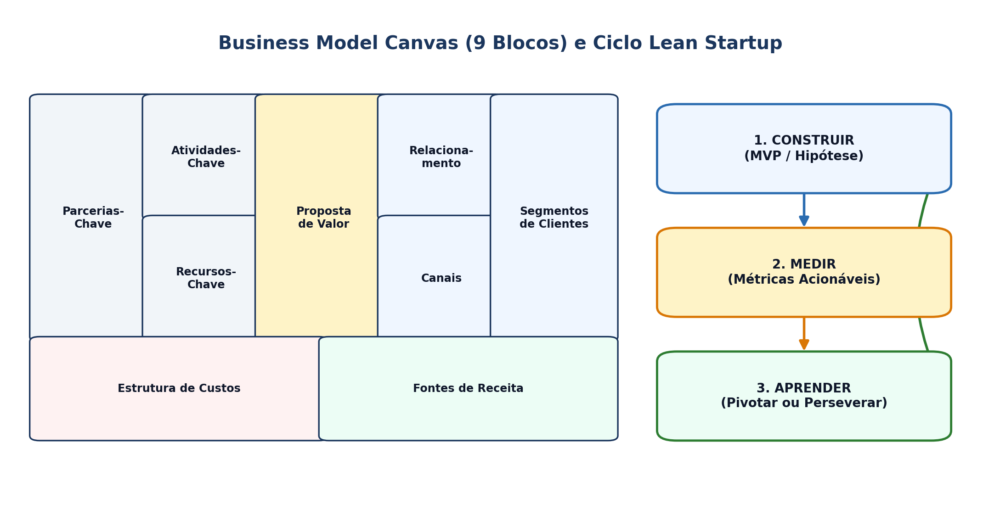

## Visão Geral da Aula {.smaller-text .lesson-slide}

::: {.columns}
::: {.column width="50%"}
### Tópicos

- [1]{.circle} Conceito de Modelo de Negócio (Chesbrough & Rosenbloom; Teece, 2010)
- [2]{.circle} *Business Model Canvas* (Osterwalder & Pigneur, 2010)
- [3]{.circle} Proposta de Valor e ajuste produto–mercado (*Value Proposition Canvas*)
- [4]{.circle} *Lean Startup*, MVP e *Customer Development* (Blank; Ries)
- [5]{.circle} Adaptações para negócios de impacto e base tecnológica territorial
:::

::: {.column width="50%"}
::: {.info-box}
**Objetivo da Aula**

Estruturar a lógica de **criação, entrega e captura de valor** em empreendimentos tecnológicos e de impacto, articulando o *Business Model Canvas* aos métodos ágeis de validação de hipóteses no território.
:::
:::
:::

# 1 · Arquitetura do Modelo de Negócio {.section-header rotulo="Conceito"}

## Tecnologia Não Gera Valor Sozinha (Chesbrough & Rosenbloom, 2002) {.smaller-text .lesson-slide}

::: {.columns}
::: {.column width="50%"}
### O Papel Mediador do Modelo de Negócio

- Uma mesma tecnologia pode gerar resultados econômicos completamente distintos dependendo do **modelo de negócio** adotado (ex.: venda de equipamento vs. *Software as a Service* — SaaS vs. licenciamento de PI).
- **Três funções centrais (Teece, 2010):**
  1. **Criar valor** para segmentos de clientes definidos;
  2. **Entregar valor** via canais, parceiros e operações;
  3. **Capturar valor** convertendo benefícios em receitas sustentáveis.
:::

::: {.column width="50%"}
### Padrões de Modelos Tecnológicos

- **Plataformas multilaterais:** conectam produtores locais e compradores (ex.: *marketplaces* agrícolas).
- ***Freemium* / Assinatura (SaaS):** receita recorrente e baixo custo marginal.
- **Isca e anzol (*Razor and Blade*):** equipamento subsidiado + insumo/serviço recorrente.
- **Licenciamento de PI:** captura de *royalties* sem imobilizar capital em fábrica.
:::
:::

# 2 · Canvas e Proposta de Valor {.section-header rotulo="Canvas"}

## Os 9 Blocos e o Ajuste ao Cliente {.smaller-text .lesson-slide}

::: {.columns}
::: {.column width="55%"}
### *Business Model Canvas* (Osterwalder & Pigneur, 2010)

| Lado da Eficiência (Infraestrutura) | Centro | Lado do Valor (Mercado) |
|---|---|---|
| Parcerias-Chave | **Proposta de Valor** | Relacionamento |
| Atividades-Chave | | Canais |
| Recursos-Chave | | Segmentos de Clientes |
| **Estrutura de Custos** | | **Fontes de Receita** |

- **Para Negócios de Impacto (Canvas Social/B):** acrescentam-se blocos de **Impacto Socioambiental Gerado** e **Beneficiários vs. Pagadores**.
:::

::: {.column width="45%"}
### *Value Proposition Canvas*

- **Perfil do Cliente:** Tarefas (*Jobs*), Dores (*Pains*) e Ganhos (*Gains*).
- **Mapa de Valor:** Produtos/Serviços, Analgésicos (*Pain Relievers*) e Criadores de Ganho (*Gain Creators*).
- **Encaixe (*Fit*):** ocorre quando os atributos técnicos da solução resolvem dores reais e mensuráveis.
:::
:::

## Esquema: Business Model Canvas e Ciclo Lean {.smaller-text .lesson-slide}

{.fig-full}

# 3 · Validação Enxuta (Lean Startup) {.section-header rotulo="Validação"}

## *Customer Development* e Ciclo Construir–Medir–Aprender {.smaller-text .lesson-slide}

::: {.columns}
::: {.column width="50%"}
### Princípios de Steve Blank & Eric Ries

- *"Nenhum plano de negócios sobrevive ao primeiro contato com o cliente"* (Blank, 2013).
- **Sair do prédio (*Get Out of the Building*):** testar hipóteses críticas antes de construir a solução definitiva.
- **MVP (Produto Mínimo Viável):** menor versão do produto que permite percorrer o ciclo **Construir $\rightarrow$ Medir $\rightarrow$ Aprender** com mínimo esforço.
:::

::: {.column width="50%"}
### Pivotar ou Perseverar?

- **Aprendizado validado:** métricas acionáveis (taxa de conversão, retenção, disposição a pagar) em vez de "métricas de vaidade" (curtidas, visitas).
- **Cuidado em *Deep Tech*:** quando a tecnologia exige validação laboratorial/regulatória prévia, o MVP começa pela **validação do problema e da disposição a pagar** com clientes-piloto.
:::
:::

# 4 · Oficina e Leituras {.section-header rotulo="Oficina"}

## Oficina de Canvas + Plano de Validação (45 min) {.smaller-text .lesson-slide}

::: {.columns}
::: {.column width="55%"}
### Construção em Sala

Preencha os 9 blocos do **Canvas** para o seu empreendimento territorial e defina:

1. Qual é a **hipótese mais arriscada** do modelo (sem a qual tudo desmorona)?
2. Qual **MVP de baixo custo** pode testar essa hipótese em 15 dias no território?
3. Qual métrica objetiva confirmará ou refutará a hipótese?
:::

::: {.column width="45%"}
### Leituras para a Próxima Aula

- **DORNELAS, J. C. A.** *Empreendedorismo: transformando ideias em negócios* (Caps. sobre Plano de Negócios).
- **BYERS, T.; DORF, R.; NELSON, A.** *Technology ventures* (Caps. 18 e 19: Fontes de Financiamento).
- Editais vigentes de subvenção econômica (FINEP / FAPESB).
:::
:::
