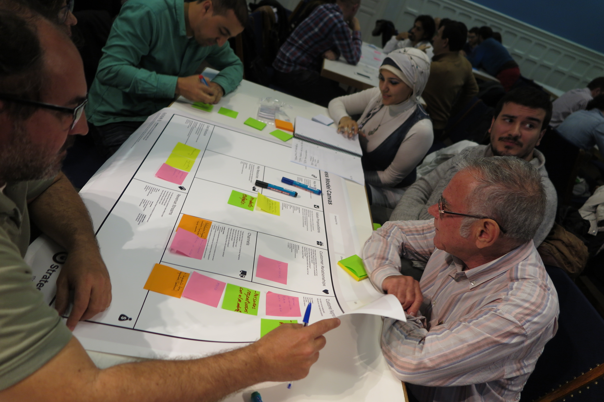
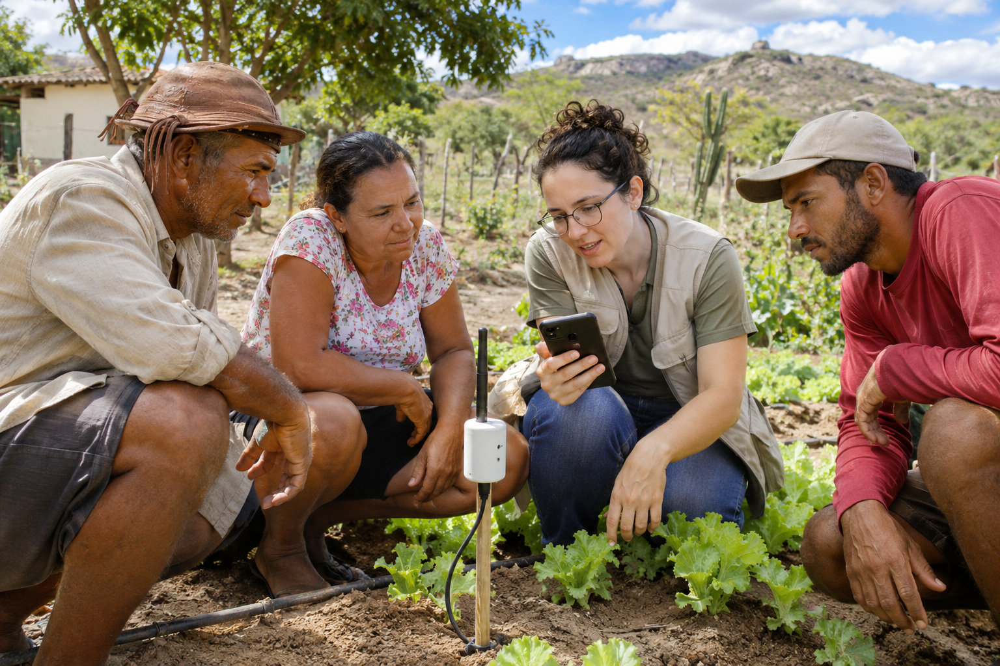
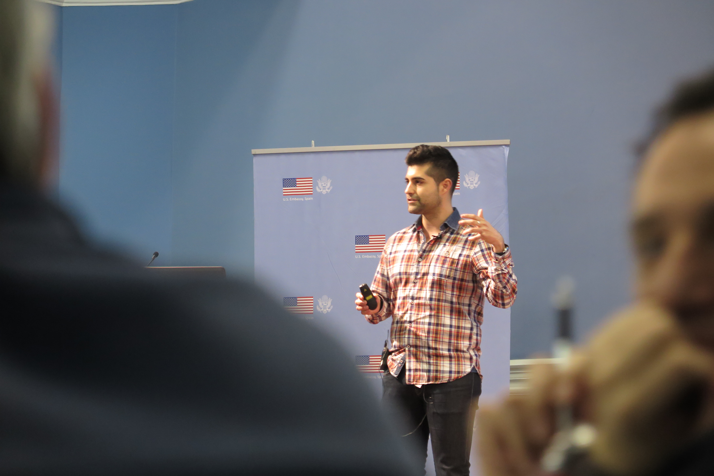
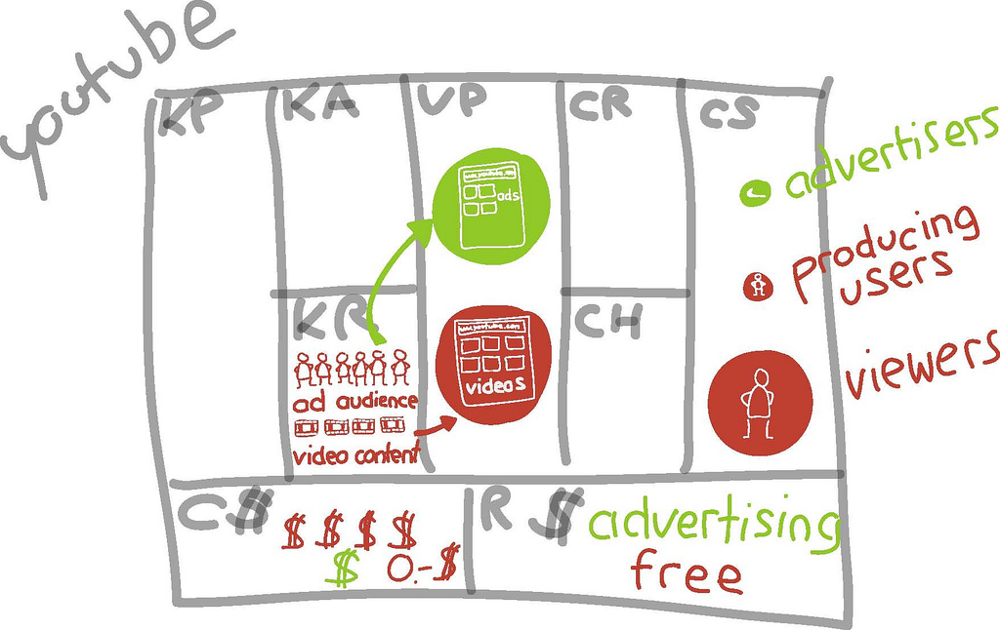
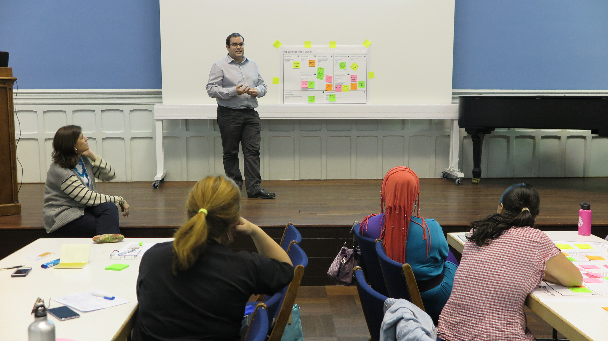
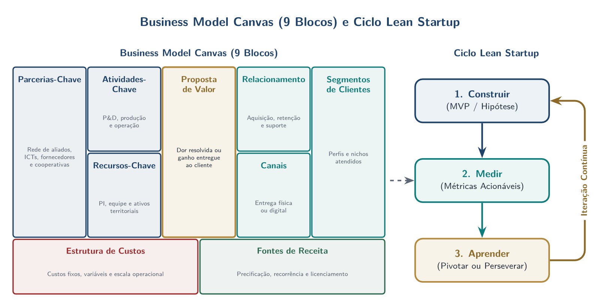

## [Abertura]{.pitch-tag} Objetivo e resultado da oficina {.smaller-text .lesson-slide}

::: {.columns}
::: {.column width="48%"}
::: {.pitch-card}
[Objetivo da oficina]{.pitch-card-index}
[Transformar modelo em mensagem clara]{.pitch-heading}

Estruturar uma apresentação curta, compreensível e fundamentada a partir da lógica de valor do negócio, conectando o quadro conceitual à fala de três minutos.
:::

::: {.pitch-pill-row}
[Quadro preenchido]{.pitch-pill}
[Pitch de 3 minutos]{.pitch-pill .pitch-pill--gold}
[Plano de validação]{.pitch-pill}
:::

::: {.pitch-band}
Esta oficina complementa os nove blocos trabalhados na **Aula 09**, traduzindo estratégia em evidência e pedido objetivo.
:::
:::
::: {.column width="52%"}
::: {.pitch-media-card .pitch-media-card--photo}

[Trabalho colaborativo com Business Model Canvas]{.pitch-caption}
[US Embassy Madrid, 2016 · CC BY 2.0 · exibição recortada]{.pitch-caption-sub}
:::
:::
:::

# 1 · Do modelo à mensagem {.section-header rotulo="Preparação"}

## [Preparação]{.pitch-tag} Canvas e pitch cumprem funções diferentes {.smaller-text .lesson-slide}

::: {.pitch-cards}
::: {.pitch-card}
[01 · Modelo]{.pitch-card-index}
[Arquitetura de valor]{.pitch-heading}

Organiza internamente como o empreendimento cria, entrega e captura valor com recursos, canais e parceiros.
:::

::: {.pitch-card .pitch-card--gold}
[02 · Pitch]{.pitch-card-index}
[Comunicação estratégica]{.pitch-heading}

Sintetiza problema, oportunidade e evidências em poucos minutos para pedir uma ação ou parceria concreta.
:::

::: {.pitch-card .pitch-card--teal}
[03 · Validação]{.pitch-card-index}
[Teste empírico]{.pitch-heading}

Confronta suposições de mercado, preço e adoção com entrevistas de campo e protótipos reais.
:::
:::

::: {.pitch-band .pitch-band--navy}
O quadro de pitch organiza a narrativa da apresentação. Os oito blocos desta oficina compõem uma adaptação didática do Canvas.
:::

## [Preparação]{.pitch-tag} Comece pelo problema e pelo contexto {.smaller-text .lesson-slide}

::: {.pitch-flow-4}
::: {.pitch-card}
[01]{.pitch-card-index}
[Quem?]{.pitch-heading}

Pessoa, grupo ou organização afetada.
:::

::: {.pitch-card .pitch-card--gold}
[02]{.pitch-card-index}
[Onde?]{.pitch-heading}

Situação concreta e recorte territorial.
:::

::: {.pitch-card}
[03]{.pitch-card-index}
[Qual dificuldade?]{.pitch-heading}

Custo, perda ou gargalo percebido.
:::

::: {.pitch-card .pitch-card--gold}
[04]{.pitch-card-index}
[Como resolve?]{.pitch-heading}

Alternativa atual e suas limitações.
:::
:::

::: {.pitch-band}
**Pergunta de partida:** que evidência observável indica que esse problema realmente importa para o público escolhido?
:::

::: {.pitch-source}
Nota pedagógica: na aula de referência (Márcia May, 2023), proposta de valor, clientes e receitas iniciam o percurso, articulados aos demais blocos.
:::

## [Preparação]{.pitch-tag} Defina a pessoa e o contexto territorial {.smaller-text .lesson-slide}

::: {.columns}
::: {.column width="49%"}
::: {.pitch-stack-2}
::: {.pitch-card}
[Recorte inicial]{.pitch-card-index}
[Primeiro segmento prioritário]{.pitch-heading}

Considere atividade econômica, território, condições reais de uso, rotinas operacionais e capacidade de decisão ou pagamento.
:::

::: {.pitch-card .pitch-card--gold}
[Exemplo didático]{.pitch-card-index}
[Associações rurais no semiárido]{.pitch-heading}

Associação de produtores familiares que precisa monitorar a umidade do solo em áreas com conexão intermitente à internet.
:::
:::

::: {.pitch-band}
**Atenção analítica:** cliente, usuário, beneficiário e pagador nem sempre são a mesma pessoa no território.
:::
:::
::: {.column width="51%"}
::: {.pitch-media-card .pitch-media-card--photo}

[Validação em ambiente real de cultivo]{.pitch-caption}
[Imagem ilustrativa gerada por IA para contextualização da oficina]{.pitch-caption-sub}
:::
:::
:::

## [Preparação]{.pitch-tag} Proposta de valor em uma frase {.smaller-text .lesson-slide}

::: {.pitch-formula}
**Para** [segmento definido] · **que enfrenta** [problema específico e mensurável]

**Oferecemos** [solução tecnológica ou serviço] · **que permite** [benefício concreto no uso]

**Nossa diferença:** [atributo verificável frente às alternativas existentes]
:::

::: {.pitch-cards}
::: {.pitch-card}
[Critério 1]{.pitch-card-index}
[Compreensão imediata]{.pitch-heading}

Um interlocutor fora da equipe entende a frase em uma leitura?
:::

::: {.pitch-card .pitch-card--gold}
[Critério 2]{.pitch-card-index}
[Relevância real]{.pitch-heading}

O benefício resolve uma dor prioritária ou apenas desejável?
:::

::: {.pitch-card .pitch-card--teal}
[Critério 3]{.pitch-card-index}
[Comparação justa]{.pitch-heading}

O atributo declarado supera o que o público já utiliza hoje?
:::
:::

## [Preparação]{.pitch-tag} Uma fala curta começa com clareza {.smaller-text .lesson-slide}

::: {.columns}
::: {.column width="48%"}
::: {.pitch-card}
[Estrutura de elevador]{.pitch-card-index}
[Sequência lógica em 4 passos]{.pitch-heading}

**01 · Quem?** Público recortado no território.

**02 · Problema?** Dificuldade concreta enfrentada.

**03 · Solução?** Oferta objetiva sem jargão técnico.

**04 · Benefício?** Ganho prático para quem decide.
:::

::: {.pitch-band}
Explique o projeto como quem conversa com um parceiro interessado que ainda não conhece sua área técnica.
:::
:::
::: {.column width="52%"}
::: {.pitch-media-card .pitch-media-card--photo}

[Comunicação objetiva em oficina de empreendedorismo]{.pitch-caption}
[US Embassy Madrid, 2016 · CC BY 2.0 · exibição recortada]{.pitch-caption-sub}
:::
:::
:::

## [Preparação]{.pitch-tag} Um exemplo para transformar em pitch {.smaller-text .lesson-slide}

::: {.columns}
::: {.column width="48%"}
::: {.pitch-card}
[Caso da aula de referência]{.pitch-card-index}
[O berço que virou estante]{.pitch-heading}

Para ilustrar como traduzir um produto em proposta clara, a professora parte de um móvel infantil reaproveitado após o crescimento da criança.

**Público inicial:** famílias com móveis infantis parados que buscam mobília funcional para novas fases.
:::
:::
::: {.column width="52%"}
::: {.pitch-card .pitch-card--gold}
[Hipóteses derivadas]{.pitch-card-index}
[Da ideia à verificação]{.pitch-heading}

**Proposta declarada:** transformar o berço original em estante modular aproveitando a estrutura existente.

**Pontos a investigar:** interesse real das famílias, custo de adaptação, logística de retirada ou entrega e disposição a pagar.
:::

::: {.pitch-band}
Benefício anunciado antes do contato com potenciais usuários é sempre **hipótese**, jamais fato comprovado.
:::
:::
:::

# 2 · Construção do quadro {.section-header rotulo="Pitch Canvas"}

## [Pitch Canvas]{.pitch-tag .pitch-tag--gold} Como o Canvas é usado em uma oficina {.smaller-text .lesson-slide}

::: {.columns}
::: {.column width="58%"}
::: {.pitch-media-card .pitch-media-card--photo .pitch-media-card--wide}

[Construção iterativa com notas adesivas]{.pitch-caption}
[US Embassy Madrid, 2016 · CC BY 2.0 · exibição recortada]{.pitch-caption-sub}
:::
:::
::: {.column width="42%"}
### Dinâmica de construção

::: {.pitch-milestones}
::: {.pitch-milestone-item}
**01 · Escrever:** registre uma ideia objetiva por cartão ou nota adesiva.
:::

::: {.pitch-milestone-item}
**02 · Agrupar:** posicione cada nota no bloco correspondente da lógica de valor.
:::

::: {.pitch-milestone-item}
**03 · Discutir:** identifique lacunas, suposições ocultas e vínculos entre blocos.
:::

::: {.pitch-milestone-item}
**04 · Revisar:** ajuste o quadro após ouvir potenciais usuários ou mentores.
:::
:::
:::
:::

## [Pitch Canvas]{.pitch-tag .pitch-tag--gold} Um Canvas preenchido: YouTube {.smaller-text .lesson-slide}

::: {.columns}
::: {.column width="60%"}
::: {.pitch-media-card .pitch-media-card--wide}

[Esboço histórico didático (Osterwalder, 2010)]{.pitch-caption}
[CC BY 2.0 · imagem original sem alteração]{.pitch-caption-sub}
:::
:::
::: {.column width="40%"}
### Leitura rápida

::: {.pitch-milestones}
::: {.pitch-milestone-item}
**Públicos:** plataforma multilateral unindo criadores de vídeo, audiência e anunciantes.
:::

::: {.pitch-milestone-item}
**Valor entregue:** hospedagem e alcance gratuito ao usuário; visibilidade segmentada ao anunciante.
:::

::: {.pitch-milestone-item}
**Receita no esboço:** publicidade sustenta a infraestrutura sem cobrar do espectador.
:::
:::

::: {.pitch-source}
Retrato conceitual de época, utilizado para compreender lógica de blocos, sem descrever o portfólio atual completo da empresa.
:::
:::
:::

## [Pitch Canvas]{.pitch-tag .pitch-tag--gold} Quadro de pitch da oficina (8 blocos) {.smaller-text .lesson-slide}

::: {.pitch-canvas}
::: {.pitch-card}
[01 · Público e problema]{.pitch-card-index}
[Dor prioritária]{.pitch-heading}

Quem enfrenta qual dificuldade relevante?
:::
::: {.pitch-card .pitch-card--gold}
[02 · Solução e valor]{.pitch-card-index}
[Oferta prática]{.pitch-heading}

O que oferecemos e com qual benefício mensurável?
:::
::: {.pitch-card}
[03 · Diferencial]{.pitch-card-index}
[Alternativas]{.pitch-heading}

Que opções existem hoje e onde superamos?
:::
::: {.pitch-card .pitch-card--gold}
[04 · Mercado]{.pitch-card-index}
[Entrada territorial]{.pitch-heading}

Qual segmento alcançaremos primeiro?
:::
::: {.pitch-card .pitch-card--teal}
[05 · Receita]{.pitch-card-index}
[Captura de valor]{.pitch-heading}

Quem paga, pelo quê e em qual frequência?
:::
::: {.pitch-card .pitch-card--gold}
[06 · Evidências]{.pitch-card-index}
[Fatos vs. hipóteses]{.pitch-heading}

O que já testamos e o que falta comprovar?
:::
::: {.pitch-card .pitch-card--teal}
[07 · Equipe]{.pitch-card-index}
[Capacidade]{.pitch-heading}

Quem executa e qual é o próximo marco?
:::
::: {.pitch-card .pitch-card--gold}
[08 · Pedido]{.pitch-card-index}
[Próxima ação]{.pitch-heading}

Que apoio específico buscamos ao final?
:::
:::

::: {.pitch-band}
Os blocos 01 a 04 explicam a **oportunidade**; os blocos 05 a 08 demonstram **viabilidade, tração e propósito da conversa**.
:::

## [Pitch Canvas]{.pitch-tag .pitch-tag--gold} Exemplo preenchido: irrigação rural {.smaller-text .lesson-slide}

::: {.pitch-canvas}
::: {.pitch-card}
[01 · Público e problema]{.pitch-card-index}
[Irrigação comunitária]{.pitch-heading}

Associações rurais precisam decidir quando e quanto irrigar.
:::
::: {.pitch-card .pitch-card--gold}
[02 · Solução e valor]{.pitch-card-index}
[Monitoramento]{.pitch-heading}

Sensores de solo e alertas simples para apoiar a decisão.
:::
::: {.pitch-card}
[03 · Diferencial]{.pitch-card-index}
[Conectividade rural]{.pitch-heading}

Operação proposta mesmo sob conexão intermitente.
:::
::: {.pitch-card .pitch-card--gold}
[04 · Mercado]{.pitch-card-index}
[Foco inicial]{.pitch-heading}

Primeiras associações de um território rural delimitado.
:::
::: {.pitch-card .pitch-card--teal}
[05 · Receita]{.pitch-card-index}
[Modelo a validar]{.pitch-heading}

Assinatura pelo serviço de monitoramento (hipótese).
:::
::: {.pitch-card .pitch-card--gold}
[06 · Evidências]{.pitch-card-index}
[Estágio atual]{.pitch-heading}

Entrevistas iniciais e protótipo de bancada a testar em campo.
:::
::: {.pitch-card .pitch-card--teal}
[07 · Equipe]{.pitch-card-index}
[Competências]{.pitch-heading}

Manejo agrícola integrado a hardware e dados ambientais.
:::
::: {.pitch-card .pitch-card--gold}
[08 · Pedido]{.pitch-card-index}
[Parceria piloto]{.pitch-heading}

Abertura de associação parceira para entrevistas e teste de uso.
:::
:::

::: {.pitch-source}
Caso fictício formulado para a oficina. Benefícios operacionais, dimensionamento de mercado e disposição a pagar permanecem como hipóteses para validação.
:::

## [Pitch Canvas]{.pitch-tag .pitch-tag--gold} 1 · Público e problema {.smaller-text .lesson-slide}

::: {.pitch-cards}
::: {.pitch-card}
[Recorte]{.pitch-card-index}
[Quem?]{.pitch-heading}

Qual segmento específico sofre primeiro com o problema e possui urgência de resolução?
:::

::: {.pitch-card .pitch-card--gold}
[Evidência]{.pitch-card-index}
[Qual problema?]{.pitch-heading}

Em que momento do dia ou da safra o problema ocorre e qual consequência financeira ou produtiva gera?
:::

::: {.pitch-card .pitch-card--teal}
[Linha de base]{.pitch-card-index}
[Alternativa atual]{.pitch-heading}

Como as pessoas contornam a falha hoje, quanto gastam e por que continuam insatisfeitas?
:::
:::

::: {.pitch-band}
**Teste prático em campo:** peça aos entrevistados que descrevam exemplos concretos da última semana ou da última safra, evitando opiniões genéricas.
:::

## [Pitch Canvas]{.pitch-tag .pitch-tag--gold} 2 · Solução, benefício e diferencial {.smaller-text .lesson-slide}

::: {.pitch-formula}
**Solução:** qual artefato físico, software ou serviço técnico colocamos nas mãos do usuário?

**Benefício:** que mudança verificável o uso produz em custo, tempo, produtividade ou segurança hídrica?

**Diferencial:** qual barreira técnica ou adaptação territorial impede que soluções tradicionais façam o mesmo?
:::

::: {.pitch-cards-2}
::: {.pitch-card}
[Ilustração territorial]{.pitch-card-index}
[Conexão intermitente]{.pitch-heading}

Sensores com armazenamento local e envio por janela de sinal evitam perda de dados na propriedade rural.
:::

::: {.pitch-card .pitch-card--gold}
[Regra de ouro]{.pitch-card-index}
[Não prometer além do testado]{.pitch-heading}

Enquanto não houver ensaio de campo, apresente o ganho esperado como **meta técnica**, não como economia garantida.
:::
:::

## [Pitch Canvas]{.pitch-tag .pitch-tag--gold} 3 · Mercado e receita {.smaller-text .lesson-slide}

::: {.pitch-cards}
::: {.pitch-card}
[Foco inicial]{.pitch-card-index}
[Mercado acessível]{.pitch-heading}

Quem podemos alcançar primeiro com a equipe, canais e recursos disponíveis neste semestre?
:::

::: {.pitch-card .pitch-card--gold}
[Captura de valor]{.pitch-card-index}
[Fonte de receita]{.pitch-heading}

Quem paga, por qual unidade de entrega (equipamento, assinatura ou licenciamento) e com que periodicidade?
:::

::: {.pitch-card .pitch-card--teal}
[Transparência]{.pitch-card-index}
[Lastro das premissas]{.pitch-heading}

Quais números vieram de censos, editais ou entrevistas e quais são estimativas iniciais?
:::
:::

::: {.pitch-band .pitch-band--navy}
Bancas avaliadoras confiam em estimativas conservadoras e bem fundamentadas muito mais do que em projeções bilionárias sem memória de cálculo.
:::

## [Pitch Canvas]{.pitch-tag .pitch-tag--gold} Do público à estimativa inicial {.smaller-text .lesson-slide}

::: {.pitch-cards}
::: {.pitch-card}
[01 · Delimitar]{.pitch-card-index}
[Universo elegível]{.pitch-heading}

Defina território e perfil do cliente para contar quantas organizações atendem aos critérios.
:::

::: {.pitch-card .pitch-card--gold}
[02 · Estimar]{.pitch-card-index}
[Alcance e adesão]{.pitch-heading}

Estabeleça uma parcela realista de contato no período e uma taxa plausível de conversão piloto.
:::

::: {.pitch-card .pitch-card--teal}
[03 · Testar]{.pitch-card-index}
[Confrontar dados]{.pitch-heading}

Documente fontes e hipóteses para revisar os percentuais após as primeiras abordagens reais.
:::
:::

::: {.pitch-band}
**Exemplo didático de cálculo:** 40 associações elegíveis × 25% alcançadas no trimestre × 20% de adesão hipotética = **2 clientes piloto** no período. Nenhum percentual acima é dado observado.
:::

## [Pitch Canvas]{.pitch-tag .pitch-tag--gold} Canal, relacionamento e receita {.smaller-text .lesson-slide}

::: {.columns}
::: {.column width="50%"}
::: {.pitch-stack-2}
::: {.pitch-card}
[Acesso e entrega]{.pitch-card-index}
[Canal]{.pitch-heading}

Como as pessoas conhecem, testam e recebem a oferta? Exemplo: parceria com associações locais, sindicatos e demonstração técnica em propriedade-piloto.
:::

::: {.pitch-card .pitch-card--teal}
[Continuidade]{.pitch-card-index}
[Relacionamento]{.pitch-heading}

Como a equipe acompanha, treina e mantém o usuário? Exemplo: suporte pós-instalação e visitas periódicas de calibração.
:::
:::
:::
::: {.column width="50%"}
::: {.pitch-card .pitch-card--gold}
[Sustentabilidade]{.pitch-card-index}
[Modelo de receita]{.pitch-heading}

Quem paga, pelo quê e como? Venda única de hardware, taxa recorrente de manutenção ou contrato institucional público constituem hipóteses distintas a testar.
:::

::: {.pitch-band}
Cada canal prometido gera exigências diretas sobre equipe, transporte e estrutura de custos. Evite assumir canais ou receitas como fatos antes do teste.
:::
:::
:::

## [Pitch Canvas]{.pitch-tag .pitch-tag--gold} O dinheiro entra depois da despesa? {.smaller-text .lesson-slide}

::: {.pitch-cards}
::: {.pitch-card}
[01 · Antes]{.pitch-card-index}
[Desembolso inicial]{.pitch-heading}

Adquirir componentes, montar protótipos, deslocar equipe e adaptar materiais para instalação.
:::

::: {.pitch-card .pitch-card--gold}
[02 · Durante]{.pitch-card-index}
[Operação e entrega]{.pitch-heading}

Executar a instalação em campo, capacitar os usuários e arcar com suporte e manutenção.
:::

::: {.pitch-card .pitch-card--teal}
[03 · Depois]{.pitch-card-index}
[Recebimento]{.pitch-heading}

Faturar e receber pelo serviço ou equipamento apenas após a entrega validada ou fechamento do ciclo.
:::
:::

::: {.pitch-band .pitch-band--navy}
**Atenção ao capital de giro:** quando despesas antecedem o recebimento, o modelo precisa prever fonte de financiamento ou cronograma de pagamento para atravessar o intervalo.
:::

## [Pitch Canvas]{.pitch-tag .pitch-tag--gold} 4 · Evidências, equipe e pedido {.smaller-text .lesson-slide}

::: {.pitch-cards}
::: {.pitch-card}
[Comprovação]{.pitch-card-index}
[Evidências]{.pitch-heading}

Separe com nitidez o que já foi medido em laboratório ou entrevistas daquilo que segue como hipótese.
:::

::: {.pitch-card .pitch-card--gold}
[Execução]{.pitch-card-index}
[Equipe]{.pitch-heading}

Explicite quem domina a técnica e a operação, reconhecendo eventuais lacunas de competência a suprir.
:::

::: {.pitch-card .pitch-card--teal}
[Chamada à ação]{.pitch-card-index}
[Pedido]{.pitch-heading}

Feche o pitch dizendo exatamente o que solicita ao interlocutor e qual passo ocorrerá na sequência.
:::
:::

::: {.pitch-band}
Um bom pedido final evita termos vagos ("queremos apoio") e especifica recursos, acesso a áreas de teste, mentoria ou parceria institucional.
:::

## [Pitch Canvas]{.pitch-tag .pitch-tag--gold} Coerência e consistência {.smaller-text .lesson-slide}

::: {.pitch-cards-2}
::: {.pitch-card}
[Critério estrutural]{.pitch-card-index}
[Coerência entre escolhas]{.pitch-heading}

Se a proposta promete atendimento presencial frequente na zona rural, os blocos de equipe, tempo e custos precisam contemplar veículos, diárias e pessoal compatíveis.
:::

::: {.pitch-card .pitch-card--gold}
[Critério analítico]{.pitch-card-index}
[Consistência das afirmações]{.pitch-heading}

Toda estimativa de mercado ou ganho técnico exige fonte, recorte geográfico, período e premissas explícitas. Projeção financeira não é faturamento realizado.
:::
:::

::: {.pitch-band}
Na síntese da aula de referência (Márcia May, 2023), a harmonia entre os blocos do Canvas e a honestidade das premissas definem a qualidade da apresentação.
:::

# 3 · Oficina guiada {.section-header rotulo="Prática"}

## [Oficina]{.pitch-tag .pitch-tag--teal} Caso integrador: irrigação no território {.smaller-text .lesson-slide}

::: {.columns}
::: {.column width="50%"}
::: {.pitch-stack-2}
::: {.pitch-card}
[Cenário de estudo]{.pitch-card-index}
[Sensores em áreas comunitárias]{.pitch-heading}

Sistema de sensores e alertas de umidade para apoiar decisões cotidianas de irrigação em associações rurais com conectividade limitada.
:::

::: {.pitch-card .pitch-card--gold}
[Trabalho em grupo]{.pitch-card-index}
[Preenchimento e triagem]{.pitch-heading}

Escolham um território real conhecido pela equipe, preencham os 8 blocos do quadro de pitch e marquem em cores distintas **fatos observados** e **hipóteses a testar**.
:::
:::
:::
::: {.column width="50%"}
::: {.pitch-media-card .pitch-media-card--photo .pitch-media-card--wide}

[Contexto territorial da prática em campo]{.pitch-caption}
[Caso fictício ilustrativo · imagem gerada por IA para fins didáticos]{.pitch-caption-sub}
:::
:::
:::

## [Oficina]{.pitch-tag .pitch-tag--teal} Roteiro para três minutos {.smaller-text .lesson-slide}

::: {.pitch-timeline}
::: {.pitch-time}
[0:00 – 0:30]{.pitch-time-badge}

**01 · Público e problema:** quem enfrenta a dificuldade, onde e com qual perda concreta.
:::
::: {.pitch-time}
[0:30 – 1:05]{.pitch-time-badge}

**02 · Solução e valor:** o que o produto ou serviço entrega na rotina de uso.
:::
::: {.pitch-time}
[1:05 – 1:35]{.pitch-time-badge}

**03 · Diferencial:** contraste objetivo frente às alternativas atuais no território.
:::
::: {.pitch-time}
[1:35 – 2:05]{.pitch-time-badge}

**04 · Mercado e receita:** foco inicial de entrada e lógica prevista de pagamento.
:::
::: {.pitch-time}
[2:05 – 2:40]{.pitch-time-badge}

**05 · Evidências e equipe:** o que já foi validado e competências para executar.
:::
::: {.pitch-time}
[2:40 – 3:00]{.pitch-time-badge}

**06 · Pedido:** convite concreto para o próximo passo após a apresentação.
:::
:::

::: {.pitch-source}
Os tempos por bloco orientam o ensaio da equipe e podem ser ajustados ao regulamento de cada banca, edital de fomento ou desafio de inovação.
:::

## [Oficina]{.pitch-tag .pitch-tag--teal} Do quadro à fala: exemplo curto {.smaller-text .lesson-slide}

::: {.pitch-formula}
“Associações rurais precisam decidir diariamente quando irrigar suas lavouras sem desperdício de água e energia. Desenvolvemos sensores e alertas locais adaptados a áreas com conexão intermitente. Nesta primeira etapa, validamos o protótipo em bancada e buscamos uma associação parceira para realizar testes em campo e entrevistas com irrigantes.”
:::

::: {.pitch-flow-4}
::: {.pitch-card}
[01 · Abertura]{.pitch-card-index}
[Público + dor]{.pitch-heading}

Define quem decide e qual problema enfrenta.
:::
::: {.pitch-card .pitch-card--gold}
[02 · Oferta]{.pitch-card-index}
[Solução]{.pitch-heading}

Apresenta resposta adaptada ao contexto rural.
:::
::: {.pitch-card .pitch-card--teal}
[03 · Estágio]{.pitch-card-index}
[Evidências]{.pitch-heading}

Situa com transparência o nível de maturidade.
:::
::: {.pitch-card .pitch-card--gold}
[04 · Fechamento]{.pitch-card-index}
[Pedido]{.pitch-heading}

Convoca parceria para teste de campo.
:::
:::

::: {.pitch-source}
Na apresentação completa de 3 minutos, a equipe acrescenta alternativas existentes, estimativa inicial de mercado e modelo de receita previsto.
:::

## [Oficina]{.pitch-tag .pitch-tag--teal} Dinâmica: preencher, apresentar e revisar {.smaller-text .lesson-slide}

::: {.columns}
::: {.column width="50%"}
::: {.pitch-media-card .pitch-media-card--photo .pitch-media-card--wide}

[Apresentação e crítica coletiva entre equipes]{.pitch-caption}
[US Embassy Madrid, 2016 · CC BY 2.0 · exibição recortada]{.pitch-caption-sub}
:::
:::
::: {.column width="50%"}
::: {.pitch-milestones}
::: {.pitch-milestone-item}
**20 min · Preencher o quadro:** consolidar os 8 blocos distinguindo dados de suposições.
:::

::: {.pitch-milestone-item}
**15 min · Preparar a fala:** distribuir os tempos entre os blocos em roteiro de 3 minutos.
:::

::: {.pitch-milestone-item}
**03 min · Apresentar por equipe:** exposição cronometrada para os colegas e docência.
:::

::: {.pitch-milestone-item}
**05 min · Receber perguntas:** registrar objeções sobre usuário, custos ou logística.
:::

::: {.pitch-milestone-item}
**15 min · Revisar e escolher um teste:** transformar a principal dúvida em plano de verificação.
:::
:::
:::
:::

## [Oficina]{.pitch-tag .pitch-tag--teal} Perguntas para avaliar o pitch {.smaller-text .lesson-slide}

::: {.pitch-milestones}
::: {.pitch-milestone-item}
**01 · Clareza de público e dor:** ficou inequívoco quem enfrenta o problema, em que território atua e por que o tema importa?
:::

::: {.pitch-milestone-item}
**02 · Valor e alternativas:** a solução entrega um benefício compreensível e explicita como supera as práticas atuais?
:::

::: {.pitch-milestone-item}
**03 · Evidência vs. suposição:** a exposição separa fatos já verificados em campo de hipóteses que ainda aguardam teste?
:::

::: {.pitch-milestone-item}
**04 · Coerência financeira e pedido:** modelo de receita, custos operacionais e pedido final correspondem ao estágio atual do projeto?
:::
:::

::: {.pitch-band .pitch-band--navy}
**Regra de devolutiva entre pares:** após cada pitch, aponte um ponto muito claro, uma dúvida central de negócio e uma sugestão prática de teste em campo.
:::

## [Oficina]{.pitch-tag .pitch-tag--teal} Rubrica de avaliação da oficina {.smaller-text .lesson-slide}

::: {.pitch-table-box}
| Critério | Pergunta orientadora | Pontos |
|---|---|---:|
| Problema e público | São específicos, contextualizados e compreensíveis? | 2 |
| Solução e diferencial | Respondem diretamente à dor e consideram alternativas? | 2 |
| Modelo e coerência | Receita, canais e custos sustentam o que foi prometido? | 2 |
| Evidências e validação | A equipe distingue fatos de hipóteses e propõe teste? | 2 |
| Apresentação e pedido | A mensagem tem clareza temporal e o pedido é concreto? | 2 |
| **Total da atividade** | **Critério adaptável às entregas parciais da disciplina** | **10** |
:::

::: {.pitch-band}
Avalie menos pela sofisticação estética de protótipos futuros e mais pela **consistência entre evidência, cliente e modelo de entrega**.
:::

## [Oficina]{.pitch-tag .pitch-tag--teal} Da objeção recebida ao plano de teste {.smaller-text .lesson-slide}

::: {.pitch-cards}
::: {.pitch-card}
[01 · Hipótese prioritária]{.pitch-card-index}
[O que precisa ser verdade?]{.pitch-heading}

Associações locais valorizam e conseguem operar alertas de irrigação com conexão intermitente.
:::

::: {.pitch-card .pitch-card--gold}
[02 · Experimento enxuto]{.pitch-card-index}
[Como testar sem construir tudo?]{.pitch-heading}

Entrevistar representantes, observar decisões atuais e demonstrar protótipo simples em tela ou bancada.
:::

::: {.pitch-card .pitch-card--teal}
[03 · Registro e critério]{.pitch-card-index}
[Como decidir após o teste?]{.pitch-heading}

Anotar perfil dos entrevistados, respostas literais e definir de antemão qual evidência força o ajuste do modelo.
:::
:::

::: {.pitch-band}
Uma objeção dura recebida durante a oficina é valiosa porque revela antes da fase de custos exatamente qual hipótese merece ser testada primeiro.
:::

## [Oficina]{.pitch-tag .pitch-tag--teal} Entrega e continuidade com a disciplina {.smaller-text .lesson-slide}

::: {.pitch-cards-2}
::: {.pitch-card}
[Produtos entregáveis]{.pitch-card-index}
[Pacote desta oficina]{.pitch-heading}

1. Quadro de pitch (8 blocos) preenchido pela equipe.

2. Roteiro estruturado para fala de 3 minutos.

3. Ficha de validação com hipótese crítica, público-alvo, método de teste, critério de decisão e próximo passo.
:::

::: {.pitch-card .pitch-card--gold}
[Articulação teórica]{.pitch-card-index}
[Retorno à Aula 09]{.pitch-heading}

Na sequência do semestre, contraste o pitch validado com os **nove blocos completos** da Aula 09 para checar parceiros-chave, atividades críticas e estrutura de custos antes do plano de negócio.
:::
:::

::: {.pitch-band .pitch-band--navy}
Pitch, Business Model Canvas e ciclo *Construir–Medir–Aprender* formam uma engrenagem contínua entre ideia tecnológica e adoção territorial.
:::

## [Oficina]{.pitch-tag .pitch-tag--teal} Da apresentação à construção do negócio {.smaller-text .lesson-slide}

::: {.pitch-media-card .pitch-media-card--wide}

[Integração entre Business Model Canvas e ciclo Lean Startup]{.pitch-caption}
[Arquitetura de criação, entrega e captura de valor vinculada ao ciclo Construir–Medir–Aprender]{.pitch-caption-sub}
:::

::: {.pitch-band}
O pitch sintetiza a oportunidade e convoca parceiros; a Aula 09 e os módulos seguintes aprofundam a arquitetura econômica e territorial do negócio.
:::

## [Referências]{.pitch-tag} Referência e nota de uso didático {.smaller-text .lesson-slide}

::: {.pitch-cards-2}
::: {.pitch-card}
[Fonte audiovisual de base]{.pitch-card-index}
[Aula de referência]{.pitch-heading}

MAY, Márcia. [*Como criar um pitch/Canvas*](https://www.youtube.com/watch?v=Dd2KHaPnPGA). Inovação e Desenvolvimento Territorial UFPR, 2023.

Os oito blocos do quadro de pitch, o caso fictício de irrigação rural, o roteiro de três minutos e a rubrica constituem adaptações didáticas próprias desta oficina.
:::

::: {.pitch-card .pitch-card--teal}
[Créditos e recursos extras]{.pitch-card-index}
[Acervo e materiais]{.pitch-heading}

Fotografias de oficinas e esboço do YouTube com autores e licenças CC BY 2.0 indicados nos slides; imagem do sensor gerada por IA para fins ilustrativos.

Recursos adicionais: [Pitch PUMA, Sebrae](https://es.lojavirtualsebrae.com.br/loja/biblioteca-digital/393-pitch-puma) · [Exemplos de Canvas, Sebrae RS](https://conhecimento.sebraers.com.br/wp-content/uploads/2022/11/E-book-Tudo-sobre-o-Business-Model-Canvas.pdf) · [Pitch Canvas, Fernando Seabra](https://pt.scribd.com/document/739657745/ebook-Pitch-Canvas-Fernando-Seabra).
:::
:::
