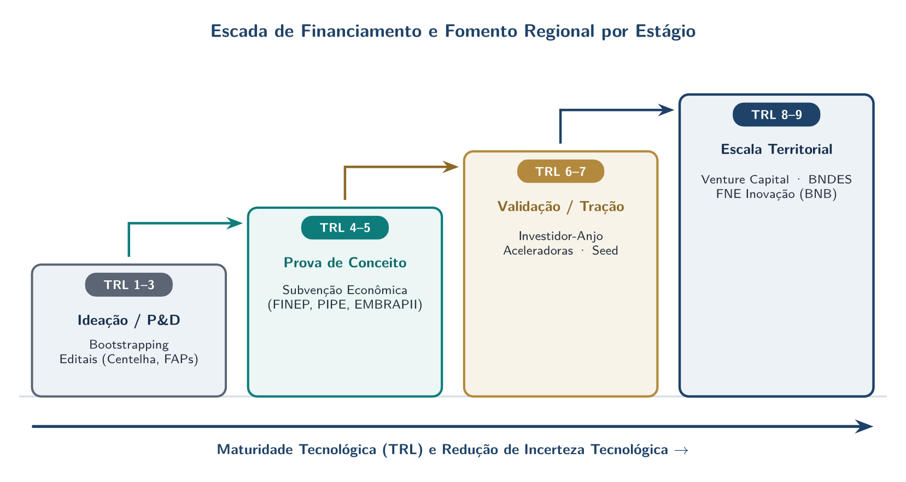

## [Unidade II]{.pitch-tag} Visão Geral da Aula {#visao-geral .smaller-text .lesson-slide}

::: {.pitch-grid-55}
::: {.pitch-card}
[Roteiro da aula · 4 horas]{.pitch-card-index}
[Tópicos estruturantes]{.pitch-heading}

1. Modelo de Negócio vs. Plano de Negócio: quando usar cada um?
2. Estrutura completa de um Plano de Negócio Tecnológico.
3. Fontes de financiamento: *bootstrapping*, subvenção e *venture capital*.
4. Fundos regionais de desenvolvimento (FNE/BNB, FINEP, FAPs).
5. *Pitch deck* e comunicação para bancas de fomento e investidores.
:::

::: {.pitch-stack-2}
::: {.pitch-card .pitch-card--gold}
[Objetivo central]{.pitch-card-index}
[Planejamento e captação regional]{.pitch-heading}

Capacitar o(a) discente a estruturar **planos de negócio** para empreendimentos tecnológicos e projetos territoriais, conectando a lógica estratégica e operacional às **fontes de financiamento e fomento regional** disponíveis no Brasil.
:::

::: {.pitch-band .pitch-band--teal}
**Ponte prática:** traduzir hipóteses validadas no *Canvas* em projetos financiáveis por editais e bancos regionais.
:::
:::
:::

# 1 · Plano de Negócio na Era Ágil {.section-header rotulo="Conceito"}

## [Conceito]{.pitch-tag} Para que serve o Plano de Negócio hoje? {#plano-negocio-era-agil .smaller-text .lesson-slide}

::: {.pitch-cards-2}
::: {.pitch-card}
[Canvas → Plano]{.pitch-card-index}
[Complementaridade com o Canvas]{.pitch-heading}

- O **Canvas** e o *Lean Startup* servem para **buscar e validar** o modelo de negócio sob alta incerteza.
- O **Plano de Negócio** entra quando é necessário **executar, escalar e captar recursos formais** (bancos de desenvolvimento, editais FINEP/FAPs, investidores institucionais).
- **Função dupla:** alinhamento interno da equipe e **redução de assimetria de informação** perante financiadores.
:::

::: {.pitch-card .pitch-card--gold}
[Arquitetura documental]{.pitch-card-index}
[Estrutura padrão de um plano tecnológico]{.pitch-heading}

1. **Sumário Executivo** (síntese decisiva em 1–2 páginas);
2. **Análise de Mercado e Setorial** (TAM/SAM/SOM, 5 Forças, diferenciais);
3. **Solução Tecnológica e PI** (TRL, proteção, *roadmap* de P&D);
4. **Plano Operacional e Locacional** (fornecedores, equipe, infraestrutura);
5. **Plano de Marketing e Vendas** (CAC, LTV, canais, precificação);
6. **Plano Financeiro** (investimentos, DRE projetada, fluxo de caixa, *break-even*).
:::
:::

# 2 · Financiamento e Fomento Regional {.section-header rotulo="Financiamento"}

## [Território]{.pitch-tag .pitch-tag--gold} A Escada do Capital e o Fomento no Nordeste {#escada-capital-nordeste .smaller-text .lesson-slide}

::: {.pitch-grid-55}
::: {.pitch-table-box}
| Estágio | Fontes Típicas | Natureza do Capital |
|---|---|---|
| **Ideação / P&D** | *Bootstrapping*, editais **PIPE/FAPs, Centelha, Tecnova** | Não reembolsável (subvenção) |
| **Validação / Tração** | Investidor-anjo, aceleradoras, **FINEP Startup** | *Equity* / mútuo conversível |
| **Escala Regional** | Fundos de *Seed / Venture Capital*, **FNE Inovação (BNB)**, BNDES | *Equity* ou dívida subsidiada |
:::

::: {.pitch-card .pitch-card--teal}
[Política regional]{.pitch-card-index}
[Instrumentos territoriais no Nordeste]{.pitch-heading}

- **FNE (Fundo Constitucional de Financiamento do Nordeste — BNB):** linhas com juros diferenciados para inovação, sustentabilidade e infraestrutura produtiva regional.
- **SUDENE / Incentivos Fiscais:** redução de IRPJ para empreendimentos prioritários na área de atuação.
- **FAPESB / FINEP:** fomento direto a *spin-offs* e cooperação ICT–Empresa.
:::
:::

::: {.pitch-band .pitch-band--navy}
No Nordeste, instrumentos constitucionais (FNE/BNB) e subvenções (FINEP/FAPs) compensam parcialmente a menor densidade de *venture capital* privado.
:::

## [Síntese]{.pitch-tag .pitch-tag--teal} Esquema: Escada de Financiamento e Fomento Regional {#esquema-escada-financiamento .smaller-text .lesson-slide}

::: {.pitch-media-card .pitch-media-card--tall}

[Escada de Financiamento e Fomento Regional por estágio TRL]{.pitch-caption}
[Alinhamento entre redução de incerteza tecnológica e adequação das fontes de capital]{.pitch-caption-sub}
:::

::: {.pitch-band}
Captar a fonte errada no estágio errado (ex.: dívida bancária em TRL 2) compromete a sobrevivência financeira do empreendimento.
:::

# 3 · Métricas-Chave e Pitch {.section-header rotulo="Métricas"}

## [Método]{.pitch-tag .pitch-tag--teal} Indicadores de Tração, Pitch Deck e Leituras {#metricas-pitch-leituras .smaller-text .lesson-slide}

::: {.pitch-grid-55}
::: {.pitch-stack-2}
::: {.pitch-card}
[Economia da unidade]{.pitch-card-index}
[*Unit Economics* essenciais]{.pitch-heading}

- **CAC (Custo de Aquisição de Cliente):** gasto comercial e de marketing dividido por novos clientes.
- **LTV (*Lifetime Value*):** margem líquida gerada pelo cliente ao longo do relacionamento.
- **Ponto de Equilíbrio (*Break-even*):** volume mínimo de vendas para cobrir custos fixos e variáveis.
:::

::: {.pitch-formula}
**Regra de saúde financeira:** $\text{LTV} / \text{CAC} \ge 3$ com recuperação do CAC em até 12 meses.
:::
:::

::: {.pitch-card .pitch-card--teal}
[Preparação · Aula 11]{.pitch-card-index}
[Leituras para a próxima aula]{.pitch-heading}

- **CHESBROUGH, H.** *Open innovation* (Caps. 1 e 3).
- **KURATKO, D. F.; COVIN, J. G.** *Corporate entrepreneurship*.
- Literatura sobre **Spin-offs Acadêmicas** e atuação dos **NITs** no Brasil.
:::
:::
