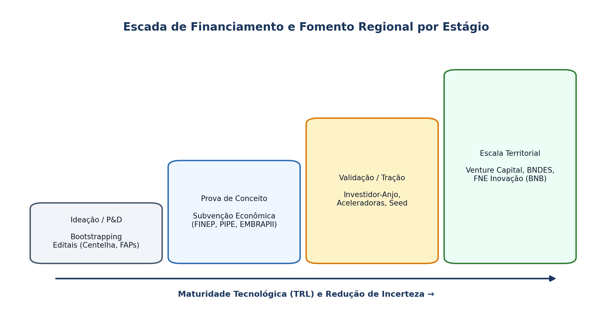

## Visão Geral da Aula {.smaller-text .lesson-slide}

::: {.columns}
::: {.column width="50%"}
### Tópicos

- [1]{.circle} Modelo de Negócio vs. Plano de Negócio: quando usar cada um?
- [2]{.circle} Estrutura completa de um Plano de Negócio Tecnológico
- [3]{.circle} Fontes de financiamento: *bootstrapping*, subvenção e *venture capital*
- [4]{.circle} Fundos regionais de desenvolvimento (FNE/BNB, FINEP, FAPs)
- [5]{.circle} *Pitch deck* e comunicação para bancas de fomento e investidores
:::

::: {.column width="50%"}
::: {.info-box}
**Objetivo da Aula**

Capacitar o(a) discente a estruturar **planos de negócio** para empreendimentos tecnológicos e projetos territoriais, conectando a lógica estratégica e operacional às **fontes de financiamento e fomento regional** disponíveis no Brasil.
:::
:::
:::

# 1 · Plano de Negócio na Era Ágil {.section-header rotulo="Conceito"}

## Para que serve o Plano de Negócio hoje? {.smaller-text .lesson-slide}

::: {.columns}
::: {.column width="50%"}
### Complementaridade com o *Canvas*

- O **Canvas** e o *Lean Startup* servem para **buscar e validar** o modelo de negócio sob alta incerteza.
- O **Plano de Negócio** entra quando é necessário **executar, escalar e captar recursos formais** (bancos de desenvolvimento, editais FINEP/FAPs, investidores institucionais).
- **Função dupla:** alinhamento interno da equipe e **redução de assimetria de informação** perante financiadores.
:::

::: {.column width="50%"}
### Estrutura Padrão de um Plano Tecnológico

1. **Sumário Executivo** (síntese decisiva em 1–2 páginas);
2. **Análise de Mercado e Setorial** (TAM/SAM/SOM, 5 Forças, diferenciais);
3. **Solução Tecnológica e PI** (TRL, proteção, *roadmap* de P&D);
4. **Plano Operacional e Locacional** (fornecedores, equipe, infraestrutura);
5. **Plano de Marketing e Vendas** (CAC, LTV, canais, precificação);
6. **Plano Financeiro** (investimentos, DRE projetada, fluxo de caixa, *break-even*).
:::
:::

# 2 · Financiamento e Fomento Regional {.section-header rotulo="Financiamento"}

## A Escada do Capital para Base Tecnológica {.smaller-text .lesson-slide}

::: {.columns}
::: {.column width="55%"}
### Fontes por Estágio de Maturidade

| Estágio | Fontes Típicas | Natureza do Capital |
|---|---|---|
| **Ideação / P&D** | *Bootstrapping*, editais **PIPE/FAPs, Centelha, Tecnova** | Não reembolsável (subvenção) |
| **Validação / Tração** | Investidor-anjo, aceleradoras, **FINEP Startup** | *Equity* / mútuo conversível |
| **Escala Regional** | Fundos de *Seed / Venture Capital*, **FNE Inovação (BNB)**, BNDES | *Equity* ou dívida subsidiada |
:::

::: {.column width="45%"}
### Instrumentos Territoriais no Nordeste

- **FNE (Fundo Constitucional de Financiamento do Nordeste — BNB):** linhas com juros diferenciados para inovação, sustentabilidade e infraestrutura produtiva regional.
- **SUDENE / Incentivos Fiscais:** redução de IRPJ para empreendimentos prioritários na área de atuação.
- **FAPESB / FINEP:** fomento direto a *spin-offs* e cooperação ICT–Empresa.
:::
:::

## Esquema: Escada de Financiamento e Fomento Regional {.smaller-text .lesson-slide}

{.fig-full}

# 3 · Métricas-Chave e Pitch {.section-header rotulo="Métricas"}

## Indicadores de Tração e Estrutura do *Pitch Deck* {.smaller-text .lesson-slide}

::: {.columns}
::: {.column width="50%"}
### *Unit Economics* Essenciais

- **CAC (Custo de Aquisição de Cliente):** gasto comercial/marketing dividido por novos clientes.
- **LTV (*Lifetime Value*):** margem líquida gerada pelo cliente ao longo do relacionamento.
- **Regra de saúde:** $\text{LTV} / \text{CAC} \ge 3$ e recuperação do CAC em até 12 meses.
- **Ponto de Equilíbrio (*Break-even*):** volume mínimo de vendas para cobrir custos fixos e variáveis.
:::

::: {.column width="50%"}
### Leituras para a Próxima Aula

- **CHESBROUGH, H.** *Open innovation* (Caps. 1 e 3).
- **KURATKO, D. F.; COVIN, J. G.** *Corporate entrepreneurship*.
- Literatura sobre **Spin-offs Acadêmicas** e atuação dos NITs no Brasil.
:::
:::
