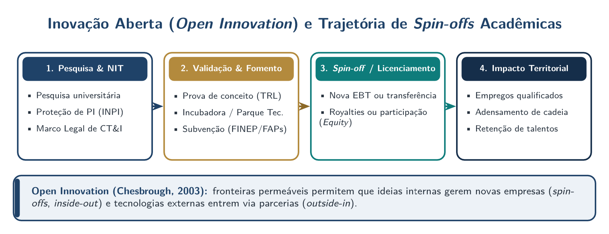

## [Unidade II]{.pitch-tag} Visão Geral da Aula {#visao-geral-11 .smaller-text .lesson-slide}

::: {.pitch-grid-55}
::: {.pitch-milestones}
::: {.pitch-milestone-item}
**01 · Conceitos:** Intraempreendedorismo vs. Empreendedorismo Corporativo.
:::

::: {.pitch-milestone-item}
**02 · Inovação Aberta:** *Open Innovation* (Chesbrough, 2003).
:::

::: {.pitch-milestone-item}
**03 · Capital Corporativo:** *Corporate Venture Capital* (CVC) e interação com *startups* locais.
:::

::: {.pitch-milestone-item}
**04 · Desdobramentos:** *Spin-offs* corporativas e acadêmicas no território.
:::

::: {.pitch-milestone-item}
**05 · Setor Público e Cooperativo:** Intraempreendedorismo no Estado e em cooperativas.
:::
:::

::: {.pitch-stack-2}
::: {.pitch-card .pitch-card--gold}
[Objetivo da Aula]{.pitch-card-index}
[Renovar capacidades a partir de dentro]{.pitch-heading}

Analisar como organizações estabelecidas (empresas, cooperativas, universidades e órgãos públicos) renovam suas capacidades por meio do **intraempreendedorismo**, da **inovação aberta** e da criação de ***spin-offs*** enraizadas no território.
:::

::: {.pitch-pill-row}
[Intraempreendedorismo]{.pitch-pill}
[Inovação Aberta]{.pitch-pill .pitch-pill--gold}
[Spin-offs]{.pitch-pill}
:::
:::
:::

## [Unidade II]{.pitch-tag} Ponto de Partida: Inovar Sem Começar do Zero {#ponto-partida-11 .smaller-text .lesson-slide}

::: {.pitch-cards-2}
::: {.pitch-card}
[01 · Organizações Existentes]{.pitch-card-index}
[Além da Startup de Garagem]{.pitch-heading}

- Nem toda inovação nasce fora das instituições: empresas estabelecidas, cooperativas agrícolas, universidades e prefeituras concentram conhecimento, infraestrutura e rede de clientes.
- Quando colaboradores criam novas soluções dentro dessas estruturas, temos o **intraempreendedorismo**.
:::

::: {.pitch-card .pitch-card--teal}
[02 · Novos Negócios Derivados]{.pitch-card-index}
[Quando a Ideia Ganha Vida Própria]{.pitch-heading}

- Muitas vezes uma pesquisa universitária ou um projeto interno precisa de agilidade própria para chegar ao mercado.
- Surge então uma ***spin-off***: uma nova empresa que nasce a partir do conhecimento gerado dentro de uma organização-mãe, retendo talentos e tecnologia no território.
:::
:::

::: {.pitch-band .pitch-band--navy}
Organizações-mãe ancoram competências acumuladas; *spin-offs* e programas internos convertem esse estoque de conhecimento em dinamismo produtivo territorial.
:::

# 1 · Empreendedorismo em Organizações Existentes {.section-header rotulo="Corporativo"}

## [Corporativo]{.pitch-tag} Conceitos e Dimensões (Pinchot, 1985; Guth & Ginsberg, 1990) {#conceitos-dimensoes .smaller-text .lesson-slide}

::: {.pitch-cards-2}
::: {.pitch-card}
[Tipologia e Dimensões]{.pitch-card-index}
[Distinções Fundamentais]{.pitch-heading}

- **Intraempreendedorismo:** iniciativa de colaboradores dentro da organização para desenvolver novos produtos, processos ou unidades de negócio usando recursos internos.
- **Empreendedorismo Corporativo (*Corporate Entrepreneurship*):** estratégia institucionalizada da firma envolvendo:
  1. **Renovação estratégica** (redefinição do negócio central);
  2. **Inovação sustentada** (novos produtos/serviços);
  3. ***Corporate Venturing*** (criação ou investimento em novos negócios).
:::

::: {.pitch-card .pitch-card--alert}
[Obstáculos e Ambidestria]{.pitch-card-index}
[Barreiras Internas à Inovação]{.pitch-heading}

- Aversão ao risco e foco exclusivo em métricas de curto prazo (*core business* atual).
- Silos departamentais e falta de autonomia decisória.
- **Solução organizacional:** *ambidestria organizacional* (O'Reilly & Tushman) — equilibrar a **exploração eficiente** (*exploitation*) do negócio atual com a **busca experimental** (*exploration*) do futuro.
:::
:::

::: {.pitch-band}
Programas de ***Corporate Venture Capital* (CVC)** ampliam essa ambidestria ao investir e co-desenvolver soluções diretamente com *startups* locais.
:::

# 2 · Inovação Aberta e Spin-offs {.section-header rotulo="Open Innovation"}

## [Território]{.pitch-tag .pitch-tag--gold} *Open Innovation* e *Spin-offs* Acadêmicas {#open-innovation-spinoffs .smaller-text .lesson-slide}

::: {.pitch-cards-2}
::: {.pitch-card}
[Chesbrough (2003)]{.pitch-card-index}
[Paradigma Aberto]{.pitch-heading}

- **Modelo Fechado:** P&D 100% interno, segredo absoluto, comercialização apenas pela própria firma.
- **Modelo Aberto:** fluxos intencionais de entrada (*inbound*) e saída (*outbound*) de conhecimento, envolvendo *startups*, universidades, fornecedores e clientes.
- **Conexão Territorial:** grandes empresas âncoras instaladas em um território (ex.: polos industriais, agroindústrias, energia) podem atuar como **tratores de inovação** para *startups* locais via programas de inovação aberta.
:::

::: {.pitch-card .pitch-card--teal}
[ICTs e NITs]{.pitch-card-index}
[*Spin-offs* Acadêmicas e Transferência de Tecnologia]{.pitch-heading}

- **Definição:** novas empresas criadas para explorar comercialmente resultados de pesquisa científica gerados em universidades ou ICTs.
- **Desafios no Brasil:** transição do pesquisador para o papel empreendedor, licenciamento de propriedade intelectual pelos NITs e acesso a capital de risco para escala.
:::
:::

## [Método]{.pitch-tag .pitch-tag--teal} Trajetória da Inovação Aberta às *Spin-offs* Acadêmicas {#diagrama-spinoff .smaller-text .lesson-slide}

::: {.pitch-media-card .pitch-media-card--wide}

[Fluxo da inovação aberta e *spin-offs* acadêmicas]{.pitch-caption}
[Da geração de conhecimento em ICTs e empresas âncoras ao impacto produtivo territorial]{.pitch-caption-sub}
:::

::: {.pitch-band .pitch-band--teal}
NITs, CVC e programas de inovação aberta conectam a fronteira científica à demanda produtiva local sem exigir que a firma inove isoladamente.
:::

# 3 · Setor Público e Fechamento da Unidade II {.section-header rotulo="Fechamento"}

## [Síntese]{.pitch-tag .pitch-tag--teal} Intraempreendedorismo Público e Leituras {#setor-publico-leituras .smaller-text .lesson-slide}

::: {.pitch-cards-2}
::: {.pitch-card .pitch-card--teal}
[Estado e Cooperativas]{.pitch-card-index}
[Inovação no Setor Público Territorial]{.pitch-heading}

- Laboratórios de inovação governamental (*GovTechs* e *Living Labs* municipais).
- Uso de compras públicas de inovação e sandboxes regulatórios para testar soluções urbanas, ambientais e de defesa civil.
- Fortalecimento de cooperativas e arranjos produtivos por meio de equipes internas de inovação.
:::

::: {.pitch-card .pitch-card--gold}
[Próxima Aula · Unidade III]{.pitch-card-index}
[Leituras Recomendadas]{.pitch-heading}

- **WOILER, S.; MATHIAS, W. F.** *Projetos: planejamento, elaboração e análise* (Caps. 1 a 4 — Mercado, Tamanho e Localização).
- **CASAROTTO FILHO, N.; KOPITTKE, B. H.** *Análise de investimentos* (Caps. introdutórios sobre elaboração de projetos).
:::
:::
