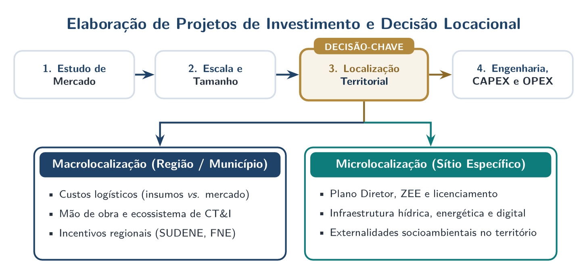

## [Unidade III]{.pitch-tag} Visão Geral da Aula {#visao-geral-12 .smaller-text .lesson-slide}

::: {.pitch-grid-55}
::: {.pitch-milestones}
::: {.pitch-milestone-item}
**01 · Ciclo do Projeto:** Elaboração de projetos de investimento (Woiler & Mathias, 2008).
:::

::: {.pitch-milestone-item}
**02 · Mercado e Escala:** Estudo de mercado e dimensionamento de tamanho/capacidade.
:::

::: {.pitch-milestone-item}
**03 · Decisão Locacional:** Macrolocalização e microlocalização no território.
:::

::: {.pitch-milestone-item}
**04 · Investimento Inicial:** Engenharia do projeto, investimentos fixos (CAPEX) e capital de giro.
:::

::: {.pitch-milestone-item}
**05 · Orçamento Operacional:** Estruturação de custos, despesas e receitas projetadas (OPEX).
:::
:::

::: {.pitch-stack-2}
::: {.pitch-card .pitch-card--gold}
[Objetivo da Aula]{.pitch-card-index}
[Engenharia econômica e território]{.pitch-heading}

Dominar as etapas técnicas de **elaboração de projetos de investimento**, destacando a **decisão locacional** como ponte direta entre a engenharia econômica e o planejamento territorial.
:::

::: {.pitch-pill-row}
[Ciclo de Projeto]{.pitch-pill}
[Decisão Locacional]{.pitch-pill .pitch-pill--gold}
[CAPEX & OPEX]{.pitch-pill}
:::
:::
:::

# 1 · Ciclo do Projeto de Investimento {.section-header rotulo="Ciclo"}

## [Método]{.pitch-tag .pitch-tag--teal} Da Ideia ao Projeto Executivo (Woiler & Mathias, 2008) {#ciclo-projeto .smaller-text .lesson-slide}

::: {.pitch-flow-4}
::: {.pitch-card}
[01 · Perfil]{.pitch-card-index}
[Identificação]{.pitch-heading}

Definição preliminar do problema, produto e escopo inicial do empreendimento.
:::

::: {.pitch-card .pitch-card--gold}
[02 · Filtro]{.pitch-card-index}
[Pré-Viabilidade]{.pitch-heading}

Análise preliminar de mercado, tecnologia e custos para selecionar alternativas.
:::

::: {.pitch-card .pitch-card--teal}
[03 · Decisão]{.pitch-card-index}
[Viabilidade Completa]{.pitch-heading}

Detalhamento técnico, econômico, ambiental e territorial para decidir o investimento.
:::

::: {.pitch-card .pitch-card--gold}
[04 · Execução]{.pitch-card-index}
[Projeto Executivo]{.pitch-heading}

Engenharia detalhada, obras, aquisição de ativos e *start-up* operacional.
:::
:::

::: {.pitch-band .pitch-band--navy}
**Os 5 Estudos Básicos da Viabilidade:** (1) **Mercado** (demanda, oferta, preços); (2) **Tamanho / Escala** (capacidade instalada); (3) **Localização** (macrorregião e sítio); (4) **Engenharia do Projeto** (processo, *layout*, cronograma); e (5) **Análise Econômico-Financeira e Socioambiental**.
:::

# 2 · Decisão Locacional no Território {.section-header rotulo="Localização"}

## [Território]{.pitch-tag .pitch-tag--gold} Fatores Locacionais: Ponte com o Planejamento Territorial {#fatores-locacionais .smaller-text .lesson-slide}

::: {.pitch-grid-55}
::: {.pitch-stack-2}
::: {.pitch-card}
[Escala Regional / Municipal]{.pitch-card-index}
[Macrolocalização]{.pitch-heading}

- Proximidade de matérias-primas vs. mercado consumidor (orientação por peso e frete — Weber);
- Disponibilidade e qualificação de mão de obra;
- Infraestrutura energética, hídrica, logística e conectividade digital;
- Incentivos fiscais (SUDENE, estados, municípios) e **ecossistema de CT&I**.
:::

::: {.pitch-card .pitch-card--teal}
[Sítio Específico]{.pitch-card-index}
[Microlocalização]{.pitch-heading}

- Zoneamento urbano e ambiental (Plano Diretor, ZEE, APPs);
- Custo do terreno, topografia, drenagem e licenciamento ambiental.
:::
:::

::: {.pitch-stack-2}
::: {.pitch-formula}
**Ponderação Locacional** (comparando municípios candidatos):

$$\text{Nota}_j = \sum_{i=1}^{n} w_i \cdot s_{ij}$$

onde $w_i$ é o peso do fator $i$ ($\sum w_i = 1$) e $s_{ij}$ é a pontuação do município $j$ no fator $i$.
:::

::: {.pitch-card .pitch-card--alert}
[Visão Crítica (PLANTERR)]{.pitch-card-index}
[Externalidades Territoriais]{.pitch-heading}

A decisão locacional privada nem sempre internaliza externalidades (tráfego, pressão hídrica, segregação socioespacial); cabe ao planejamento territorial orientá-la.
:::
:::
:::

## [Decisão]{.pitch-tag} Esquema: Ciclo de Projetos e Decisão Locacional {#diagrama-locacional .smaller-text .lesson-slide}

::: {.pitch-media-card .pitch-media-card--wide}

[Articulação entre ciclo de elaboração de projetos e decisão locacional]{.pitch-caption}
[Estudo de mercado, dimensionamento de escala, macro/microlocalização territorial e CAPEX/OPEX]{.pitch-caption-sub}
:::

::: {.pitch-band}
A escolha do sítio e da escala redefine diretamente custos logísticos, exigências ambientais e investimentos iniciais do projeto.
:::

# 3 · Estrutura Econômica do Projeto {.section-header rotulo="Orçamento"}

## [Método]{.pitch-tag .pitch-tag--teal} CAPEX, Capital de Giro e OPEX {#capex-opex .smaller-text .lesson-slide}

::: {.pitch-cards-2}
::: {.pitch-card}
[Investimento Inicial · Ano 0]{.pitch-card-index}
[CAPEX e Capital de Giro Líquido]{.pitch-heading}

- **CAPEX (Investimentos Fixos):** terrenos, edificações, máquinas, equipamentos, P&D capitalizado, licenças e software.
- **Capital de Giro Líquido (CGL):** recursos para financiar o ciclo operacional (estoques + contas a receber $-$ fornecedores).
- **Erro comum:** esquecer o capital de giro ou sua variação ($\Delta \text{CGL}$) nos anos de crescimento da receita.
:::

::: {.pitch-card .pitch-card--gold}
[Custos e Benefício Fiscal]{.pitch-card-index}
[OPEX e Depreciação]{.pitch-heading}

- **Custos Variáveis** (proporcionais ao volume produzido) vs. **Custos Fixos**.
- **Depreciação:** não representa saída de caixa, mas **reduz a base de cálculo do Imposto de Renda**, gerando o benefício fiscal da depreciação ($+ D \cdot T$).
:::
:::

::: {.pitch-band .pitch-band--teal}
CAPEX, variação do CGL e benefício fiscal da depreciação alimentam diretamente o **Fluxo de Caixa Livre da Firma (FCFF)** analisado na próxima aula.
:::

# 4 · Oficina e Leituras {.section-header rotulo="Oficina"}

## [Síntese]{.pitch-tag .pitch-tag--teal} Matriz Locacional e Leituras {#oficina-locacional .smaller-text .lesson-slide}

::: {.pitch-grid-55}
::: {.pitch-card .pitch-card--gold}
[Exercício Prático · 35 min]{.pitch-card-index}
[Matriz de Ponderação Locacional]{.pitch-heading}

Para o projeto escolhido pelo grupo, defina **5 critérios locacionais** (com pesos somando 100%) e compare **2 municípios ou zonas territoriais** candidatas a receber o empreendimento, justificando os trade-offs socioambientais e logísticos.
:::

::: {.pitch-card}
[Próxima Aula]{.pitch-card-index}
[Leituras Recomendadas]{.pitch-heading}

- **CASAROTTO FILHO, N.; KOPITTKE, B. H.** *Análise de investimentos* (Caps. sobre VPL, TIR, Payback e Análise de Risco).
- **ASSAF NETO, A.** *Finanças corporativas e valor* (Caps. sobre Custo de Capital e Decisões de Investimento).
:::
:::
