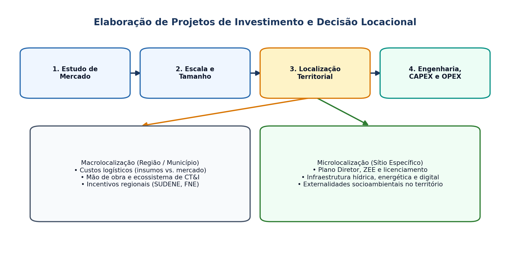

## Visão Geral da Aula {.smaller-text .lesson-slide}

::: {.columns}
::: {.column width="50%"}
### Tópicos

- [1]{.circle} Ciclo de elaboração de projetos de investimento (Woiler & Mathias, 2008)
- [2]{.circle} Estudo de mercado e dimensionamento de escala/tamanho
- [3]{.circle} **Decisão locacional no território** (macrolocalização e microlocalização)
- [4]{.circle} Engenharia do projeto, investimentos fixos (CAPEX) e capital de giro
- [5]{.circle} Estruturação de custos, despesas e receitas projetadas (OPEX)
:::

::: {.column width="50%"}
::: {.info-box}
**Objetivo da Aula**

Dominar as etapas técnicas de **elaboração de projetos de investimento**, destacando a **decisão locacional** como ponte direta entre a engenharia econômica e o planejamento territorial.
:::
:::
:::

# 1 · Ciclo do Projeto de Investimento {.section-header rotulo="Ciclo"}

## Da Ideia ao Projeto Executivo (Woiler & Mathias, 2008) {.smaller-text .lesson-slide}

::: {.columns}
::: {.column width="50%"}
### Fases do Projeto

1. **Identificação / Perfil:** definição preliminar do problema, produto e escopo.
2. **Estudo de Pré-Viabilidade:** análise preliminar de mercado, tecnologia e custos para filtrar alternativas.
3. **Estudo de Viabilidade (Técnica, Econômica, Ambiental e Territorial):** detalhamento completo para decisão de investimento.
4. **Projeto Executivo e Implantação:** engenharia detalhada, obras, aquisição e *start-up*.
:::

::: {.column width="50%"}
### Os 5 Estudos Básicos da Viabilidade

- Estudo de **Mercado** (demanda, oferta, preços, comercialização);
- Estudo de **Tamanho / Escala** (capacidade instalada vs. demanda);
- Estudo de **Localização** (macrorregião e sítio específico);
- **Engenharia do Projeto** (processo produtivo, *layout*, cronograma físico);
- **Análise Econômico-Financeira e Socioambiental**.
:::
:::

# 2 · Decisão Locacional no Território {.section-header rotulo="Localização"}

## Fatores Locacionais: Ponte com o Planejamento Territorial {.smaller-text .lesson-slide}

::: {.columns}
::: {.column width="55%"}
### Macrolocalização vs. Microlocalização

- **Macrolocalização (escala regional/municipal):**
  - Proximidade de matérias-primas vs. mercado consumidor (orientação por peso/custo de transporte — Weber);
  - Disponibilidade e qualificação de mão de obra;
  - Infraestrutura energética, hídrica, logística e conectividade digital;
  - Incentivos fiscais (SUDENE, estados, municípios) e **ecossistema de CT&I**.
- **Microlocalização (sítio específico):**
  - Zoneamento urbano/ambiental (Plano Diretor, ZEE, APPs);
  - Custo do terreno, topografia, drenagem e licenciamento ambiental.
:::

::: {.column width="45%"}
### Método de Ponderação Locacional

Para comparar 2 ou 3 municípios candidatos:

$$\text{Nota}_j = \sum_{i=1}^{n} w_i \cdot s_{ij}$$

onde $w_i$ é o peso do fator locacional $i$ ($\sum w_i = 1$) e $s_{ij}$ é a pontuação do município $j$ no fator $i$.

::: {.highlight-box}
**Visão Crítica (PPGPT):** A decisão locacional privada nem sempre internaliza externalidades (tráfego, pressão hídrica, segregação socioespacial); cabe ao planejamento territorial orientá-la.
:::
:::
:::

## Esquema: Ciclo de Projetos e Decisão Locacional {.smaller-text .lesson-slide}

{.fig-full}

# 3 · Estrutura Econômica do Projeto {.section-header rotulo="Orçamento"}

## CAPEX, Capital de Giro e OPEX {.smaller-text .lesson-slide}

::: {.columns}
::: {.column width="50%"}
### Investimento Inicial (Ano 0)

- **CAPEX (Investimentos Fixos):** terrenos, edificações, máquinas, equipamentos, P&D capitalizado, licenças e software.
- **Capital de Giro Líquido (CGL):** recursos necessários para financiar o ciclo operacional (estoques + contas a receber $-$ fornecedores).
- **Erro comum:** esquecer o capital de giro ou sua variação nos anos de crescimento da receita.
:::

::: {.column width="50%"}
### Custos, Despesas e Depreciação (OPEX)

- **Custos Variáveis** (proporcionais ao volume produzido) vs. **Custos Fixos**.
- **Depreciação:** não é saída de caixa, mas **reduz a base de cálculo do Imposto de Renda** (benefício fiscal da depreciação: $+ D \cdot T$).
:::
:::

# 4 · Oficina e Leituras {.section-header rotulo="Oficina"}

## Matriz Locacional + Leituras {.smaller-text .lesson-slide}

::: {.columns}
::: {.column width="55%"}
### Exercício Prático (35 min)

Para o projeto escolhido pelo grupo, defina **5 critérios locacionais** (com pesos somando 100%) e compare **2 municípios ou zonas territoriais** candidatas a receber o empreendimento, justificando os trade-offs socioambientais e logísticos.
:::

::: {.column width="45%"}
### Leituras para a Próxima Aula

- **CASAROTTO FILHO, N.; KOPITTKE, B. H.** *Análise de investimentos* (Caps. sobre VPL, TIR, Payback e Análise de Risco).
- **ASSAF NETO, A.** *Finanças corporativas e valor* (Caps. sobre Custo de Capital e Decisões de Investimento).
:::
:::
