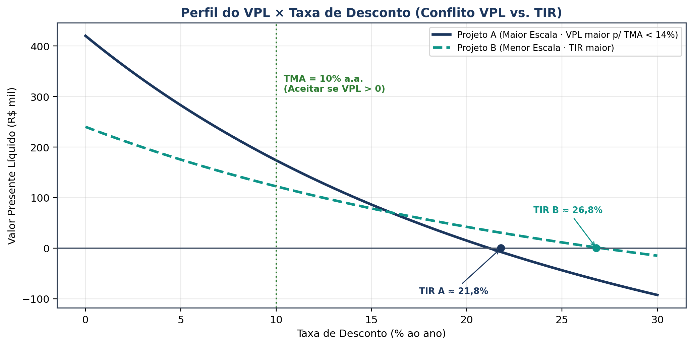

## Visão Geral da Aula {.smaller-text .lesson-slide}

::: {.columns}
::: {.column width="50%"}
### Tópicos

- [1]{.circle} Valor do dinheiro no tempo e construção do Fluxo de Caixa Livre
- [2]{.circle} Custo de oportunidade do capital: TMA, CAPM e WACC
- [3]{.circle} Métodos determinísticos: VPL, TIR, MTIR, VAUE e *Payback*
- [4]{.circle} Projetos mutuamente excludentes, vidas desiguais e racionamento
- [5]{.circle} Análise sob risco e incerteza: sensibilidade, cenários e Monte Carlo
:::

::: {.column width="50%"}
::: {.info-box}
**Objetivo da Aula**

Capacitar o(a) discente a estruturar fluxos de caixa de projetos, estimar taxas de desconto (TMA/WACC) e aplicar os principais **métodos quantitativos de análise de investimentos** (VPL, TIR, MTIR, *Payback* e análise de risco) em empreendimentos tecnológicos e territoriais.
:::
:::
:::

# 1 · Fluxo de Caixa e Custo de Capital {.section-header rotulo="Fluxo e TMA"}

## Fluxo de Caixa Livre e Taxa de Desconto {.smaller-text .lesson-slide}

::: {.columns}
::: {.column width="50%"}
### Construção do Fluxo de Caixa da Firma (FCFF)

$$\text{FCFF} = \text{EBIT} \cdot (1 - T) + \text{Depreciação} - \text{CAPEX} - \Delta \text{CGL}$$

- **Regra de ouro:** trabalhar com **fluxos de caixa incrementais** (não lucro contábil) e excluir **custos afundados** (*sunk costs*).
- **Taxas nominais vs. reais:** se o fluxo está em moeda constante (sem inflação), descontar pela taxa real; se inclui inflação, usar taxa nominal (Equação de Fisher: $1 + i_{\text{nom}} = (1 + i_{\text{real}})(1 + \pi)$).
:::

::: {.column width="50%"}
### TMA, CAPM e WACC (Assaf Neto, 2021)

- **CAPM (Custo do Capital Próprio):**
  $$K_e = R_f + \beta \cdot (R_m - R_f) + R_{\text{país}}$$
- **WACC (Custo Médio Ponderado de Capital):**
  $$\text{WACC} = K_e \cdot \frac{E}{D + E} + K_d \cdot (1 - T) \cdot \frac{D}{D + E}$$
- Projetos públicos ou de impacto territorial frequentemente usam uma **Taxa Social de Desconto** além da TMA privada.
:::
:::

# 2 · Critérios de Decisão de Investimentos {.section-header rotulo="Métodos"}

## VPL, TIR, MTIR, VAUE e *Payback* {.smaller-text .lesson-slide}

::: {.columns}
::: {.column width="55%"}
### Fórmulas e Regras de Decisão

- **Valor Presente Líquido (VPL):**
  $$\text{VPL} = -I_0 + \sum_{t=1}^{n} \frac{FC_t}{(1 + i)^t}$$
  *Aceitar se $\text{VPL} > 0$.* Mede a criação absoluta de riqueza na data zero.
- **Taxa Interna de Retorno (TIR):** taxa $i^*$ que zera o VPL ($\text{VPL}(i^*) = 0$). *Aceitar se $\text{TIR} > \text{TMA}$.*
- **MTIR (TIR Modificada):** corrige a premissa irrealista da TIR de reinvestimento à própria TIR, usando a TMA para reinvestimento.
:::

::: {.column width="45%"}
### Comparação e Armadilhas

- ***Payback* Simples vs. Descontado:** mede o tempo de recuperação do investimento; o simples ignora o valor do dinheiro no tempo e ambos ignoram fluxos após o corte.
- **Armadilhas da TIR:** múltiplas TIRs em fluxos não convencionais (mudanças de sinal) e conflito de escala em projetos mutuamente excludentes $\rightarrow$ **em caso de conflito, prevalece o VPL**.
- **VAUE (Valor Anual Uniforme Equivalente):** ideal para comparar projetos com **vidas úteis diferentes**.
:::
:::

## Gráfico Didático: Perfil do VPL × Taxa de Desconto {.smaller-text .lesson-slide}

{.fig-full}

# 3 · Análise de Risco e Oficina em Planilha {.section-header rotulo="Risco"}

## Sensibilidade, Cenários e Prática em Sala {.smaller-text .lesson-slide}

::: {.columns}
::: {.column width="50%"}
### Tratamento de Risco e Incerteza

1. **Análise de Sensibilidade:** varia uma variável-chave por vez (ex.: preço $-15\%$, CAPEX $+20\%$) para identificar o ponto crítico (*break-even* financeiro).
2. **Análise de Cenários:** constrói combinações coerentes (Otimista, Base, Pessimista).
3. **Simulação de Monte Carlo:** atribui distribuições de probabilidade às entradas incertas e gera a distribuição de probabilidade do VPL ($P(\text{VPL} > 0)$).
:::

::: {.column width="50%"}
### Oficina Prática + Leituras (60 min)

**Exercício em planilha:** dado um projeto agroindustrial/tecnológico com investimento inicial de R\$ 500 mil e horizonte de 5 anos, calcular **FCFF, WACC, VPL, TIR, MTIR e Payback Descontado**, e testar sensibilidade a uma queda de 15% na receita.

**Leituras para a Próxima Aula:**
- **DAMODARAN, A.** *Avaliação de investimentos* (Caps. sobre FCD e Múltiplos) e *The dark side of valuation* (Cap. sobre empresas jovens).
:::
:::
