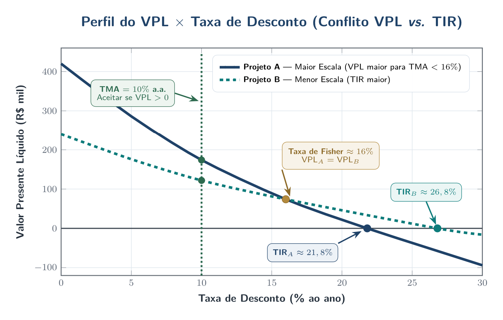

## [Unidade III]{.pitch-tag} Visão Geral da Aula {#visao-geral-13 .smaller-text .lesson-slide}

::: {.pitch-grid-55}
::: {.pitch-milestones}
::: {.pitch-milestone-item}
**01 · Fluxo de Caixa:** Valor do dinheiro no tempo e construção do Fluxo de Caixa Livre.
:::

::: {.pitch-milestone-item}
**02 · Custo de Capital:** Custo de oportunidade via TMA, CAPM e WACC.
:::

::: {.pitch-milestone-item}
**03 · Critérios Determinísticos:** VPL, TIR, MTIR, VAUE e *Payback*.
:::

::: {.pitch-milestone-item}
**04 · Conflitos de Decisão:** Projetos mutuamente excludentes, vidas desiguais e racionamento.
:::

::: {.pitch-milestone-item}
**05 · Risco e Incerteza:** Análise de sensibilidade, cenários e simulação de Monte Carlo.
:::
:::

::: {.pitch-stack-2}
::: {.pitch-card .pitch-card--gold}
[Objetivo da Aula]{.pitch-card-index}
[Rigor quantitativo na decisão]{.pitch-heading}

Capacitar o(a) discente a estruturar fluxos de caixa de projetos, estimar taxas de desconto (TMA/WACC) e aplicar os principais **métodos quantitativos de análise de investimentos** (VPL, TIR, MTIR, *Payback* e análise de risco) em empreendimentos tecnológicos e territoriais.
:::

::: {.pitch-pill-row}
[FCFF & WACC]{.pitch-pill}
[VPL & TIR]{.pitch-pill .pitch-pill--gold}
[Monte Carlo]{.pitch-pill}
:::
:::
:::

# 1 · Fluxo de Caixa e Custo de Capital {.section-header rotulo="Fluxo e TMA"}

## [Método]{.pitch-tag .pitch-tag--teal} Antes das Fórmulas: Por Que R$ 100 Hoje Valem Mais que Amanhã? {#valor-dinheiro-tempo .smaller-text .lesson-slide}

::: {.pitch-cards-2}
::: {.pitch-card}
[Fundamento 01]{.pitch-card-index}
[O Valor do Dinheiro no Tempo]{.pitch-heading}

- Receber **R\$ 100 hoje** permite aplicar esse recurso ou resolver uma necessidade imediata; esperar 3 anos traz inflação, risco e perda de oportunidades.
- Ao avaliar um projeto territorial (como uma agroindústria cooperativa ou planta de bioinsumos), não basta somar quanto entra no caixa ao longo dos anos.
- É preciso **trazer os valores futuros para o presente** usando uma taxa de desconto mínima aceitável (**TMA**).
:::

::: {.pitch-card .pitch-card--gold}
[Fundamento 02]{.pitch-card-index}
[Caixa Não É Lucro Contábil]{.pitch-heading}

- Uma empresa pode registrar lucro no papel e quebrar por falta de dinheiro em caixa para pagar fornecedores ou comprar equipamentos.
- Na análise de investimentos, trabalhamos com **Fluxo de Caixa**: o dinheiro que efetivamente entra e sai a cada período, já descontando investimentos em máquinas (**CAPEX**) e capital de giro (**CGL**).
:::
:::

::: {.pitch-band .pitch-band--navy}
**Regra de ouro:** trabalhar apenas com **fluxos de caixa incrementais** e excluir **custos afundados** (*sunk costs*).
:::

## [Método]{.pitch-tag .pitch-tag--teal} Fluxo de Caixa Livre e Taxa de Desconto {#fcff-wacc .smaller-text .lesson-slide}

::: {.pitch-grid-50}
::: {.pitch-stack-2}
::: {.pitch-formula}
**Fluxo de Caixa Livre da Firma (FCFF)**

$$\text{FCFF} = \text{EBIT} \cdot (1 - T) + \text{Depreciação} - \text{CAPEX} - \Delta \text{CGL}$$
:::

::: {.pitch-card}
[Consistência Monetária]{.pitch-card-index}
[Taxas Nominais vs. Reais]{.pitch-heading}

- Se o fluxo está em moeda constante (sem inflação), descontar pela taxa real; se inclui inflação, usar taxa nominal.
- **Equação de Fisher:** $1 + i_{\text{nom}} = (1 + i_{\text{real}})(1 + \pi)$.
:::
:::

::: {.pitch-stack-2}
::: {.pitch-formula}
**CAPM e WACC (Assaf Neto, 2021)**

$$K_e = R_f + \beta \cdot (R_m - R_f) + R_{\text{país}}$$

$$\text{WACC} = K_e \cdot \frac{E}{D + E} + K_d \cdot (1 - T) \cdot \frac{D}{D + E}$$
:::

::: {.pitch-card .pitch-card--teal}
[Projetos Territoriais]{.pitch-card-index}
[Taxa Social de Desconto]{.pitch-heading}

Projetos públicos ou de impacto territorial frequentemente utilizam uma **Taxa Social de Desconto** complementar à TMA privada.
:::
:::
:::

# 2 · Critérios de Decisão de Investimentos {.section-header rotulo="Métodos"}

## [Decisão]{.pitch-tag} VPL, TIR, MTIR, VAUE e *Payback* {#vpl-tir-mtir .smaller-text .lesson-slide}

::: {.pitch-grid-55}
::: {.pitch-stack-2}
::: {.pitch-formula}
**Valor Presente Líquido (VPL)**

$$\text{VPL} = -I_0 + \sum_{t=1}^{n} \frac{FC_t}{(1 + i)^t}$$

*Aceitar se $\text{VPL} > 0$.* Mede a criação absoluta de riqueza na data zero.
:::

::: {.pitch-card}
[Taxas de Retorno]{.pitch-card-index}
[TIR e MTIR]{.pitch-heading}

- **TIR:** taxa $i^*$ que zera o VPL ($\text{VPL}(i^*) = 0$). *Aceitar se $\text{TIR} > \text{TMA}$.*
- **MTIR (TIR Modificada):** corrige a premissa irrealista de reinvestimento à própria TIR, adotando a TMA para reinvestir os fluxos intermediários.
:::
:::

::: {.pitch-stack-2}
::: {.pitch-card .pitch-card--gold}
[Tempo e Escala]{.pitch-card-index}
[*Payback* e VAUE]{.pitch-heading}

- ***Payback* Simples vs. Descontado:** mede o tempo de recuperação do investimento; o simples ignora o valor do dinheiro no tempo e ambos ignoram fluxos após o corte.
- **VAUE (Valor Anual Uniforme Equivalente):** ideal para comparar projetos com **vidas úteis diferentes**.
:::

::: {.pitch-card .pitch-card--alert}
[Armadilhas da TIR]{.pitch-card-index}
[Quando há Conflito, Prevalece o VPL]{.pitch-heading}

Múltiplas TIRs em fluxos não convencionais (mudanças de sinal) e conflito de escala em projetos mutuamente excludentes $\rightarrow$ **em caso de conflito, prevalece o VPL**.
:::
:::
:::

## [Decisão]{.pitch-tag} Gráfico Didático: Perfil do VPL × Taxa de Desconto {#grafico-vpl-tir .smaller-text .lesson-slide}

::: {.pitch-media-card .pitch-media-card--wide}

[Perfil do VPL em função da taxa de desconto]{.pitch-caption}
[Conflito VPL vs. TIR para projetos mutuamente excludentes abaixo da taxa de interseção de Fisher]{.pitch-caption-sub}
:::

::: {.pitch-band}
Abaixo da taxa de interseção de Fisher, TIR e VPL ordenam os projetos de forma oposta; o **VPL** decide corretamente por medir o ganho líquido em valor presente.
:::

# 3 · Análise de Risco e Oficina em Planilha {.section-header rotulo="Risco"}

## [Síntese]{.pitch-tag .pitch-tag--teal} Sensibilidade, Cenários e Prática em Sala {#risco-oficina .smaller-text .lesson-slide}

::: {.pitch-grid-50}
::: {.pitch-milestones}
::: {.pitch-milestone-item}
**01 · Análise de Sensibilidade:** varia uma variável-chave por vez (ex.: preço $-15\%$, CAPEX $+20\%$) para identificar o ponto crítico (*break-even* financeiro).
:::

::: {.pitch-milestone-item}
**02 · Análise de Cenários:** constrói combinações coerentes de variáveis (Otimista, Base, Pessimista).
:::

::: {.pitch-milestone-item}
**03 · Simulação de Monte Carlo:** atribui distribuições de probabilidade às entradas incertas e estima a distribuição do VPL ($P(\text{VPL} > 0)$).
:::
:::

::: {.pitch-stack-2}
::: {.pitch-card .pitch-card--gold}
[Oficina Prática · 60 min]{.pitch-card-index}
[Exercício em Planilha]{.pitch-heading}

Dado um projeto agroindustrial/tecnológico com investimento inicial de **R\$ 500 mil** e horizonte de **5 anos**, calcular **FCFF, WACC, VPL, TIR, MTIR e Payback Descontado**, e testar sensibilidade a uma queda de **15% na receita**.
:::

::: {.pitch-card}
[Próxima Aula]{.pitch-card-index}
[Leituras Recomendadas]{.pitch-heading}

- **DAMODARAN, A.** *Avaliação de investimentos* (Caps. sobre FCD e Múltiplos) e *The dark side of valuation* (Cap. sobre empresas jovens).
:::
:::
:::
