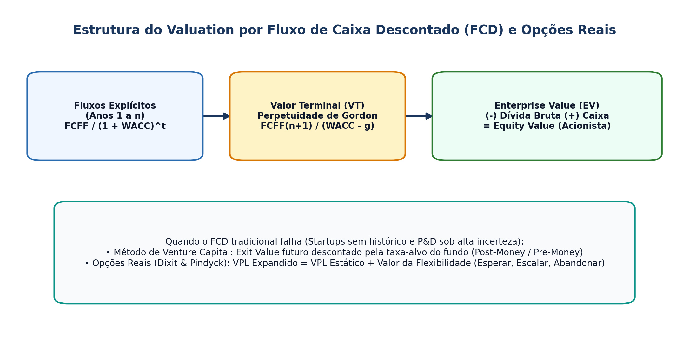

## Visão Geral da Aula {.smaller-text .lesson-slide}

::: {.columns}
::: {.column width="50%"}
### Tópicos

- [1]{.circle} Fundamentos do *Valuation*: *Enterprise Value* vs. *Equity Value*
- [2]{.circle} Fluxo de Caixa Descontado (FCD) e Valor Terminal
- [3]{.circle} *Valuation* Relativo por Múltiplos (EV/EBITDA, P/L, EV/Receita)
- [4]{.circle} *The Dark Side of Valuation*: empresas jovens e *startups*
- [5]{.circle} Método de *Venture Capital*, Opções Reais e valor de intangíveis
:::

::: {.column width="50%"}
::: {.info-box}
**Objetivo da Aula**

Compreender as principais metodologias de ***valuation*** aplicáveis a empresas de base tecnológica, *startups* e projetos de impacto territorial, reconhecendo seus pressupostos, limites sob alta incerteza e conexão com a estratégia.
:::
:::
:::

# 1 · Fluxo de Caixa Descontado e Múltiplos {.section-header rotulo="FCD e Múltiplos"}

## *Enterprise Value*, *Equity Value* e FCD (Damodaran, 2010) {.smaller-text .lesson-slide}

::: {.columns}
::: {.column width="50%"}
### A Equação Geral do FCD

$$\text{EV} = \sum_{t=1}^{n} \frac{\text{FCFF}_t}{(1 + \text{WACC})^t} + \frac{\text{VT}_n}{(1 + \text{WACC})^n}$$

- **Valor Terminal (Perpetuidade de Gordon):**
  $$\text{VT}_n = \frac{\text{FCFF}_{n+1}}{\text{WACC} - g}$$
  *(onde $g$ nunca deve superar o crescimento nominal de longo prazo da economia).*
- **Ponte para o Acionista:**
  $$\text{Equity Value} = \text{Enterprise Value} - \text{Dívida Bruta} + \text{Caixa}$$
:::

::: {.column width="50%"}
### *Valuation* Relativo (Múltiplos)

- Compara o ativo com pares de mercado via razão preço/driver: **EV/EBITDA**, **P/L**, **EV/Receita** (comum em SaaS quando EBITDA é negativo).
- **Cuidado crítico:** múltiplos exigem controle por **crescimento esperado, risco e retorno sobre o capital (ROIC)** — empresas em territórios ou setores distintos não são diretamente comparáveis sem ajustes.
:::
:::

# 2 · Valuation de Startups e Opções Reais {.section-header rotulo="Startups"}

## *The Dark Side of Valuation* e Método de *Venture Capital* {.smaller-text .lesson-slide}

::: {.columns}
::: {.column width="50%"}
### Por que avaliar *startups* é difícil? (Damodaran, 2018)

- Sem histórico operacional e com fluxos negativos nos primeiros anos.
- Alta taxa de mortalidade e ausência de empresas comparáveis listadas em bolsa.
- **Método de *Venture Capital*:**
  1. Estima o *Exit Value* no ano $n$ (ex.: $8 \times \text{EBITDA}_n$);
  2. Desconta pela taxa-alvo do fundo (ex.: $35\%–50\%$ a.a.) para obter o *Post-Money Valuation* atual;
  3. $\text{Pre-Money} = \text{Post-Money} - \text{Aporte}$.
:::

::: {.column width="50%"}
### Introdução às Opções Reais (Dixit & Pindyck, 1994)

- O VPL tradicional assume decisão estática ("agora ou nunca").
- **Opções Reais** capturam o valor da **flexibilidade gerencial** sob incerteza: opção de **esperar**, **expandir**, **abandonar** ou **escalar por estágios** (comum em P&D, patentes e projetos territoriais de longo prazo).
:::
:::

## Esquema: Fluxo de Caixa Descontado e Opções Reais {.smaller-text .lesson-slide}

{.fig-full}

# 3 · Preparação do Seminário Final {.section-header rotulo="Fechamento"}

## Roteiro da Entrega Final (AV3 — 50%) {.smaller-text .lesson-slide}

::: {.columns}
::: {.column width="55%"}
### Estrutura do Trabalho Final (Aula 15)

Cada discente/dupla apresentará em **20 minutos** (+ 10 min de arguição) seu estudo aplicado contendo:

1. **Diagnóstico Territorial e Ecossistêmico** (Unidade I);
2. **Oportunidade, Modelo de Negócio / Impacto e Estratégia** (Unidade II);
3. **Projeto de Investimento, Decisão Locacional, VPL/TIR e noções de *Valuation*** (Unidade III).
:::

::: {.column width="45%"}
### Recomendações

- Tragam dados reais ou realistas do território escolhido (IBGE, SEI-BA, MapBiomas, INPI, editais FINEP/FAPESB).
- A entrega escrita final (artigo ou estudo técnico) segue as normas do PPGPT/UEFS.
:::
:::
