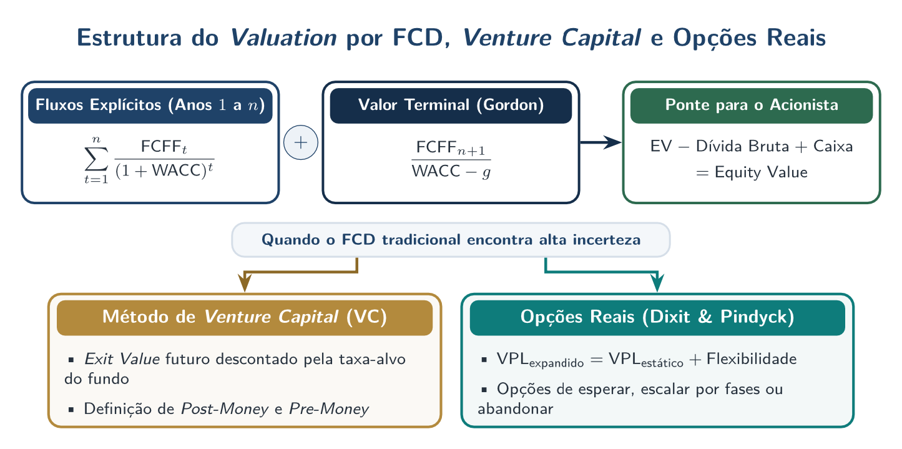

## [Unidade III]{.pitch-tag} Visão Geral da Aula {#visao-geral-14 .smaller-text .lesson-slide}

::: {.pitch-grid-55}
::: {.pitch-milestones}
::: {.pitch-milestone-item}
**01 · Fundamentos:** *Enterprise Value* vs. *Equity Value*.
:::

::: {.pitch-milestone-item}
**02 · FCD:** Fluxo de Caixa Descontado e Valor Terminal.
:::

::: {.pitch-milestone-item}
**03 · Múltiplos:** *Valuation* relativo (EV/EBITDA, P/L, EV/Receita).
:::

::: {.pitch-milestone-item}
**04 · Empresas Jovens:** *The Dark Side of Valuation* aplicado a *startups*.
:::

::: {.pitch-milestone-item}
**05 · Alta Incerteza:** Método de *Venture Capital*, Opções Reais e valor de intangíveis.
:::
:::

::: {.pitch-stack-2}
::: {.pitch-card .pitch-card--gold}
[Objetivo da Aula]{.pitch-card-index}
[Avaliar valor sob incerteza]{.pitch-heading}

Compreender as principais metodologias de ***valuation*** aplicáveis a empresas de base tecnológica, *startups* e projetos de impacto territorial, reconhecendo seus pressupostos, limites sob alta incerteza e conexão com a estratégia.
:::

::: {.pitch-pill-row}
[EV & Equity]{.pitch-pill}
[FCD & Múltiplos]{.pitch-pill .pitch-pill--gold}
[Opções Reais]{.pitch-pill}
:::
:::
:::

# 1 · Fluxo de Caixa Descontado e Múltiplos {.section-header rotulo="FCD e Múltiplos"}

## [Método]{.pitch-tag .pitch-tag--teal} Antes das Equações: O Que Significa Avaliar (*Valuation*)? {#significado-valuation .smaller-text .lesson-slide}

::: {.pitch-cards-2}
::: {.pitch-card}
[Conceito 01]{.pitch-card-index}
[Preço vs. Valor Intrínseco]{.pitch-heading}

- **Preço** é o que se paga em uma negociação ou bolsa em dado momento; **Valor** é a capacidade esperada de um ativo gerar caixa e benefícios ao longo do tempo.
- Em *startups* e projetos de impacto territorial, o valor não está apenas nos equipamentos atuais, mas no potencial de mercado, tecnologia e equipe.
:::

::: {.pitch-card .pitch-card--gold}
[Conceito 02]{.pitch-card-index}
[A Empresa Inteira vs. A Fatia dos Sócios]{.pitch-heading}

- ***Enterprise Value* (EV):** valor econômico total da operação do negócio (o "prédio inteiro"), independente de quem financiou.
- ***Equity Value*:** o que sobra para os sócios/acionistas após subtrair as dívidas líquidas (EV menos dívidas, somado ao caixa disponível).
:::
:::

::: {.pitch-band .pitch-band--navy}
Separar o valor operacional do negócio (**EV**) do valor atribuível aos sócios (**Equity Value**) evita distorções ao comparar empresas endividadas e desalavancadas.
:::

## [Método]{.pitch-tag .pitch-tag--teal} *Enterprise Value*, *Equity Value* e FCD (Damodaran, 2010) {#fcd-multiplos .smaller-text .lesson-slide}

::: {.pitch-grid-55}
::: {.pitch-stack-2}
::: {.pitch-formula}
**Equação Geral do FCD e Valor Terminal (Gordon)**

$$\text{EV} = \sum_{t=1}^{n} \frac{\text{FCFF}_t}{(1 + \text{WACC})^t} + \frac{\text{VT}_n}{(1 + \text{WACC})^n} \qquad \text{VT}_n = \frac{\text{FCFF}_{n+1}}{\text{WACC} - g}$$

$$\text{Equity Value} = \text{Enterprise Value} - \text{Dívida Bruta} + \text{Caixa}$$
:::

::: {.pitch-band}
*Restrição de perpetuidade:* $g$ nunca deve superar o crescimento nominal de longo prazo da economia.
:::
:::

::: {.pitch-card .pitch-card--teal}
[Comparação de Mercado]{.pitch-card-index}
[*Valuation* Relativo (Múltiplos)]{.pitch-heading}

- Compara o ativo com pares de mercado via razão preço/driver: **EV/EBITDA**, **P/L**, **EV/Receita** (comum em SaaS quando EBITDA é negativo).
- **Cuidado crítico:** múltiplos exigem controle por **crescimento esperado, risco e retorno sobre o capital (ROIC)** — empresas em territórios ou setores distintos não são diretamente comparáveis sem ajustes.
:::
:::

# 2 · Valuation de Startups e Opções Reais {.section-header rotulo="Startups"}

## [Decisão]{.pitch-tag} *The Dark Side of Valuation* e Método de *Venture Capital* {#dark-side-vc .smaller-text .lesson-slide}

::: {.pitch-cards-2}
::: {.pitch-card .pitch-card--alert}
[Damodaran (2018)]{.pitch-card-index}
[Por que avaliar *startups* é difícil?]{.pitch-heading}

- Sem histórico operacional, fluxos negativos nos primeiros anos, alta mortalidade e ausência de comparáveis listadas em bolsa.
- **Método de *Venture Capital*:**
  1. Estima o *Exit Value* no ano $n$ (ex.: $8 \times \text{EBITDA}_n$);
  2. Desconta pela taxa-alvo do fundo (ex.: $35\%–50\%$ a.a.) para obter o *Post-Money Valuation* atual;
  3. $\text{Pre-Money} = \text{Post-Money} - \text{Aporte}$.
:::

::: {.pitch-card .pitch-card--teal}
[Dixit & Pindyck (1994)]{.pitch-card-index}
[Introdução às Opções Reais]{.pitch-heading}

- O VPL tradicional assume decisão estática ("agora ou nunca").
- **Opções Reais** capturam o valor da **flexibilidade gerencial** sob incerteza: opção de **esperar**, **expandir**, **abandonar** ou **escalar por estágios** (comum em P&D, patentes e projetos territoriais de longo prazo).
:::
:::

## [Método]{.pitch-tag .pitch-tag--teal} Esquema: Fluxo de Caixa Descontado e Opções Reais {#diagrama-valuation .smaller-text .lesson-slide}

::: {.pitch-media-card .pitch-media-card--wide}

[Do *Enterprise Value* ao *Equity Value*: FCD, *VC Method* e Opções Reais]{.pitch-caption}
[Estrutura de cálculo e alternativas metodológicas para ativos tecnológicos sob alta incerteza]{.pitch-caption-sub}
:::

::: {.pitch-band}
Quanto maior a incerteza tecnológica e o peso de intangíveis, menor a suficiência do FCD isolado e maior a relevância de estágios e opções reais.
:::

# 3 · Preparação do Seminário Final {.section-header rotulo="Fechamento"}

## [Síntese]{.pitch-tag .pitch-tag--teal} Roteiro da Entrega Final (AV3 — 50%) {#roteiro-av3 .smaller-text .lesson-slide}

::: {.pitch-grid-55}
::: {.pitch-milestones}
::: {.pitch-milestone-item}
**Formato:** apresentação de **20 minutos** (+ **10 min** de arguição) por discente ou dupla.
:::

::: {.pitch-milestone-item}
**01 · Unidade I:** Diagnóstico Territorial e Ecossistêmico.
:::

::: {.pitch-milestone-item}
**02 · Unidade II:** Oportunidade, Modelo de Negócio / Impacto e Estratégia.
:::

::: {.pitch-milestone-item}
**03 · Unidade III:** Projeto de Investimento, Decisão Locacional, VPL/TIR e noções de *Valuation*.
:::
:::

::: {.pitch-card .pitch-card--gold}
[Recomendações]{.pitch-card-index}
[Base Empírica e Normas]{.pitch-heading}

- Tragam dados reais ou realistas do território escolhido (IBGE, SEI-BA, MapBiomas, INPI, editais FINEP/FAPESB).
- A entrega escrita final (artigo ou estudo técnico) segue as normas do **PLANTERR/UEFS**.
:::
:::
