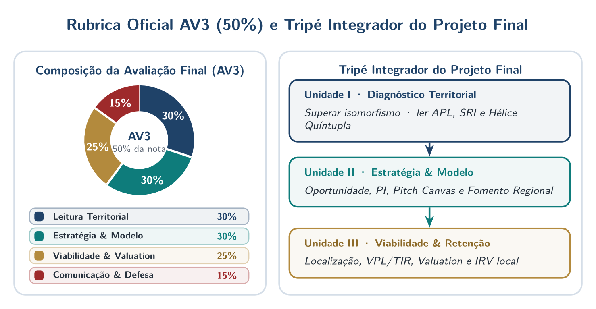

## [Síntese]{.pitch-tag .pitch-tag--teal} Visão Geral do Encerramento {#visao-geral-15 .smaller-text .lesson-slide}

::: {.pitch-grid-55}
::: {.pitch-milestones}
::: {.pitch-milestone-item}
**01 · Defesas:** Apresentações dos Projetos Finais (20 min por equipe).
:::

::: {.pitch-milestone-item}
**02 · Debate:** Arguição técnica e discussão entre pares (10 min por equipe).
:::

::: {.pitch-milestone-item}
**03 · Integração:** Síntese entre território, inovação e sustentabilidade financeira.
:::

::: {.pitch-milestone-item}
**04 · Encaminhamentos:** Balanço da disciplina e próximos passos para pesquisa e publicação.
:::
:::

::: {.pitch-stack-2}
::: {.pitch-card .pitch-card--gold}
[Objetivo da Aula]{.pitch-card-index}
[Defesa pública dos projetos]{.pitch-heading}

Consolidar a aprendizagem das Unidades I, II e III por meio da **defesa pública dos projetos aplicados**, avaliando a coerência entre diagnóstico territorial, estratégia de negócio/impacto e viabilidade econômico-financeira.
:::

::: {.pitch-pill-row}
[Unidade I · Território]{.pitch-pill}
[Unidade II · Estratégia]{.pitch-pill .pitch-pill--gold}
[Unidade III · Viabilidade]{.pitch-pill}
:::
:::
:::

# 1 · Critérios de Avaliação do Seminário {.section-header rotulo="Avaliação"}

## [Rubrica]{.pitch-tag .pitch-tag--gold} Matriz de Rubrica (AV3 — 50% da Nota Final) {#matriz-rubrica .smaller-text .lesson-slide}

::: {.pitch-grid-60}
::: {.pitch-table-box}
| Critério | Peso | O que se espera |
|---|---:|---|
| **Leitura Territorial e Ecossistêmica** | 30% | Diagnóstico rigoroso de atores, gargalos, APL/SRI, contrapontos críticos (*lock-in*, Estado, emancipação) e aderência ao território |
| **Estratégia, Oportunidade e Modelo** | 30% | Coerência do *Canvas*, proposta de valor, barreiras de entrada e PI/impacto |
| **Viabilidade e *Valuation*** | 25% | Clareza na decisão locacional, premissas de fluxo de caixa, VPL/TIR e riscos |
| **Comunicação e Defesa Técnica** | 15% | Domínio conceitual, síntese visual e consistência nas respostas à arguição |
:::

::: {.pitch-card .pitch-card--teal}
[Encaminhamentos Pós-Disciplina]{.pitch-card-index}
[Pesquisa e Publicação]{.pitch-heading}

Trabalhos com alto potencial analítico podem ser amadurecidos para submissão em periódicos de **Planejamento Urbano e Regional / Desenvolvimento Territorial** ou eventos científicos (ANPUR, ENANPAD, ENGEMA).

**Contato:** `ldvsantos@uefs.br`
:::
:::

## [Território]{.pitch-tag .pitch-tag--gold} Articulação Epistemológica do Projeto Final (AV3) {#articulacao-epistemologica .smaller-text .lesson-slide}

::: {.pitch-cards-2}
::: {.pitch-card}
[Unidades I → II]{.pitch-card-index}
[Da Crítica Sociológica à Estratégia]{.pitch-heading}

1. **Superação do Isomorfismo:** o projeto respeita as vocações e capacitações endógenas do território (*Smart Specialisation*) ou tenta importar um modelo desenraizado?
2. **Enraizamento e Governança:** como o empreendimento interage com APLs, universidades/ICTs, políticas públicas e a sociedade civil (Hélice Quádrupla/Quíntupla)?
:::

::: {.pitch-card .pitch-card--teal}
[Unidade III → Território]{.pitch-card-index}
[Da Viabilidade Financeira ao Valor Territorial]{.pitch-heading}

3. **Decisão Locacional e Fluxo de Caixa:** os indicadores de viabilidade (VPL, TIR, *Payback*, *Valuation*) consideram as restrições logísticas e infraestruturais reais da região?
4. **Retenção de Valor e Emancipação:** o excedente gerado permanece no território (via Tecnologia Social, Economia Solidária, IGs ou *spin-offs* locais) ou é drenado para fora?
:::
:::

## [Síntese]{.pitch-tag .pitch-tag--teal} Síntese Integradora do Projeto Final (AV3) {#diagrama-av3 .smaller-text .lesson-slide}

::: {.pitch-media-card .pitch-media-card--wide}

[Arquitetura Integradora do Projeto Final (AV3)]{.pitch-caption}
[Conexão entre diagnóstico territorial (Unidade I), estratégia e modelo (Unidade II) e viabilidade financeira (Unidade III)]{.pitch-caption-sub}
:::

::: {.pitch-band .pitch-band--navy}
O seminário final avalia a consistência completa do percurso: da leitura crítica do território à engenharia econômica do projeto aplicado.
:::
