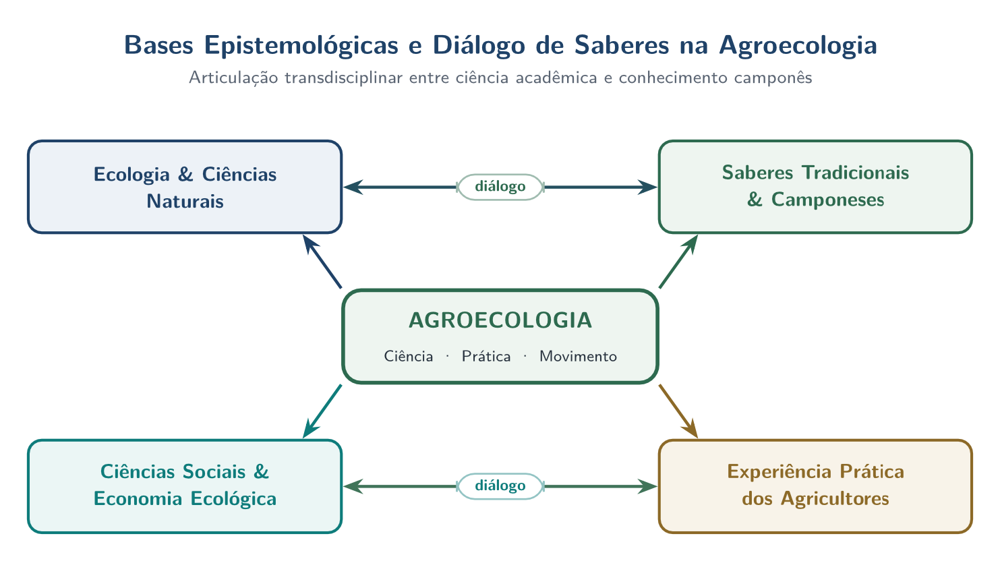
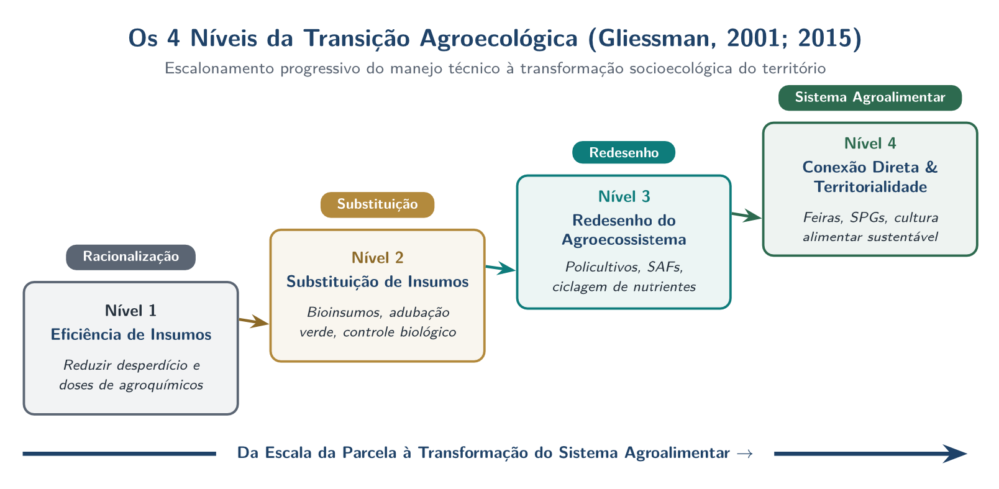
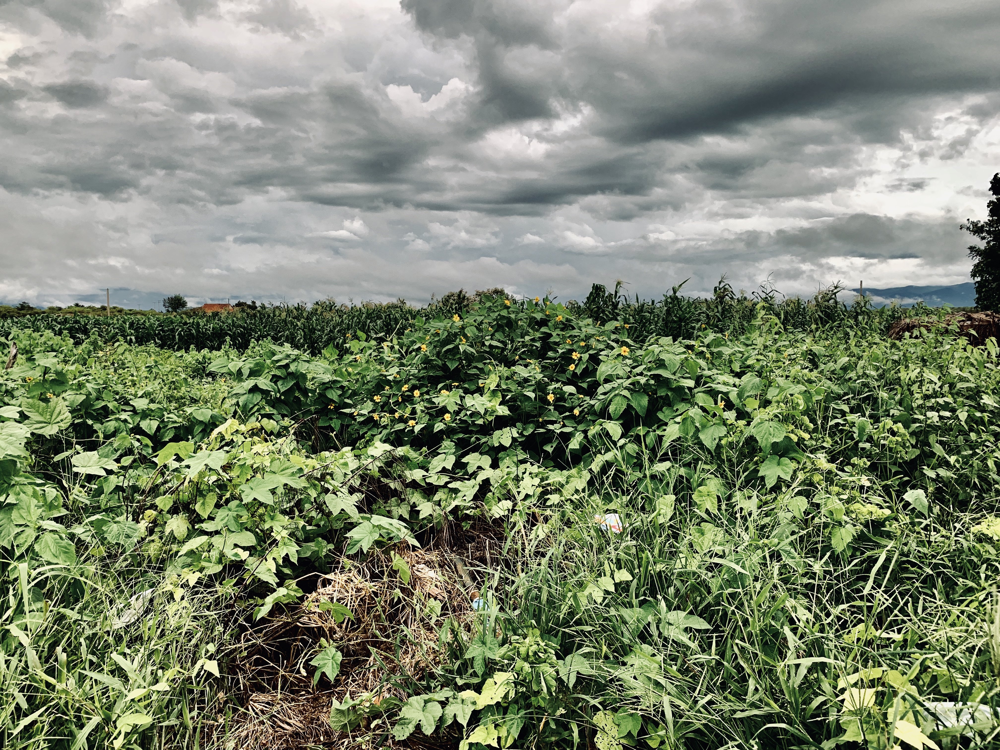
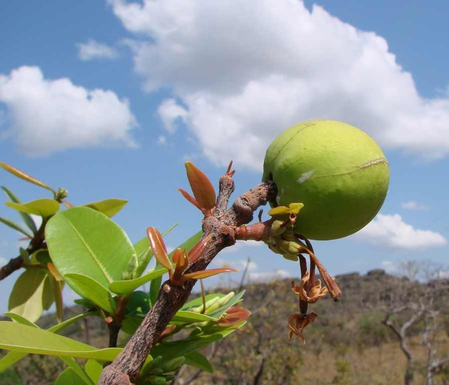

## [Abertura]{.pitch-tag .pitch-tag--forest} Visão Geral da Aula {#visao-geral .smaller-text .lesson-slide}

::: {.pitch-grid-50}
::: {.pitch-card}
[Roteiro da aula]{.pitch-card-index}
[Tópicos estruturantes]{.pitch-heading}

- [1]{.circle} Fundamentos da Agroecologia
- [2]{.circle} Princípios Ecológicos e Sociais
- [3]{.circle} Transição Agroecológica
- [4]{.circle} Marcos Legais (PNAPO, PLANAPO)
- [5]{.circle} O Extensionista na Transição
- [6]{.circle} Experiências Brasileiras
:::

::: {.pitch-stack-2}
::: {.pitch-card .pitch-card--forest}
[Objetivo central]{.pitch-card-index}
[Agroecologia na Extensão Rural]{.pitch-heading}

Apresentar os fundamentos teóricos e práticos da agroecologia como referência para a extensão rural contemporânea, analisando os processos de transição agroecológica e os marcos legais que orientam a atuação do extensionista.
:::

::: {.pitch-pill-row}
[Ciência · Movimento · Prática]{.pitch-pill}
[PNAPO · PLANAPO · PNATER]{.pitch-pill .pitch-pill--gold}
[Caatinga e Semiárido]{.pitch-pill}
:::

::: {.pitch-band .pitch-band--teal}
Da substituição de insumos ao redesenho territorial dos sistemas agroalimentares.
:::
:::
:::

# 1 · Fundamentos e Epistemologia {.section-header rotulo="Fundamentos"}

## [Fundamentos]{.pitch-tag .pitch-tag--forest} Agroecologia: Ciência, Movimento e Prática {#fundamentos-agroecologia .smaller-text .lesson-slide}

::: {.pitch-cards}
::: {.pitch-card .pitch-card--forest}
[01 · Ciência]{.pitch-card-index}
[Base interdisciplinar]{.pitch-heading}

Integra princípios ecológicos, agronômicos e socioeconômicos para o desenho e manejo de agroecossistemas sustentáveis (Altieri, 2012).
:::

::: {.pitch-card .pitch-card--gold}
[02 · Movimento Social]{.pitch-card-index}
[Articulação territorial]{.pitch-heading}

Articula agricultores, pesquisadores e extensionistas em torno de modelos alternativos ao agronegócio convencional.
:::

::: {.pitch-card .pitch-card--teal}
[03 · Prática Produtiva]{.pitch-card-index}
[Base ecológica]{.pitch-heading}

Materializa-se em sistemas que valorizam biodiversidade, ciclos biogeoquímicos e relações ecológicas como base da produtividade (Gliessman, 2014).
:::
:::

::: {.pitch-band .pitch-band--navy}
**Agroecologia ≠ Agricultura Orgânica:** a orgânica frequentemente foca na *substituição de insumos* (trocar agrotóxico por biodefensivo); a agroecologia propõe o **redesenho dos agroecossistemas** e o fortalecimento das relações sociais nos sistemas alimentares locais (Caporal e Costabeber, 2004).
:::

## [Fundamentos]{.pitch-tag .pitch-tag--forest} Bases Epistemológicas e Ecologia de Saberes {#bases-epistemologicas .smaller-text .lesson-slide}

::: {.pitch-grid-50}
::: {.pitch-stack-2}
::: {.pitch-card}
[Gomes (2005)]{.pitch-card-index}
[Epistemologia plural]{.pitch-heading}

Supera o reducionismo cartesiano ao integrar saberes tradicionais, conhecimento científico e experiência empírica dos agricultores.
:::

::: {.pitch-card .pitch-card--gold}
[Santos (2007)]{.pitch-card-index}
[Ecologia de saberes]{.pitch-heading}

Não existe ignorância geral nem saber geral: cada forma de conhecimento é parcial e complementar às demais em diálogo horizontal.
:::
:::

::: {.pitch-stack-2}
::: {.pitch-cards-2}
::: {.pitch-card .pitch-card--forest}
[Polo 1]{.pitch-card-index}
[Ecologia e Ciências Naturais]{.pitch-heading}

Processos ecológicos, ciclagem e dinâmica de agroecossistemas.
:::

::: {.pitch-card .pitch-card--teal}
[Polo 2]{.pitch-card-index}
[Saberes Tradicionais]{.pitch-heading}

Memória biocultural, manejo ancestral e sementes crioulas.
:::

::: {.pitch-card}
[Polo 3]{.pitch-card-index}
[Ciências Sociais e Econômicas]{.pitch-heading}

Relações agrárias, mercados, políticas e organização social.
:::

::: {.pitch-card .pitch-card--gold}
[Polo 4]{.pitch-card-index}
[Experiência dos Agricultores]{.pitch-heading}

Observação empírica, adaptação local e experimentação camponesa.
:::
:::

::: {.pitch-band .pitch-band--teal}
Diálogo contínuo: Ciências Naturais ↔ Saberes Tradicionais e Ciências Sociais ↔ Experiência Local.
:::
:::
:::

## [Epistemologia]{.pitch-tag .pitch-tag--forest} Diagrama das Bases Epistemológicas da Agroecologia {#bases-agroecologia-tikz .smaller-text .lesson-slide}

::: {.pitch-media-card .pitch-media-card--tall}

[Bases Epistemológicas e Diálogo de Saberes na Agroecologia]{.pitch-caption}
[Articulação entre ecologia, ciências sociais, saberes tradicionais e experimentação agricultora (Altieri, 2012; Santos, 2007)]{.pitch-caption-sub}
:::

::: {.pitch-band .pitch-band--navy}
A agroecologia consolida-se simultaneamente como **ciência, prática de manejo e movimento social**, superando a hierarquia entre saber acadêmico e saber tradicional.
:::

## [Princípios]{.pitch-tag .pitch-tag--forest} Princípios Ecológicos de Manejo {#principios-ecologicos .smaller-text .lesson-slide}

::: {.pitch-table-box}
| Princípio (Gliessman, 2014) | Aplicação no Agroecossistema |
| --- | --- |
| **Biodiversidade funcional** | Consórcios, policultivos, sistemas agroflorestais |
| **Ciclagem de nutrientes** | Compostagem, adubação verde, integração animal-vegetal |
| **Interações biológicas** | Controle biológico, polinização, sinergias entre espécies |
| **Eficiência energética** | Redução de insumos externos, uso de energia solar e biomassa |
| **Resiliência** | Diversificação produtiva como proteção contra eventos extremos |
| **Autonomia** | Redução da dependência de mercados de insumos |
:::

::: {.pitch-band}
**Sem receituário pronto:** a aplicação desses princípios exige do extensionista capacidade de **leitura ecológica** de cada agroecossistema e co-construção de soluções com o agricultor.
:::

## [Princípios]{.pitch-tag .pitch-tag--forest} As Seis Dimensões da Sustentabilidade Agroecológica {#dimensoes-sustentabilidade .smaller-text .lesson-slide}

::: {.pitch-cards}
::: {.pitch-card .pitch-card--forest}
[01 · Ecológica]{.pitch-card-index}
[Base biofísica]{.pitch-heading}

Conservação dos recursos naturais, do solo, da água e da agrobiodiversidade.
:::

::: {.pitch-card .pitch-card--teal}
[02 · Social]{.pitch-card-index}
[Equidade e inclusão]{.pitch-heading}

Justiça social, inclusão produtiva e fortalecimento das organizações comunitárias.
:::

::: {.pitch-card .pitch-card--gold}
[03 · Econômica]{.pitch-card-index}
[Viabilidade justa]{.pitch-heading}

Geração de renda, eficiência produtiva e distribuição equitativa de resultados.
:::
:::

::: {.pitch-cards}
::: {.pitch-card}
[04 · Cultural]{.pitch-card-index}
[Identidades rurais]{.pitch-heading}

Valorização de saberes locais, práticas tradicionais e modos de vida camponeses.
:::

::: {.pitch-card .pitch-card--teal}
[05 · Política]{.pitch-card-index}
[Empoderamento]{.pitch-heading}

Participação social e protagonismo dos agricultores nas decisões territoriais.
:::

::: {.pitch-card .pitch-card--gold}
[06 · Ética]{.pitch-card-index}
[Compromisso futuro]{.pitch-heading}

Responsabilidade com as gerações futuras e relações justas entre sociedade e natureza.
:::
:::

::: {.pitch-band}
Para **Caporal e Costabeber (2004)**, as seis dimensões são indissociáveis: nenhuma sustentabilidade técnica se sustenta sem justiça social e autonomia política.
:::

# 2 · Transição Agroecológica e Território {.section-header rotulo="Transição"}

## [Transição]{.pitch-tag .pitch-tag--forest} Escalonamento da Transição Agroecológica {#niveis-transicao .smaller-text .lesson-slide}

::: {.pitch-media-card .pitch-media-card--tall}

[Os 4 Níveis da Transição Agroecológica: da Parcela ao Sistema Agroalimentar]{.pitch-caption}
[Adaptado de Gliessman (2001; 2014; 2015) e Gliessman & Rosemeyer (2010) · Racionalização → Substituição → Redesenho → Territorialidade]{.pitch-caption-sub}
:::

## [Transição]{.pitch-tag .pitch-tag--forest} Dinâmica Gradual: Dos Insumos ao Sistema Alimentar {#dinamica-transicao .smaller-text .lesson-slide}

::: {.pitch-flow-4}
::: {.pitch-card}
[Nível 1]{.pitch-card-index}
[Eficiência de insumos]{.pitch-heading}

Reduzir e racionalizar doses de insumos convencionais e desperdícios na unidade produtiva.
:::

::: {.pitch-card .pitch-card--gold}
[Nível 2]{.pitch-card-index}
[Substituição]{.pitch-heading}

Trocar agroquímicos por bioinsumos, adubação verde e controle biológico.
:::

::: {.pitch-card .pitch-card--teal}
[Nível 3]{.pitch-card-index}
[Redesenho]{.pitch-heading}

Reestruturar o agroecossistema com policultivos, SAFs e ciclagem ecológica (Gliessman, 2014).
:::

::: {.pitch-card .pitch-card--forest}
[Nível 4]{.pitch-card-index}
[Sistema agroalimentar]{.pitch-heading}

Transformar circuitos territoriais: cadeias curtas, certificação participativa e soberania alimentar (Gliessman e Rosemeyer, 2010).
:::
:::

::: {.pitch-band .pitch-band--navy}
**Papel da ATER na transição:** evitar que o agricultor estacione no Nível 2 (substituição dependente de insumos caros) e apoiar a passagem progressiva ao redesenho ecológico e comercial.
:::

## [Território]{.pitch-tag .pitch-tag--forest} Agrobiodiversidade e Convivência no Semiárido {#agrobiodiversidade-semiarido .smaller-text .lesson-slide}

::: {.pitch-grid-50}
::: {.pitch-media-card .pitch-media-card--photo .pitch-media-card--compact}

[Consórcios e cobertura vegetal na Caatinga]{.pitch-caption}
[Wikimedia Commons · Licença CC-BY-SA · Agricultura adaptada ao semiárido]{.pitch-caption-sub}
:::

::: {.pitch-media-card .pitch-media-card--photo .pitch-media-card--compact}

[Agrobiodiversidade nativa: mangaba (*Hancornia speciosa*)]{.pitch-caption}
[Wikimedia Commons · Licença CC · Extrativismo sustentável e renda local]{.pitch-caption-sub}
:::
:::

::: {.pitch-band .pitch-band--teal}
**Leitura ecológica regional:** no Nordeste e na Bahia, a transição agroecológica integra roçados diversificados de convivência com a Caatinga e o manejo sustentável de fruteiras nativas e sociobiodiversidade.
:::

# 3 · Marcos Legais e O Extensionista {.section-header rotulo="Marcos e ATER"}

## [Legislação]{.pitch-tag .pitch-tag--gold} Marcos Legais da Agroecologia no Brasil {#marcos-legais .smaller-text .lesson-slide}

::: {.pitch-table-box}
| Marco Legal | Conteúdo Principal |
| --- | --- |
| **Lei 10.831/2003** | Dispõe sobre a agricultura orgânica no Brasil, definindo sistema orgânico de produção |
| **Decreto 6.323/2007** | Regulamenta a Lei 10.831, criando o Sistema Brasileiro de Avaliação da Conformidade Orgânica |
| **PNATER (Lei 12.188/2010)** | Estabelece princípios agroecológicos como referência para a ATER pública |
| **Decreto 7.794/2012 (PNAPO)** | Institui a Política Nacional de Agroecologia e Produção Orgânica |
| **PLANAPO I (2013–2015)** | Primeiro Plano Nacional de Agroecologia e Produção Orgânica |
| **PLANAPO II (2016–2019)** | Segundo plano, ampliando ações de ATER, pesquisa e crédito |
:::

::: {.pitch-band}
O Brasil consolidou um arcabouço normativo pioneiro de apoio à agroecologia e à produção orgânica, embora sua efetivação enfrente desafios orçamentários e institucionais persistentes.
:::

## [Legislação]{.pitch-tag .pitch-tag--gold} A PNAPO e os Eixos do PLANAPO {#pnapo-planapo .smaller-text .lesson-slide}

::: {.pitch-grid-50}
::: {.pitch-stack-2}
::: {.pitch-card}
[Decreto 7.794/2012]{.pitch-card-index}
[PNAPO como estratégia estatal]{.pitch-heading}

Reconhece a agroecologia como política de desenvolvimento rural sustentável, articulando ATER, crédito, pesquisa, comercialização e formação em torno da transição.
:::

::: {.pitch-card .pitch-card--gold}
[Governança intersetorial]{.pitch-card-index}
[PLANAPO e CNAPO]{.pitch-heading}

Operacionaliza a PNAPO envolvendo mais de **14 ministérios e órgãos federais**, além da sociedade civil organizada via **CNAPO** (Comissão Nacional de Agroecologia e Produção Orgânica).
:::
:::

::: {.pitch-milestones}
::: {.pitch-milestone-item}
**Eixo 1 · Produção:** fomento à transição agroecológica, sementes crioulas e agrobiodiversidade.
:::

::: {.pitch-milestone-item}
**Eixo 2 · Uso e conservação de recursos naturais:** manejo sustentável de solo, água e ecossistemas.
:::

::: {.pitch-milestone-item}
**Eixo 3 · Conhecimento:** pesquisa aplicada, ATER agroecológica e formação técnica e camponesa.
:::

::: {.pitch-milestone-item}
**Eixo 4 · Comercialização e consumo:** mercados institucionais, certificação e soberania alimentar.
:::
:::
:::

## [Prática]{.pitch-tag .pitch-tag--teal} O Extensionista na Transição Agroecológica {#extensionista-transicao .smaller-text .lesson-slide}

::: {.pitch-formula}
**Extensão Rural Agroecológica (Caporal, 2003):** *"processo de intervenção de caráter educativo e transformador, baseado em metodologias de investigação-ação participante, que permitam o desenvolvimento de uma prática social mediante a qual os sujeitos do processo buscam a construção e sistematização de conhecimentos que os levem a incidir conscientemente sobre a realidade."*
:::

::: {.pitch-grid-50}
::: {.pitch-card .pitch-card--teal}
[Repertório técnico-social]{.pitch-card-index}
[Competências exigidas]{.pitch-heading}

- Ecologia de agroecossistemas e biodiversidade funcional
- Diagnóstico Rural Participativo (DRP) e experimentação coletiva
- Articulação com redes de pesquisa e sociedade civil
- Domínio de certificação, mercados e políticas públicas
:::

::: {.pitch-card .pitch-card--forest}
[Caporal e Costabeber (2004)]{.pitch-card-index}
[Mudança de postura]{.pitch-heading}

- Abandonar a prescrição de soluções padronizadas
- Facilitar processos de experimentação local
- Respeitar o tempo de cada agricultor na transição
- Construir indicadores multidimensionais de sustentabilidade
:::
:::

# 4 · Experiências, Mercados e Desafios {.section-header rotulo="Prática"}

## [Experiências]{.pitch-tag .pitch-tag--forest} Experiências Brasileiras em Agroecologia {#experiencias-brasileiras .smaller-text .lesson-slide}

::: {.pitch-grid-50}
::: {.pitch-card .pitch-card--forest}
[Região Sul · Meirelles (2010)]{.pitch-card-index}
[Rede Ecovida de Agroecologia]{.pitch-heading}

- Atua nos três estados do Sul articulando mais de **4.500 famílias** em núcleos regionais
- Opera com **certificação participativa (SPG)**, feiras agroecológicas e intercâmbio entre agricultores
- Demonstra ser alternativa viável à auditoria externa, com custos menores e maior fortalecimento organizativo
:::

::: {.pitch-card .pitch-card--gold}
[Região Nordeste · Semiárido]{.pitch-card-index}
[Articulação do Semiárido (ASA)]{.pitch-heading}

- Integra mais de **3.000 organizações** pela convivência com o semiárido com tecnologias sociais e agroecologia
- Programas **P1MC** (cisternas de placa) e **P1+2** (água para produção) em escala nacional
- Mais de **1,2 milhão de famílias** beneficiadas em articulação com políticas públicas
:::
:::

::: {.pitch-band .pitch-band--teal}
Ambas as redes comprovam que a transição ganha escala quando combina **organização social**, **tecnologia apropriada** e **acesso a políticas públicas**.
:::

## [Mercados]{.pitch-tag .pitch-tag--gold} Agroecologia, Mercados e Certificação {#agroecologia-mercados .smaller-text .lesson-slide}

::: {.pitch-cards}
::: {.pitch-card}
[01 · Mercados Institucionais]{.pitch-card-index}
[PAA e PNAE]{.pitch-heading}

Compras públicas estruturantes, com destaque para o **PNAE** (mínimo de **30%** da agricultura familiar) e o **PAA**, garantindo escoamento e renda na transição (Grisa e Schneider, 2015).
:::

::: {.pitch-card .pitch-card--gold}
[02 · Circuitos Curtos]{.pitch-card-index}
[Relação direta]{.pitch-heading}

Feiras agroecológicas, cestas por assinatura, lojas solidárias e plataformas digitais aproximam produtor e consumidor, com preços justos e transparência.
:::

::: {.pitch-card .pitch-card--forest}
[03 · Garantia Orgânica]{.pitch-card-index}
[Mecanismos do MAPA]{.pitch-heading}

Três vias reconhecidas: **Certificação por Auditoria** (3ª parte), **Sistemas Participativos de Garantia (SPG)** e **Organização de Controle Social (OCS)** para venda direta.
:::
:::

::: {.pitch-band}
A sustentabilidade econômica da transição depende de canais de comercialização que remunerem os atributos ecológicos e sociais da produção familiar.
:::

## [Desafios]{.pitch-tag .pitch-tag--alert} Desafios e Barreiras à Transição Agroecológica {#desafios-transicao .smaller-text .lesson-slide}

::: {.pitch-grid-50}
::: {.pitch-stack-2}
::: {.pitch-card .pitch-card--alert}
[Escala da propriedade]{.pitch-card-index}
[Obstáculos produtivos]{.pitch-heading}

Redução temporária de produtividade durante a conversão, maior demanda por mão de obra qualificada e dependência de mercados diferenciados.
:::

::: {.pitch-card}
[Escala institucional]{.pitch-card-index}
[Gargalos estruturais]{.pitch-heading}

Descontinuidade de políticas públicas, insuficiência de pesquisa agroecológica aplicada e fragilidade da ATER pública para acompanhamento contínuo.
:::
:::

::: {.pitch-milestones}
::: {.pitch-milestone-item}
**1.** Redução temporária de produtividade na conversão
:::

::: {.pitch-milestone-item}
**2.** Descontinuidade de políticas públicas (PNAPO, PLANAPO)
:::

::: {.pitch-milestone-item}
**3.** Insuficiência de pesquisa agroecológica aplicada
:::

::: {.pitch-milestone-item}
**4.** Fragilidade da ATER pública para acompanhar a transição
:::

::: {.pitch-milestone-item}
**5.** Pressão de mercado por *commodities* e insumos externos
:::

::: {.pitch-milestone-item}
**6.** Formação universitária ainda centrada no modelo convencional
:::
:::
:::

## [Síntese]{.pitch-tag .pitch-tag--forest} Conclusão {#conclusao .smaller-text .lesson-slide}

::: {.pitch-cards-2}
::: {.pitch-card .pitch-card--forest}
[Referência paradigmática]{.pitch-card-index}
[ATER contemporânea]{.pitch-heading}

A agroecologia orienta a extensão rural brasileira nos termos da **PNATER (Lei 12.188/2010)** e da **PNAPO (Decreto 7.794/2012)**, exigindo competências ecológicas, sociais, comunicacionais e políticas que superem o modelo tecnicista.
:::

::: {.pitch-card .pitch-card--gold}
[Formação profissional]{.pitch-card-index}
[Papel do Engenheiro Agrônomo]{.pitch-heading}

Mais que um conjunto de técnicas alternativas, a agroecologia é um **enfoque sistêmico** que integra dimensões ecológicas, sociais, econômicas, culturais e políticas para mediar a transição em diálogo com comunidades e instituições.
:::
:::

::: {.pitch-band .pitch-band--navy}
Mediar processos de transição agroecológica exige articular leitura ecológica do território, políticas públicas e protagonismo da agricultura familiar.
:::

## [Referências]{.pitch-tag} Referências da Aula {#referencias .smaller-text .lesson-slide}

::: {.pitch-cards-2}
::: {.pitch-card}
[Bloco 1 · Fundamentos e Transição]{.pitch-card-index}
[Epistemologia, ecologia e extensão]{.pitch-heading}

- Altieri, M. A. *Agroecologia: bases científicas para uma agricultura sustentável*. São Paulo: Expressão Popular, 2012.
- Caporal, F. R. *Extensão Rural Agroecológica*. Brasília: MDA, 2003.
- Caporal, F. R.; Costabeber, J. A. *Agroecologia e Extensão Rural: contribuições para o desenvolvimento rural sustentável*. Brasília: MDA/IICA, 2004.
- Gliessman, S. R. *Agroecology: the ecology of sustainable food systems*. Boca Raton: CRC Press, 2014.
- Gliessman, S. R.; Rosemeyer, M. *The Conversion to Sustainable Agriculture*. Boca Raton: CRC Press, 2010.
- Gomes, J. C. C. Bases epistemológicas da agroecologia. In: Aquino, A. N.; Assis, R. L. *Agroecologia: princípios e técnicas*. Brasília: Embrapa, 2005.
:::

::: {.pitch-card .pitch-card--forest}
[Bloco 2 · Experiências, Saberes e Legislação]{.pitch-card-index}
[Políticas públicas e redes]{.pitch-heading}

- Grisa, C.; Schneider, S. Três gerações de políticas públicas para a agricultura familiar. *Revista de Economia e Sociologia Rural*, v. 52, p. 125–146, 2015.
- Meirelles, L. *Certificação participativa: a experiência da Rede Ecovida*. Ipê: Centro Ecológico, 2010.
- Santos, B. S. Para além do pensamento abissal. *Novos Estudos CEBRAP*, n. 79, 2007.
- Brasil. *Decreto 7.794/2012*. Política Nacional de Agroecologia e Produção Orgânica (2012).
- Brasil. *Lei 10.831/2003*. Agricultura orgânica (2003).
- Brasil. *Lei 12.188/2010*. PNATER/PRONATER (2010).
:::
:::

## {.center background-color="#2135A6"}

::: {style="text-align: center;"}
[Obrigado!]{.obrigado-fit-text style="color: white;"}

::: {style="color: white; font-size: 0.7em;"}
Luiz Diego Vidal Santos

Universidade Estadual de Feira de Santana (UEFS)
:::
:::
