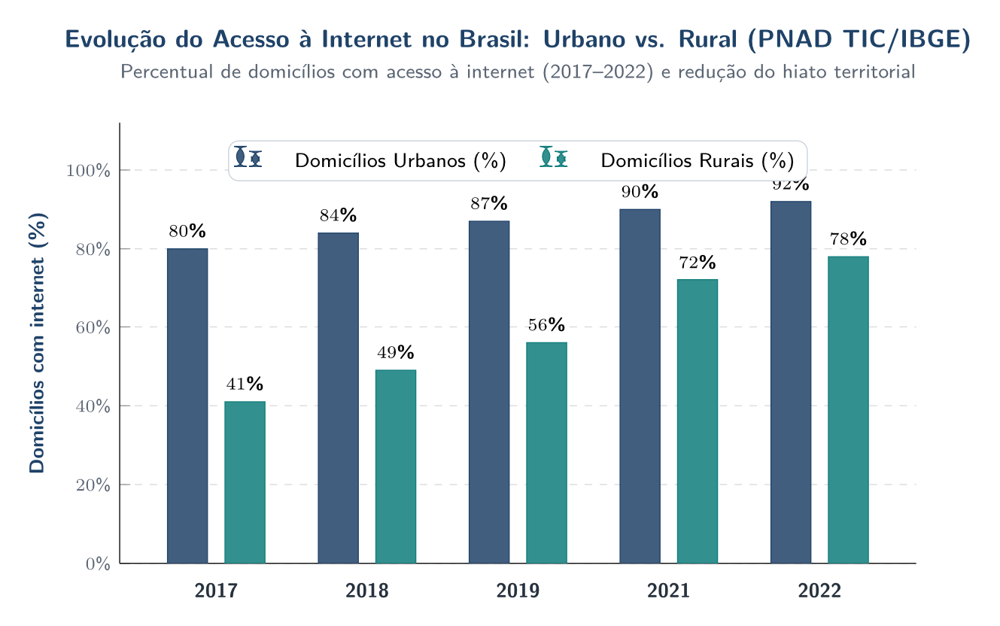
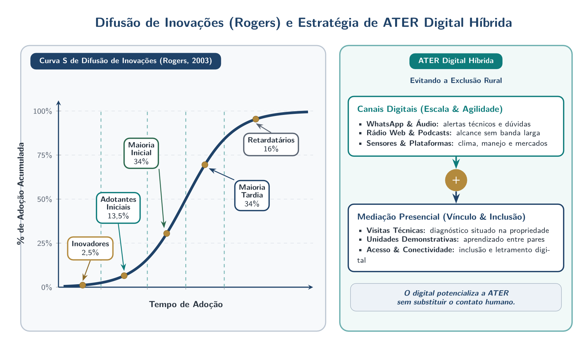

## [Abertura]{.pitch-tag} Visão Geral da Aula {#visao-geral .smaller-text .lesson-slide}

::: {.pitch-grid-50}
::: {.pitch-card}
[Roteiro da aula]{.pitch-card-index}
[Tópicos principais]{.pitch-heading}

- [1]{.circle} Conceito de ATER e Estatização (EMBRATER)
- [2]{.circle} Freire: Extensão ou Comunicação?
- [3]{.circle} Andragogia e Métodos Comunicacionais
- [4]{.circle} ATER Digital e Inclusão Digital
- [5]{.circle} Difusão Tecnológica como Empoderamento
:::

::: {.pitch-stack-2}
::: {.pitch-card .pitch-card--gold}
[Objetivo da aula]{.pitch-card-index}
[Novos paradigmas da ATER]{.pitch-heading}

Explorar os novos paradigmas da extensão rural, da ATER Digital à difusão tecnológica como instrumento de empoderamento e desenvolvimento sustentável.
:::

::: {.pitch-pill-row}
[Lei 6.126/74]{.pitch-pill}
[PNATER]{.pitch-pill .pitch-pill--gold}
[ATER Digital]{.pitch-pill}
:::

::: {.pitch-band .pitch-band--teal}
Como articular tecnologia digital, inclusão rural e comunicação dialógica sem reproduzir o difusionismo unilateral.
:::
:::
:::

# 1 · Fundamentos e Crítica ao Difusionismo {.section-header rotulo="Fundamentos"}

## [Conceito]{.pitch-tag} O que é ATER e a Estatização do Sistema {#conceito-ater .smaller-text .lesson-slide}

::: {.pitch-cards-2}
::: {.pitch-card}
[Assistência Técnica e Extensão Rural]{.pitch-card-index}
[Definição operacional]{.pitch-heading}

Processos cooperativos, baseados em princípios educacionais, que têm por finalidade levar aos adultos e jovens do meio rural informações sobre inovações na agricultura, pecuária e economia doméstica.

Propõe melhorias a partir de **troca de saberes**.
:::

::: {.pitch-card .pitch-card--gold}
[Marco institucional]{.pitch-card-index}
[Lei 6.126/74 · EMBRATER]{.pitch-heading}

Estatizou o sistema brasileiro de extensão rural, instituindo a **EMBRATER** e consolidando a rede pública nacional de extensão (Peixoto, 2008).
:::
:::

::: {.pitch-band}
A transição histórica da ATER envolve superar o repasse vertical de receitas técnicas para consolidar processos cooperativos de educação no campo.
:::

## [Histórico]{.pitch-tag .pitch-tag--alert} O Paradigma Inicial e a Crítica de Freire {#paradigma-inicial .smaller-text .lesson-slide}

::: {.pitch-cards-2}
::: {.pitch-card .pitch-card--alert}
[Origem negocial]{.pitch-card-index}
[Transferência tecnológica vertical]{.pitch-heading}

O paradigma inicial da ATER como ferramenta de comunicação **não surgiu** para beneficiar o pequeno produtor. Transvestida de **transferência tecnológica**, a extensão servia como mera ferramenta negocial:

- Atuação da **AIA** (Associação Americana para Desenvolvimento) e seus interesses empresariais
- Abordagem "do **topo para baixo**" (Peixoto, 2008)
:::

::: {.pitch-card}
[Ruptura conceitual]{.pitch-card-index}
[Paulo Freire (1980)]{.pitch-heading}

Em *Comunicação ou Extensão* (1980), Paulo Freire estabelece a exigência ética e metodológica para o profissional das ciências agrárias:

> O agrônomo deve transcender a ideia de "extensionista" como mero **artefato de informações técnicas**.
:::
:::

## [Freire]{.pitch-tag .pitch-tag--forest} Freire: Extensão ou Comunicação? {#freire-extensao-comunicacao .smaller-text .lesson-slide}

::: {.pitch-cards-2}
::: {.pitch-card .pitch-card--alert}
[Campo associativo do termo "extensão"]{.pitch-card-index}
[Coisificação do sujeito]{.pitch-heading}

Freire analisa os sentidos implícitos da palavra **"extensão"**:

- **Invasão cultural**
- Messianismo
- Transmissão

Estes termos **coisificam** o homem do campo, transformando-o em mero receptor.
:::

::: {.pitch-card .pitch-card--forest}
[Proposta de Paulo Freire]{.pitch-card-index}
[Agrônomo como comunicador]{.pitch-heading}

O agrônomo deve se posicionar como um **"comunicador"**, engajando-se em diálogo **bidirecional e participativo** com as comunidades rurais.
:::
:::

::: {.pitch-band .pitch-band--navy}
A comunicação autêntica substitui a entrega unilateral de pacotes pela co-construção crítica do conhecimento agronômico.
:::

# 2 · Andragogia, Métodos e PNATER {.section-header rotulo="Andragogia"}

## [Educação]{.pitch-tag} Andragogia e Métodos Comunicacionais {#metodos-comunicacionais .smaller-text .lesson-slide}

::: {.pitch-flow-4}
::: {.pitch-card .pitch-card--forest}
[01 · Paulo Freire]{.pitch-card-index}
[Extensão como comunicação]{.pitch-heading}

Diálogo horizontal e problematização conjunta da realidade agrária.
:::

::: {.pitch-card}
[02 · Jean Piaget]{.pitch-card-index}
[Educação crítica construtivista]{.pitch-heading}

Construção ativa do conhecimento a partir da interação com o meio.
:::

::: {.pitch-card .pitch-card--teal}
[03 · José Libâneo]{.pitch-card-index}
[Crítica emancipatória]{.pitch-heading}

Mediação pedagógica orientada à autonomia e transformação social.
:::

::: {.pitch-card .pitch-card--gold}
[04 · Malcolm S. Knowles]{.pitch-card-index}
[Andragogia]{.pitch-heading}

Educação de adultos centrada na experiência prévia e autodireção.
:::
:::

::: {.pitch-band .pitch-band--teal}
A andragogia valoriza a **experiência prévia** do adulto e incentiva o **aprendizado autodirigido** (Knowles, 1980).
:::

## [Andragogia]{.pitch-tag .pitch-tag--gold} Princípios da Andragogia na ATER {#principios-andragogia .smaller-text .lesson-slide}

::: {.pitch-table-box}
| Princípio | Aplicação na ATER |
| --- | --- |
| **Necessidade** | Explorar interesses pessoais do produtor |
| **Autonomia** | Promover capacidade de autogestão |
| **Experiência** | A experiência do agricultor é fundamental |
| **Motivação** | Técnicos como agentes catalisadores |
| **Orientação na realidade** | Ações que caibam na realidade do produtor |
| **Aplicabilidade** | Proposta real — usar e propagar o conhecimento |
:::

::: {.pitch-band}
Quando respeita os seis princípios andragógicos, a ATER converte o saber prático do agricultor em ponto de partida da inovação.
:::

## [Política]{.pitch-tag} PNATER (Lei 12.188/2010) e PRONATER {#pnater-pronater .smaller-text .lesson-slide}

::: {.pitch-band .pitch-band--navy}
**PNATER — Lei 12.188/2010:** política voltada para a melhoria das condições de vida da população rural, orientada por seis princípios norteadores.
:::

::: {.pitch-cards}
::: {.pitch-card}
[01 · Equidade]{.pitch-card-index}
[Inclusão social]{.pitch-heading}

Igualdade de direitos e superação de desigualdades no campo.
:::

::: {.pitch-card .pitch-card--forest}
[02 · Agroecologia]{.pitch-card-index}
[Transição ecológica]{.pitch-heading}

Fomento a práticas agroecológicas e sistemas sustentáveis.
:::

::: {.pitch-card .pitch-card--teal}
[03 · Integração]{.pitch-card-index}
[ATER–Pesquisa–Ensino]{.pitch-heading}

Articulação contínua entre assistência técnica, pesquisa e ensino.
:::

::: {.pitch-card .pitch-card--gold}
[04 · Diversidade]{.pitch-card-index}
[Reconhecimento cultural]{.pitch-heading}

Respeito às diversidades da agricultura familiar (Lei 11.326/06).
:::

::: {.pitch-card}
[05 · Economia]{.pitch-card-index}
[Geração de renda]{.pitch-heading}

Diversificação produtiva e agregação de valor nos territórios.
:::

::: {.pitch-card .pitch-card--teal}
[06 · Governança]{.pitch-card-index}
[Atuação em redes]{.pitch-heading}

Gestão participativa e cooperação interinstitucional.
:::
:::

# 3 · ATER Digital e Difusão de Inovações {.section-header rotulo="ATER Digital"}

## [Digital]{.pitch-tag .pitch-tag--teal} Programa ATER Digital: Ferramentas e Vantagens {#ater-digital .smaller-text .lesson-slide}

::: {.pitch-band .pitch-band--teal}
O **Programa ATER Digital** insere-se na intersecção entre a **ATER** e a **revolução digital**.
:::

::: {.pitch-cards-2}
::: {.pitch-card .pitch-card--teal}
[Instrumentos tecnológicos]{.pitch-card-index}
[Ferramentas]{.pitch-heading}

- Sistemas de Informação Geográfica (SIG)
- Plataformas de aprendizagem online
- Hubs tecnológicos
:::

::: {.pitch-card}
[Ganhos operacionais]{.pitch-card-index}
[Vantagens]{.pitch-heading}

- Algoritmos de aprendizagem de máquina para identificar **lacunas** no conhecimento
- Abordagem mais **focada e eficiente** na transferência de tecnologia
- Adaptação às **peculiaridades** dos agricultores familiares
:::
:::

## [Inclusão]{.pitch-tag .pitch-tag--teal} Inclusão Digital do Campo (PNAD TIC/IBGE) {#inclusao-digital .smaller-text .lesson-slide}

::: {.pitch-grid-55}
::: {.pitch-stack-2}
::: {.pitch-table-box}
| Ano | Domicílios Urbanos (%) | Domicílios Rurais (%) | Diferença |
| --- | ---: | ---: | ---: |
| **2017** | 80% | 41% | 39 p.p. |
| **2018** | 84% | 49% | 35 p.p. |
| **2019** | 87% | 56% | 31 p.p. |
| **2021** | 90% | 72% | 18 p.p. |
| **2022** | 92% | 78% | 14 p.p. |
:::

::: {.pitch-band}
**Fonte:** PNAD Contínua TIC — IBGE. Avanço acelerado no acesso rural à internet, ainda com hiato de conectividade e letramento digital.
:::
:::

::: {.pitch-stack-2}
::: {.pitch-card .pitch-card--teal}
[Catalisador territorial]{.pitch-card-index}
[Infraestrutura e educação]{.pitch-heading}

Fornece **infraestrutura básica** e educação digital para comunidades rurais frequentemente **marginalizadas** em relação ao acesso à tecnologia.
:::

::: {.pitch-card .pitch-card--forest}
[Meio de transformação]{.pitch-card-index}
[Resultados esperados]{.pitch-heading}

- Eficácia em práticas agrícolas
- Redução do hiato de informação técnica
- Autonomia produtiva com suporte contínuo
:::
:::
:::

## [Indicadores]{.pitch-tag .pitch-tag--teal} Gráfico PNAD Contínua TIC: Urbano vs. Rural {#grafico-pnad-tic .smaller-text .lesson-slide}

::: {.pitch-media-card .pitch-media-card--tall}

[Evolução do Acesso à Internet nos Domicílios Urbanos e Rurais (2017–2022)]{.pitch-caption}
[Elaboração a partir de dados da PNAD Contínua TIC (IBGE): avanço rural de 41% para 78% no período]{.pitch-caption-sub}
:::

::: {.pitch-band}
Apesar da redução do hiato entre 2017 (39 p.p.) e 2022 (14 p.p.), persistem assimetrias regionais, de largura de banda e de letramento digital que exigem **ATER híbrida**.
:::
- Gestão de recursos naturais
- Desenvolvimento rural **sustentável**
:::
:::
:::

## [Difusão]{.pitch-tag .pitch-tag--teal} Curva de Difusão (Rogers) e ATER Digital Híbrida {#curva-rogers-hibrida .smaller-text .lesson-slide}

::: {.pitch-media-card .pitch-media-card--tall}

[Difusão de Inovações (Rogers, 2003) e Estratégia de ATER Digital Híbrida]{.pitch-caption}
[Integração entre canais digitais (WhatsApp, podcasts, sensores) e mediação presencial para evitar a exclusão rural]{.pitch-caption-sub}
:::

# 4 · Participação, Empoderamento e Síntese {.section-header rotulo="Empoderamento"}

## [Troca de Saberes]{.pitch-tag .pitch-tag--forest} Difusão Tecnológica e Diagnóstico Participativo {#difusao-drp .smaller-text .lesson-slide}

::: {.pitch-cards-2}
::: {.pitch-card}
[Processo complexo e contextual]{.pitch-card-index}
[Difusão tecnológica (Amorim et al., 2016)]{.pitch-heading}

A difusão tecnológica na agropecuária familiar exige:

- Interação sinérgica entre **entidades acadêmicas**, **órgãos governamentais** e **agricultores**
- Processo **dinâmico e bidirecional**, sustentado pela **"troca de saberes"**

Não deve se restringir a tecnologias simplesmente "transmitidas" do campo acadêmico ao produtor.
:::

::: {.pitch-card .pitch-card--forest}
[Diagnóstico Rural Participativo (DRP)]{.pitch-card-index}
[Exemplo · Projeto Silvânia (Embrapa Cerrados)]{.pitch-heading}

Utiliza análises e diagnósticos situacionais para compreender o contexto:

1. **Análise e diagnóstico** situacional
2. **Experimentação** em unidades rurais selecionadas
3. **Extensão e transferência** adaptada às particularidades edáficas, socioeconômicas e culturais
:::
:::

## [Empoderamento]{.pitch-tag .pitch-tag--gold} Difusão como Empoderamento e Desenvolvimento {#difusao-empoderamento .smaller-text .lesson-slide}

::: {.pitch-cards}
::: {.pitch-card .pitch-card--gold}
[01 · Autonomia]{.pitch-card-index}
[Empoderamento]{.pitch-heading}

Ferramenta de **empoderamento** decisório das famílias agricultoras.
:::

::: {.pitch-card .pitch-card--forest}
[02 · Sustentabilidade]{.pitch-card-index}
[Desenvolvimento rural]{.pitch-heading}

Instrumento de **desenvolvimento rural sustentável** nos territórios.
:::

::: {.pitch-card .pitch-card--teal}
[03 · Transformação]{.pitch-card-index}
[Real desenvolvimento]{.pitch-heading}

Supera a métrica exclusiva de **aumento de produtividade**.
:::
:::

::: {.pitch-formula}
**Conceito de desenvolvimento:** postulado por autores como **Amartya Sen**, **Zander Navarro** e **Ricardo Abramovay** — desenvolvimento como **liberdade e autonomia**.
:::

## [Síntese]{.pitch-tag} Conclusão: Alcance da ATER de Qualidade {#conclusao .smaller-text .lesson-slide}

::: {.pitch-band .pitch-band--navy}
As políticas e programas de ATER representam esforços significativos em busca de uma assistência técnica de **qualidade** no campo brasileiro.
:::

::: {.pitch-milestones}
::: {.pitch-milestone-item}
**Desenvolvimento rural sustentável:** conciliação entre inovação tecnológica, conservação ambiental e equidade social.
:::

::: {.pitch-milestone-item}
**Fortalecimento da agricultura familiar:** valorização da troca de saberes e da autonomia produtiva.
:::

::: {.pitch-milestone-item}
**Segurança alimentar e nutricional:** ampliação da capacidade produtiva e da diversidade alimentar.
:::

::: {.pitch-milestone-item}
**Redução da pobreza rural:** inclusão digital, produtiva e geração de renda.
:::

::: {.pitch-milestone-item}
**Mitigação das mudanças climáticas:** sistemas resilientes apoiados por tecnologias sociais e digitais.
:::
:::

## [Referências]{.pitch-tag} Referências Bibliográficas e Marcos Legais {#referencias .smaller-text .lesson-slide}

::: {.pitch-cards-2}
::: {.pitch-card}
[Marcos legais e bases de dados]{.pitch-card-index}
[Legislação e levantamentos]{.pitch-heading}

- Brasil. Lei 6.126/74 — EMBRATER (1974)
- Brasil. Lei 11.326/06 — Agricultura Familiar (2006)
- Brasil. Lei 12.188/2010 — PNATER/PRONATER (2010)
- IBGE. Pesquisa Nacional por Amostra de Domicílios Contínua — PNAD TIC (2017–2022)
:::

::: {.pitch-card .pitch-card--teal}
[Literatura científica]{.pitch-card-index}
[Autores citados]{.pitch-heading}

- Amorim et al. Troca de saberes e difusão tecnológica na agricultura familiar (2016)
- Freire, P. *Extensão ou Comunicação* (1979; 1980)
- Knowles, M. S. *A prática moderna da educação de adultos* (1970; 1980)
- Peixoto, M. et al. *Extensão rural no Brasil* (2008)
- Rogers, E. M. *Diffusion of Innovations* (2003)
- Sen, A.; Navarro, Z.; Abramovay, R. Desenvolvimento como liberdade e autonomia
:::
:::
