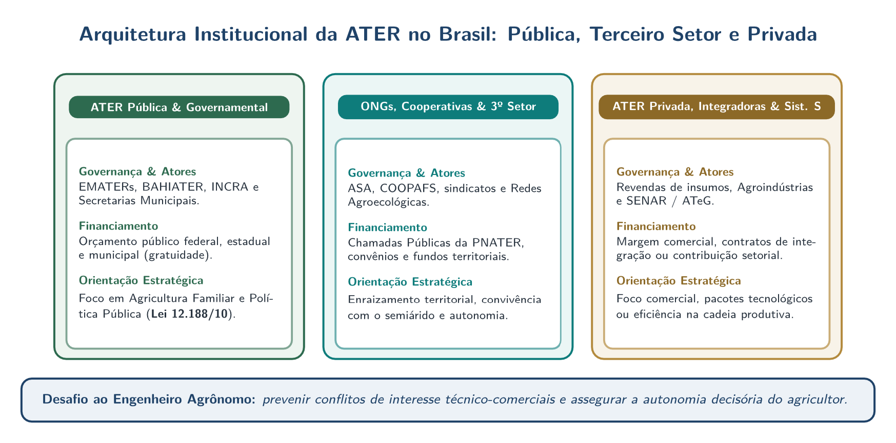

## [Abertura]{.pitch-tag} Visão Geral da Aula {#visao-geral .smaller-text .lesson-slide}

::: {.pitch-grid-50}
::: {.pitch-card}
[Roteiro da aula]{.pitch-card-index}
[Tópicos principais]{.pitch-heading}

- [1]{.circle} ATER Pública — EMATER e Estaduais
- [2]{.circle} ATER Privada — Consultorias e Revendas
- [3]{.circle} Sistema S — SENAR e SEBRAE
- [4]{.circle} Cooperativas, Associações e ONGs
- [5]{.circle} Desafios, Conflitos e Complementaridades
:::

::: {.pitch-stack-2}
::: {.pitch-card .pitch-card--gold}
[Objetivo da aula]{.pitch-card-index}
[Sistemas de ATER no Brasil]{.pitch-heading}

Comparar os diferentes sistemas de assistência técnica e extensão rural no Brasil, analisando suas abordagens, públicos-alvo, fontes de financiamento e efetividade na promoção do desenvolvimento rural.
:::

::: {.pitch-pill-row}
[EMATER · PNATER]{.pitch-pill}
[SENAR · SEBRAE]{.pitch-pill .pitch-pill--gold}
[Cooperativas · ONGs]{.pitch-pill}
:::

::: {.pitch-band .pitch-band--teal}
Da arquitetura plural da ATER brasileira aos desafios de governança territorial e autonomia decisória.
:::
:::
:::

# 1 · Arquitetura Institucional e ATER Pública {.section-header rotulo="ATER Pública"}

## [Institucional]{.pitch-tag .pitch-tag--gold} O Sistema Plural de ATER no Brasil {#sistema-ater-brasil .smaller-text .lesson-slide}

::: {.pitch-cards-2}
::: {.pitch-card}
[Organização descentralizada]{.pitch-card-index}
[Pluralidade institucional]{.pitch-heading}

A assistência técnica e extensão rural no Brasil se organiza em um **sistema plural e descentralizado**, composto por entidades públicas, privadas e do terceiro setor.

A **Lei 12.188/2010** (PNATER) estabeleceu o marco legal que reconhece essa pluralidade institucional, priorizando a **agricultura familiar** como público preferencial da ATER pública.
:::

::: {.pitch-card .pitch-card--gold}
[Linha do tempo normativa]{.pitch-card-index}
[Marcos Legais]{.pitch-heading}

- **Lei 6.126/74** — Criação da EMBRATER
- **Lei 8.447/92** — Extinção da EMBRATER
- **Lei 12.188/2010** — PNATER
- **Decreto 7.215/2010** — PRONATER
:::
:::

::: {.pitch-band}
O reconhecimento jurídico da pluralidade exige mecanismos de coordenação pública para evitar sobreposição de ações e lacunas de atendimento.
:::

## [Matriz]{.pitch-tag .pitch-tag--gold} Arquitetura Institucional da ATER no Brasil {#matriz-ater-institucional .smaller-text .lesson-slide}

::: {.pitch-media-card .pitch-media-card--tall}

[Arquitetura Institucional da ATER no Brasil: Pública, Terceiro Setor e Privada]{.pitch-caption}
[Comparação de governança, financiamento e orientação estratégica entre provedores (Lei 12.188/10)]{.pitch-caption-sub}
:::

## [Histórico]{.pitch-tag} ATER Pública: Origem e Trajetória (1948–1990) {#ater-publica-origem .smaller-text .lesson-slide}

::: {.columns}
::: {.column width="58%"}
::: {.pitch-milestones}
::: {.pitch-milestone-item}
**1948 — ACAR (MG):** criação da primeira agência de extensão rural no país, com apoio da **Associação Internacional Americana (AIA)**, do grupo Rockefeller.
:::

::: {.pitch-milestone-item}
**1956 — ABCAR:** fundação da Associação Brasileira de Crédito e Assistência Rural, articulando agências estaduais.
:::

::: {.pitch-milestone-item}
**1974 — Lei 6.126 (EMBRATER):** estatização e centralização do sistema nacional de extensão rural.
:::

::: {.pitch-milestone-item}
**1990 — Extinção da EMBRATER:** extinção no governo Collor desencadeou crise que fragmentou o sistema público de ATER.
:::
:::
:::

::: {.column width="42%"}
::: {.pitch-media-card .pitch-media-card--compact}

[EMATER-MG · Referência em ATER pública]{.pitch-caption}
[CC-BY-SA 4.0 · EMATER-MG / Wikimedia]{.pitch-caption-sub}
:::

::: {.pitch-band}
A partir dos anos 1990, a descentralização transferiu aos estados a responsabilidade direta pela continuidade dos serviços públicos de extensão.
:::
:::
:::

## [Estaduais]{.pitch-tag} ATER Pública: EMATER e Entidades Estaduais {#ater-publica-estaduais .smaller-text .lesson-slide}

::: {.pitch-band}
Após a extinção da EMBRATER, cada estado passou a gerir suas próprias entidades e arranjos de ATER:
:::

::: {.pitch-table-box}
| Estado | Entidade | Natureza |
| --- | --- | --- |
| Minas Gerais | EMATER-MG | Empresa Pública |
| Sergipe | EMDAGRO | Empresa Pública |
| Bahia | BAHIA PRODUTIVA / SDR | Secretaria de Estado |
| São Paulo | CATI/SAA | Coordenadoria Estadual |
| Paraná | EMATER-PR / IDR | Instituto de Desenvolvimento |
:::

::: {.pitch-band .pitch-band--teal}
**Características comuns:** gratuidade, foco na agricultura familiar, capilaridade municipal e vínculo com os princípios da PNATER.
:::

## [Alerta]{.pitch-tag .pitch-tag--alert} ATER Pública: Gargalos Estruturais e Cobertura {#ater-publica-desafios .smaller-text .lesson-slide}

::: {.pitch-cards-2}
::: {.pitch-card .pitch-card--alert}
[Gargalos estruturais]{.pitch-card-index}
[Limites operacionais crônicos]{.pitch-heading}

A ATER pública enfrenta desafios que comprometem sua efetividade:

- Déficit de extensionistas (1 para cada 800+ agricultores em muitos estados)
- Infraestrutura precária (veículos, escritórios, conectividade)
- Descontinuidade de políticas a cada ciclo eleitoral
- Baixa remuneração e envelhecimento do quadro técnico
:::

::: {.pitch-card .pitch-card--gold}
[Censo Agropecuário IBGE (2017)]{.pitch-card-index}
[Dados relevantes de cobertura]{.pitch-heading}

Os números oficiais revelam forte desigualdade regional:

- Apenas **20,2%** dos estabelecimentos da agricultura familiar receberam algum tipo de assistência técnica
- Nos estados do Nordeste, essa proporção cai para menos de **10%** em algumas UFs
- O principal provedor para a agricultura familiar continua sendo o **governo** (federal e estadual)
:::
:::

# 2 · ATER Privada e Sistema S {.section-header rotulo="Privada e S"}

## [Privada]{.pitch-tag .pitch-tag--gold} ATER Privada: Consultorias e AgTechs {#ater-privada-consultorias .smaller-text .lesson-slide}

::: {.pitch-band}
A ATER privada atua predominantemente junto ao **agronegócio** e à **agricultura empresarial**.
:::

::: {.pitch-cards-2}
::: {.pitch-card}
[Segmentos de atuação]{.pitch-card-index}
[Modalidades]{.pitch-heading}

- Consultorias agronômicas independentes
- Departamentos técnicos de revendas de insumos
- Empresas de agricultura de precisão
- Startups agrotechs (AgTechs)
:::

::: {.pitch-card .pitch-card--alert}
[Financiamento e limitação]{.pitch-card-index}
[Assimetria comercial]{.pitch-heading}

**Financiamento:** custeado pelo próprio produtor ou vinculado à venda de insumos e serviços.

**Limitação:** frequentemente se confunde com **assistência técnica comercial** — o extensionista é, na prática, um vendedor de tecnologias.
:::
:::

## [Alerta]{.pitch-tag .pitch-tag--alert} ATER Privada: Revendas e Conflito de Interesses {#ater-privada-revendas .smaller-text .lesson-slide}

::: {.pitch-cards-2}
::: {.pitch-card}
[Modelo de negócio]{.pitch-card-index}
[Assistência vinculada à compra]{.pitch-heading}

Muitos agricultores recebem assistência técnica **vinculada** à compra de insumos:

- Defensivos (assistência técnica de receituário)
- Sementes e fertilizantes (consultoria de manejo)
- Máquinas agrícolas (treinamento operacional)

O produtor não paga diretamente pela AT, mas ela está **embutida** no preço do produto.
:::

::: {.pitch-card .pitch-card--alert}
[Conflito de interesses (Peixoto, 2008)]{.pitch-card-index}
[Risco estrutural]{.pitch-heading}

Há risco estrutural quando a AT é ofertada por quem vende insumos:

- Viés em direção a **pacotes tecnológicos** próprios
- Desconsideração de alternativas agroecológicas
- Foco no **produto**, não no **sistema produtivo**
:::
:::

::: {.pitch-band}
A ATER privada vinculada a revendas tende a reproduzir o modelo **difusionista** criticado por Paulo Freire.
:::

## [Sistema S]{.pitch-tag .pitch-tag--teal} Sistema S: SENAR e SEBRAE {#sistema-s-senar-sebrae .smaller-text .lesson-slide}

::: {.pitch-cards-2}
::: {.pitch-card .pitch-card--teal}
[Lei 8.315/1991 · Contribuição setorial]{.pitch-card-index}
[SENAR — Formação e ATeG]{.pitch-heading}

Financiado por contribuição compulsória sobre a folha do setor agropecuário. Atua em **Formação Profissional Rural (FPR)**, **Promoção Social (PS)** e **Assistência Técnica e Gerencial (ATeG)** desde 2014.

Atende agricultura familiar e empresarial, com foco em **gestão da propriedade** e **aumento de produtividade** via visitas periódicas e metas de indicadores (sistema de pontuação).
:::

::: {.pitch-card .pitch-card--gold}
[Gestão e acesso a mercados]{.pitch-card-index}
[SEBRAE — Empreendedorismo rural]{.pitch-heading}

Atua no meio rural com foco em **empreendedorismo e gestão de negócios**:

- Capacitação em acesso a mercados
- Formalização de agroindústrias familiares
- Planos de negócios para cooperativas
- Certificação de origem e selos de qualidade

Atua em parceria com EMATER, cooperativas e prefeituras, complementando a dimensão **gerencial e mercadológica**.
:::
:::

# 3 · Cooperativas, ONGs e Comparativo {.section-header rotulo="Terceiro Setor"}

## [Terceiro Setor]{.pitch-tag .pitch-tag--forest} Cooperativas, Associações e ONGs {#cooperativas-ongs .smaller-text .lesson-slide}

::: {.pitch-cards}
::: {.pitch-card}
[01 · Intermediação]{.pitch-card-index}
[Cooperativas Agropecuárias]{.pitch-heading}

Oferecem assistência técnica aos cooperados, acesso a insumos com preços negociados, canais de comercialização, armazenagem e beneficiamento.
:::

::: {.pitch-card .pitch-card--forest}
[02 · Horizontalidade]{.pitch-card-index}
[Modelo Cooperativo Familiar]{.pitch-heading}

Extensionista membro da comunidade, valorização do saber local, foco em **sistemas produtivos integrados** e alinhamento com a **PNATER** (ex.: reforma agrária).
:::

::: {.pitch-card .pitch-card--teal}
[03 · Baixa cobertura estatal]{.pitch-card-index}
[ONGs no Nordeste]{.pitch-heading}

**AS-PTA**, **MOC (BA)**, **SASOP (BA)** e **Centro Sabiá (PE)**. Financiamento via cooperação internacional, chamadas ATER/MDA e parcerias estaduais.
:::
:::

## [Comparativo]{.pitch-tag .pitch-tag--gold} Comparativo Institucional dos Sistemas de ATER {#comparativo-institucional .smaller-text .lesson-slide}

::: {.pitch-table-box}
| Critério | EMATER/Estaduais | SENAR | Privada/Revendas | Cooperativas | ONGs |
| --- | --- | --- | --- | --- | --- |
| **Público** | Agricultura familiar | Todos | Empresarial | Cooperados | Comunidades |
| **Custo** | Gratuito | Gratuito | Embutido/pago | Taxa cooperativa | Gratuito |
| **Abordagem** | Participativa | Gerencial | Difusionista | Horizontal | Agroecológica |
| **Capilaridade** | Alta (municipal) | Média | Variável | Local | Pontual |
| **Continuidade** | Baixa (política) | Média | Alta (mercado) | Média | Baixa (projetos) |
:::

::: {.pitch-band}
Cada arranjo institucional combina forças e limites distintos quanto a custo, escala, continuidade e postura metodológica.
:::

## [Articulação]{.pitch-tag} Complementaridades e Conflitos no Território {#complementaridades-conflitos .smaller-text .lesson-slide}

::: {.pitch-cards-2}
::: {.pitch-card .pitch-card--forest}
[Pluralidade virtuosa]{.pitch-card-index}
[Complementaridades]{.pitch-heading}

Quando há **articulação** interinstitucional, cada ator potencializa o sistema:

- **EMATER:** diagnóstico e planejamento participativo
- **SENAR:** capacitação gerencial e técnica
- **Cooperativas:** comercialização e escala
- **ONGs:** metodologias participativas e agroecologia
:::

::: {.pitch-card .pitch-card--alert}
[Falta de coordenação]{.pitch-card-index}
[Conflitos e lacunas]{.pitch-heading}

A ausência de pactuação territorial gera **sobreposição e lacunas**:

- Disputa por público entre entidades
- Abordagens contraditórias (agroecologia × pacote tecnológico)
- Desarticulação territorial
- Fraca integração com pesquisa (Embrapa, universidades)
:::
:::

# 4 · Governança, Síntese e Referências {.section-header rotulo="Síntese"}

## [Futuro]{.pitch-tag .pitch-tag--teal} Perspectivas para a Governança Territorial da ATER {#perspectivas-ater .smaller-text .lesson-slide}

::: {.pitch-milestones}
::: {.pitch-milestone-item}
**Conselhos Municipais de Desenvolvimento Rural:** espaços institucionalizados de pactuação territorial.
:::

::: {.pitch-milestone-item}
**Chamadas públicas de ATER:** editais que valorizem resultados qualitativos e impacto social, não apenas metas quantitativas.
:::

::: {.pitch-milestone-item}
**Integração com pesquisa:** articulação orgânica com Embrapa, universidades e Institutos Federais (IFs).
:::

::: {.pitch-milestone-item}
**ATER Digital transversal:** uso de ferramentas digitais integrado a todos os provedores sem excluir públicos vulneráveis.
:::

::: {.pitch-milestone-item}
**Formação continuada:** qualificação permanente de extensionistas públicos e privados em comunicação e agroecologia.
:::
:::

::: {.pitch-band .pitch-band--navy}
O desafio não é escolher entre ATER pública ou privada, mas construir um **sistema integrado** que atenda à diversidade do campo brasileiro.
:::

## [Síntese]{.pitch-tag} Conclusão: Um Sistema Plural, Descentralizado e Desigual {#conclusao .smaller-text .lesson-slide}

::: {.pitch-cards-2}
::: {.pitch-card}
[Síntese dos subsistemas]{.pitch-card-index}
[Forças e tensões atuais]{.pitch-heading}

- A **ATER pública** garante alcance à agricultura familiar, mas sofre com a precarização.
- A **ATER privada** é eficiente para o agronegócio, mas reproduz o modelo difusionista.
- O **Sistema S** oferece capacitação gerencial, porém com cobertura limitada.
- **Cooperativas e ONGs** inovam em metodologia, mas dependem de financiamento externo.
:::

::: {.pitch-card .pitch-card--forest}
[Papel do engenheiro agrônomo]{.pitch-card-index}
[Atuação integradora]{.pitch-heading}

O engenheiro agrônomo deve estar preparado para atuar em **qualquer um desses espaços**, articulando saberes técnicos, sociais e comunicacionais para uma extensão rural efetiva e inclusiva.
:::
:::

::: {.pitch-band .pitch-band--teal}
**Compromisso profissional:** prevenir conflitos de interesse técnico-comerciais e assegurar a autonomia decisória do agricultor.
:::

## [Referências]{.pitch-tag} Referências Bibliográficas e Marcos Legais {#referencias .smaller-text .lesson-slide}

::: {.pitch-cards-2}
::: {.pitch-card}
[Legislação e estatísticas oficiais]{.pitch-card-index}
[Marcos legais e censos]{.pitch-heading}

- Brasil. Lei 6.126/74 — EMBRATER (1974)
- Brasil. Lei 8.315/91 — SENAR (1991)
- Brasil. Lei 8.447/92 — Extinção da EMBRATER (1992)
- Brasil. Lei 12.188/2010 — PNATER/PRONATER (2010)
- IBGE. *Censo Agropecuário 2017* (2019)
:::

::: {.pitch-card .pitch-card--teal}
[Literatura científica]{.pitch-card-index}
[Referências teóricas]{.pitch-heading}

- Caporal, F. R.; Ramos, L. F. *Da extensão rural convencional à extensão rural para o desenvolvimento sustentável* (2006)
- Freire, P. *Extensão ou Comunicação* (1979)
- Peixoto, M. *Extensão rural no Brasil* (2008)
:::
:::
