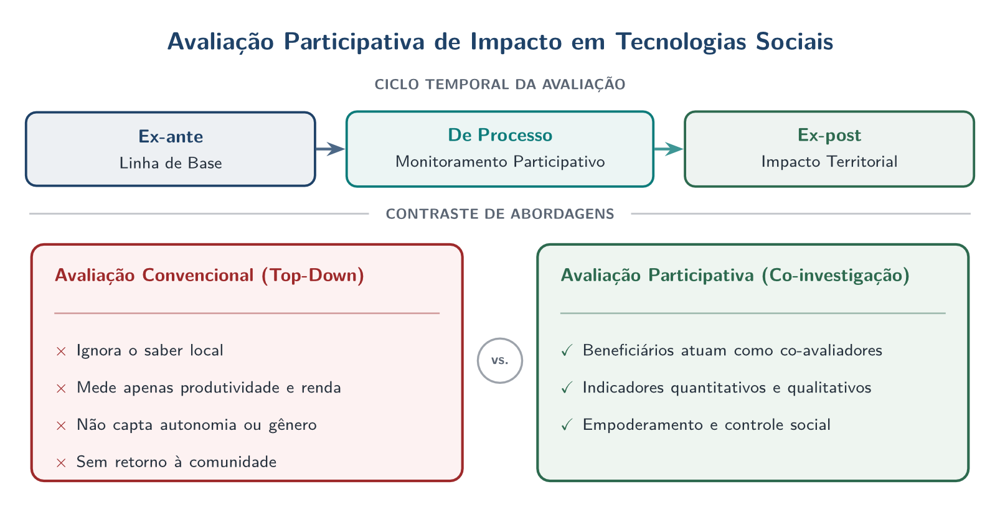
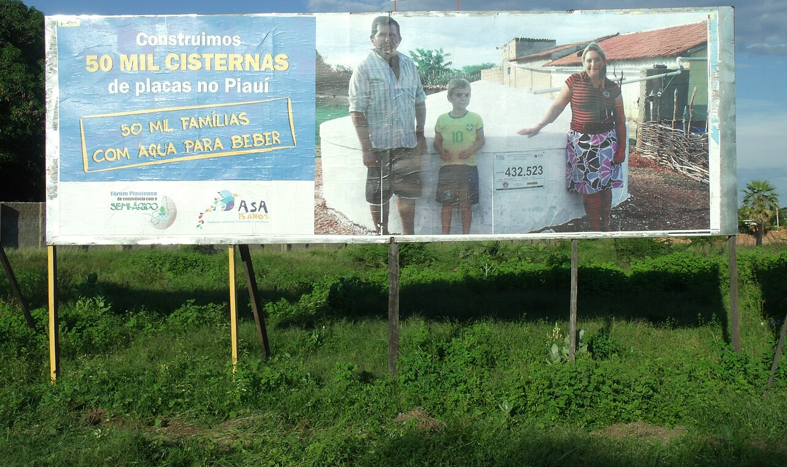

## [Abertura]{.pitch-tag} Visão Geral da Aula {#visao-geral .smaller-text .lesson-slide}

::: {.pitch-grid-50}
::: {.pitch-card}
[Roteiro da aula]{.pitch-card-index}
[Tópicos principais]{.pitch-heading}

- [1]{.circle} O que é avaliação de impacto e por que participativa?
- [2]{.circle} Métodos participativos de avaliação
- [3]{.circle} Indicadores para tecnologias sociais
- [4]{.circle} Estudo de caso: cisternas no semiárido
- [5]{.circle} Oficina prática: construindo uma avaliação
- [6]{.circle} Análise qualitativa dos resultados
:::

::: {.pitch-stack-2}
::: {.pitch-card .pitch-card--gold}
[Objetivo central]{.pitch-card-index}
[Avaliação construída com as comunidades]{.pitch-heading}

Capacitar o estudante de Engenharia Agronômica a planejar e conduzir uma avaliação participativa de impacto de tecnologias sociais implantadas no meio rural, utilizando indicadores construídos com as comunidades.
:::

::: {.pitch-pill-row}
[Co-investigação]{.pitch-pill}
[Indicadores locais]{.pitch-pill .pitch-pill--gold}
[Oficina de 4h]{.pitch-pill}
[Ética e devolutiva]{.pitch-pill .pitch-pill--gold}
:::

::: {.pitch-band .pitch-band--teal}
Dos marcos teóricos de Freire e Fetterman às ferramentas de campo e à análise quali-quantitativa.
:::
:::
:::

# 1 · Avaliação de Impacto: Conceitos {.section-header rotulo="Conceitos"}

## [Impacto]{.pitch-tag .pitch-tag--teal} O que é avaliação de impacto e por que participativa? {#o-que-e-avaliacao .smaller-text .lesson-slide}

::: {.pitch-grid-50}
::: {.pitch-stack-2}
::: {.pitch-card}
[Definição]{.pitch-card-index}
[Mudanças intencionais ou não]{.pitch-heading}

**Avaliação de impacto** é o processo sistemático de identificar as **mudanças** — intencionais ou não — que uma intervenção (projeto, política, tecnologia) gerou na vida das pessoas e nos sistemas em que estão inseridas.
:::

::: {.pitch-table-box}
| Tipo | Momento | Foco |
|---|---|---|
| **Ex ante** | Antes da ação | Viabilidade e projeção |
| **De processo** | Durante | Ajustes e aprendizados |
| **Ex post** | Após conclusão | Resultados e impactos |
:::
:::

::: {.pitch-card .pitch-card--gold}
[Abordagem dialógica]{.pitch-card-index}
[Por que participativa?]{.pitch-heading}

A avaliação convencional (*top-down*) frequentemente:

- Ignora o **saber local**
- Mede apenas indicadores técnicos (produtividade, renda)
- Não capta **mudanças subjetivas** (autonomia, autoestima, organização comunitária)
- Produz resultados que **não retornam** às comunidades

A avaliação **participativa** envolve os beneficiários como **co-avaliadores**, não apenas informantes.
:::
:::

## [Impacto]{.pitch-tag .pitch-tag--teal} Ciclo Temporal e Contraste de Abordagens {#ciclo-contraste-avaliacao .smaller-text .lesson-slide}

::: {.pitch-media-card .pitch-media-card--tall}

[Avaliação Participativa de Impacto em Tecnologias Sociais]{.pitch-caption}
[Integração entre linha de base, monitoramento participativo e análise de impacto territorial]{.pitch-caption-sub}
:::

::: {.pitch-band .pitch-band--navy}
Avaliar participativamente combina rigor metodológico (quantitativo e qualitativo) com empoderamento e controle social.
:::

## [Impacto]{.pitch-tag} Base Teórica: Freire e Empowerment Evaluation {#base-teorica .smaller-text .lesson-slide}

::: {.pitch-cards-2}
::: {.pitch-card .pitch-card--teal}
[Paulo Freire]{.pitch-card-index}
[Extensão dialógica]{.pitch-heading}

A avaliação participativa é coerente com a extensão freireana:

- Comunidade como **sujeito** da avaliação
- Diálogo como **método**
- Indicadores definidos **com** e não **para** o público
- Resultados devolvidos na forma de **ação transformadora**
:::

::: {.pitch-card .pitch-card--gold}
[Fetterman (2001)]{.pitch-card-index}
[Empowerment Evaluation]{.pitch-heading}

1. **Melhoria** — avaliar para melhorar, não para punir
2. **Apropriação comunitária** — a comunidade conduz o processo
3. **Inclusão** — todas as vozes, especialmente as marginalizadas
4. **Prestação de contas democrática** — transparência nos resultados
5. **Capacitação** — a comunidade aprende a avaliar
:::
:::

::: {.pitch-band}
A avaliação deixa de ser auditoria externa e passa a ser instrumento pedagógico de autogestão comunitária.
:::

# 2 · Métodos Participativos e Indicadores {.section-header rotulo="Métodos"}

## [Métodos]{.pitch-tag .pitch-tag--forest} Ferramentas Participativas de Coleta {#ferramentas-coleta .smaller-text .lesson-slide}

::: {.pitch-table-box}
| Ferramenta | Descrição | Quando usar |
|---|---|---|
| **Mapa Falante** | Desenho coletivo do território antes/depois da intervenção | Início da oficina — aquecer e contextualizar |
| **Linha do Tempo** | Reconstrução cronológica de mudanças percebidas | Avaliar processos ao longo dos anos |
| **Matriz de Indicadores** | Tabela com critérios definidos pelas famílias para pontuar mudanças | Quantificar percepções de forma estruturada |
| **Caminhada Transversal** | Percurso pelo território com observação participante | Triangular informações visuais e verbais |
| **Grupo Focal** | Discussão estruturada com 8–12 pessoas sobre temas-chave | Aprofundar percepções qualitativas |
| **Entrevista Semiestruturada** | Roteiro flexível aplicado individualmente | Captar experiências pessoais e sensíveis |
:::

::: {.pitch-band .pitch-band--teal}
A combinação de ferramentas visuais, coletivas e individuais permite triangular percepções com observação direta em campo.
:::

## [Métodos]{.pitch-tag .pitch-tag--forest} Construção Participativa de Indicadores {#construcao-indicadores .smaller-text .lesson-slide}

::: {.pitch-grid-55}
::: {.pitch-stack-2}
::: {.pitch-card}
[Processo em 4 etapas]{.pitch-card-index}
[Da escuta à métrica local]{.pitch-heading}

1. **Pergunta geradora:** *"O que mudou na sua vida depois da cisterna?"*
2. **Listagem livre:** cada participante fala mudanças percebidas
3. **Agrupamento temático:** facilitador organiza em categorias
4. **Definição de escala:** grupo define como "medir" cada indicador
:::

::: {.pitch-table-box}
| Nível | Descrição (definida pelo grupo) |
|:---:|---|
| **1** | "Não mudou nada" |
| **2** | "Melhorou um pouco" |
| **3** | "Melhorou bastante" |
| **4** | "Mudou completamente a vida" |
:::
:::

::: {.pitch-card .pitch-card--gold}
[Dimensões avaliadas]{.pitch-card-index}
[Categorias comuns de indicadores]{.pitch-heading}

- **Segurança hídrica** — acesso a água limpa, frequência de falta
- **Segurança alimentar** — diversificação da alimentação
- **Renda** — venda de excedentes, redução de gastos
- **Trabalho** — tempo gasto buscando água, divisão de tarefas
- **Saúde** — doenças de veiculação hídrica
- **Organização social** — participação em reuniões, associações
- **Gênero** — empoderamento feminino na gestão da água
:::
:::

# 3 · Estudo de Caso: Cisternas no Semiárido {.section-header rotulo="Estudo de Caso"}

## [Casos]{.pitch-tag .pitch-tag--teal} Programa Um Milhão de Cisternas (P1MC) {#programa-p1mc .smaller-text .lesson-slide}

::: {.pitch-grid-55}
::: {.pitch-stack-2}
::: {.pitch-card}
[Contexto e tecnologia social]{.pitch-card-index}
[ASA · Agricultura familiar do semiárido]{.pitch-heading}

- **Articulação do Semiárido Brasileiro (ASA):** > **1,2 milhão** de cisternas de placa (**16.000 L** cada)
- **Por que é tecnologia social?** Materiais e mão de obra locais, troca de conhecimento entre famílias, respeito cultural e baixo custo replicável
:::

::: {.pitch-table-box}
| Indicador (ASA, 2023) | Antes | Depois |
|---|:---:|:---:|
| Acesso à água potável | 23% | 89% |
| Doenças diarreicas (crianças) | Frequente | Rara |
| Tempo gasto buscando água | 3–5 h/dia | < 30 min/dia |
| Mulheres em associações | 12% | 47% |
| Quintais produtivos ativos | 8% | 62% |
:::
:::

::: {.pitch-media-card .pitch-media-card--photo}

[Cisternas de placa e famílias do Semiárido (ASA)]{.pitch-caption}
[Wikimedia Commons · acervo da disciplina]{.pitch-caption-sub}
:::
:::

## [Casos]{.pitch-tag .pitch-tag--teal} Exemplo de Avaliação Participativa: Riacho Seco (BA) {#exemplo-riacho-seco .smaller-text .lesson-slide}

::: {.pitch-band}
**Comunidade fictícia: Riacho Seco (BA)** — 35 famílias atendidas, cisternas implantadas desde 2018. Matriz construída como resultado direto da oficina comunitária:
:::

::: {.pitch-table-box}
| Indicador (definido pelas famílias) | Nota média (1–4) | Evidência qualitativa |
|---|:---:|---|
| **"Água na seca"** | **3,7** | "Antes dependia de carro-pipa, agora só peço quando a seca é muito longa" |
| **"Comida mais variada"** | **3,2** | "Plantei coentro, cebolinha, tomate — antes tudo vinha da feira" |
| **"Saúde das crianças"** | **3,5** | "Diminuiu as diarreias, a água é limpa" |
| **"Trabalho das mulheres"** | **3,8** | "Não carrego mais lata na cabeça, sobra tempo pra roça e reunião" |
| **"União da comunidade"** | **2,9** | "Quando construímos juntos, aprendemos a trabalhar em mutirão" |
:::

# 4 · Oficina Prática e Análise {.section-header rotulo="Oficina e Análise"}

## [Oficina]{.pitch-tag .pitch-tag--gold} Planejamento da Oficina Participativa (4 horas) {#planejamento-oficina .smaller-text .lesson-slide}

::: {.pitch-table-box}
| Momento | Tempo | Atividade | Material |
|---|:---:|---|---|
| **Abertura** | 15 min | Apresentação, expectativas, regras de convivência | Flip chart |
| **Mapa Falante** | 30 min | Desenho coletivo: "como era antes × como é agora" | Papel kraft, canetões |
| **Linha do Tempo** | 20 min | Marcos importantes desde a implantação da tecnologia | Barbante, cartões |
| **Intervalo** | 15 min | Café com bolo (cortesia) | — |
| **Construção de Indicadores** | 40 min | Pergunta geradora → listagem → agrupamento → escala | Cartões, tarjetas |
| **Pontuação coletiva** | 30 min | Cada família pontua os indicadores (votação com adesivos) | Adesivos coloridos |
| **Grupo Focal** | 20 min | Aprofundamento de 2–3 indicadores mais relevantes | Gravador (com permissão) |
| **Devolutiva e encerramento** | 10 min | Síntese visual dos resultados, próximos passos | Cartaz-síntese |
:::

## [Oficina]{.pitch-tag .pitch-tag--gold} Fichas de Campo para Coleta e Síntese {#fichas-campo .smaller-text .lesson-slide}

::: {.pitch-cards-2}
::: {.pitch-card}
[Instrumento 1]{.pitch-card-index}
[Ficha individual do facilitador]{.pitch-heading}

- **Cabeçalho:** Comunidade · Data · Família nº · Nº de membros · Tecnologia avaliada
- **Indicadores (escala 1–4):**
  1. [Indicador 1] `[   ]`
  2. [Indicador 2] `[   ]`
  3. [Indicador 3] `[   ]`
  4. [Indicador 4] `[   ]`
  5. [Indicador 5] `[   ]`
- **Observações de campo:** registro de falas literais e contexto domiciliar
:::

::: {.pitch-card .pitch-card--teal}
[Instrumento 2]{.pitch-card-index}
[Ficha de síntese coletiva]{.pitch-heading}

- **Cabeçalho:** Comunidade · Nº de participantes (homens / mulheres)
- **Quadro-síntese:** `Indicador | Nota média | Evidência` (linhas 1 a 3+)
- **Pontos fortes da tecnologia:** síntese consensual do grupo
- **Pontos a melhorar:** gargalos técnicos ou organizacionais
- **Recomendações do grupo:** encaminhamentos para a comunidade e ATER
:::
:::

::: {.pitch-band}
Padronizar fichas simples garante rastreabilidade sem engessar a escuta participativa durante a oficina.
:::

## [Análise]{.pitch-tag} Análise dos Resultados e Princípios Éticos {#analise-resultados .smaller-text .lesson-slide}

::: {.pitch-cards}
::: {.pitch-card}
[Dados quantitativos]{.pitch-card-index}
[Síntese numérica]{.pitch-heading}

- **Estatística descritiva** das notas por indicador (média, mediana, moda)
- **Gráfico radar** com as dimensões avaliadas
- Comparar notas entre subgrupos (gênero, idade, tamanho do lote)
:::

::: {.pitch-card .pitch-card--teal}
[Dados qualitativos]{.pitch-card-index}
[Bardin (2011)]{.pitch-heading}

- **Análise de conteúdo** das falas e anotações (Bardin, 2011)
- Identificar **categorias emergentes** — temas não previstos
- **Triangulação** — cruzar falas × observação × dados quantitativos
:::

::: {.pitch-card .pitch-card--alert}
[Princípios éticos]{.pitch-card-index}
[Compromisso com a comunidade]{.pitch-heading}

1. **Consentimento informado** — explicar o propósito e obter autorização
2. **Anonimato** — não vincular falas a nomes no relatório
3. **Devolutiva** — retornar os resultados à comunidade
4. **Não-extração** — não beneficiar apenas o pesquisador
5. **Aprovação em CEP** — para pesquisas acadêmicas (TCC, dissertação)
:::
:::

## [Oficina]{.pitch-tag .pitch-tag--gold} Exercício Proposto em Grupo {#exercicio-proposto .smaller-text .lesson-slide}

::: {.pitch-grid-60}
::: {.pitch-card}
[Atividade em grupo (4–5 alunos)]{.pitch-card-index}
[Roteiro prático da avaliação]{.pitch-heading}

1. Escolham uma **tecnologia social** implementada no seu município (cisterna, fossa biodigestora, horta comunitária, etc.)
2. Planejem uma **oficina de avaliação participativa** seguindo o roteiro apresentado
3. Definam pelo menos **5 indicadores** com escala participativa
4. Elaborem as **fichas de campo**
5. Simulem a oficina com colegas da turma como "comunidade"
6. Apresentem os resultados em formato de **relatório técnico**
:::

::: {.pitch-card .pitch-card--gold}
[Critérios de entrega]{.pitch-card-index}
[Avaliação da atividade]{.pitch-heading}

- **Formato:** relatório PDF + fichas preenchidas
- **Prazo:** 14 dias
- **Distribuição da nota:**
  - Planejamento: **25%**
  - Indicadores: **25%**
  - Simulação: **25%**
  - Relatório: **25%**
:::
:::

## [Referências]{.pitch-tag} Referências Bibliográficas {#referencias .smaller-text .lesson-slide}

::: {.pitch-cards-2}
::: {.pitch-card}
[Fundamentos metodológicos]{.pitch-card-index}
[Avaliação e análise de conteúdo]{.pitch-heading}

- BARDIN, L. *Análise de Conteúdo*. Edições 70, 2011.
- CHAMBERS, R. Participatory Rural Appraisal (PRA). *World Development*, v. 22, n. 9, p. 1253–1268, 1994.
- FETTERMAN, D. M. *Foundations of Empowerment Evaluation*. Sage, 2001.
:::

::: {.pitch-card .pitch-card--teal}
[Tecnologias sociais e marco legal]{.pitch-card-index}
[Semiárido e PNATER]{.pitch-heading}

- ASA BRASIL. *Programa Um Milhão de Cisternas — Relatório de Impacto*. Recife, 2023.
- BRASIL. *PNATER — Política Nacional de Assistência Técnica e Extensão Rural*. Lei nº 12.188/2010.
:::
:::
