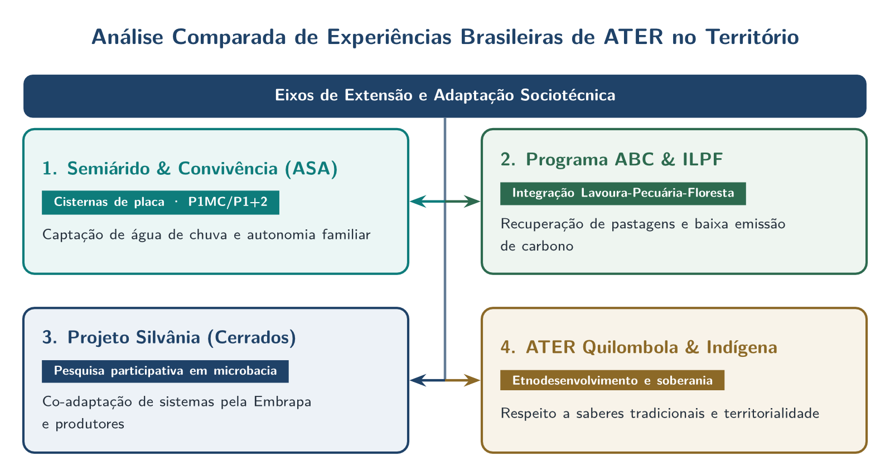
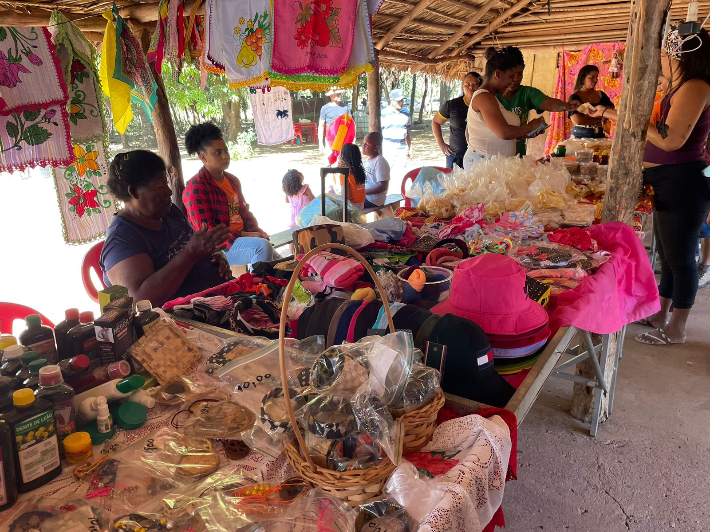

## [Abertura]{.pitch-tag} Visão Geral da Aula {#visao-geral .smaller-text .lesson-slide}

::: {.pitch-grid-50}
::: {.pitch-card}
[Roteiro da aula]{.pitch-card-index}
[Tópicos principais]{.pitch-heading}

- [1]{.circle} ATER e Agroecologia no Semiárido
- [2]{.circle} Programa ABC e Agricultura de Baixo Carbono
- [3]{.circle} Projeto Silvânia — Embrapa Cerrados
- [4]{.circle} ATER Quilombola e Indígena
- [5]{.circle} Extensão Rural e Convivência com a Seca
:::

::: {.pitch-stack-2}
::: {.pitch-card .pitch-card--gold}
[Objetivo central]{.pitch-card-index}
[Análise crítica de experiências reais]{.pitch-heading}

Analisar casos práticos de extensão rural no Brasil, avaliando metodologias empregadas, resultados alcançados e lições aprendidas para a formação do engenheiro agrônomo.
:::

::: {.pitch-pill-row}
[Semiárido & ASA]{.pitch-pill}
[ABC / ABC+]{.pitch-pill .pitch-pill--gold}
[Projeto Silvânia]{.pitch-pill}
[ATER Quilombola]{.pitch-pill .pitch-pill--gold}
:::

::: {.pitch-band .pitch-band--teal}
Da convivência hídrica à política climática e aos territórios tradicionais: como a ATER se adapta a cada realidade.
:::
:::
:::

## [Fundamentos]{.pitch-tag} Por que estudar casos práticos? {#por-que-estudar-casos .smaller-text .lesson-slide}

::: {.pitch-grid-50}
::: {.pitch-card}
[Formação profissional]{.pitch-card-index}
[Da teoria à prática no campo]{.pitch-heading}

A formação do engenheiro agrônomo exige mais do que conhecimento teórico sobre extensão rural. É na **análise de experiências concretas** que se revelam:

- As tensões entre teoria e prática
- As adaptações metodológicas necessárias
- Os fatores que determinam sucesso ou fracasso
- As especificidades regionais e culturais
:::

::: {.pitch-card .pitch-card--gold}
[Critérios de análise]{.pitch-card-index}
[Roteiro comparativo dos cinco casos]{.pitch-heading}

Para cada caso, avaliaremos:

1. Contexto socioambiental
2. Metodologia de extensão adotada
3. Público-alvo e participação
4. Resultados mensuráveis
5. Sustentabilidade da ação
:::
:::

::: {.pitch-band}
Estudar casos reais evita a aplicação mecânica de modelos únicos e desenvolve leitura territorial crítica.
:::

## [Panorama]{.pitch-tag} Matriz Comparada de Experiências Brasileiras de ATER {#matriz-casos-ater .smaller-text .lesson-slide}

::: {.pitch-media-card .pitch-media-card--tall}

[Eixos de extensão e adaptação sociotécnica no Brasil]{.pitch-caption}
[Síntese visual dos quatro grandes campos de experimentação e territorialização da ATER]{.pitch-caption-sub}
:::

::: {.pitch-band .pitch-band--navy}
Cada experiência articula tecnologia social ou produtiva, arranjo institucional e protagonismo dos sujeitos locais.
:::

# 1 · Convivência com o Semiárido {.section-header rotulo="Semiárido"}

## [Casos]{.pitch-tag .pitch-tag--teal} Caso 1 · Agroecologia e ASA no Semiárido {#caso-1-agroecologia-semiarido .smaller-text .lesson-slide}

::: {.pitch-grid-55}
::: {.pitch-stack-2}
::: {.pitch-card .pitch-card--teal}
[Contexto · IBGE (2017)]{.pitch-card-index}
[Agricultura familiar e escassez hídrica]{.pitch-heading}

O semiárido nordestino abriga mais de **1,5 milhão** de estabelecimentos da agricultura familiar (IBGE, 2017), enfrentando escassez hídrica crônica e solos degradados.
:::

::: {.pitch-card}
[Ação e metodologia · ASA]{.pitch-card-index}
[Convivência com o semiárido]{.pitch-heading}

Programas articulados pela **ASA (Articulação do Semiárido)** e ONGs locais promovem:

- Cisternas de placa (**P1MC** — Programa Um Milhão de Cisternas)
- Quintais produtivos agroecológicos
- Bancos de sementes crioulas e fossas sépticas biodigestoras

**Metodologia:** DRP (Diagnóstico Rural Participativo) + mobilização comunitária + formação de agricultores-multiplicadores.
:::
:::

::: {.pitch-media-card .pitch-media-card--photo}

[Programa Um Milhão de Cisternas (P1MC / ASA)]{.pitch-caption}
[Wikimedia Commons · CC BY-SA 3.0 BR · acervo da disciplina]{.pitch-caption-sub}
:::
:::

## [Casos]{.pitch-tag .pitch-tag--teal} Caso 1 · Resultados e Lições para o Agrônomo {#caso-1-resultados-licoes .smaller-text .lesson-slide}

::: {.pitch-grid-55}
::: {.pitch-stack-2}
::: {.pitch-card .pitch-card--forest}
[Resultados alcançados]{.pitch-card-index}
[Escala social e autonomia hídrica]{.pitch-heading}

- Mais de **1,2 milhão** de cisternas construídas até 2023
- Redução da dependência de carros-pipa
- Diversificação da produção para autoconsumo
- Empoderamento das mulheres na gestão hídrica
- Premiação internacional (**ONU, FAO**)
:::

::: {.pitch-card .pitch-card--gold}
[Lições para o agrônomo]{.pitch-card-index}
[Construção conjunta de resiliência]{.pitch-heading}

- A **convivência com a seca** é mais eficaz que o combate à seca
- Tecnologias sociais de baixo custo podem atingir **grande escala**
- A mobilização comunitária é pré-requisito para a sustentabilidade
- O saber local sobre manejo hídrico é complementar ao técnico
:::
:::

::: {.pitch-stack-2}
::: {.pitch-media-card .pitch-media-card--photo .pitch-media-card--compact}

[Cisterna de placa em Serrinha/BA]{.pitch-caption}
[MDS / Wikimedia Commons · CC BY-SA 2.0]{.pitch-caption-sub}
:::

::: {.pitch-band .pitch-band--teal}
"A extensão aqui não é 'transferência', é **construção conjunta** de resiliência" (Malvezzi, 2007).
:::
:::
:::

## [Casos]{.pitch-tag .pitch-tag--teal} Caso 5 · Convivência com a Seca em Sergipe {#caso-5-sergipe .smaller-text .lesson-slide}

::: {.pitch-band}
**Contexto:** o semiárido sergipano concentra parte significativa dos municípios com baixo IDH do estado. A **EMDAGRO** (Empresa de Desenvolvimento Agropecuário de Sergipe) e organizações de base atuam na extensão rural local.
:::

::: {.pitch-cards}
::: {.pitch-card}
[Ações desenvolvidas]{.pitch-card-index}
[Tecnologias e comercialização]{.pitch-heading}

- Cisternas de **1ª e 2ª águas** (P1MC + P1+2)
- Manejo sustentável da Caatinga para apicultura
- Quintais produtivos com gotejamento simplificado
- Bancos de sementes crioulas do semiárido
- Feiras agroecológicas para venda direta
:::

::: {.pitch-card .pitch-card--gold}
[Rede de ATER em Sergipe]{.pitch-card-index}
[Articulação interinstitucional]{.pitch-heading}

- **EMDAGRO:** capilaridade municipal e crédito (PRONAF)
- **UFS / IFS:** pesquisa e formação de extensionistas
- **SENAR-SE:** capacitação gerencial
- **ASA / ONGs:** tecnologias sociais e mobilização
- **Prefeituras:** logística e infraestrutura local
:::

::: {.pitch-card .pitch-card--forest}
[Resultados observados]{.pitch-card-index}
[Resiliência em rede territorial]{.pitch-heading}

- Redução de perdas por estiagem nas propriedades atendidas
- Aumento da diversidade produtiva (até **12 espécies** por quintal produtivo)
- Inserção em mercados institucionais (**PAA e PNAE**)
- Formação de grupos de mulheres produtoras
:::
:::

::: {.pitch-band .pitch-band--navy}
A extensão rural é mais eficaz quando opera em **rede territorial**, e não como ação isolada de uma única entidade.
:::

# 2 · Baixo Carbono e Pesquisa Participativa {.section-header rotulo="ABC+ e Silvânia"}

## [Casos]{.pitch-tag .pitch-tag--forest} Caso 2 · Programa ABC e Agricultura de Baixo Carbono {#caso-2-programa-abc .smaller-text .lesson-slide}

::: {.pitch-grid-55}
::: {.pitch-stack-2}
::: {.pitch-card .pitch-card--forest}
[Contexto e papel da ATER]{.pitch-card-index}
[Mitigação climática no campo]{.pitch-heading}

O Plano de Agricultura de Baixo Carbono (**ABC**), lançado em 2010 e reformulado como **ABC+** em 2021, visa **mitigar emissões de GEE** no setor agropecuário.

Sua efetividade depende de **extensionistas capacitados** para orientar a adoção das tecnologias pelos produtores.
:::

::: {.pitch-card}
[Tecnologias promovidas]{.pitch-card-index}
[Seis pilares produtivos]{.pitch-heading}

- Recuperação de pastagens degradadas
- Integração Lavoura-Pecuária-Floresta (**iLPF**)
- Sistema Plantio Direto (**SPD**)
- Fixação biológica de nitrogênio (**FBN**)
- Tratamento de dejetos animais e Sistemas Agroflorestais (**SAFs**)
:::
:::

::: {.pitch-media-card .pitch-media-card--photo}

[Integração Lavoura-Pecuária-Floresta (iLPF), Cachoeira Dourada/GO]{.pitch-caption}
[Túllio F / Wikimedia Commons · CC BY-SA 4.0]{.pitch-caption-sub}
:::
:::

## [Casos]{.pitch-tag .pitch-tag--forest} Caso 2 · Desafios e Resultados do Programa ABC (2010–2023) {#caso-2-resultados-abc .smaller-text .lesson-slide}

::: {.pitch-flow-4}
::: {.pitch-card .pitch-card--forest}
[Pastagens]{.pitch-card-index}
[52 milhões ha]{.pitch-heading}

Área com algum grau de recuperação de pastagens degradadas.
:::

::: {.pitch-card}
[Plantio direto]{.pitch-card-index}
[17,4 milhões ha]{.pitch-heading}

Adoção do Sistema Plantio Direto (SPD) em áreas agrícolas.
:::

::: {.pitch-card .pitch-card--teal}
[Sistemas integrados]{.pitch-card-index}
[18,7 milhões ha]{.pitch-heading}

Área implantada em Integração Lavoura-Pecuária-Floresta (iLPF).
:::

::: {.pitch-card .pitch-card--gold}
[Mitigação de GEE]{.pitch-card-index}
[170 Mt CO₂eq]{.pitch-heading}

Redução estimada de emissões de gases de efeito estufa evitadas.
:::
:::

::: {.pitch-cards-2}
::: {.pitch-card .pitch-card--alert}
[Desafios de implementação]{.pitch-card-index}
[Gargalos para a ATER]{.pitch-heading}

- Alto nível de **conhecimento técnico** requerido (solo, carbono, integração)
- Necessidade de **planejamento de longo prazo** (5–15 anos)
- Dificuldade de mensuração de resultados (emissões evitadas)
- Acesso ao crédito como gargalo (burocracia bancária)
:::

::: {.pitch-card .pitch-card--forest}
[Significado institucional]{.pitch-card-index}
[ATER como política climática]{.pitch-heading}

A efetividade do Programa ABC está diretamente ligada à capacidade técnica da assistência rural e demonstra que a ATER pode atuar como instrumento de **política climática**, não apenas de produtividade.
:::
:::

## [Casos]{.pitch-tag} Caso 3 · Projeto Silvânia (Embrapa Cerrados) {#caso-3-projeto-silvania .smaller-text .lesson-slide}

::: {.pitch-band}
**Contexto:** conduzido pela **Embrapa Cerrados (DF/GO)** nas décadas de 1980–2000, o Projeto Silvânia é referência em **pesquisa-desenvolvimento participativa** no Brasil — co-construída com agricultores desde o início, em vez de "transferida" da estação experimental.
:::

::: {.pitch-cards}
::: {.pitch-card}
[Fase 1 · Zoby e Xavier (2004)]{.pitch-card-index}
[Análise e diagnóstico]{.pitch-heading}

Levantamento socioeconômico e edáfico das propriedades rurais do município.
:::

::: {.pitch-card .pitch-card--gold}
[Fase 2 · Experimentação]{.pitch-card-index}
[Unidades demonstrativas]{.pitch-heading}

Implantação em propriedades selecionadas, com participação ativa dos agricultores.
:::

::: {.pitch-card .pitch-card--teal}
[Fase 3 · Extensão e difusão]{.pitch-card-index}
[Adaptação territorial]{.pitch-heading}

Adaptação das inovações às particularidades produtivas e econômicas de cada produtor.
:::
:::

::: {.pitch-cards-2}
::: {.pitch-card .pitch-card--forest}
[Condições de integração]{.pitch-card-index}
[Pesquisa e ATER integradas]{.pitch-heading}

- O **agricultor** participa do desenho experimental
- A **propriedade** é a unidade de referência (não a estação experimental)
- Os **indicadores** são definidos conjuntamente (produtividade + renda + qualidade de vida)
- O **tempo** de maturação é respeitado (mais de 10 anos)
:::

::: {.pitch-card .pitch-card--gold}
[Legado institucional]{.pitch-card-index}
[Influência na PNATER]{.pitch-heading}

Influenciou a criação de metodologias participativas na Embrapa (**Projeto Unaí**, **Projeto Fruticultura Centro-Norte**) e reforçou os princípios posteriormente incorporados à **PNATER (Lei 12.188/2010)**.
:::
:::

# 3 · Povos e Comunidades Tradicionais {.section-header rotulo="Quilombolas"}

## [Casos]{.pitch-tag .pitch-tag--gold} Caso 4 · ATER Quilombola e Território Coletivo {#caso-4-ater-quilombola .smaller-text .lesson-slide}

::: {.pitch-grid-55}
::: {.pitch-stack-2}
::: {.pitch-card .pitch-card--gold}
[Contexto e chamadas públicas]{.pitch-card-index}
[Fundação Palmares (2023) · MDA (2013–2016)]{.pitch-heading}

O Brasil possui mais de **6.300 comunidades quilombolas** identificadas (Fundação Palmares, 2023), a maioria no Nordeste, com terras tituladas ou em regularização.

Chamadas Públicas de **ATER Quilombola (MDA, 2013–2016)** contrataram ONGs e cooperativas para assistência técnica culturalmente adequada.
:::

::: {.pitch-card .pitch-card--alert}
[Desafios específicos]{.pitch-card-index}
[Limites do modelo individual]{.pitch-heading}

- **Terras coletivas** (não se aplica o modelo individual de ATER)
- Sistemas baseados em roça de toco, extrativismo e pequena pecuária
- Saberes tradicionais sobre manejo de agrobiodiversidade
- Insegurança territorial e conflitos fundiários
:::
:::

::: {.pitch-media-card .pitch-media-card--photo}

[Comunidade Quilombola Mata Cavalo]{.pitch-caption}
[Acervo próprio da disciplina · fotografia documental de campo]{.pitch-caption-sub}
:::
:::

## [Casos]{.pitch-tag .pitch-tag--gold} Caso 4 · Metodologias Culturalmente Adequadas {#caso-4-metodologias .smaller-text .lesson-slide}

::: {.pitch-cards-2}
::: {.pitch-card .pitch-card--forest}
[Princípios da ATER Quilombola]{.pitch-card-index}
[Respeito à territorialidade]{.pitch-heading}

- Respeito ao **calendário produtivo** tradicional
- Valorização dos **sistemas agroflorestais** ancestrais
- Fortalecimento das **organizações comunitárias** locais
- Integração com políticas de **acesso a mercados** (PAA, PNAE)
- Formação de **agentes comunitários de ATER**
:::

::: {.pitch-card}
[Lições-chave]{.pitch-card-index}
[Escuta e intervenção comunitária]{.pitch-heading}

- O modelo "universal" de extensão é **insuficiente**
- A escuta ativa é mais importante que o receituário técnico
- O território é **coletivo** — a intervenção deve ser comunitária
- A segurança territorial é pré-condição para qualquer ação produtiva
:::
:::

::: {.pitch-band .pitch-band--navy}
"Não há ATER eficaz sem **justiça fundiária**" (Almeida, 2008).
:::

# 4 · Síntese e Referências {.section-header rotulo="Síntese"}

## [Síntese]{.pitch-tag} Quadro Comparativo dos Casos Analisados {#sintese-comparativa .smaller-text .lesson-slide}

::: {.pitch-table-box}
| Caso | Região | Metodologia | Público | Resultado Principal |
| --- | --- | --- | --- | --- |
| **Semiárido / ASA** | Nordeste | DRP + Mobilização | Agricultura familiar | 1,2M cisternas |
| **ABC / ABC+** | Nacional | Crédito + AT | Todos | 52M ha pastagens recuperadas |
| **Silvânia** | Cerrado | Pesquisa participativa | Pequenos produtores | Modelo pesquisa-ATER |
| **ATER Quilombola** | Nordeste | Culturalmente adequada | Quilombolas | Fortalecimento territorial |
| **Convivência (SE)** | Sergipe | Rede territorial | Agricultura familiar | Resiliência hídrica |
:::

::: {.pitch-band .pitch-band--teal}
A extensão rural brasileira não admite receitas universais; exige **adaptação metodológica** ao contexto socioambiental, cultural e institucional de cada território.
:::

## [Síntese]{.pitch-tag .pitch-tag--teal} Conclusão para a Formação Agronômica {#conclusao .smaller-text .lesson-slide}

::: {.pitch-cards-2}
::: {.pitch-card}
[Atuação profissional]{.pitch-card-index}
[Perfil do engenheiro agrônomo]{.pitch-heading}

O engenheiro agrônomo formado pela UEFS deve ser capaz de diagnosticar realidades, selecionar métodos participativos, articular redes institucionais e avaliar resultados de modo crítico, sempre com respeito aos saberes locais e às dinâmicas territoriais.
:::

::: {.pitch-card .pitch-card--gold}
[Síntese metodológica]{.pitch-card-index}
[Território antes da receita]{.pitch-heading}

Cada território demanda leitura edafoclimática, sociocultural e institucional própria — unindo ciência agronômica, tecnologia social e protagonismo comunitário.
:::
:::

::: {.pitch-formula}
"A extensão rural eficaz é aquela que se torna **desnecessária** — porque empoderou o agricultor a seguir por conta própria."
:::

## [Referências]{.pitch-tag} Referências Bibliográficas {#referencias .smaller-text .lesson-slide}

::: {.pitch-cards-2}
::: {.pitch-card}
[Casos, semiárido e povos tradicionais]{.pitch-card-index}
[Obras de referência]{.pitch-heading}

- ALMEIDA, A. W. B. *Terras tradicionalmente ocupadas* (2008).
- ASA BRASIL. *Programa Um Milhão de Cisternas* (2023).
- IBGE. *Censo Agropecuário 2017* (2019).
- MALVEZZI, R. *Semi-Árido — Uma Visão Holística* (2007).
:::

::: {.pitch-card .pitch-card--teal}
[Políticas públicas e pesquisa participativa]{.pitch-card-index}
[Legislação e estudos]{.pitch-heading}

- BRASIL. *Plano ABC — Agricultura de Baixo Carbono* (2012).
- BRASIL. *Lei nº 12.188/2010 — PNATER* (2010).
- ZOBY, J. L. F.; XAVIER, J. H. V. *Projeto Silvânia — CPAC/Embrapa Cerrados* (2004).
:::
:::
