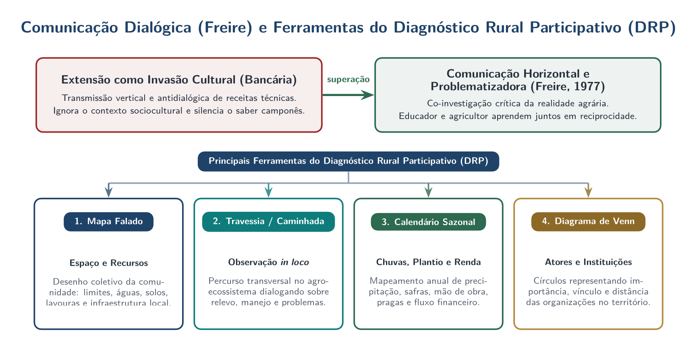

## [Abertura]{.pitch-tag} Visão Geral da Aula {#visao-geral .smaller-text .lesson-slide}

::: {.pitch-grid-50}
::: {.pitch-card}
[Roteiro da aula]{.pitch-card-index}
[Tópicos principais]{.pitch-heading}

- [1]{.circle} Extensão Rural e Comunicação
- [2]{.circle} Transição Paradigmática
- [3]{.circle} Freire: Extensão ou Comunicação?
- [4]{.circle} Andragogia e Abordagens Sistêmicas
- [5]{.circle} Métodos Participativos (DRP, ARP, ECA)
:::

::: {.pitch-stack-2}
::: {.pitch-card .pitch-card--gold}
[Objetivo da aula]{.pitch-card-index}
[Comunicação dialógica e prática]{.pitch-heading}

Compreender a transição da extensão difusionista para a comunicação dialógica e participativa, com base em Paulo Freire, na andragogia e nos métodos participativos.
:::

::: {.pitch-pill-row}
[Paulo Freire]{.pitch-pill}
[Andragogia]{.pitch-pill .pitch-pill--gold}
[DRP · ARP · ECA]{.pitch-pill}
:::

::: {.pitch-band .pitch-band--teal}
Do monólogo técnico da transferência de pacotes à escuta ativa e à construção compartilhada do conhecimento.
:::
:::
:::

# 1 · Da Difusão à Comunicação Dialógica {.section-header rotulo="Comunicação"}

## [Difusionismo]{.pitch-tag .pitch-tag--alert} A Extensão Rural e a Comunicação Linear {#extensao-comunicacao .smaller-text .lesson-slide}

::: {.pitch-cards-2}
::: {.pitch-card .pitch-card--alert}
[Abordagem difusionista inicial]{.pitch-card-index}
[Fluxo unilateral]{.pitch-heading}

A extensão rural nas fases iniciais foi caracterizada por uma abordagem **difusionista**:

- Fluxo de informações **unilateral** (extensionista → agricultor)
- Mera ferramenta de implementação de tecnologias
- Abordagem "do **topo para baixo**" (Peixoto, 2008)
:::

::: {.pitch-card}
[Assimetria comunicacional]{.pitch-card-index}
[Comunicação linear]{.pitch-heading}

Comunicação **linear**, baseada na posse absoluta do conhecimento pelo extensionista.

**Exemplo histórico:** atuação da Associação Americana para o Desenvolvimento Econômico e Social (**AIA**).
:::
:::

::: {.pitch-band}
No modelo linear, o erro ou a não adoção são imputados ao agricultor, ignorando a inadequação das mensagens e das tecnologias ao contexto local.
:::

## [Transição]{.pitch-tag .pitch-tag--teal} A Transição Paradigmática para o Diálogo {#transicao-paradigmatica .smaller-text .lesson-slide}

::: {.pitch-cards-2}
::: {.pitch-card .pitch-card--teal}
[Via de mão dupla]{.pitch-card-index}
[Comunicação dialógica]{.pitch-heading}

Um avanço significativo emergiu com a transição da **mera difusão** para uma **comunicação dialógica e participativa**, assegurando fluxo em **via de mão dupla**.
:::

::: {.pitch-card .pitch-card--forest}
[Valorização do sujeito]{.pitch-card-index}
[Saberes e interesses locais]{.pitch-heading}

A comunicação participativa promove a incorporação efetiva da **sabedoria e experiência local** do agricultor e dos seus **interesses**.
:::
:::

::: {.pitch-formula}
**Princípio da reciprocidade:** Extensionista e agricultor tornam-se **aprendizes e educadores simultâneos**.
:::

## [Freire/DRP]{.pitch-tag .pitch-tag--forest} Freire: Extensão ou Comunicação? {#freire-extensao-comunicacao .smaller-text .lesson-slide}

::: {.columns}
::: {.column width="34%"}
::: {.pitch-media-card .pitch-media-card--photo .pitch-media-card--tall}
{style="object-position: center 15%;"}

[Paulo Freire (1977)]{.pitch-caption}
[Slobodan Dimitro · CC-BY-SA 3.0]{.pitch-caption-sub}
:::
:::

::: {.column width="66%"}
::: {.pitch-stack-2}
::: {.pitch-card .pitch-card--alert}
[Crítica ao termo "extensão"]{.pitch-card-index}
[Comunicação ou Extensão (1980)]{.pitch-heading}

O termo "extensão", como verbo transitivo, **coisifica** o homem do campo.

**Campo associativo:** invasão cultural, messianismo, transmissão.
:::

::: {.pitch-card .pitch-card--forest}
[Proposta de Paulo Freire]{.pitch-card-index}
[Articulação de saberes]{.pitch-heading}

O agrônomo deve se posicionar como **"comunicador"**, engajando-se em diálogo **bidirecional e participativo**. A comunicação torna-se um processo de **articulação de saberes** — construção conjunta de conhecimentos aplicados à realidade.
:::
:::
:::
:::

# 2 · Abordagens Sistêmicas, Andragogia e PNATER {.section-header rotulo="Andragogia"}

## [Teorias]{.pitch-tag} Abordagens Comunicacionais e Base Teórica {#abordagens-comunicacionais .smaller-text .lesson-slide}

::: {.pitch-band .pitch-band--teal}
Nasce a perspectiva das **abordagens sistêmicas e participativas**, que transformaram o ato de extensão em **momentos de trocas de saberes**.
:::

::: {.pitch-table-box}
| Teoria | Autor | Foco |
| --- | --- | --- |
| **Extensão como Comunicação** | Paulo Freire | Diálogo bidirecional |
| **Educação Crítica Construtivista** | Jean Piaget | Construção do conhecimento |
| **Crítica Emancipatória** | José Libâneo | Autonomia do sujeito |
| **Andragogia** | Malcolm S. Knowles | Aprendizagem adulta |
:::

## [Andragogia]{.pitch-tag .pitch-tag--gold} Andragogia: Os Seis Princípios na ATER {#andragogia-principios .smaller-text .lesson-slide}

::: {.pitch-band}
A andragogia busca, a partir de **seis princípios**, estruturar uma ATER efetiva, participativa e centrada no aprendiz adulto (Knowles, 1980):
:::

::: {.pitch-cards}
::: {.pitch-card}
[01 · Necessidade]{.pitch-card-index}
[Interesses reais]{.pitch-heading}

Explorar interesses pessoais do produtor.
:::

::: {.pitch-card .pitch-card--gold}
[02 · Autonomia]{.pitch-card-index}
[Autogestão]{.pitch-heading}

Promover capacidade de autogestão nas decisões.
:::

::: {.pitch-card .pitch-card--forest}
[03 · Experiência]{.pitch-card-index}
[Saber acumulado]{.pitch-heading}

O saber do agricultor é recurso pedagógico fundamental.
:::

::: {.pitch-card .pitch-card--teal}
[04 · Motivação]{.pitch-card-index}
[Mediação ativa]{.pitch-heading}

Técnicos atuam como agentes catalisadores.
:::

::: {.pitch-card}
[05 · Orientação na realidade]{.pitch-card-index}
[Contexto local]{.pitch-heading}

Ações que caibam na realidade da propriedade.
:::

::: {.pitch-card .pitch-card--gold}
[06 · Aplicabilidade]{.pitch-card-index}
[Uso e propagação]{.pitch-heading}

Proposta real, que o produtor possa usar e propagar.
:::
:::

## [Autonomia]{.pitch-tag .pitch-tag--forest} Andragogia, Autonomia e Abordagens Sistêmicas {#andragogia-autonomia-sistemicas .smaller-text .lesson-slide}

::: {.pitch-cards-2}
::: {.pitch-card .pitch-card--forest}
[Pedagogia da Autonomia]{.pitch-card-index}
[Empoderamento pela comunicação]{.pitch-heading}

A andragogia e a pedagogia da autonomia destacam-se como imperativo de uma extensão que **empodera** os indivíduos a *"tornarem-se autores de suas próprias histórias"* (Freire, 1996), a partir da **comunicação** existente entre todas as partes.

Exige a seleção de **métodos e meios apropriados** para garantir a compreensão do público-alvo.
:::

::: {.pitch-card}
[Abordagens sistêmicas]{.pitch-card-index}
[Complexidade dos sistemas locais]{.pitch-heading}

A agricultura não opera em um **vácuo**: está entrelaçada com contextos **sociais, econômicos e ambientais**.

Essa multiplicidade alinha-se à ênfase de Knowles na **experiência de vida** do adulto, promovendo relacionamento mais **simétrico e colaborativo** entre extensionistas e agricultores.
:::
:::

## [Política]{.pitch-tag} PNATER (Lei 12.188/10) como Comunicação {#pnater-comunicacao .smaller-text .lesson-slide}

::: {.pitch-band .pitch-band--navy}
A **Lei 12.188/10 (PNATER)** enfatiza a necessidade de **comunicação eficaz** como meio de promover seus seis princípios norteadores.
:::

::: {.pitch-cards}
::: {.pitch-card}
[01 · Equidade]{.pitch-card-index}
[Inclusão social]{.pitch-heading}

Participação democrática das famílias agricultoras.
:::

::: {.pitch-card .pitch-card--gold}
[02 · Reconhecimento]{.pitch-card-index}
[Respeito à diversidade]{.pitch-heading}

Valorização das identidades e saberes locais.
:::

::: {.pitch-card .pitch-card--forest}
[03 · Sustentabilidade]{.pitch-card-index}
[Transição ecológica]{.pitch-heading}

Transição para agricultura de base ecológica.
:::

::: {.pitch-card}
[04 · Economia]{.pitch-card-index}
[Ocupação e renda]{.pitch-heading}

Geração de trabalho, renda e agregação de valor.
:::

::: {.pitch-card .pitch-card--teal}
[05 · Integração]{.pitch-card-index}
[Pesquisa–ATER–Ensino]{.pitch-heading}

Articulação permanente entre conhecimento científico e empírico.
:::

::: {.pitch-card .pitch-card--teal}
[06 · Cooperação]{.pitch-card-index}
[Atuação em redes]{.pitch-heading}

Trocas interinstitucionais e protagonismo comunitário.
:::
:::

# 3 · Metodologias Participativas e Novas Mídias {.section-header rotulo="Métodos"}

## [Freire/DRP]{.pitch-tag .pitch-tag--forest} Comunicação Dialógica e Ferramentas do DRP {#diagrama-drp-freire .smaller-text .lesson-slide}

::: {.pitch-media-card .pitch-media-card--tall}

[Comunicação Dialógica (Freire) e Ferramentas do Diagnóstico Rural Participativo (DRP)]{.pitch-caption}
[Mapa Falado, Travessia/Caminhada, Calendário Sazonal e Diagrama de Venn como práticas de co-investigação]{.pitch-caption-sub}
:::

## [Métodos]{.pitch-tag .pitch-tag--forest} Métodos Participativos: ARP, DRP e ECA {#metodos-participativos .smaller-text .lesson-slide}

::: {.columns}
::: {.column width="36%"}
::: {.pitch-media-card .pitch-media-card--photo .pitch-media-card--tall}
{style="object-position: center 35%;"}

[Método Paulo Freire — educação dialógica]{.pitch-caption}
[Ilustração de André Koehne · CC-BY-SA 3.0]{.pitch-caption-sub}
:::
:::

::: {.column width="64%"}
::: {.pitch-stack-2}
::: {.pitch-table-box}
| Método | Sigla | Descrição |
| --- | --- | --- |
| **Avaliação Rural Participativa** | ARP | Avaliação de necessidades e potencialidades |
| **Diagnóstico Rural Participativo** | DRP | Diagnóstico assertivo e direcionado |
| **Escolas de Campo para Agricultores** | ECA | Aprendizado prático no campo |
:::

::: {.pitch-band .pitch-band--teal}
Facilitam o **diálogo** e a **tomada de decisão compartilhada**, incorporando na prática rural os princípios freireanos e andragógicos.
:::
:::
:::
:::

## [Prática]{.pitch-tag .pitch-tag--gold} Aplicação Prática dos Métodos Participativos {#aplicacao-metodos .smaller-text .lesson-slide}

::: {.pitch-band}
**Possibilidades operacionais** para condução qualificada de processos participativos com grupos rurais:
:::

::: {.pitch-milestones}
::: {.pitch-milestone-item}
**1. Diagnósticos assertivos (ex.: DRP):** direcionados ao perfil concreto da comunidade e do agroecossistema.
:::

::: {.pitch-milestone-item}
**2. Programação clara:** permitir que os participantes expressem seus interesses antes da oficina ou encontro.
:::

::: {.pitch-milestone-item}
**3. Capacitar grupos com interesse comum:** redução de ruídos comunicacionais e maior engajamento coletivo.
:::

::: {.pitch-milestone-item}
**4. Recursos didáticos apropriados:** materiais visuais e práticos para reduzir dificuldades de materialização.
:::

::: {.pitch-milestone-item}
**5. Ouvir ativamente:** ouvir o máximo possível, tomar anotações e compreender necessidades reais antes de propor soluções.
:::
:::

## [Mídias]{.pitch-tag .pitch-tag--teal} Marketing Rural e Novas Mídias na Extensão {#marketing-novas-midias .smaller-text .lesson-slide}

::: {.pitch-cards-2}
::: {.pitch-card .pitch-card--gold}
[Comercialização e território]{.pitch-card-index}
[Marketing Rural]{.pitch-heading}

Estratégias de comercialização de produtos e serviços voltados ao campo:

- **Marketing de insumos:** sementes, fertilizantes, máquinas
- **Marketing de produtos:** comercialização agrícola, feiras, mercados institucionais (PAA, PNAE)
- **Marketing territorial:** indicações geográficas, selos de origem
- **Marketing social:** campanhas educativas no campo
:::

::: {.pitch-card .pitch-card--teal}
[Revolução digital no campo]{.pitch-card-index}
[Novas Mídias na Extensão]{.pitch-heading}

Novos canais transformaram a comunicação rural:

- **WhatsApp** como ferramenta de articulação entre agricultores e extensionistas
- **YouTube** — canais de manejo agrícola com milhões de acessos
- Redes sociais de cooperativas e feiras agroecológicas
- **Podcasts** rurais e agronômicos
:::
:::

::: {.pitch-band}
O desafio é garantir que as novas mídias sirvam à comunicação **dialógica**, não à mera difusão publicitária (Freire, 1979).
:::

# 4 · Síntese e Referências {.section-header rotulo="Síntese"}

## [Síntese]{.pitch-tag} Conclusão: A Comunicação como Elemento Crucial {#conclusao .smaller-text .lesson-slide}

::: {.pitch-band .pitch-band--navy}
Uma comunicação eficaz emerge como elemento **crucial** para o sucesso do novo paradigma da extensão rural brasileira.
:::

::: {.pitch-flow-4}
::: {.pitch-card .pitch-card--forest}
[01 · Sustentabilidade]{.pitch-card-index}
[Catalisador]{.pitch-heading}

Atua como **catalisador** para o desenvolvimento rural sustentável.
:::

::: {.pitch-card .pitch-card--gold}
[02 · Protagonismo]{.pitch-card-index}
[Empoderamento]{.pitch-heading}

Promove o **empoderamento** das comunidades rurais.
:::

::: {.pitch-card .pitch-card--teal}
[03 · Reciprocidade]{.pitch-card-index}
[Troca de saberes]{.pitch-heading}

Transforma a extensão em **troca de saberes** contextualizados.
:::

::: {.pitch-card}
[04 · Postura profissional]{.pitch-card-index}
[Comunicador]{.pitch-heading}

O extensionista atua como **comunicador**, não como transmissor.
:::
:::

## [Referências]{.pitch-tag} Referências Bibliográficas e Marcos Legais {#referencias .smaller-text .lesson-slide}

::: {.pitch-cards-2}
::: {.pitch-card}
[Legislação e fundamentos freireanos]{.pitch-card-index}
[Normas e pedagogia dialógica]{.pitch-heading}

- Brasil. Lei 12.188/2010 — PNATER (2010)
- Freire, P. *Extensão ou Comunicação* (1979; 1980)
- Freire, P. *Pedagogia da Autonomia* (1996)
:::

::: {.pitch-card .pitch-card--teal}
[Andragogia e extensão rural]{.pitch-card-index}
[Referências complementares]{.pitch-heading}

- Knowles, M. S. *A prática moderna da educação de adultos* (1980)
- Landini, F. *Problemas enfrentados por extensionistas* (2015)
- Peixoto, M. et al. *Extensão rural no Brasil* (2008)
- Piaget, J.; Libâneo, J. C. Abordagens construtivistas e emancipatórias
:::
:::
