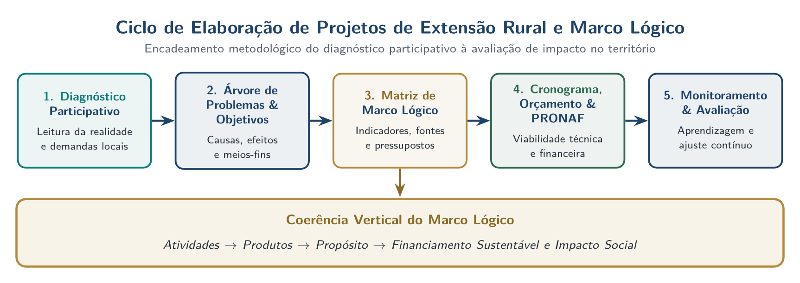
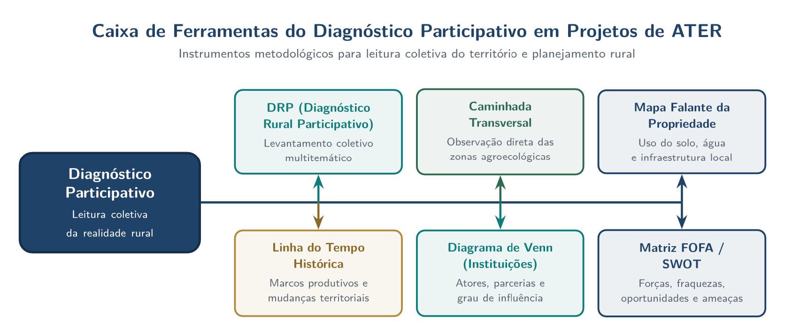
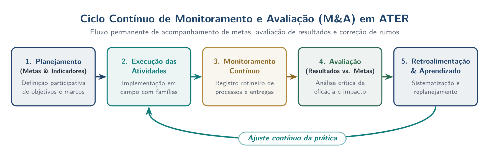

## [Abertura]{.pitch-tag .pitch-tag--teal} Visão Geral da Aula {#visao-geral .smaller-text .lesson-slide}

::: {.pitch-grid-50}
::: {.pitch-card}
[Roteiro da aula]{.pitch-card-index}
[Tópicos estruturantes]{.pitch-heading}

- [1]{.circle} Concepções de Projeto em Extensão
- [2]{.circle} Diagnóstico e Identificação de Demandas
- [3]{.circle} Estrutura do Projeto (Problema, Objetivos, Metas)
- [4]{.circle} Estratégia Metodológica
- [5]{.circle} Orçamento e Cronograma
- [6]{.circle} Monitoramento, Avaliação e Defesa Pública
:::

::: {.pitch-stack-2}
::: {.pitch-card .pitch-card--teal}
[Objetivo central]{.pitch-card-index}
[Do diagnóstico à defesa pública]{.pitch-heading}

Capacitar o estudante de ciências agrárias para a elaboração, execução e avaliação de projetos de extensão rural voltados à agricultura familiar, desde a identificação do problema até a defesa pública da proposta.
:::

::: {.pitch-pill-row}
[DRP Participativo]{.pitch-pill}
[Metas SMART · Gantt]{.pitch-pill .pitch-pill--gold}
[Marco Lógico · PRONAF]{.pitch-pill}
:::

::: {.pitch-band .pitch-band--teal}
Coerência metodológica entre demanda territorial, planejamento operacional e avaliação participativa.
:::
:::
:::

# 1 · Concepções e Diagnóstico Participativo {.section-header rotulo="Diagnóstico"}

## [Projetos]{.pitch-tag .pitch-tag--teal} Concepções e Fontes de Financiamento em ATER {#concepcoes-projeto .smaller-text .lesson-slide}

::: {.pitch-band .pitch-band--navy}
**Coelho (2014):** projetos de extensão rural diferenciam-se de projetos de pesquisa e investimento por sua **natureza interventiva e educativa**, promovendo mudanças concretas via participação e ação coletiva.
:::

::: {.pitch-grid-50}
::: {.pitch-card}
[Tipologia de atuação]{.pitch-card-index}
[Tipos de projetos em ATER]{.pitch-heading}

- **Assessoria técnica:** orientação produtiva a grupos para melhoria de sistemas específicos
- **Desenvolvimento comunitário:** organização social, acesso a mercados e infraestrutura
- **Pesquisa-ação participativa:** geração de conhecimento com agricultores como co-pesquisadores
- **Formação:** capacitação de multiplicadores locais em temas técnicos e organizativos
:::

::: {.pitch-card .pitch-card--gold}
[Captação e fomento]{.pitch-card-index}
[Fontes de financiamento]{.pitch-heading}

- Chamadas Públicas de ATER (ANATER e governos estaduais)
- Editais de extensão universitária (PROEX, MEC)
- Emendas parlamentares e convênios governamentais
- Cooperação internacional (FAO, FIDA, GIZ)
- Sistema S (SENAR, SEBRAE), fundações e OSCs
:::
:::

## [Projetos]{.pitch-tag .pitch-tag--teal} Ciclo de Projetos de Extensão e Marco Lógico {#ciclo-projetos-tikz .smaller-text .lesson-slide}

::: {.pitch-media-card .pitch-media-card--tall}

[Ciclo de Elaboração de Projetos de Extensão Rural e Coerência do Marco Lógico]{.pitch-caption}
[1. Diagnóstico Participativo → 2. Árvore de Problemas & Objetivos → 3. Matriz de Marco Lógico → 4. Cronograma, Orçamento & PRONAF → 5. Monitoramento & Avaliação]{.pitch-caption-sub}
:::

## [Diagnóstico]{.pitch-tag .pitch-tag--forest} Diagnóstico Participativo e Ferramentas do DRP {#diagnostico-drp .smaller-text .lesson-slide}

::: {.pitch-band}
**Verdejo (2006) e Kummer (2007):** o diagnóstico não é mera coleta extrativa de dados, mas leitura participativa da realidade com os agricultores como sujeitos; o **DRP** (adaptado do *PRA*) é sua principal caixa de ferramentas.
:::

::: {.pitch-cards}
::: {.pitch-card .pitch-card--teal}
[01 · Mapa Falante]{.pitch-card-index}
[Leitura espacial]{.pitch-heading}

Comunidade desenha seu território, localizando recursos naturais, áreas produtivas, infraestrutura e problemas ambientais.
:::

::: {.pitch-card}
[02 · Linha do Tempo]{.pitch-card-index}
[Trajetória histórica]{.pitch-heading}

Reconstrói marcos de transformação produtiva, climática e organizativa vividos pela comunidade.
:::

::: {.pitch-card .pitch-card--gold}
[03 · Diagrama de Venn]{.pitch-card-index}
[Rede institucional]{.pitch-heading}

Mapeia instituições, sindicatos e organizações atuantes no território e a força de seus vínculos locais.
:::
:::

::: {.pitch-cards}
::: {.pitch-card .pitch-card--forest}
[04 · Caminhada Transversal]{.pitch-card-index}
[Observação em transecto]{.pitch-heading}

Percurso em campo com moradores observando solos, relevo, cobertura vegetal e usos produtivos.
:::

::: {.pitch-card .pitch-card--gold}
[05 · Matriz FOFA / SWOT]{.pitch-card-index}
[Síntese estratégica]{.pitch-heading}

Organiza Forças, Oportunidades, Fraquezas e Ameaças levantadas para orientar prioridades do projeto.
:::

::: {.pitch-card .pitch-card--teal}
[06 · Calendário Sazonal]{.pitch-card-index}
[Dinâmica anual]{.pitch-heading}

Identifica padrões mensais de chuvas, trabalho, produção, renda e períodos críticos de vulnerabilidade.
:::
:::

## [Diagnóstico]{.pitch-tag .pitch-tag--forest} Caixa de Ferramentas do Diagnóstico Participativo {#ferramentas-drp-tikz .smaller-text .lesson-slide}

::: {.pitch-media-card .pitch-media-card--tall}

[Ferramentas Participativas de Diagnóstico em Projetos de Extensão Rural]{.pitch-caption}
[Combinação de ferramentas espaciais, temporais, relacionais e estratégicas no DRP (Verdejo, 2006; Kummer, 2007)]{.pitch-caption-sub}
:::

::: {.pitch-band}
O cruzamento de ferramentas visuais com diferentes grupos (mulheres, jovens e idosos) reduz vieses e qualifica o levantamento de demandas do projeto.
:::

# 2 · Estrutura, Problema e Metas {.section-header rotulo="Estrutura"}

## [Estrutura]{.pitch-tag .pitch-tag--teal} Encadeamento Lógico do Projeto de Extensão {#estrutura-projeto .smaller-text .lesson-slide}

::: {.pitch-flow-4}
::: {.pitch-card .pitch-card--alert}
[01 · Problema]{.pitch-card-index}
[O que resolver?]{.pitch-heading}

Situação concreta delimitada e comprovada no diagnóstico.
:::

::: {.pitch-card .pitch-card--gold}
[02 · Justificativa]{.pitch-card-index}
[Por que importa?]{.pitch-heading}

Relevância social, econômica, ambiental e respaldo legal.
:::

::: {.pitch-card}
[03 · Objetivos]{.pitch-card-index}
[O que alcançar?]{.pitch-heading}

Mudança geral pretendida e desdobramentos específicos.
:::

::: {.pitch-card .pitch-card--teal}
[04 · Metas]{.pitch-card-index}
[Quanto e quando?]{.pitch-heading}

Quantificação objetiva em prazo e magnitude (SMART).
:::
:::

::: {.pitch-flow-4}
::: {.pitch-card .pitch-card--forest}
[05 · Metodologia]{.pitch-card-index}
[Como fazer?]{.pitch-heading}

Métodos participativos coerentes com a PNATER.
:::

::: {.pitch-card}
[06 · Cronograma]{.pitch-card-index}
[Quando agir?]{.pitch-heading}

Sequência temporal e dependências (Gráfico de Gantt).
:::

::: {.pitch-card .pitch-card--gold}
[07 · Orçamento]{.pitch-card-index}
[Com quais recursos?]{.pitch-heading}

Rubricas detalhadas, justificadas e viáveis.
:::

::: {.pitch-card .pitch-card--teal}
[08 · Avaliação]{.pitch-card-index}
[Como medir?]{.pitch-heading}

Indicadores quantitativos e qualitativos participativos.
:::
:::

::: {.pitch-band .pitch-band--navy}
A força de uma proposta reside na **coerência interna**: cada objetivo específico deve dialogar com uma meta, um método, uma rubrica e um indicador.
:::

## [Estrutura]{.pitch-tag .pitch-tag--teal} Formulação do Problema e da Justificativa {#problema-justificativa .smaller-text .lesson-slide}

::: {.pitch-grid-50}
::: {.pitch-card .pitch-card--alert}
[Delimitação espacial e temporal]{.pitch-card-index}
[O Problema refinado]{.pitch-heading}

Evitar fórmulas genéricas ("baixa produtividade" ou "falta de ATER"); o problema precisa ser específico, mensurável e ancorado no diagnóstico.

**Exemplo refinado:** *"Os 45 agricultores familiares do assentamento Nova Esperança (município X, SE) apresentam perda média de 30% da produção de hortaliças por manejo fitossanitário inadequado, comprometendo a renda familiar e o abastecimento da feira local."*
:::

::: {.pitch-card .pitch-card--gold}
[Argumentação técnica e política · Coelho (2014)]{.pitch-card-index}
[A Justificativa]{.pitch-heading}

Responde *"por que esse problema merece atenção?"* articulando:

- Dados empíricos locais obtidos no DRP
- Referências científicas da literatura agronômica
- Marcos legais pertinentes (**PNATER**, **LOSAN**, **PNAPO**)
- Relevância social, econômica e ambiental para convencer o financiador ou órgão de ATER
:::
:::

## [Estrutura]{.pitch-tag .pitch-tag--teal} Objetivos e Metas SMART {#objetivos-metas .smaller-text .lesson-slide}

::: {.pitch-grid-50}
::: {.pitch-stack-2}
::: {.pitch-card}
[Verbo no infinitivo]{.pitch-card-index}
[Objetivo Geral]{.pitch-heading}

Expressa a mudança ampla em coerência direta com o problema: *"Promover o manejo agroecológico de hortaliças no assentamento Nova Esperança, reduzindo perdas produtivas e fortalecendo a comercialização na feira local."*
:::

::: {.pitch-card .pitch-card--teal}
[Desdobramento operacional]{.pitch-card-index}
[Objetivos Específicos]{.pitch-heading}

Decompõem o objetivo geral em ações concretamente alcançáveis na vigência do projeto, gerando metas e indicadores verificáveis.
:::
:::

::: {.pitch-stack-2}
::: {.pitch-band}
**Critério SMART:** *Specific* (específica), *Measurable* (mensurável), *Achievable* (alcançável), *Relevant* (relevante) e *Time-bound* (temporal).
:::

::: {.pitch-milestones}
::: {.pitch-milestone-item}
**Meta 1:** Capacitar **45 agricultores** em manejo integrado de pragas até o **mês 3**.
:::

::: {.pitch-milestone-item}
**Meta 2:** Implantar **15 unidades demonstrativas** de horticultura agroecológica até o **mês 5**.
:::

::: {.pitch-milestone-item}
**Meta 3:** Reduzir em **20%** as perdas por fitossanidade até o **mês 10**.
:::

::: {.pitch-milestone-item}
**Meta 4:** Inserir **10 novos produtores** na feira local até o **mês 12**.
:::
:::
:::
:::

# 3 · Metodologia, Orçamento e Cronograma {.section-header rotulo="Operação"}

## [Metodologia]{.pitch-tag .pitch-tag--forest} Estratégia Metodológica Participativa {#estrategia-metodologica .smaller-text .lesson-slide}

::: {.pitch-table-box}
| Método | Descrição | Quando Usar |
| --- | --- | --- |
| **Oficinas participativas** | Atividades práticas com grupos de agricultores | Capacitação em manejo e processamento |
| **Unidades demonstrativas** | Áreas experimentais em propriedades | Validação de tecnologias adaptadas |
| **Intercâmbio agricultor-agricultor** | Visitas entre produtores de diferentes regiões | Troca de experiências e motivação |
| **Dias de campo** | Eventos abertos com demonstrações práticas | Difusão ampliada de resultados |
| **Assistência técnica individual** | Visitas às propriedades com orientação sob medida | Acompanhamento de casos específicos |
| **Produção de material didático** | Cartilhas, vídeos, folders | Suporte às atividades de formação |
:::

::: {.pitch-band .pitch-band--teal}
Em coerência com a **PNATER**, métodos participativos devem prevalecer sobre abordagens puramente transmissivas (Caporal e Costabeber, 2004).
:::

## [Metodologia]{.pitch-tag .pitch-tag--forest} Produção de Material Didático no Projeto {#material-didatico-projeto .smaller-text .lesson-slide}

::: {.pitch-grid-50}
::: {.pitch-stack-2}
::: {.pitch-card}
[Adequação comunicacional · Coelho (2014)]{.pitch-card-index}
[Linguagem e visualidade]{.pitch-heading}

Para agricultores com baixa escolaridade, priorizar fotografias, ilustrações e esquemas com textos curtos, diretos e aplicáveis à rotina produtiva.
:::

::: {.pitch-card .pitch-card--teal}
[Múltiplos suportes]{.pitch-card-index}
[Formatos na ATER contemporânea]{.pitch-heading}

Cartilhas técnicas ilustradas, folders e panfletos, vídeos instrucionais, podcasts e programas de rádio, cadernos de campo e materiais digitais para celular.
:::
:::

::: {.pitch-milestones}
::: {.pitch-milestone-item}
**1. Linguagem acessível:** evitar jargão acadêmico excessivo.
:::

::: {.pitch-milestone-item}
**2. Riqueza visual:** fotos reais da comunidade e esquemas claros.
:::

::: {.pitch-milestone-item}
**3. Conteúdo prático:** orientações passo a passo aplicáveis em campo.
:::

::: {.pitch-milestone-item}
**4. Diversidade cultural:** respeito às expressões e saberes locais.
:::

::: {.pitch-milestone-item}
**5. Meio adequado:** impresso, digital ou rádio conforme acesso local.
:::

::: {.pitch-milestone-item}
**6. Co-produção:** elaborar e validar com os agricultores sempre que possível.
:::
:::
:::

## [Operação]{.pitch-tag .pitch-tag--gold} Orçamento e Cronograma (Gráfico de Gantt) {#orcamento-cronograma .smaller-text .lesson-slide}

::: {.pitch-grid-40}
::: {.pitch-card .pitch-card--gold}
[Viabilidade financeira]{.pitch-card-index}
[Rubricas do Orçamento]{.pitch-heading}

Organizadas segundo as regras do financiador:

- **Recursos humanos:** bolsas, diárias e honorários
- **Material de consumo:** insumos, sementes e escritório
- **Equipamentos / permanente**
- **Serviços de terceiros:** gráfica, transporte e audiovisual
- **Deslocamentos** (combustível, passagens) e custos administrativos
:::

::: {.pitch-stack-2}
::: {.pitch-table-box}
| Atividade (Gantt) | M1 | M2 | M3 | M4 | M5 | M6 |
| --- | :---: | :---: | :---: | :---: | :---: | :---: |
| Diagnóstico (DRP) | X | X | | | | |
| Oficinas de capacitação | | X | X | X | | |
| Unidades demonstrativas | | | X | X | X | |
| Dias de campo | | | | | X | |
| Avaliação e relatório | | | | | X | X |
:::

::: {.pitch-band}
Clareza orçamentária e realismo no **Gráfico de Gantt** são fatores decisivos para aprovação em editais e crédito rural (como **PRONAF** / chamadas de ATER).
:::
:::
:::

# 4 · Monitoramento, Marco Lógico e Defesa {.section-header rotulo="Avaliação e Defesa"}

## [Avaliação]{.pitch-tag .pitch-tag--teal} Ciclo de Monitoramento e Avaliação (M&A) {#monitoramento-avaliacao .smaller-text .lesson-slide}

::: {.pitch-grid-50}
::: {.pitch-milestones}
::: {.pitch-milestone-item}
**1. Planejamento:** definição prévia de metas, linha de base e indicadores.
:::

::: {.pitch-milestone-item}
**2. Execução:** realização das atividades previstas no cronograma.
:::

::: {.pitch-milestone-item}
**3. Monitoramento:** acompanhamento contínuo da entrega e do ritmo das ações.
:::

::: {.pitch-milestone-item}
**4. Avaliação:** análise dos resultados alcançados frente aos objetivos e metas (Rua, 2009).
:::

::: {.pitch-milestone-item}
**5. Retroalimentação:** ajustes de rota e aprendizados devolvidos diretamente à execução.
:::
:::

::: {.pitch-stack-2}
::: {.pitch-card}
[Rua (2009)]{.pitch-card-index}
[Monitorar ≠ Avaliar]{.pitch-heading}

O **monitoramento** verifica continuamente *se estamos fazendo conforme planejado*; a **avaliação** analisa *quais resultados e transformações foram efetivamente produzidos*.
:::

::: {.pitch-card .pitch-card--forest}
[Coerência com a PNATER]{.pitch-card-index}
[Avaliação participativa]{.pitch-heading}

Envolve os próprios agricultores na leitura dos resultados, combinando dados numéricos e dimensões qualitativas de autonomia.
:::
:::
:::

## [Ciclo M&A]{.pitch-tag .pitch-tag--teal} Fluxo Contínuo de Monitoramento e Avaliação {#monitoramento-avaliacao-tikz .smaller-text .lesson-slide}

::: {.pitch-media-card .pitch-media-card--tall}

[Ciclo Contínuo de Monitoramento e Avaliação (M&A) em Projetos de ATER]{.pitch-caption}
[Retroalimentação permanente entre planejamento, execução em campo, monitoramento e avaliação de resultados]{.pitch-caption-sub}
:::

::: {.pitch-band .pitch-band--navy}
**Gestão adaptativa:** o monitoramento acompanha processos durante a execução; a avaliação verifica transformações e retroalimenta o replanejamento com as famílias.
:::

## [Avaliação]{.pitch-tag .pitch-tag--teal} Indicadores Quantitativos e Qualitativos {#indicadores-resultado .smaller-text .lesson-slide}

::: {.pitch-cards-2}
::: {.pitch-card}
[Mensuração objetiva]{.pitch-card-index}
[Indicadores Quantitativos]{.pitch-heading}

Permitem comparações numéricas diretas ao longo do projeto:

- Número de agricultores capacitados
- Área implantada sob manejo agroecológico
- Variação percentual de produtividade e renda
- Volume de produção comercializado
- Número de organizações comunitárias fortalecidas
:::

::: {.pitch-card .pitch-card--teal}
[Efetividade transformadora]{.pitch-card-index}
[Indicadores Qualitativos]{.pitch-heading}

Captam dimensões não reduzíveis a números:

- Grau de participação nas decisões do projeto
- Percepção de mudança na qualidade de vida
- Fortalecimento de redes de cooperação entre produtores
- Autonomia decisória dos beneficiários
- Satisfação com os serviços de ATER
:::
:::

::: {.pitch-band .pitch-band--navy}
Projetos robustos equilibram **metas físicas entregues** com **evidências de apropriação e autonomia comunitária**.
:::

## [Marco Lógico]{.pitch-tag .pitch-tag--gold} Modelo de Marco Lógico (Logical Framework) {#marco-logico .smaller-text .lesson-slide}

::: {.pitch-table-box}
| Nível Hierárquico | Descrição | Exemplo em Projeto de ATER |
| --- | --- | --- |
| **Objetivo Superior** | Mudança de longo prazo à qual o projeto contribui | Melhoria da SAN no território |
| **Objetivo do Projeto** | Mudança direta que o projeto produz | Agricultores adotam manejo agroecológico |
| **Resultados** | Produtos e serviços entregues pelo projeto | 15 unidades demonstrativas implantadas |
| **Atividades** | Ações concretas para alcançar os resultados | Oficinas, visitas técnicas, dias de campo |
:::

::: {.pitch-band .pitch-band--teal}
Para cada nível definem-se **indicadores verificáveis**, **fontes de verificação** e **pressupostos** (condições externas) — padrão amplamente exigido por **FAO**, **FIDA** e **GIZ**.
:::

## [Defesa]{.pitch-tag .pitch-tag--teal} Defesa Pública da Proposta {#defesa-publica .smaller-text .lesson-slide}

::: {.pitch-grid-50}
::: {.pitch-card}
[Comunicação em banca ou comunidade]{.pitch-card-index}
[Estrutura da apresentação]{.pitch-heading}

- **Abertura:** contextualiza o problema e o território
- **Desenvolvimento:** apresenta objetivos, metodologia, cronograma e orçamento
- **Fechamento:** sintetiza resultados esperados e contribuições sociais
- **Arguição:** diálogo fundamentado com banca examinadora ou comunidade
:::

::: {.pitch-milestones}
::: {.pitch-milestone-item}
**1.** Pertinência e clareza na delimitação do problema
:::

::: {.pitch-milestone-item}
**2.** Coerência lógica entre problema, objetivos e metodologia
:::

::: {.pitch-milestone-item}
**3.** Viabilidade real do orçamento e do cronograma
:::

::: {.pitch-milestone-item}
**4.** Uso consistente de métodos participativos
:::

::: {.pitch-milestone-item}
**5.** Qualidade do material de apoio produzido
:::

::: {.pitch-milestone-item}
**6.** Capacidade de argumentação e resposta na arguição
:::
:::
:::

## [Síntese]{.pitch-tag .pitch-tag--teal} Conclusão e Referências {#conclusao-referencias .smaller-text .lesson-slide}

::: {.pitch-band .pitch-band--navy}
**Síntese:** um projeto de extensão rural consistente articula diagnóstico participativo, fundamentação teórica e legal, planejamento operacional factível e avaliação dialógica voltada à transformação das condições de vida no campo.
:::

::: {.pitch-cards-2}
::: {.pitch-card}
[Bloco 1 · Metodologia e Projetos]{.pitch-card-index}
[Base técnica e participativa]{.pitch-heading}

- Caporal, F. R.; Costabeber, J. A. *Agroecologia e Extensão Rural: contribuições para o desenvolvimento rural sustentável*. Brasília: MDA/IICA, 2004.
- Coelho, F. M. G. *A Arte das Orientações Técnicas no Campo*. Rio Branco: Suprema, 2014.
- Kummer, L. *Metodologia Participativa no Meio Rural: uma visão interdisciplinar*. Salvador: GTZ, 2007.
- Rua, M. G. *Avaliação de Políticas, Programas e Projetos: notas introdutórias*. Brasília: ENAP, 2009.
- Verdejo, M. E. *Diagnóstico Rural Participativo: guia prático DRP*. Brasília: MDA/SAF, 2006.
:::

::: {.pitch-card .pitch-card--teal}
[Bloco 2 · Marcos Legais]{.pitch-card-index}
[Referências normativas brasileiras]{.pitch-heading}

- Brasil. *Lei 12.188/2010*. PNATER/PRONATER (2010).
- Brasil. *Lei 11.346/2006*. Lei Orgânica de Segurança Alimentar (LOSAN).
- Brasil. *Decreto 7.794/2012*. Política Nacional de Agroecologia e Produção Orgânica (PNAPO).
:::
:::

## {.center background-color="#2135A6"}

::: {style="text-align: center;"}
[Obrigado!]{.obrigado-fit-text style="color: white;"}

::: {style="color: white; font-size: 0.7em;"}
Luiz Diego Vidal Santos

Universidade Estadual de Feira de Santana (UEFS)
:::
:::
