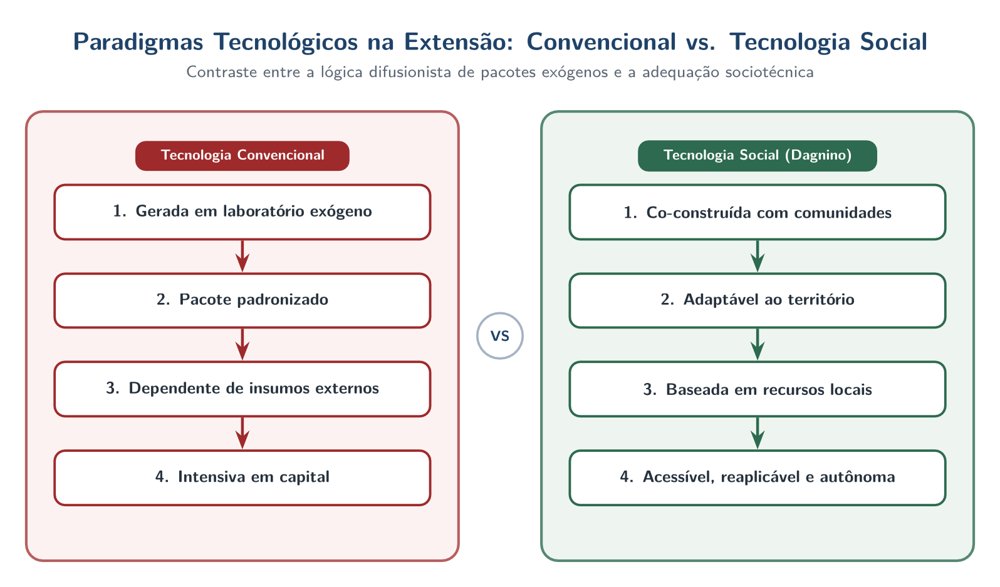
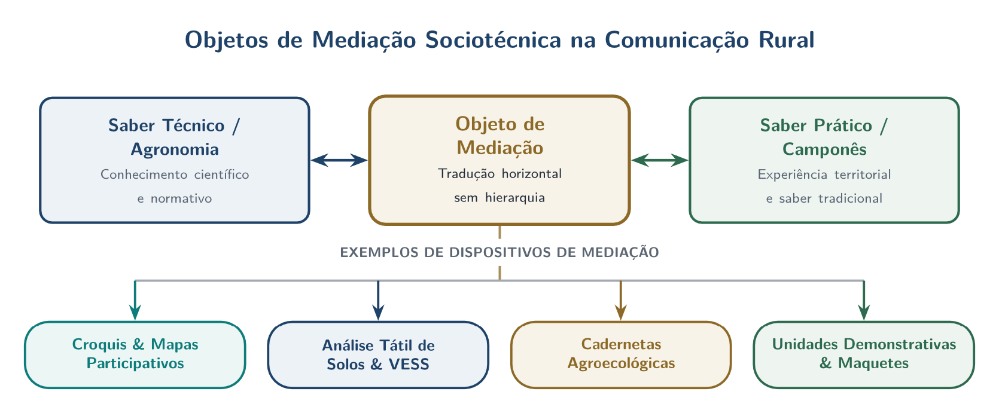

## [Abertura]{.pitch-tag} Visão Geral da Aula {#visao-geral .smaller-text .lesson-slide}

::: {.pitch-grid-50}
::: {.pitch-card}
[Roteiro da aula]{.pitch-card-index}
[Tópicos principais]{.pitch-heading}

- [1]{.circle} Conhecimento Cotidiano e Saber Local
- [2]{.circle} Ciência e Conhecimento Científico
- [3]{.circle} Técnica e Tecnologia
- [4]{.circle} Tecnologia Social
- [5]{.circle} Mediação e o Papel do Extensionista
:::

::: {.pitch-stack-2}
::: {.pitch-card .pitch-card--gold}
[Objetivo central]{.pitch-card-index}
[Diálogo entre saberes no campo]{.pitch-heading}

Compreender os diferentes tipos de conhecimento que circulam na prática extensionista e como o extensionista atua como mediador entre saberes distintos na construção de soluções para o meio rural.
:::

::: {.pitch-pill-row}
[Saber local]{.pitch-pill}
[Ciência agronômica]{.pitch-pill .pitch-pill--gold}
[Tecnologia social]{.pitch-pill}
[Mediação]{.pitch-pill .pitch-pill--gold}
:::

::: {.pitch-band .pitch-band--teal}
Do saber empírico dos territórios à tradução dialógica e à co-construção de tecnologias sociais.
:::
:::
:::

# 1 · Objetos de Mediação e Saberes {.section-header rotulo="Saberes"}

## [Mediação]{.pitch-tag .pitch-tag--forest} O que são objetos de mediação? {#o-que-sao-objetos .smaller-text .lesson-slide}

::: {.pitch-cards-2}
::: {.pitch-card .pitch-card--forest}
[Conceito central · Coelho (2014)]{.pitch-card-index}
[Pontes entre atores do campo]{.pitch-heading}

Na extensão rural, os **objetos de mediação** são os elementos que conectam extensionistas, agricultores e pesquisadores em processos de interação e construção de conhecimento (Coelho, 2014).
:::

::: {.pitch-card .pitch-card--gold}
[Natureza e função]{.pitch-card-index}
[Superação dos pacotes prontos]{.pitch-heading}

Incluem artefatos, práticas, saberes e linguagens que circulam entre os atores. Compreendê-los permite estabelecer diálogos produtivos, evitando a imposição unilateral de pacotes tecnológicos e valorizando múltiplas fontes de saber.
:::
:::

::: {.pitch-band .pitch-band--navy}
O extensionista não é apenas um transmissor de informações, mas um **facilitador de encontros** entre formas distintas de conhecer e agir sobre a realidade agrária (Freire, 1983).
:::

## [Mediação]{.pitch-tag .pitch-tag--forest} Conhecimento Cotidiano e Saber Local {#conhecimento-cotidiano .smaller-text .lesson-slide}

::: {.pitch-grid-55}
::: {.pitch-stack-2}
::: {.pitch-card .pitch-card--forest}
[Toledo e Barrera-Bassols (2009)]{.pitch-card-index}
[Memória biocultural e prática]{.pitch-heading}

O saber local, também chamado de conhecimento cotidiano ou popular, resulta de gerações de observação, experimentação e adaptação dos agricultores às condições de solo, clima e arranjos produtivos de seus territórios.
:::

::: {.pitch-card}
[Expressões concretas]{.pitch-card-index}
[Exemplos no campo]{.pitch-heading}

Transmitido oralmente, enraizado na prática e sensível ao contexto ecológico, manifesta-se no manejo de **sementes crioulas**, no uso de **bioindicadores vegetais** de fertilidade do solo e nos **calendários agrícolas** baseados em sinais naturais.
:::
:::

::: {.pitch-card .pitch-card--gold}
[Características do saber local]{.pitch-card-index}
[Cinco atributos centrais]{.pitch-heading}

1. Transmissão oral e intergeracional
2. Base empírica e adaptativa
3. Contexto-dependente (território)
4. Holístico (integra dimensões produtivas, culturais e espirituais)
5. Frequentemente invisibilizado pela ciência convencional
:::
:::

## [Mediação]{.pitch-tag .pitch-tag--forest} Ciência e Conhecimento Científico {#ciencia-conhecimento .smaller-text .lesson-slide}

::: {.pitch-cards}
::: {.pitch-card}
[Gomes (2005)]{.pitch-card-index}
[Produção científica]{.pitch-heading}

Produzido por métodos sistemáticos de observação, formulação de hipóteses, experimentação controlada e revisão por pares — expresso em **resultados de pesquisa** de universidades, Embrapa e instituições internacionais.
:::

::: {.pitch-card .pitch-card--alert}
[Chambers (1997)]{.pitch-card-index}
[Limite do modelo linear]{.pitch-heading}

A ciência agronômica trouxe avanços em genética, solo, irrigação e fitossanidade. Contudo, o modelo linear (*ciência gera → extensionista transfere → agricultor adota*) mostrou-se **insuficiente** para a complexidade dos sistemas agrários.
:::

::: {.pitch-card .pitch-card--teal}
[Desafio atual]{.pitch-card-index}
[Interface dialógica]{.pitch-heading}

Estabelecer diálogo horizontal entre conhecimento científico e saber local para que ambos se complementem e se enriqueçam mutuamente em soluções adaptadas ao território.
:::
:::

::: {.pitch-band}
A ciência oferece precisão analítica e causalidade; o saber local aporta leitura territorial, historicidade e viabilidade adaptativa.
:::

# 2 · Técnica, Tecnologia e Tecnologia Social {.section-header rotulo="Tecnologia Social"}

## [Tecnologia]{.pitch-tag .pitch-tag--teal} Técnica e Tecnologia na Extensão Rural {#tecnica-tecnologia .smaller-text .lesson-slide}

::: {.pitch-cards-2}
::: {.pitch-card}
[Dagnino (2004)]{.pitch-card-index}
[Técnica]{.pitch-heading}

Consiste em procedimentos e habilidades práticas desenvolvidos para resolver problemas específicos: preparo do solo, semeadura, poda, colheita e processamento.

Pode originar-se tanto no **saber local** (roça de toco, coivara) quanto na **pesquisa científica** (plantio direto, irrigação por gotejamento).
:::

::: {.pitch-card .pitch-card--gold}
[Não-neutralidade · Dagnino (2004)]{.pitch-card-index}
[Tecnologia]{.pitch-heading}

É o conjunto organizado de conhecimentos científicos e técnicos aplicados a um processo produtivo ou social, envolvendo sistematização, padronização e incorporação de capital.

A escolha tecnológica **nunca é neutra**: reflete visões de mundo, relações de poder e modelos de desenvolvimento que incluem ou excluem agricultores.
:::
:::

## [Tecnologia]{.pitch-tag .pitch-tag--teal} Tecnologia Convencional vs. Tecnologia Social {#convencional-vs-social .smaller-text .lesson-slide}

::: {.pitch-cards-2}
::: {.pitch-card .pitch-card--alert}
[Paradigma 1]{.pitch-card-index}
[Tecnologia Convencional]{.pitch-heading}

::: {.pitch-milestones}
::: {.pitch-milestone-item}
**1. Origem:** gerada em laboratório e ambiente controlado
:::

::: {.pitch-milestone-item}
**2. Formato:** padronizada para larga escala homogênea
:::

::: {.pitch-milestone-item}
**3. Dependência:** requer insumos externos contínuos
:::

::: {.pitch-milestone-item}
**4. Acesso:** intensiva em capital e crédito
:::
:::
:::

::: {.pitch-card .pitch-card--forest}
[Paradigma 2]{.pitch-card-index}
[Tecnologia Social]{.pitch-heading}

::: {.pitch-milestones}
::: {.pitch-milestone-item}
**1. Origem:** co-construída com as comunidades
:::

::: {.pitch-milestone-item}
**2. Formato:** adaptável ao contexto socioambiental
:::

::: {.pitch-milestone-item}
**3. Autonomia:** baseada no uso de recursos locais
:::

::: {.pitch-milestone-item}
**4. Acesso:** acessível, de baixo custo e replicável
:::
:::
:::
:::

::: {.pitch-band .pitch-band--teal}
A tecnologia social nasce do diálogo entre saberes para responder a demandas sociais concretas com **baixo custo e alta replicabilidade** (ITS Brasil, 2004).
:::

## [Diagrama]{.pitch-tag .pitch-tag--forest} Paradigmas Tecnológicos na Extensão Rural {#paradigmas-tecnologicos-tikz .smaller-text .lesson-slide}

::: {.pitch-media-card .pitch-media-card--tall}

[Tecnologia Convencional vs. Tecnologia Social na Extensão Rural]{.pitch-caption}
[Contrastes entre o pacote exógeno padronizado e a co-construção adaptada ao território (Dagnino, 2004; ITS Brasil, 2004)]{.pitch-caption-sub}
:::

::: {.pitch-band}
**Critério agronômico:** tecnologias sociais não recusam ciência — reorientam o conhecimento técnico para autonomia, recursos locais e reprodutibilidade camponesa.
:::

## [Tecnologia]{.pitch-tag .pitch-tag--teal} Tecnologia Social na Prática {#tecnologia-social-pratica .smaller-text .lesson-slide}

::: {.pitch-grid-55}
::: {.pitch-stack-2}
::: {.pitch-card}
[ITS Brasil · RTS / FBB (2004)]{.pitch-card-index}
[Conceito operacional]{.pitch-heading}

"Produtos, técnicas ou metodologias reaplicáveis, desenvolvidas na interação com a comunidade e que representem efetivas soluções de transformação social" (ITS Brasil, 2004).
:::

::: {.pitch-card .pitch-card--forest}
[Exemplos no meio rural brasileiro]{.pitch-card-index}
[Escala com enraizamento local]{.pitch-heading}

A **cisterna de placas do P1MC** foi implantada em mais de **1,2 milhão** de propriedades no semiárido. Outros exemplos incluem os **biodigestores sertanejos**, as **fossas sépticas biodigestoras da Embrapa** e os **quintais produtivos agroecológicos**.
:::
:::

::: {.pitch-card .pitch-card--gold}
[Critérios de Tecnologia Social (RTS)]{.pitch-card-index}
[Cinco requisitos essenciais]{.pitch-heading}

1. Responder a uma demanda social concreta
2. Ser desenvolvida em interação com a comunidade
3. Ser reaplicável em diferentes contextos
4. Gerar transformação social efetiva
5. Ter baixo custo e uso de recursos locais
:::
:::

# 3 · Mediação e Interface entre Saberes {.section-header rotulo="Mediação"}

## [Mediação]{.pitch-tag} Objetos de Mediação Sociotécnica na Comunicação Rural {#diagrama-objetos-mediacao .smaller-text .lesson-slide}

::: {.pitch-media-card .pitch-media-card--tall}

[Dispositivos de tradução horizontal sem hierarquia entre saberes]{.pitch-caption}
[Croquis e mapas participativos · Análise tátil de solos e VESS · Cadernetas agroecológicas · Unidades demonstrativas e maquetes]{.pitch-caption-sub}
:::

::: {.pitch-band}
Os objetos de mediação materializam o diálogo entre agronomia e prática camponesa em linguagem compartilhada.
:::

## [Mediação]{.pitch-tag} O Extensionista como Mediador de Saberes {#mediacao-papel-extensionista .smaller-text .lesson-slide}

::: {.pitch-formula}
Paulo Freire (1983): *"O conhecimento não se estende do que se julga sabedor até aqueles que se julga não saberem"* — crítica à postura extensionista que ignora os saberes do agricultor.
:::

::: {.pitch-cards-2}
::: {.pitch-card .pitch-card--teal}
[Prática cotidiana · Coelho (2014)]{.pitch-card-index}
[O que faz o mediador?]{.pitch-heading}

Envolve escuta ativa, tradução de linguagens técnicas para linguagem acessível, valorização de saberes locais e facilitação de processos coletivos de experimentação e aprendizagem — articulando ciência, técnica e conhecimento cotidiano.
:::

::: {.pitch-card .pitch-card--gold}
[Formação do agrônomo]{.pitch-card-index}
[Competências necessárias]{.pitch-heading}

Deve incluir comunicação intercultural, reconhecimento de epistemologias diversas e capacidade de dialogar com agricultores, pesquisadores, gestores públicos e organizações da sociedade civil.
:::
:::

## [Mediação]{.pitch-tag} A Interface Saber Local e Ciência {#interface-saberes .smaller-text .lesson-slide}

::: {.pitch-flow-4}
::: {.pitch-card .pitch-card--forest}
[01 · Polo territorial]{.pitch-card-index}
[Saber Local]{.pitch-heading}

Agricultores aportam observação empírica, biodiversidade e manejo territorial em **diálogo** contínuo.
:::

::: {.pitch-card .pitch-card--gold}
[02 · Mediação]{.pitch-card-index}
[Extensionista]{.pitch-heading}

Atua como **mediador** intercultural e facilitador de encontros entre linguagens e práticas.
:::

::: {.pitch-card}
[03 · Polo acadêmico]{.pitch-card-index}
[Ciência]{.pitch-heading}

Pesquisa agronômica oferece métodos, explicação causal e **tradução** técnica contextualizada.
:::

::: {.pitch-card .pitch-card--teal}
[04 · Resultado cíclico]{.pitch-card-index}
[Inovação Co-construída]{.pitch-heading}

Solução compartilhada que **retroalimenta** tanto o saber dos agricultores quanto a agenda científica.
:::
:::

::: {.pitch-band .pitch-band--navy}
Superar o modelo linear (pesquisa → extensão → agricultor) exige arquiteturas interativas em que os saberes se articulam horizontalmente e retroalimentam-se continuamente (Chambers, 1997).
:::

# 4 · Desafios, Conclusão e Referências {.section-header rotulo="Desafios e Síntese"}

## [Desafios]{.pitch-tag .pitch-tag--alert} Desafios Contemporâneos da Mediação {#desafios-mediacao .smaller-text .lesson-slide}

::: {.pitch-grid-50}
::: {.pitch-stack-2}
::: {.pitch-card .pitch-card--alert}
[Obstáculo epistemológico · Santos (2007)]{.pitch-card-index}
[Hierarquização de saberes]{.pitch-heading}

O desafio mais profundo reside na hierarquização entre conhecimento científico e saber popular, que frequentemente relega o segundo à condição de "crença" ou "atraso".
:::

::: {.pitch-card}
[Obstáculo institucional]{.pitch-card-index}
[Lacuna na formação agrária]{.pitch-heading}

A formação dos profissionais de ciências agrárias ainda privilegia a dimensão técnico-produtiva em detrimento das competências de comunicação, facilitação e leitura de contextos socioculturais.
:::
:::

::: {.pitch-milestones}
::: {.pitch-milestone-item}
**1. Epistemologia:** superar a hierarquia entre saberes científicos e locais.
:::

::: {.pitch-milestone-item}
**2. Formação:** preparar extensionistas mediadores, não apenas técnicos executores.
:::

::: {.pitch-milestone-item}
**3. Pluralidade:** reconhecer a diversidade de sistemas de conhecimento no campo.
:::

::: {.pitch-milestone-item}
**4. Sustentabilidade:** integrar inovação tecnológica e transformação social.
:::

::: {.pitch-milestone-item}
**5. Escala:** ampliar tecnologias sociais sem perder a identidade local.
:::
:::
:::

## [Síntese]{.pitch-tag} Conclusão {#conclusao .smaller-text .lesson-slide}

::: {.pitch-cards-2}
::: {.pitch-card .pitch-card--forest}
[Superação do difusionismo]{.pitch-card-index}
[Articulação de conhecimentos]{.pitch-heading}

A compreensão dos objetos de mediação é requisito fundamental para uma prática profissional que reconheça, valorize e articule saber empírico dos agricultores, produção científica recente, técnicas tradicionais e tecnologias sociais emergentes.
:::

::: {.pitch-card .pitch-card--gold}
[Ciências agrárias]{.pitch-card-index}
[Extensão dialógica e inclusiva]{.pitch-heading}

Incorporar essa perspectiva na formação agronômica contribui para uma extensão rural mais dialógica, inclusiva e efetiva frente aos desafios complexos do desenvolvimento rural sustentável no Brasil.
:::
:::

## [Referências]{.pitch-tag} Referências Bibliográficas {#referencias .smaller-text .lesson-slide}

::: {.pitch-cards-2}
::: {.pitch-card}
[Epistemologia e mediação]{.pitch-card-index}
[Saberes e comunicação]{.pitch-heading}

- CHAMBERS, R. *Whose Reality Counts? Putting the First Last*. London: ITDG, 1997.
- COELHO, F. M. G. *A Arte das Orientações Técnicas no Campo*. Rio Branco: Suprema, 2014.
- FREIRE, P. *Extensão ou Comunicação?* Rio de Janeiro: Paz e Terra, 1983.
- SANTOS, B. S. Para além do pensamento abissal. *Novos Estudos CEBRAP*, n. 79, 2007.
:::

::: {.pitch-card .pitch-card--teal}
[Agroecologia e tecnologia social]{.pitch-card-index}
[Fundamentos técnicos]{.pitch-heading}

- DAGNINO, R. *Tecnologia Social: ferramenta para construir outra sociedade*. Campinas: Unicamp, 2004.
- GOMES, J. C. C. Bases epistemológicas da agroecologia. In: AQUINO, A. N.; ASSIS, R. L. *Agroecologia: princípios e técnicas*. Brasília: Embrapa, 2005.
- ITS BRASIL. *Tecnologia Social: uma estratégia para o desenvolvimento*. Rio de Janeiro: FBB, 2004.
- TOLEDO, V. M.; BARRERA-BASSOLS, N. *A Memória Biocultural*. São Paulo: Expressão Popular, 2009.
:::
:::
