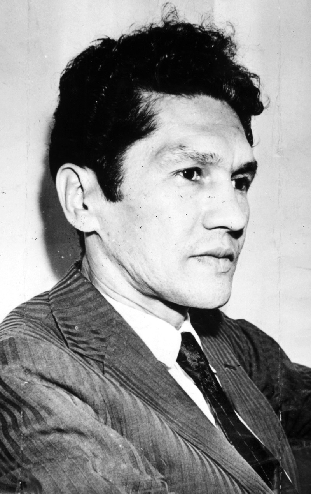
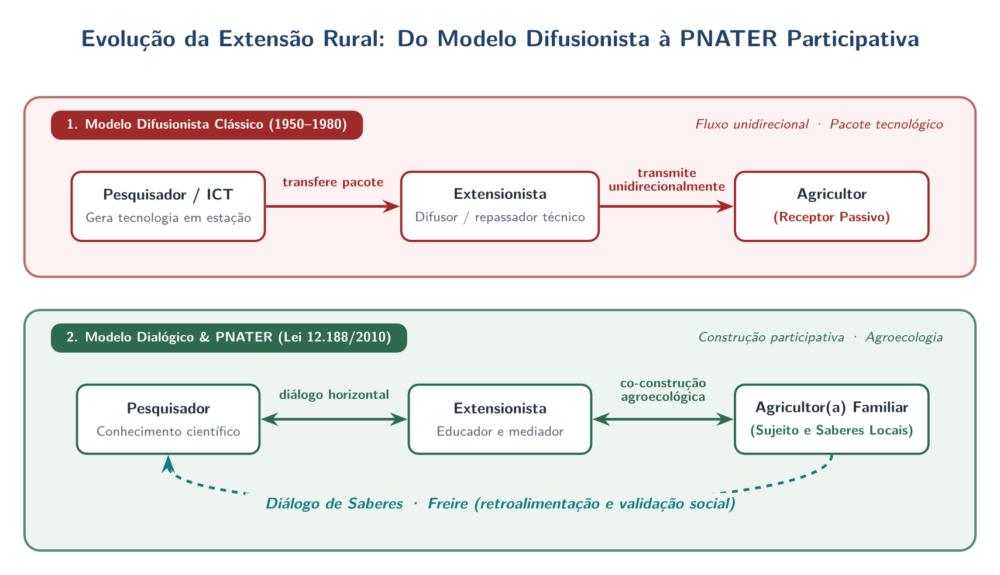
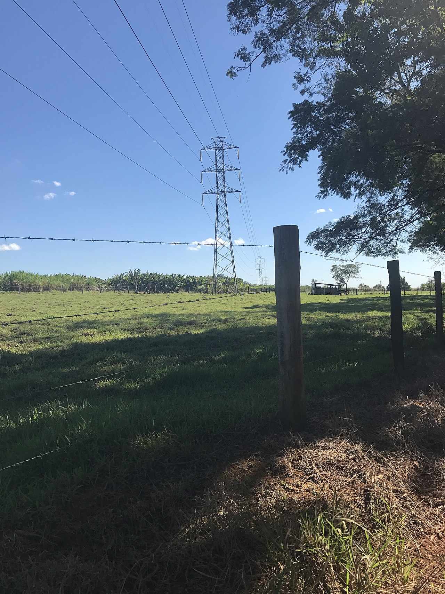
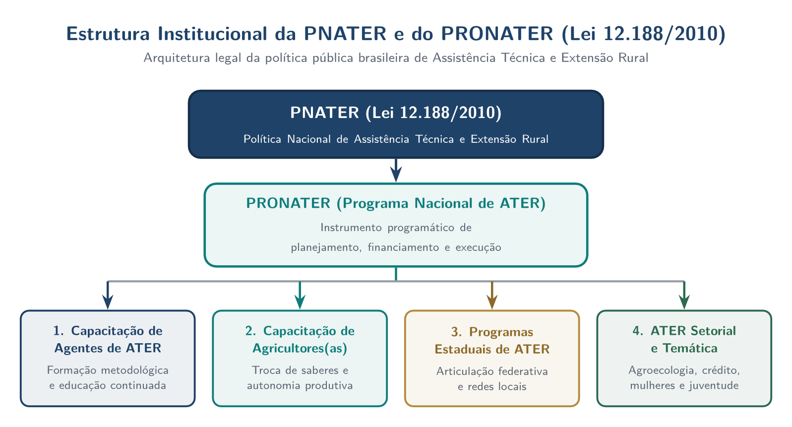

## [Abertura]{.pitch-tag} Visão Geral da Aula {#visao-geral .smaller-text .lesson-slide}

::: {.pitch-grid-50}
::: {.pitch-card}
[Roteiro da aula]{.pitch-card-index}
[Tópicos principais]{.pitch-heading}

- [1]{.circle} Contexto Histórico e Estrutura Agrária
- [2]{.circle} Modelo Difusionista e seus Problemas
- [3]{.circle} Extensão Rural Agroecológica
- [4]{.circle} Andragogia de Knowles
- [5]{.circle} PNATER, PRONATER e ATER Digital
:::

::: {.pitch-stack-2}
::: {.pitch-card .pitch-card--gold}
[Objetivo da aula]{.pitch-card-index}
[Da difusão à participação]{.pitch-heading}

Analisar a evolução das políticas de extensão rural no Brasil, do modelo difusionista às abordagens participativas, agroecológicas e andragógicas.
:::

::: {.pitch-pill-row}
[Lei 4.504/64]{.pitch-pill}
[Lei 12.188/2010]{.pitch-pill .pitch-pill--gold}
[Andragogia]{.pitch-pill}
:::

::: {.pitch-band .pitch-band--teal}
Da transferência unilateral de pacotes tecnológicos ao diálogo de saberes no campo brasileiro.
:::
:::
:::

# 1 · Raízes Agrárias e Modelo Difusionista {.section-header rotulo="Histórico"}

## [Histórico]{.pitch-tag} Contexto Histórico e Estrutura Agrária {#contexto-historico .smaller-text .lesson-slide}

::: {.columns}
::: {.column width="62%"}
::: {.pitch-stack-2}
::: {.pitch-card}
[Transformação institucional]{.pitch-card-index}
[Oligarquias e questão agrária]{.pitch-heading}

Nos últimos 30 anos, o Brasil passou por **mudanças significativas** no cenário político institucional e nas dinâmicas sociais. A institucionalização da estrutura agrária foi historicamente marcada por políticas voltadas à consolidação de **grupos oligárquicos**.
:::

::: {.pitch-milestones}
::: {.pitch-milestone-item}
**Das sesmarias à Lei de Terras (1850):** consolidação da estrutura fundiária concentrada.
:::

::: {.pitch-milestone-item}
**Estatuto da Terra — Lei 4.504/64 (Brasil, 1964):** marco regulatório agrário e agrícola.
:::

::: {.pitch-milestone-item}
**Políticas agrárias de crédito — Lei 5.969/73 (PROAGRO):** a necessidade de uma **política de extensão rural** tomou força.
:::
:::
:::
:::

::: {.column width="38%"}
::: {.pitch-media-card .pitch-media-card--photo .pitch-media-card--tall}
{style="object-position: center 15%;"}

[Francisco Julião e as Ligas Camponesas]{.pitch-caption}
[Arquivo histórico / Domínio Público · lutas agrárias e contexto pré-1964]{.pitch-caption-sub}
:::
:::
:::

## [Paradigma]{.pitch-tag .pitch-tag--alert} O Modelo Difusionista na Extensão Rural {#modelo-difusionista .smaller-text .lesson-slide}

::: {.pitch-cards-2}
::: {.pitch-card .pitch-card--alert}
[Caracterização (Peixoto, 2008)]{.pitch-card-index}
[Fluxo unilateral de informações]{.pitch-heading}

A extensão rural, especialmente nas fases iniciais, foi marcada pelo **modelo difusionista**:

- Fluxo de informações **unilateral** (extensionista → agricultor)
- Transvestida de **transferência de tecnologia**
- Abordagem "do **topo para baixo**" (Peixoto, 2008)
:::

::: {.pitch-card}
[Efeitos sobre o produtor]{.pitch-card-index}
[Consequências no campo]{.pitch-heading}

A verticalidade da comunicação gera assimetrias estruturais:

- Agricultor reduzido a **receptor passivo**
- Produtor frequentemente tratado como **"problema a ser solucionado"**
- Limitação da **participação e autonomia** das famílias rurais
:::
:::

::: {.pitch-band}
**Ruptura necessária:** superar a imposição de pacotes tecnológicos para construir processos educativos e dialógicos no território.
:::

## [Comparativo]{.pitch-tag} Do Modelo Difusionista à PNATER Participativa {#modelos-extensao-diagrama .smaller-text .lesson-slide}

::: {.pitch-media-card .pitch-media-card--tall}

[Evolução dos modelos de extensão rural no Brasil]{.pitch-caption}
[Contraste entre transferência unilateral (1950–1980) e co-construção dialógica prevista na Lei 12.188/2010]{.pitch-caption-sub}
:::

## [Crítica]{.pitch-tag .pitch-tag--alert} Problemas da Abordagem Difusionista {#problemas-difusionismo .smaller-text .lesson-slide}

::: {.pitch-cards-2}
::: {.pitch-card .pitch-card--alert}
[Dificuldades para os agricultores (Landini, 2015)]{.pitch-card-index}
[Barreiras de apropriação]{.pitch-heading}

- Trabalho grupal ou em parcerias
- Aceitação de mudanças disruptivas
- Inovações que não condizem com a realidade local
:::

::: {.pitch-card .pitch-card--gold}
[Dificuldades para os extensionistas]{.pitch-card-index}
[Limites de postura técnica]{.pitch-heading}

- Persistência de uma abordagem **tecnicista**
- Olhar **autocrítico** dirigido ao agricultor
- Tendência a ver o produtor como **um problema**
:::
:::

::: {.pitch-band .pitch-band--navy}
**Diagnóstico de Landini (2015):** quando a extensão desconsidera o contexto local, falhas de adequação tecnológica são erroneamente atribuídas à "resistência" do agricultor.
:::

# 2 · Agroecologia, Comunicação e Andragogia {.section-header rotulo="Abordagens"}

## [Agroecologia]{.pitch-tag .pitch-tag--forest} Extensão Rural Agroecológica {#extensao-agroecologica .smaller-text .lesson-slide}

::: {.columns}
::: {.column width="58%"}
::: {.pitch-stack-2}
::: {.pitch-formula}
**Caporal (2003) — novo significado para "extensão":**

*"Processo de intervenção de caráter educativo e transformador, baseado em metodologias que permitam o desenvolvimento de uma prática social."*
:::

::: {.pitch-card .pitch-card--forest}
[Sujeitos da transformação]{.pitch-card-index}
[Ação consciente sobre a realidade]{.pitch-heading}

Os sujeitos do processo buscam a **construção e sistematização** de conhecimentos que os levem a agir **conscientemente** sobre a realidade agrária e socioambiental.
:::
:::
:::

::: {.column width="42%"}
::: {.pitch-media-card .pitch-media-card--photo .pitch-media-card--tall}
{style="object-position: center 55%;"}

[Agricultura familiar em área de assentamento]{.pitch-caption}
[Registro de campo · agroecossistemas familiares e prática social extensionista]{.pitch-caption-sub}
:::
:::
:::

## [Teorias]{.pitch-tag .pitch-tag--teal} Abordagens Sistêmicas e Participativas {#abordagens-sistemicas .smaller-text .lesson-slide}

::: {.pitch-band .pitch-band--teal}
O surgimento de estruturas **sistêmicas e humanistas** revolucionou a extensão rural (Favero e Sarriera, 2009).
:::

::: {.pitch-table-box}
| Teoria | Autor |
| --- | --- |
| **Extensão como Comunicação** | Paulo Freire |
| **Educação Crítica Construtivista** | Jean Piaget |
| **Andragogia** | Malcolm S. Knowles |
| **Pedagogia da Autonomia** | Paulo Freire |
:::

::: {.pitch-band}
A convergência entre comunicação dialógica, construtivismo e educação de adultos desloca o extensionista do papel de transmissor para o de **mediador pedagógico**.
:::

## [Andragogia]{.pitch-tag .pitch-tag--gold} Andragogia de Knowles na Extensão Rural {#andragogia-knowles .smaller-text .lesson-slide}

::: {.pitch-band}
A andragogia oferece um quadro centrado no **aprendiz adulto**, valorizando sua experiência prévia e incentivando o **aprendizado autodirigido** (Knowles, 1980).
:::

::: {.pitch-table-box}
| Princípio | Aplicação na ATER |
| --- | --- |
| **Necessidade** | Explorar interesses pessoais do produtor |
| **Autonomia** | Promover capacidade de autogestão |
| **Experiência** | Valorizar o saber do agricultor |
| **Motivação** | Técnicos como agentes catalisadores |
| **Orientação na realidade** | Ações que caibam na realidade do produtor |
| **Aplicabilidade** | Proposta real e prática ao produtor |
:::

# 3 · PNATER, PRONATER e ATER Digital {.section-header rotulo="Políticas"}

## [Política]{.pitch-tag} PNATER (Lei 12.188/2010) e Estrutura do PRONATER {#pnater-pronater .smaller-text .lesson-slide}

::: {.pitch-band .pitch-band--navy}
**Política Nacional de Assistência Técnica e Extensão Rural (Lei 12.188/2010):** voltada para a **melhoria das condições de vida** da população rural, apoiando a modernização da agricultura e estruturando o **PRONATER** em quatro subprogramas (MDA, 2013).
:::

::: {.pitch-flow-4}
::: {.pitch-card}
[Subprograma 01]{.pitch-card-index}
[Agentes de ATER]{.pitch-heading}

Capacitação continuada de **agentes de ATER** para atuação dialógica e participativa.
:::

::: {.pitch-card .pitch-card--gold}
[Subprograma 02]{.pitch-card-index}
[Agricultores Familiares]{.pitch-heading}

Capacitação técnica, social e organizativa de **agricultores familiares**.
:::

::: {.pitch-card .pitch-card--teal}
[Subprograma 03]{.pitch-card-index}
[Programas Estaduais]{.pitch-heading}

Fomento e fortalecimento dos **programas estaduais de ATER** nos territórios.
:::

::: {.pitch-card .pitch-card--forest}
[Subprograma 04]{.pitch-card-index}
[ATER Setorial]{.pitch-heading}

Ações de **ATER Setorial** voltadas a cadeias produtivas e públicos específicos.
:::
:::

::: {.pitch-band}
**Fonte normativa:** Lei nº 12.188/2010 e Ministério do Desenvolvimento Agrário (MDA, 2013).
:::

## [Arquitetura]{.pitch-tag .pitch-tag--teal} Estrutura PNATER → PRONATER (Lei 12.188/2010) {#pnater-diagrama .smaller-text .lesson-slide}

::: {.pitch-media-card .pitch-media-card--tall}

[Arquitetura Institucional da PNATER e do PRONATER]{.pitch-caption}
[Política Nacional de ATER (Lei nº 12.188/2010) e seus quatro eixos programáticos no PRONATER]{.pitch-caption-sub}
:::

::: {.pitch-band .pitch-band--navy}
O **PRONATER** operacionaliza a PNATER nos territórios por meio de formação de agentes, capacitação de agricultores familiares, programas estaduais e ações setoriais.
:::

## [Diretrizes]{.pitch-tag .pitch-tag--forest} Princípios da ATER no Brasil {#principios-ater .smaller-text .lesson-slide}

::: {.pitch-cards}
::: {.pitch-card}
[01 · Equidade]{.pitch-card-index}
[Inclusão social]{.pitch-heading}

Superar discriminação e exclusão histórica no campo.
:::

::: {.pitch-card .pitch-card--forest}
[02 · Sustentabilidade]{.pitch-card-index}
[Transição agroecológica]{.pitch-heading}

Práticas agroecológicas, quintais produtivos e feiras locais.
:::

::: {.pitch-card .pitch-card--teal}
[03 · Tripé formativo]{.pitch-card-index}
[ATER–Pesquisa–Ensino]{.pitch-heading}

Educação no campo e transferência articulada de tecnologia.
:::

::: {.pitch-card .pitch-card--gold}
[04 · Diversidade]{.pitch-card-index}
[Reconhecimento cultural]{.pitch-heading}

Povos originários, quilombolas e pescadores (Lei 11.326/06).
:::

::: {.pitch-card}
[05 · Economia]{.pitch-card-index}
[Ocupação e renda]{.pitch-heading}

Diversificação produtiva e agregação de valor no território.
:::

::: {.pitch-card .pitch-card--teal}
[06 · Governança]{.pitch-card-index}
[Atuação em redes]{.pitch-heading}

Cooperação entre instituições e gestão participativa.
:::
:::

## [Digital]{.pitch-tag .pitch-tag--teal} Programa ATER Digital {#ater-digital .smaller-text .lesson-slide}

::: {.pitch-band .pitch-band--teal}
O **Programa ATER Digital** busca aprimorar a eficácia e o alcance da assistência técnica por meio de **tecnologias digitais**, representando avanço significativo na era da informação.
:::

::: {.pitch-cards}
::: {.pitch-card .pitch-card--teal}
[01 · Acessibilidade]{.pitch-card-index}
[Alcance e interatividade]{.pitch-heading}

Ampliação da **acessibilidade** e da interatividade nos atendimentos técnicos a distância.
:::

::: {.pitch-card}
[02 · Articulação]{.pitch-card-index}
[Diálogo institucional]{.pitch-heading}

Aproximação contínua entre agricultores e instituições de extensão rural.
:::

::: {.pitch-card .pitch-card--gold}
[03 · Equidade]{.pitch-card-index}
[Inclusão digital]{.pitch-heading}

**Inclusão digital** como catalisador para comunidades rurais marginalizadas.
:::
:::

# 4 · Síntese e Referências {.section-header rotulo="Síntese"}

## [Síntese]{.pitch-tag} Conclusão: Alcance das Políticas de Extensão Rural {#conclusao .smaller-text .lesson-slide}

::: {.pitch-band .pitch-band--navy}
As políticas e programas de extensão rural representam **esforços significativos** dos agricultores em busca de uma ATER estatizada de qualidade.
:::

::: {.pitch-milestones}
::: {.pitch-milestone-item}
**Desenvolvimento rural sustentável:** integração entre produção agrícola, conservação ambiental e justiça social.
:::

::: {.pitch-milestone-item}
**Fortalecimento da agricultura familiar:** autonomia produtiva e reconhecimento dos sujeitos do campo.
:::

::: {.pitch-milestone-item}
**Segurança alimentar e nutricional:** oferta diversificada de alimentos saudáveis em circuitos locais e institucionais.
:::

::: {.pitch-milestone-item}
**Redução da pobreza rural:** inclusão produtiva, geração de trabalho e agregação de renda.
:::

::: {.pitch-milestone-item}
**Mitigação das mudanças climáticas:** transição agroecológica e ampliação da resiliência dos agroecossistemas.
:::
:::

## [Referências]{.pitch-tag} Referências Bibliográficas e Marcos Legais {#referencias .smaller-text .lesson-slide}

::: {.pitch-cards-2}
::: {.pitch-card}
[Legislação e documentos]{.pitch-card-index}
[Marcos legais e institucionais]{.pitch-heading}

- Brasil. Lei 4.504/64 — Estatuto da Terra (1964)
- Brasil. Lei 5.969/73 — PROAGRO (1973)
- Brasil. Lei 6.126/74 — EMBRATER (1974)
- Brasil. Lei 11.326/06 — Agricultura Familiar (2006)
- Brasil. Lei 12.188/2010 — PNATER/PRONATER (2010)
- MDA. Programa Nacional de ATER — PRONATER (2013)
:::

::: {.pitch-card .pitch-card--teal}
[Literatura científica]{.pitch-card-index}
[Referências teóricas]{.pitch-heading}

- Caporal, F. R. *Extensão Rural Agroecológica* (2003)
- Favero, E.; Sarriera, J. C. Abordagens sistêmicas e humanistas na extensão rural (2009)
- Knowles, M. S. *A prática moderna da educação de adultos* (1970; 1980)
- Landini, F. *Problemas enfrentados por extensionistas* (2015)
- Peixoto, M. et al. *Extensão rural no Brasil* (2008)
:::
:::
