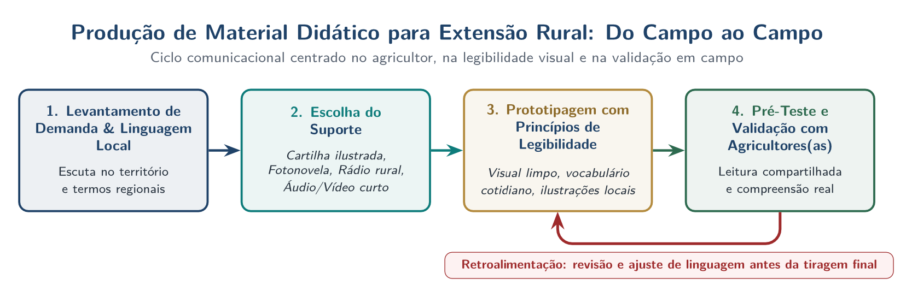

## [Abertura]{.pitch-tag} Visão Geral da Aula {#visao-geral .smaller-text .lesson-slide}

::: {.pitch-grid-50}
::: {.pitch-card}
[Roteiro da aula]{.pitch-card-index}
[Tópicos estruturantes]{.pitch-heading}

- [1]{.circle} O Material Didático na ATER
- [2]{.circle} Princípios de Comunicação para o Campo
- [3]{.circle} Cartilhas e Publicações Técnicas
- [4]{.circle} Folders, Panfletos e Banners
- [5]{.circle} Produção Audiovisual (Vídeo e Rádio)
- [6]{.circle} Mídias Digitais e ATER Digital
:::

::: {.pitch-stack-2}
::: {.pitch-card .pitch-card--gold}
[Objetivo central]{.pitch-card-index}
[Comunicação técnica acessível]{.pitch-heading}

Desenvolver competências para a produção de material didático e de divulgação voltado à extensão rural, abordando princípios de comunicação, formatos, linguagem adequada ao público-alvo e ferramentas acessíveis para cartilhas, folders, vídeos e conteúdos digitais.
:::

::: {.pitch-pill-row}
[Cartilhas & Folders]{.pitch-pill}
[Vídeo, Rádio & Podcast]{.pitch-pill .pitch-pill--gold}
[ATER Digital · WhatsApp]{.pitch-pill}
:::

::: {.pitch-band .pitch-band--teal}
Traduzir conhecimento técnico em materiais dialógicos, legíveis e validados com os agricultores.
:::
:::
:::

# 1 · Fundamentos e Comunicação Rural {.section-header rotulo="Fundamentos"}

## [Fundamentos]{.pitch-tag} O Material Didático na ATER {#material-didatico-ater .smaller-text .lesson-slide}

::: {.pitch-cards}
::: {.pitch-card}
[01 · Multiplicação]{.pitch-card-index}
[Alcance permanente · Coelho (2014)]{.pitch-heading}

Amplia a orientação técnica para além do encontro presencial, servindo de referência permanente e instrumento de multiplicação comunitária.
:::

::: {.pitch-card .pitch-card--gold}
[02 · Previsão Legal]{.pitch-card-index}
[PNATER (Lei 12.188/2010)]{.pitch-heading}

Prevê a produção de materiais educativos para a agricultura familiar; Chamadas Públicas de ATER exigem cartilhas, folders e vídeos como produtos (Brasil, 2010).
:::

::: {.pitch-card .pitch-card--teal}
[03 · Tradução Dialógica]{.pitch-card-index}
[Papel do extensionista]{.pitch-heading}

Não é tarefa secundária ou estética: exige traduzir ciência em linguagem acessível, selecionar o suporte certo e co-produzir com os agricultores.
:::
:::

::: {.pitch-band .pitch-band--navy}
Material didático eficaz nasce da **escuta do território** e retorna ao campo como apoio prático à autonomia do agricultor.
:::

## [Ciclo]{.pitch-tag .pitch-tag--teal} Fluxo de Produção: Do Campo ao Campo {#ciclo-material-didatico .smaller-text .lesson-slide}

::: {.pitch-media-card .pitch-media-card--tall}

[Produção de Material Didático para Extensão Rural: Do Campo ao Campo]{.pitch-caption}
[1. Levantamento de Demanda & Linguagem Local → 2. Escolha do Suporte → 3. Prototipagem com Legibilidade → 4. Pré-Teste e Validação (com retroalimentação)]{.pitch-caption-sub}
:::

## [Comunicação]{.pitch-tag .pitch-tag--forest} Princípios de Comunicação para o Campo {#principios-comunicacao .smaller-text .lesson-slide}

::: {.pitch-grid-50}
::: {.pitch-stack-2}
::: {.pitch-card}
[Freire (1983)]{.pitch-card-index}
[Comunicação dialógica]{.pitch-heading}

A extensão como mera transmissão viola a condição de sujeito do agricultor. O material didático deve ser **dialógico**, nunca prescritivo.
:::

::: {.pitch-card .pitch-card--teal}
[Bordenave (1983)]{.pitch-card-index}
[Aderência à realidade]{.pitch-heading}

A mensagem eficaz parte da realidade do receptor, adota seu vocabulário, respeita seus valores culturais e traz soluções aplicáveis ao concreto.
:::
:::

::: {.pitch-milestones}
::: {.pitch-milestone-item}
**1.** Partir da realidade e do vocabulário local do público
:::

::: {.pitch-milestone-item}
**2.** Priorizar informação prática e diretamente aplicável
:::

::: {.pitch-milestone-item}
**3.** Utilizar exemplos locais e sistemas reconhecíveis
:::

::: {.pitch-milestone-item}
**4.** Respeitar diversidades culturais e níveis de escolaridade
:::

::: {.pitch-milestone-item}
**5.** Privilegiar imagem sobre texto quando há baixa escolaridade
:::

::: {.pitch-milestone-item}
**6.** Permitir que o agricultor se veja representado no material
:::
:::
:::

# 2 · Impressos e Design Visual {.section-header rotulo="Impressos"}

## [Impressos]{.pitch-tag .pitch-tag--gold} Cartilhas e Publicações Técnicas {#cartilhas-publicacoes .smaller-text .lesson-slide}

::: {.pitch-band}
**Formato clássico da ATER:** publicação impressa e digital (geralmente de **16 a 48 páginas**) que desenvolve de modo didático um tema técnico orientado à prática. A **Embrapa (2023)** mantém amplo acervo gratuito de referência.
:::

::: {.pitch-cards-2}
::: {.pitch-card}
[Anatomia editorial]{.pitch-card-index}
[Estrutura de uma Cartilha]{.pitch-heading}

1. **Capa:** identifica tema, autoria e instituição
2. **Apresentação:** contextualiza problema e público-alvo
3. **Corpo técnico:** ilustrações, fotos e esquemas acessíveis
4. **Seção prática:** orientações passo a passo aplicáveis
5. **Fechamento:** referências e contatos da equipe de ATER
:::

::: {.pitch-card .pitch-card--gold}
[Clareza e identificação]{.pitch-card-index}
[Boas Práticas de Redação]{.pitch-heading}

- Frases e parágrafos curtos, evitando jargão acadêmico
- Espaçamento generoso e hierarquia clara de títulos
- Cores e ícones consistentes para alertas e etapas
- **Fotos de agricultores reais da região** geram mais identificação do que ilustrações genéricas
:::
:::

## [Design]{.pitch-tag .pitch-tag--gold} Design Visual para o Campo {#design-visual .smaller-text .lesson-slide}

::: {.pitch-table-box}
| Elemento | Recomendação para ATER |
| --- | --- |
| **Fonte** | *Sans-serif*, corpo 12–14 pt (impresso) e 16–18 pt (projeção) |
| **Cores** | Paleta limitada (3–4 cores), sempre com alto contraste |
| **Imagens** | Fotos reais da região, agricultores locais e passo a passo visual |
| **Layout** | Margens generosas, espaço em branco e colunas largas |
| **Ícones** | Simples, intuitivos e consistentes ao longo do material |
:::

::: {.pitch-band .pitch-band--teal}
**Regra de legibilidade:** garantir hierarquia visual clara e, para públicos com baixa escolaridade, destinar no mínimo **40% da área** a elementos visuais.
:::

## [Impressos]{.pitch-tag .pitch-tag--gold} Folders, Panfletos, Cartilhas e Banners {#folders-panfletos .smaller-text .lesson-slide}

::: {.pitch-flow-4}
::: {.pitch-card}
[01 · Panfleto]{.pitch-card-index}
[Folha simples]{.pitch-heading}

Frente e verso, leitura rápida; ideal para divulgação de eventos, convites e avisos urgentes de curta duração.
:::

::: {.pitch-card .pitch-card--gold}
[02 · Folder]{.pitch-card-index}
[A4 em 3 dobras]{.pitch-heading}

Gera **6 faces** organizadas pela sequência de abertura; indicado para programas, serviços e orientações de média complexidade.
:::

::: {.pitch-card .pitch-card--teal}
[03 · Cartilha]{.pitch-card-index}
[Múltiplas páginas]{.pitch-heading}

Publicação de referência técnica permanente para conteúdos detalhados de manejo, sanidade ou gestão.
:::

::: {.pitch-card .pitch-card--forest}
[04 · Banner / Cartaz]{.pitch-card-index}
[Espaços públicos]{.pitch-heading}

Comunicação visual à distância em feiras, galpões associativos, escolas rurais e dias de campo.
:::
:::

::: {.pitch-band}
A escolha do formato depende da **densidade da informação**, do **tempo de uso** esperado e do **espaço de circulação** no território.
:::

# 3 · Audiovisual, Rádio e ATER Digital {.section-header rotulo="Audiovisual e Digital"}

## [Audiovisual]{.pitch-tag .pitch-tag--teal} Produção Audiovisual para ATER {#producao-audiovisual .smaller-text .lesson-slide}

::: {.pitch-grid-50}
::: {.pitch-stack-2}
::: {.pitch-card}
[Vidal Santos e Oliveira (2020)]{.pitch-card-index}
[Smartphones e redes no campo]{.pitch-heading}

A popularização dos celulares e redes (**YouTube, WhatsApp, Instagram**) ampliou decisivamente o alcance das orientações técnicas audiovisuais.
:::

::: {.pitch-card .pitch-card--teal}
[Formatos principais]{.pitch-card-index}
[Tipos de vídeo para ATER]{.pitch-heading}

- **Instrucional:** passo a passo de calda, poda ou compostagem
- **Depoimento:** relato de agricultor gerando credibilidade
- **Documentário curto:** experiências coletivas para formação
- **Animação:** simplifica processos complexos
:::
:::

::: {.pitch-milestones}
::: {.pitch-milestone-item}
**1. Duração curta:** 3 a 7 minutos para vídeos instrucionais.
:::

::: {.pitch-milestone-item}
**2. Fala natural:** linguagem oral espontânea, sem leitura mecânica.
:::

::: {.pitch-milestone-item}
**3. Filmagem em campo:** mostrar a prática real na propriedade.
:::

::: {.pitch-milestone-item}
**4. Acessibilidade:** legendas para locais ruidosos ou baixa audição.
:::

::: {.pitch-milestone-item}
**5. Leveza técnica:** formato compatível com WhatsApp (leve/vertical).
:::

::: {.pitch-milestone-item}
**6. Protagonismo:** centralidade da voz e da prática do agricultor.
:::
:::
:::

## [Áudio]{.pitch-tag .pitch-tag--forest} Rádio Comunitária e Podcast Rural {#radio-podcast .smaller-text .lesson-slide}

::: {.pitch-cards}
::: {.pitch-card .pitch-card--forest}
[01 · Rádio Rural]{.pitch-card-index}
[Capilaridade · Embrapa (2023)]{.pitch-heading}

Mantém altíssimo alcance em áreas de baixa conectividade, com tradição do **Programa Prosa Rural** e das rádios comunitárias em assentamentos.
:::

::: {.pitch-card .pitch-card--teal}
[02 · Podcast Rural]{.pitch-card-index}
[Áudio sob demanda]{.pitch-heading}

Permite ouvir conteúdos técnicos durante as atividades no campo; exige apenas smartphone com gravador e distribuição gratuita (Spotify, Anchor, Google Podcasts).
:::

::: {.pitch-card .pitch-card--gold}
[03 · Linguagem Sonora]{.pitch-card-index}
[Formato e duração]{.pitch-heading}

Estilo coloquial e narrativo, com entrevistas de agricultores, especialistas e extensionistas em episódios temáticos de **15 a 30 minutos**.
:::
:::

::: {.pitch-band}
O áudio supera barreiras de alfabetização e conectividade contínua, acompanhando o ritmo cotidiano do trabalho rural.
:::

## [ATER Digital]{.pitch-tag .pitch-tag--teal} Ecossistema de Mídias na ATER Digital {#ater-digital-ecossistema .smaller-text .lesson-slide}

::: {.pitch-band .pitch-band--navy}
**ANATER (2020):** a **ATER Digital** incorpora TICs utilizando exatamente as plataformas que o agricultor já acessa no cotidiano, reduzindo barreiras de adoção e conectando conteúdo técnico ao campo.
:::

::: {.pitch-cards}
::: {.pitch-card .pitch-card--forest}
[Canal 1]{.pitch-card-index}
[WhatsApp]{.pitch-heading}

Mensagens rápidas, áudios curtos, vídeos instrucionais leves e grupos temáticos.
:::

::: {.pitch-card .pitch-card--alert}
[Canal 2]{.pitch-card-index}
[YouTube]{.pitch-heading}

Repositório de vídeos instrucionais detalhados e depoimentos de experiências locais.
:::

::: {.pitch-card .pitch-card--gold}
[Canal 3]{.pitch-card-index}
[Instagram e Facebook]{.pitch-heading}

Cards visuais, *stories* e *reels* para divulgação rápida e mobilização territorial.
:::
:::

::: {.pitch-cards-2}
::: {.pitch-card .pitch-card--teal}
[Canal 4]{.pitch-card-index}
[Podcasts]{.pitch-heading}

Séries de áudio sob demanda com entrevistas, boletins técnicos e relatos rurais.
:::

::: {.pitch-card}
[Canal 5]{.pitch-card-index}
[Aplicativos Técnicos]{.pitch-heading}

Ferramentas de apoio à decisão em campo, como **Plantio Certo** e **Agrobase**.
:::
:::

## [ATER Digital]{.pitch-tag .pitch-tag--forest} WhatsApp como Ferramenta de ATER {#whatsapp-ater .smaller-text .lesson-slide}

::: {.pitch-grid-50}
::: {.pitch-stack-2}
::: {.pitch-card .pitch-card--forest}
[IBGE (2022) · >83% dos domicílios]{.pitch-card-index}
[Principal canal digital rural]{.pitch-heading}

Mais de **83% dos domicílios rurais** com internet utilizam o WhatsApp para texto, áudio, vídeos curtos e compartilhamento de cartilhas em PDF.
:::

::: {.pitch-card}
[Comunidades de prática]{.pitch-card-index}
[Troca horizontal em grupos]{.pitch-heading}

Grupos temáticos (hortaliças, apicultura, cooperativas) permitem que agricultores troquem fotos de lavouras e soluções entre si, não apenas com o técnico.
:::
:::

::: {.pitch-milestones}
::: {.pitch-milestone-item}
**1.** Definir regras claras de convivência e foco temático no grupo
:::

::: {.pitch-milestone-item}
**2.** Evitar excesso de mensagens (priorizar qualidade sobre volume)
:::

::: {.pitch-milestone-item}
**3.** Enviar áudios curtos (até 1 minuto) para orientações objetivas
:::

::: {.pitch-milestone-item}
**4.** Usar fotos e vídeos reais de campo como suporte visual
:::

::: {.pitch-milestone-item}
**5.** Reservar janelas específicas para dúvidas e respostas
:::

::: {.pitch-milestone-item}
**6.** Respeitar horários de descanso (evitar envios noturnos)
:::
:::
:::

# 4 · Ferramentas, Validação e Síntese {.section-header rotulo="Produção e Validação"}

## [Produção]{.pitch-tag} Ferramentas Acessíveis de Produção {#ferramentas-producao .smaller-text .lesson-slide}

::: {.pitch-table-box}
| Ferramenta | Tipo | Uso em ATER |
| --- | --- | --- |
| **Canva** | Design gráfico online | Cartilhas, folders, posts, apresentações |
| **Google Docs / Slides** | Editor colaborativo | Textos e apresentações com co-autoria |
| **CapCut / InShot** | Edição de vídeo (celular) | Vídeos instrucionais e depoimentos |
| **Anchor / Spotify for Podcasters** | Plataforma de podcast | Gravação e distribuição de episódios |
| **OBS Studio** | Gravação de tela (PC) | Tutoriais e apresentações gravadas |
| **Audacity** | Editor de áudio (PC) | Edição de podcasts e spots de rádio |
:::

::: {.pitch-band .pitch-band--gold}
**Co-produção no território:** envolver agricultores na captura de fotos, gravação de depoimentos e revisão de linguagem amplia a apropriação comunitária do material.
:::

## [Validação]{.pitch-tag .pitch-tag--teal} Avaliação e Checklist de Qualidade {#validacao-material .smaller-text .lesson-slide}

::: {.pitch-grid-50}
::: {.pitch-card}
[Antes da tiragem final]{.pitch-card-index}
[Validação com o público-alvo]{.pitch-heading}

Evita materiais tecnicamente corretos porém incomunicáveis:

- **Pré-teste em grupo:** registrar compreensão, dúvidas e sugestões
- **Revisão por pares:** olhar de extensionistas experientes da região
- **Ajustes editoriais:** adequar termos e figuras após o retorno
- **Acessibilidade:** checar contraste, legendas e clareza sonora
:::

::: {.pitch-milestones}
::: {.pitch-milestone-item}
**1.** A linguagem é acessível ao público-alvo?
:::

::: {.pitch-milestone-item}
**2.** As imagens representam fielmente a realidade local?
:::

::: {.pitch-milestone-item}
**3.** O conteúdo é prático e aplicável em campo?
:::

::: {.pitch-milestone-item}
**4.** O formato é adequado ao meio de distribuição?
:::

::: {.pitch-milestone-item}
**5.** Foi validado com agricultores antes da versão final?
:::

::: {.pitch-milestone-item}
**6.** Respeita direitos autorais e de imagem?
:::

::: {.pitch-milestone-item}
**7.** Garante acessibilidade (contraste, legendas, áudio)?
:::
:::
:::

## [Síntese]{.pitch-tag} Conclusão e Referências {#conclusao-referencias .smaller-text .lesson-slide}

::: {.pitch-band .pitch-band--navy}
**Conclusão:** cartilhas, folders, vídeos, podcasts e mídias digitais potencializam a ATER quando guiados pelos princípios da comunicação rural e pela co-produção com agricultores — a ATER Digital complementa, mas não substitui o encontro presencial.
:::

::: {.pitch-cards-2}
::: {.pitch-card}
[Bloco 1 · Comunicação e Didática]{.pitch-card-index}
[Fundamentos teóricos e práticos]{.pitch-heading}

- Bordenave, J. D. *O que é comunicação rural*. São Paulo: Brasiliense, 1983.
- Coelho, F. M. G. *A Arte das Orientações Técnicas no Campo*. Rio Branco: Suprema, 2014.
- Freire, P. *Extensão ou Comunicação?* Rio de Janeiro: Paz e Terra, 1983.
- Vidal Santos, L. D.; Oliveira, R. S. Uso de mídias digitais na extensão rural. In: *Congresso Brasileiro de Extensão Rural*, 2020.
:::

::: {.pitch-card .pitch-card--teal}
[Bloco 2 · Políticas, Rádio e Conectividade]{.pitch-card-index}
[Referências institucionais]{.pitch-heading}

- ANATER. *Programa ATER Digital*. Brasília: Agência Nacional de Assistência Técnica e Extensão Rural, 2020.
- Brasil. *Lei 12.188/2010*. PNATER/PRONATER (2010).
- Embrapa. *Prosa Rural: programa de rádio para a agricultura familiar*. Brasília: Embrapa, 2023.
- IBGE. *Pesquisa Nacional por Amostra de Domicílios Contínua: acesso à internet e TV* (2022).
:::
:::

## {.center background-color="#2135A6"}

::: {style="text-align: center;"}
[Obrigado!]{.obrigado-fit-text style="color: white;"}

::: {style="color: white; font-size: 0.7em;"}
Luiz Diego Vidal Santos

Universidade Estadual de Feira de Santana (UEFS)
:::
:::
