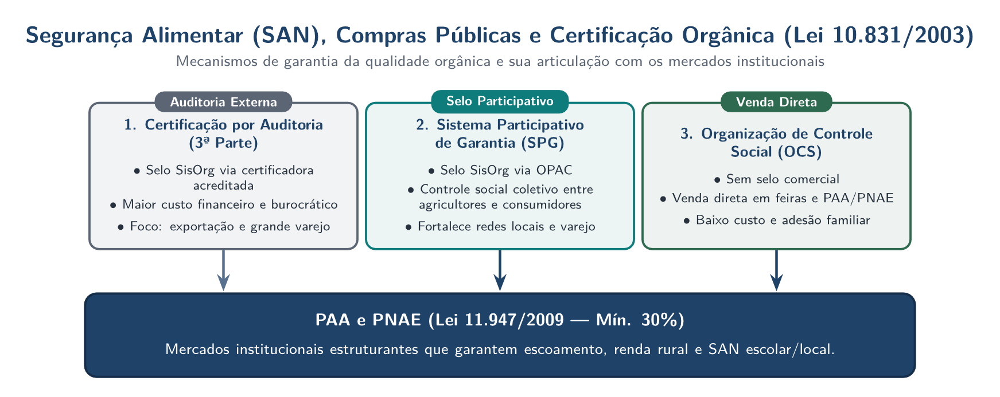
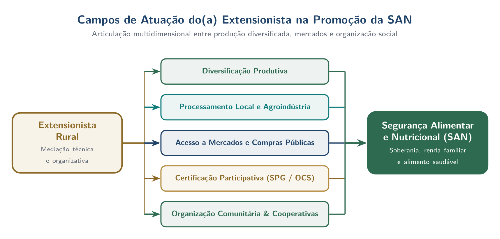
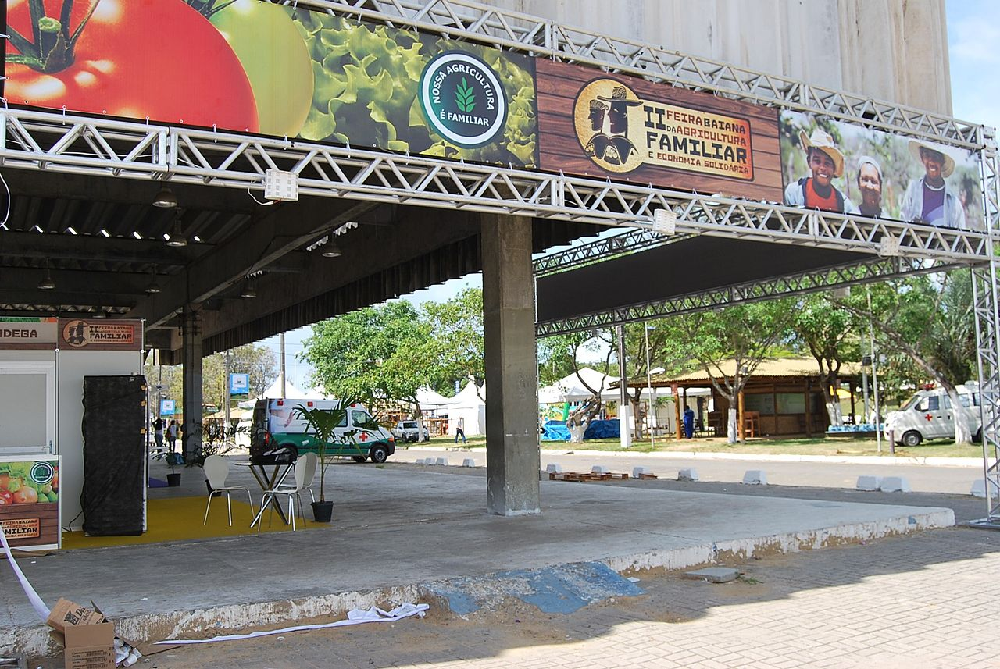

## [Abertura]{.pitch-tag .pitch-tag--gold} Visão Geral da Aula {#visao-geral .smaller-text .lesson-slide}

::: {.pitch-grid-50}
::: {.pitch-card}
[Roteiro da aula]{.pitch-card-index}
[Tópicos estruturantes]{.pitch-heading}

- [1]{.circle} Segurança Alimentar e Nutricional (SAN)
- [2]{.circle} Soberania Alimentar
- [3]{.circle} Certificação Orgânica no Brasil
- [4]{.circle} Sistemas Participativos de Garantia (SPG)
- [5]{.circle} Indicações Geográficas (IG)
- [6]{.circle} O Papel do Extensionista na SAN
:::

::: {.pitch-stack-2}
::: {.pitch-card .pitch-card--gold}
[Objetivo central]{.pitch-card-index}
[Da produção ao consumo responsável]{.pitch-heading}

Compreender os conceitos de segurança e soberania alimentar, os mecanismos de certificação de produtos orgânicos e as indicações geográficas como estratégias de valorização da agricultura familiar e de promoção do desenvolvimento rural sustentável.
:::

::: {.pitch-pill-row}
[LOSAN · SISAN]{.pitch-pill}
[Auditoria · SPG · OCS]{.pitch-pill .pitch-pill--gold}
[IP · DO · INPI]{.pitch-pill}
:::

::: {.pitch-band .pitch-band--teal}
Conectando direito humano à alimentação, certificação participativa e mercados territoriais.
:::
:::
:::

# 1 · Segurança e Soberania Alimentar {.section-header rotulo="SAN e Soberania"}

## [SAN]{.pitch-tag .pitch-tag--gold} Segurança Alimentar e Nutricional (SAN) {#conceito-san .smaller-text .lesson-slide}

::: {.pitch-formula}
**LOSAN (Lei 11.346/2006, Art. 3°):** *"realização do direito de todos ao acesso regular e permanente a alimentos de qualidade, em quantidade suficiente, sem comprometer o acesso a outras necessidades essenciais, tendo como base práticas alimentares promotoras de saúde que respeitem a diversidade cultural e que sejam ambiental, cultural, econômica e socialmente sustentáveis."*
:::

::: {.pitch-flow-4}
::: {.pitch-card .pitch-card--forest}
[01 · Disponibilidade]{.pitch-card-index}
[Produção e oferta]{.pitch-heading}

Sistemas produtivos diversificados, sustentáveis e abastecimento local.
:::

::: {.pitch-card .pitch-card--gold}
[02 · Acesso]{.pitch-card-index}
[Renda e distribuição]{.pitch-heading}

Capacidade econômica e canais regulares de obtenção de alimentos.
:::

::: {.pitch-card .pitch-card--teal}
[03 · Utilização biológica]{.pitch-card-index}
[Qualidade e higiene]{.pitch-heading}

Valor nutricional, processamento, conservação e inocuidade sanitária.
:::

::: {.pitch-card}
[04 · Estabilidade]{.pitch-card-index}
[Regularidade temporal]{.pitch-heading}

Continuidade do acesso frente a secas, crises e choques de preços.
:::
:::

::: {.pitch-band}
A extensão rural incide diretamente sobre a **disponibilidade** (diversificação produtiva) e a **utilização biológica** (processamento, conservação e higiene alimentar — Maluf, 2007).
:::

## [SAN]{.pitch-tag .pitch-tag--alert} Insegurança Alimentar e o Paradoxo Brasileiro {#inseguranca-alimentar .smaller-text .lesson-slide}

::: {.pitch-grid-50}
::: {.pitch-stack-2}
::: {.pitch-card .pitch-card--alert}
[POF (IBGE, 2020) · VIGISAN (2022)]{.pitch-card-index}
[O paradoxo alimentar brasileiro]{.pitch-heading}

O país figura entre os maiores produtores e exportadores mundiais de alimentos, mas não assegura acesso alimentar adequado a parcela expressiva da população.
:::

::: {.pitch-card}
[Vulnerabilidade no campo]{.pitch-card-index}
[Quem mais sofre no meio rural]{.pitch-heading}

Agricultores familiares do semiárido, comunidades quilombolas, povos indígenas e assentados da reforma agrária concentram índices críticos de insegurança alimentar (IBGE, 2020).
:::
:::

::: {.pitch-milestones}
::: {.pitch-milestone-item}
**33,1 milhões** de brasileiros viviam em **insegurança alimentar grave (fome)** segundo o VIGISAN (2022).
:::

::: {.pitch-milestone-item}
**125,2 milhões** enfrentavam algum grau de insegurança alimentar no país.
:::

::: {.pitch-milestone-item}
**Desigualdade regional:** maior incidência concentrada nas regiões Norte e Nordeste.
:::

::: {.pitch-milestone-item}
**Recorte interseccional:** domicílios chefiados por mulheres negras são os mais atingidos.
:::

::: {.pitch-milestone-item}
**Assimetria rural-urbana:** o meio rural apresenta proporcionalmente maior insegurança alimentar que o urbano.
:::
:::
:::

## [Soberania]{.pitch-tag .pitch-tag--forest} Soberania Alimentar e Controle dos Sistemas {#soberania-alimentar .smaller-text .lesson-slide}

::: {.pitch-formula}
**Via Campesina (1996):** *"o direito dos povos de definir suas próprias políticas e estratégias sustentáveis de produção, distribuição e consumo de alimentos, garantindo o direito à alimentação para toda a população, com base na pequena e média produção, respeitando suas próprias culturas e a diversidade dos modos camponeses de produção e comercialização."*
:::

::: {.pitch-cards-2}
::: {.pitch-card}
[Foco no "O Quê"]{.pitch-card-index}
[Segurança Alimentar (SAN)]{.pitch-heading}

Garante acesso regular e permanente a alimentos suficientes, seguros e de qualidade nutricional para toda a população.
:::

::: {.pitch-card .pitch-card--forest}
[Foco no "Como" e "Por Quem"]{.pitch-card-index}
[Soberania Alimentar]{.pitch-heading}

Questiona quem controla os sistemas alimentares, defendendo circuitos curtos, sementes crioulas, mercados locais e agroecologia (Maluf, 2007).
:::
:::

::: {.pitch-band .pitch-band--teal}
Para o extensionista, articular SAN e soberania alimentar significa fortalecer a autonomia produtiva e alimentar das famílias rurais.
:::

## [Políticas]{.pitch-tag .pitch-tag--gold} Políticas Públicas de SAN no Brasil {#politicas-san .smaller-text .lesson-slide}

::: {.pitch-table-box}
| Política / Programa | Ano | Contribuição para a SAN |
| --- | --- | --- |
| **LOSAN (Lei 11.346)** | 2006 | Define SAN como direito humano e cria o SISAN |
| **PAA** | 2003 | Compra direta da agricultura familiar para doação e estoques |
| **PNAE (Lei 11.947)** | 2009 | Mínimo de **30%** da alimentação escolar oriunda da agricultura familiar |
| **Programa Cisternas** | 2003 | Acesso à água para consumo e produção no semiárido |
| **PNAPO (Decreto 7.794)** | 2012 | Fomento à agroecologia e à produção orgânica |
| **Programa Brasil Sem Fome** | 2023 | Retomada articulada de ações de combate à fome |
:::

::: {.pitch-band}
A **extensão rural** é componente transversal dessas políticas, atuando da diversificação produtiva à habilitação para compras públicas (Grisa e Schneider, 2015).
:::

# 2 · Certificação Orgânica e SPG {.section-header rotulo="Certificação"}

## [Certificação]{.pitch-tag .pitch-tag--teal} Conformidade Orgânica e Compras Públicas {#certificacao-organica-diagrama .smaller-text .lesson-slide}

::: {.pitch-media-card .pitch-media-card--tall}

[Avaliação da Conformidade Orgânica (Lei 10.831/2003) e Articulação com PAA/PNAE]{.pitch-caption}
[Auditoria de 3ª Parte, Sistema Participativo de Garantia (SPG) e Organização de Controle Social (OCS) · Lei 11.947/2009 (Mín. 30%)]{.pitch-caption-sub}
:::

## [Certificação]{.pitch-tag .pitch-tag--teal} Mecanismos de Avaliação da Conformidade Orgânica {#modalidades-conformidade .smaller-text .lesson-slide}

::: {.pitch-cards}
::: {.pitch-card}
[01 · Auditoria (3ª parte)]{.pitch-card-index}
[Certificadoras credenciadas]{.pitch-heading}

- Emissão do selo SisOrg por certificadora credenciada pelo MAPA
- Custo financeiro e burocrático mais elevado
- Voltada a exportação, grande varejo e escalas maiores
:::

::: {.pitch-card .pitch-card--teal}
[02 · SPG]{.pitch-card-index}
[Sistema Participativo de Garantia]{.pitch-heading}

- Emite selo SisOrg via **OPAC** credenciado ao MAPA
- Controle social coletivo entre agricultores, consumidores e técnicos
- Acessível à agricultura familiar e coerente com a agroecologia
:::

::: {.pitch-card .pitch-card--forest}
[03 · OCS]{.pitch-card-index}
[Organização de Controle Social]{.pitch-heading}

- Venda **direta** ao consumidor final sem selo comercial
- Exige cadastro ativo no MAPA e rastreabilidade do grupo
- Baixo custo para feiras locais e vendas institucionais (PAA/PNAE)
:::
:::

::: {.pitch-band .pitch-band--navy}
**Lei 10.831/2003 e Decreto 6.323/2007:** cada mecanismo atende a públicos e escalas distintas, democratizando o acesso da agricultura familiar à garantia orgânica.
:::

## [Certificação]{.pitch-tag .pitch-tag--forest} Sistemas Participativos de Garantia (SPG) na Prática {#spg-pratica .smaller-text .lesson-slide}

::: {.pitch-grid-50}
::: {.pitch-stack-2}
::: {.pitch-card .pitch-card--teal}
[Decreto 6.323/2007 · OPAC]{.pitch-card-index}
[Confiança e controle compartilhado]{.pitch-heading}

Credenciados pelo MAPA como **Organismos Participativos de Avaliação da Conformidade (OPACs)**, os SPGs unem rigor normativo, participação social e emissão do selo orgânico nacional.
:::

::: {.pitch-card .pitch-card--forest}
[Referência nacional · Meirelles (2010)]{.pitch-card-index}
[Rede Ecovida de Agroecologia]{.pitch-heading}

Maior experiência brasileira de SPG, articulando mais de **4.500 famílias agricultoras** em **27 núcleos regionais** nos três estados do Sul do Brasil.
:::
:::

::: {.pitch-milestones}
::: {.pitch-milestone-item}
**1.** Grupo de agricultores constitui um núcleo territorial
:::

::: {.pitch-milestone-item}
**2.** Visitas periódicas de verificação cruzada entre pares
:::

::: {.pitch-milestone-item}
**3.** Participação ativa de consumidores e técnicos no controle
:::

::: {.pitch-milestone-item}
**4.** Registro formal do grupo no MAPA como OPAC
:::

::: {.pitch-milestone-item}
**5.** Emissão do selo orgânico brasileiro para mercados formais
:::

::: {.pitch-milestone-item}
**6.** Custo expressivamente menor que a auditoria de terceira parte
:::
:::
:::

# 3 · Indicações Geográficas (IG) {.section-header rotulo="Indicações Geográficas"}

## [Território]{.pitch-tag .pitch-tag--gold} Indicações Geográficas: IP e DO (Lei 9.279/1996) {#indicacoes-geograficas .smaller-text .lesson-slide}

::: {.pitch-cards-2}
::: {.pitch-card}
[Modalidade 1 · Reputação]{.pitch-card-index}
[Indicação de Procedência (IP)]{.pitch-heading}

Reconhece região que se tornou conhecida como centro de extração, produção ou fabricação de determinado produto ou serviço.

- **Foco:** reputação histórica do território
- **Exemplos:** Vale dos Vinhedos (RS — vinhos) e Litoral Norte Gaúcho (arroz)
:::

::: {.pitch-card .pitch-card--gold}
[Modalidade 2 · Terroir]{.pitch-card-index}
[Denominação de Origem (DO)]{.pitch-heading}

Reconhece produto cujas qualidades ou características se devem **exclusivamente** ao meio geográfico, incluindo fatores naturais e humanos.

- **Foco:** vínculo qualidade-território comprovado cientificamente
- **Exemplos:** Região do Cerrado Mineiro (café) e Costa Negra (CE — camarão)
:::
:::

::: {.pitch-band .pitch-band--navy}
**Registro no INPI:** o Instituto Nacional da Propriedade Industrial é o órgão responsável. Até **2024**, o Brasil contabilizava **mais de 100 IGs registradas**, com forte expansão no setor agropecuário.
:::

## [Território]{.pitch-tag .pitch-tag--gold} IGs e Agricultura Familiar: Potencial e Riscos {#igs-agricultura-familiar .smaller-text .lesson-slide}

::: {.pitch-cards}
::: {.pitch-card .pitch-card--teal}
[01 · Papel do Extensionista]{.pitch-card-index}
[Construção coletiva]{.pitch-heading}

Realizar diagnósticos locais, apoiar a organização coletiva, articular instituições de pesquisa na caracterização do produto e facilitar o registro no INPI (Niederle, 2013).
:::

::: {.pitch-card .pitch-card--forest}
[02 · Casos Familiares]{.pitch-card-index}
[Identidade territorial]{.pitch-heading}

- Própolis Vermelha de Alagoas
- Queijo Artesanal do Serro (MG)
- Cachaça da Região de Salinas (MG)
- Aguardente de Paraty (RJ)
:::

::: {.pitch-card .pitch-card--alert}
[03 · Desafios e Cuidados]{.pitch-card-index}
[Risco de exclusão]{.pitch-heading}

Exige conformidade com cadernos de especificação técnica, infraestrutura e marketing territorial; há risco recorrente de exclusão de pequenos produtores na área delimitada (Niederle, 2013).
:::
:::

::: {.pitch-band}
A IG agrega valor a saberes tradicionais apenas quando governada de forma inclusiva pelas organizações da agricultura familiar.
:::

# 4 · Atuação do Extensionista e Circuitos Curtos {.section-header rotulo="Atuação e Circuitos"}

## [Atuação]{.pitch-tag .pitch-tag--forest} O Extensionista na Promoção da SAN {#extensionista-san .smaller-text .lesson-slide}

::: {.pitch-grid-50}
::: {.pitch-milestones}
::: {.pitch-milestone-item}
**1. Diversificação produtiva:** ampliação de cultivos alimentares para autoconsumo e venda.
:::

::: {.pitch-milestone-item}
**2. Processamento local:** agregação de valor, higiene e conservação de alimentos.
:::

::: {.pitch-milestone-item}
**3. Acesso a mercados:** habilitação e logística para **PAA** e **PNAE**.
:::

::: {.pitch-milestone-item}
**4. Certificação (SPG/OCS):** construção de confiança e conformidade orgânica acessível.
:::

::: {.pitch-milestone-item}
**5. Organização comunitária:** gestão coletiva da produção, beneficiamento e comercialização.
:::
:::

::: {.pitch-stack-2}
::: {.pitch-card .pitch-card--forest}
[Visão sistêmica · Maluf (2007)]{.pitch-card-index}
[Além da tecnologia produtiva]{.pitch-heading}

Todos os cinco eixos de trabalho do extensionista convergem para a promoção da **Segurança Alimentar e Nutricional** no campo e na cidade, superando a assistência técnica puramente produtivista.
:::

::: {.pitch-band .pitch-band--navy}
Produzir com diversidade + beneficiar no território + certificar coletivamente + escoar em mercados justos = **SAN sustentável**.
:::
:::
:::

## [Diagrama]{.pitch-tag .pitch-tag--forest} Campos de Atuação do(a) Extensionista na SAN {#extensionista-san-tikz .smaller-text .lesson-slide}

::: {.pitch-media-card .pitch-media-card--tall}

[Atuação Sistêmica do Extensionista na Promoção da Segurança Alimentar e Nutricional]{.pitch-caption}
[Convergência entre diversificação produtiva, processamento local, mercados institucionais, SPG/OCS e organização comunitária]{.pitch-caption-sub}
:::

::: {.pitch-band}
A promoção da **SAN** demanda atuação integrada do extensionista do campo à mesa, articulando produção agroecológica e mercados de proximidade.
:::

## [Mercados]{.pitch-tag .pitch-tag--gold} Sistemas Alimentares Locais e Circuitos Curtos {#sistemas-alimentares-locais .smaller-text .lesson-slide}

::: {.pitch-grid-55}
::: {.pitch-stack-2}
::: {.pitch-card}
[Schneider et al. (2020)]{.pitch-card-index}
[Circuitos curtos de comercialização]{.pitch-heading}

Aproximam produtores e consumidores, reduzem cadeias intermediárias e promovem simultaneamente **SAN** (alimentos frescos), **soberania alimentar** e **viabilidade econômica** familiar.
:::

::: {.pitch-card .pitch-card--gold}
[Modalidades em expansão no Brasil]{.pitch-card-index}
[Canais diretos e institucionais]{.pitch-heading}

1. Feiras agroecológicas e familiares (**+7.000** no país)
2. Entregas em domicílio (cestas orgânicas)
3. Grupos de Consumo Responsável (GCR) e cooperativas
4. Compras públicas (**PAA**, **PNAE**) e plataformas digitais
:::
:::

::: {.pitch-media-card .pitch-media-card--photo}

[II Feira Baiana da Agricultura Familiar e Economia Solidária]{.pitch-caption}
[Salvador/BA · Foto: Neusa Cadore (CC-BY 2.0) · Encontro direto entre campo e cidade]{.pitch-caption-sub}
:::
:::

## [Síntese]{.pitch-tag .pitch-tag--gold} Conclusão {#conclusao .smaller-text .lesson-slide}

::: {.pitch-cards-2}
::: {.pitch-card .pitch-card--gold}
[Articulação estratégica]{.pitch-card-index}
[SAN, Certificação e Origem]{.pitch-heading}

Integrar SAN, soberania alimentar, certificação orgânica (SPG/OCS) e Indicações Geográficas capacita o extensionista a apoiar sistemas diversificados e mercados que valorizam qualidade, origem e atributos socioambientais.
:::

::: {.pitch-card .pitch-card--forest}
[Superação do paradoxo]{.pitch-card-index}
[Direito humano e território]{.pitch-heading}

A extensão rural comprometida com a SAN conecta o potencial produtivo agrário brasileiro ao **direito humano à alimentação adequada** e ao fortalecimento dos sistemas alimentares territoriais.
:::
:::

::: {.pitch-band .pitch-band--navy}
Da produção diversificada à mesa do consumidor: certificação e mercados territoriais garantem autonomia à agricultura familiar.
:::

## [Referências]{.pitch-tag} Referências da Aula {#referencias .smaller-text .lesson-slide}

::: {.pitch-cards-2}
::: {.pitch-card}
[Bloco 1 · Legislação e Marcos Normativos]{.pitch-card-index}
[Leis e decretos estruturantes]{.pitch-heading}

- Brasil. *Lei 9.279/1996*. Propriedade Industrial (1996).
- Brasil. *Lei 10.831/2003*. Agricultura Orgânica (2003).
- Brasil. *Lei 11.346/2006*. Lei Orgânica de Segurança Alimentar (LOSAN).
- Brasil. *Lei 11.947/2009*. Programa Nacional de Alimentação Escolar (PNAE).
- Brasil. *Decreto 6.323/2007*. Regulamentação da agricultura orgânica.
- Brasil. *Decreto 7.794/2012*. Política Nacional de Agroecologia e Produção Orgânica (PNAPO).
:::

::: {.pitch-card .pitch-card--gold}
[Bloco 2 · Literatura e Inquéritos]{.pitch-card-index}
[Estudos de SAN, SPG, IG e mercados]{.pitch-heading}

- Grisa, C.; Schneider, S. Três gerações de políticas públicas para a agricultura familiar. *Revista de Economia e Sociologia Rural*, v. 52, p. 125–146, 2015.
- IBGE. *Pesquisa de Orçamentos Familiares 2017–2018* (2020).
- Maluf, R. S. *Segurança Alimentar e Nutricional*. Petrópolis: Vozes, 2007.
- Meirelles, L. *Certificação participativa: a experiência da Rede Ecovida*. Ipê: Centro Ecológico, 2010.
- Niederle, P. A. *Indicações geográficas: qualidade e origem nos mercados alimentares*. Porto Alegre: UFRGS, 2013.
- Rede PENSSAN. *VIGISAN: Inquérito Nacional sobre Insegurança Alimentar* (2022).
- Schneider, S. et al. *A pandemia e os sistemas alimentares no Brasil*. Porto Alegre: UFRGS, 2020.
- Via Campesina. *Declaração sobre Soberania Alimentar*. Roma, 1996.
:::
:::

## {.center background-color="#2135A6"}

::: {style="text-align: center;"}
[Obrigado!]{.obrigado-fit-text style="color: white;"}

::: {style="color: white; font-size: 0.7em;"}
Luiz Diego Vidal Santos

Universidade Estadual de Feira de Santana (UEFS)
:::
:::
