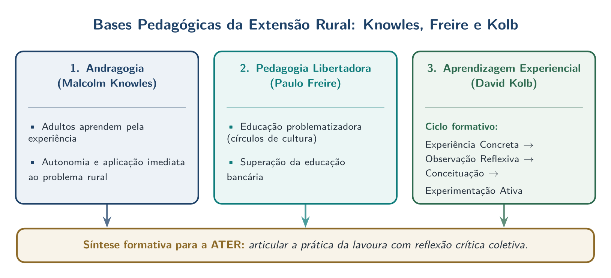

## [Abertura]{.pitch-tag} Visão Geral da Aula {#visao-geral .smaller-text .lesson-slide}

::: {.pitch-grid-50}
::: {.pitch-card}
[Roteiro da aula]{.pitch-card-index}
[Tópicos principais]{.pitch-heading}

- [1]{.circle} Educação e Extensão Rural
- [2]{.circle} Concepção Tradicional (Pedagogia Bancária)
- [3]{.circle} Concepção Nova (Escola Nova)
- [4]{.circle} Concepção Tecnicista
- [5]{.circle} Concepção Crítico-Social dos Conteúdos
- [6]{.circle} Implicações para a Prática Extensionista
:::

::: {.pitch-stack-2}
::: {.pitch-card .pitch-card--gold}
[Objetivo central]{.pitch-card-index}
[Teorias pedagógicas e modelos de ATER]{.pitch-heading}

Sistematizar as quatro grandes concepções pedagógicas e analisar como cada uma influencia modelos, métodos e estratégias de extensão rural, desde o difusionismo até as abordagens participativas contemporâneas.
:::

::: {.pitch-pill-row}
[Saviani]{.pitch-pill}
[Paulo Freire]{.pitch-pill .pitch-pill--gold}
[Malcolm Knowles]{.pitch-pill}
[PNATER]{.pitch-pill .pitch-pill--gold}
:::

::: {.pitch-band .pitch-band--teal}
Toda prática extensionista carrega uma concepção pedagógica — explícita ou implícita — que define o lugar do agricultor.
:::
:::
:::

## [Fundamentos]{.pitch-tag} Educação e Extensão Rural {#educacao-extensao .smaller-text .lesson-slide}

::: {.pitch-cards-2}
::: {.pitch-card}
[Freire (1983)]{.pitch-card-index}
[A extensão como processo educativo]{.pitch-heading}

A extensão rural é, em sua essência, um **processo educativo**. Todo ato extensionista envolve relações de ensino-aprendizagem entre extensionistas e agricultores, configuradas de formas distintas conforme a concepção pedagógica subjacente.
:::

::: {.pitch-card .pitch-card--gold}
[Saviani (2008)]{.pitch-card-index}
[Exigência para o agrônomo]{.pitch-heading}

Compreender as teorias pedagógicas não se restringe a educadores formais: é a concepção pedagógica adotada que determina se o extensionista atuará como **transmissor de pacotes tecnológicos** ou como **facilitador de processos emancipatórios**.
:::
:::

::: {.pitch-band .pitch-band--navy}
Dermeval Saviani organizou as correntes pedagógicas brasileiras em quatro grandes concepções, cada uma com reflexos diretos na ATER.
:::

# 1 · As Quatro Concepções Pedagógicas {.section-header rotulo="Concepções"}

## [Pedagogia]{.pitch-tag .pitch-tag--alert} Concepção Tradicional (Pedagogia Bancária) {#concepcao-tradicional .smaller-text .lesson-slide}

::: {.pitch-grid-55}
::: {.pitch-stack-2}
::: {.pitch-card}
[Freire (1987) · Peixoto (2008)]{.pitch-card-index}
[Transmissão vertical e difusionismo]{.pitch-heading}

A **pedagogia tradicional** baseia-se na transmissão vertical do professor (detentor do saber) para o aluno (receptáculo passivo), chamada por Paulo Freire (1987) de **educação bancária**.

Na extensão rural, manifestou-se no **modelo difusionista clássico**: o agricultor era visto como carente de conhecimento válido e seu saber empírico era tratado como obstáculo à modernização.
:::

::: {.pitch-band}
**Consequência:** exclusão de grande parcela de agricultores familiares que não se adequavam ao modelo modernizante, com perda de agrobiodiversidade e saberes tradicionais associados (Caporal e Costabeber, 2004).
:::
:::

::: {.pitch-card .pitch-card--alert}
[Características na Extensão Rural]{.pitch-card-index}
[Cinco marcas do difusionismo]{.pitch-heading}

1. Comunicação unidirecional (extensionista → agricultor)
2. Agricultor como receptor passivo de tecnologias
3. Saber local desvalorizado ou ignorado
4. Foco na adoção de pacotes tecnológicos
5. Avaliação pelo número de "adotantes"
:::
:::

## [Pedagogia]{.pitch-tag .pitch-tag--teal} Concepção Nova (Escola Nova) {#concepcao-nova .smaller-text .lesson-slide}

::: {.pitch-band}
**Movimento escolanovista (1920–1930):** consolidado no Brasil com **Anísio Teixeira** e **Lourenço Filho**, desloca o centro do processo educativo do professor para o **aluno**, concebendo a aprendizagem como processo ativo, experiencial e centrado nos interesses do educando (Libâneo, 1994).
:::

::: {.pitch-cards-2}
::: {.pitch-card}
[Pilares teóricos]{.pitch-card-index}
[Princípios]{.pitch-heading}

- Valorização da experiência prévia do aprendiz
- Protagonismo do educando na definição dos temas de estudo
- Papel do educador como **facilitador**, não transmissor
- Ênfase em métodos ativos de aprendizagem (**aprender fazendo**)
:::

::: {.pitch-card .pitch-card--teal}
[Coelho (2014)]{.pitch-card-index}
[Reflexos na Extensão Rural]{.pitch-heading}

- Unidades Demonstrativas em propriedades de agricultores
- Trocas de experiências entre produtores (**agricultor a agricultor**)
- Dias de campo participativos
- Valorização do **saber-fazer** do agricultor como ponto de partida da intervenção
:::
:::

## [Pedagogia]{.pitch-tag .pitch-tag--gold} Concepção Tecnicista {#concepcao-tecnicista .smaller-text .lesson-slide}

::: {.pitch-cards-2}
::: {.pitch-card .pitch-card--gold}
[Saviani (2008)]{.pitch-card-index}
[Eficiência e controle]{.pitch-heading}

Consolidada no Brasil durante o regime militar (décadas de 1960 e 1970), prioriza a eficiência do ensino por meio da racionalização, planejamento rigoroso, definição de objetivos mensuráveis e controle de resultados.
:::

::: {.pitch-card}
[Peixoto (2008)]{.pitch-card-index}
[Modernização conservadora e EMBRATER]{.pitch-heading}

Alinhou-se à **modernização conservadora**: o extensionista atuava como técnico especializado avaliado por produtividade, adoção de insumos e volume de crédito rural intermediado. A **EMBRATER (1974–1990)** operou predominantemente sob essa lógica.
:::
:::

::: {.pitch-band .pitch-band--navy}
**Consequência:** **homogeneização** das recomendações técnicas, desconsiderando diversidades edafoclimáticas, socioeconômicas e culturais — marginalizando agricultores que não se enquadravam no modelo produtivista.
:::

## [Pedagogia]{.pitch-tag .pitch-tag--forest} Concepção Crítico-Social dos Conteúdos {#concepcao-critico-social .smaller-text .lesson-slide}

::: {.pitch-cards-2}
::: {.pitch-card .pitch-card--forest}
[Libâneo (1994) · Freire (1987)]{.pitch-card-index}
[Mediação crítica e libertação]{.pitch-heading}

Sistematizada por **Dermeval Saviani** e **José Carlos Libâneo**, supera o conteudismo tradicional e o espontaneísmo escolanovista: conteúdos são instrumentos para compreender e transformar a realidade social, com o educador como mediador crítico.

**Paulo Freire (1987)** complementa essa visão com a **pedagogia libertadora**, pelo diálogo problematizador mútuo.
:::

::: {.pitch-card}
[Caporal (2003)]{.pitch-card-index}
[Aplicação na Extensão Rural]{.pitch-heading}

- Diálogo horizontal entre extensionista e agricultor
- Problematização da realidade como ponto de partida
- Construção coletiva de soluções contextualizadas
- Valorização simultânea de saber técnico-científico e saber local
- Avaliação por indicadores de transformação social, não apenas produtividade
:::
:::

## [Pedagogia]{.pitch-tag} Síntese Comparativa das Concepções {#sintese-concepcoes .smaller-text .lesson-slide}

::: {.pitch-table-box}
| Concepção | Papel do Educador / Extensionista | Papel do Educando / Agricultor | Método Predominante | Modelo de ER Associado |
| --- | --- | --- | --- | --- |
| **Tradicional** | Transmissor | Receptor passivo | Palestra, dia de campo demonstrativo | Difusionismo clássico |
| **Escola Nova** | Facilitador | Protagonista ativo | Unidades demonstrativas, trocas | Transição |
| **Tecnicista** | Técnico especializado | Executor de receituários | Planejamento, metas, crédito | Modernização conservadora |
| **Crítico-Social** | Mediador dialógico | Co-construtor de conhecimento | DRP, pesquisa-ação, experimentação participativa | PNATER, agroecologia |
:::

::: {.pitch-band .pitch-band--teal}
Identificar a concepção dominante revela quem decide os objetivos, como o saber circula e qual modelo de desenvolvimento é reforçado.
:::

# 2 · Pedagogia Freiriana e Andragogia {.section-header rotulo="Freire e Knowles"}

## [Freire]{.pitch-tag .pitch-tag--teal} A Pedagogia Freiriana: Extensão ou Comunicação? {#pedagogia-freiriana .smaller-text .lesson-slide}

::: {.pitch-band}
Em *"Extensão ou Comunicação?"* (1983), **Paulo Freire** mostra que "extensão" carrega a ideia de **estender algo de quem sabe para quem não sabe** (lógica bancária), propondo em seu lugar a **comunicação** dialógica entre sujeitos.
:::

::: {.pitch-flow-4}
::: {.pitch-card}
[01 · Sujeito]{.pitch-card-index}
[Extensionista]{.pitch-heading}

**Sujeito cognoscente** que problematiza e escuta sem impor pacotes prontos.
:::

::: {.pitch-card .pitch-card--teal}
[02 · Encontro]{.pitch-card-index}
[Diálogo Problematizador]{.pitch-heading}

Comunicação horizontal bidirecional entre extensionista e agricultor.
:::

::: {.pitch-card .pitch-card--forest}
[03 · Sujeito]{.pitch-card-index}
[Agricultor]{.pitch-heading}

**Sujeito cognoscente** portador de experiência territorial e saber empírico.
:::

::: {.pitch-card .pitch-card--gold}
[04 · Síntese]{.pitch-card-index}
[Realidade → Práxis]{.pitch-heading}

**Objeto cognoscível** transformado conjuntamente pela **práxis** (ação-reflexão).
:::
:::

::: {.pitch-band .pitch-band--navy}
A **práxis** freiriana (ação + reflexão) é o fundamento metodológico do DRP, da pesquisa-ação e da construção coletiva do conhecimento agroecológico.
:::

## [Andragogia]{.pitch-tag} Bases Pedagógicas: Knowles, Freire e Kolb {#bases-pedagogicas-diagrama .smaller-text .lesson-slide}

::: {.pitch-media-card .pitch-media-card--tall}

[Convergência formativa para a ATER]{.pitch-caption}
[Articular a prática da lavoura com autonomia do aprendiz adulto e reflexão crítica coletiva]{.pitch-caption-sub}
:::

::: {.pitch-band}
Knowles (experiência adulta), Freire (problematização) e Kolb (experiência → reflexão → conceituação → ação) sustentam metodologias participativas no campo.
:::

## [Andragogia]{.pitch-tag} Andragogia de Knowles e Extensão Rural {#andragogia-extensao .smaller-text .lesson-slide}

::: {.pitch-grid-50}
::: {.pitch-card}
[Knowles (1970)]{.pitch-card-index}
[Seis pilares da educação de adultos]{.pitch-heading}

A **andragogia** aborda especificamente a educação de adultos — perfil dos agricultores, com vasta experiência de vida e expectativas concretas de aplicação:

- **Necessidade de saber** (por que aprender)
- **Autoconceito do aprendiz** (autonomia)
- **Papel da experiência prévia**
- **Prontidão** e **orientação** para a aprendizagem
- **Motivação intrínseca**
:::

::: {.pitch-card .pitch-card--gold}
[Aplicação em ATER]{.pitch-card-index}
[Conexão Andragogia e Extensão]{.pitch-heading}

1. Agricultores aprendem melhor quando o conteúdo resolve problemas reais
2. A experiência do agricultor é recurso pedagógico central
3. A motivação intrínseca supera incentivos externos
4. O extensionista facilita, não impõe
5. A aprendizagem deve respeitar o ritmo e a autonomia do adulto
6. O planejamento do processo educativo deve ser compartilhado
:::
:::

# 3 · Formação Agronômica, Conclusão e Referências {.section-header rotulo="Prática e Síntese"}

## [Formação]{.pitch-tag .pitch-tag--forest} Implicações para a Formação do Agrônomo {#implicacoes-formacao .smaller-text .lesson-slide}

::: {.pitch-band}
A formação do engenheiro agrônomo não pode se limitar às competências técnico-produtivas: os pressupostos pedagógicos definem a qualidade da relação entre o profissional e os agricultores (Coelho, 2014).
:::

::: {.pitch-cards-2}
::: {.pitch-card .pitch-card--forest}
[Repertório do extensionista]{.pitch-card-index}
[Competências pedagógicas necessárias]{.pitch-heading}

- Escuta ativa e diálogo intercultural
- Domínio de métodos participativos (**DRP, pesquisa-ação**)
- Planejamento de processos educativos centrados no aprendiz
- Sensibilidade para reconhecer e valorizar saberes diversos
- Reflexão crítica sobre a própria prática
:::

::: {.pitch-card .pitch-card--alert}
[Caporal e Costabeber (2004)]{.pitch-card-index}
[Desafios institucionais]{.pitch-heading}

A institucionalidade da ATER no Brasil ainda opera fortemente sob lógicas **tecnicistas e quantitativas** (nº de visitas, laudos emitidos, produtividade), em detrimento de indicadores de empoderamento, participação e transformação social.
:::
:::

## [Síntese]{.pitch-tag} Conclusão {#conclusao .smaller-text .lesson-slide}

::: {.pitch-cards-2}
::: {.pitch-card}
[Consciência pedagógica]{.pitch-card-index}
[Teoria na prática concreta]{.pitch-heading}

As quatro concepções sistematizadas por Saviani (tradicional, escolanovista, tecnicista e crítico-social) manifestam-se concretamente nos modelos de extensão rural no Brasil. Reconhecê-las evita reproduções inconscientes de modelos superados e orienta práticas dialógicas e transformadoras.
:::

::: {.pitch-card .pitch-card--gold}
[PNATER · Lei 12.188/2010]{.pitch-card-index}
[Alinhamento crítico-social]{.pitch-heading}

A **PNATER (Lei 12.188/2010)** estabelece princípios alinhados à concepção crítico-social, mas sua efetivação depende de extensionistas pedagogicamente conscientes e de instituições que valorizem indicadores qualitativos de transformação social além dos indicadores produtivos.
:::
:::

## [Referências]{.pitch-tag} Referências Bibliográficas {#referencias .smaller-text .lesson-slide}

::: {.pitch-cards-2}
::: {.pitch-card}
[Pedagogia, educação e extensão]{.pitch-card-index}
[Obras de referência]{.pitch-heading}

- COELHO, F. M. G. *A Arte das Orientações Técnicas no Campo*. Rio Branco: Suprema, 2014.
- FREIRE, P. *Extensão ou Comunicação?* Rio de Janeiro: Paz e Terra, 1983.
- FREIRE, P. *Pedagogia do Oprimido*. Rio de Janeiro: Paz e Terra, 1987.
- KNOWLES, M. S. *The Modern Practice of Adult Education*. New York: Association Press, 1970.
- LIBÂNEO, J. C. *Didática*. São Paulo: Cortez, 1994.
- SAVIANI, D. *Escola e Democracia*. Campinas: Autores Associados, 2008.
:::

::: {.pitch-card .pitch-card--teal}
[Extensão rural brasileira]{.pitch-card-index}
[Agroecologia e história da ATER]{.pitch-heading}

- CAPORAL, F. R. *Extensão Rural Agroecológica*. Brasília: MDA, 2003.
- CAPORAL, F. R.; COSTABEBER, J. A. *Agroecologia e Extensão Rural: contribuições para o desenvolvimento rural sustentável*. Brasília: MDA/IICA, 2004.
- PEIXOTO, M. et al. *Extensão Rural no Brasil: uma abordagem histórica*. Texto para Discussão, CONLEG/Senado, 2008.
:::
:::
