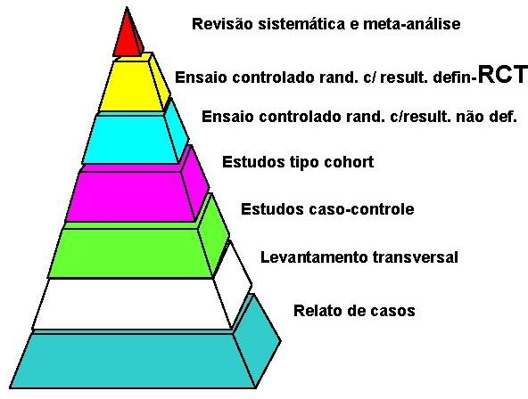
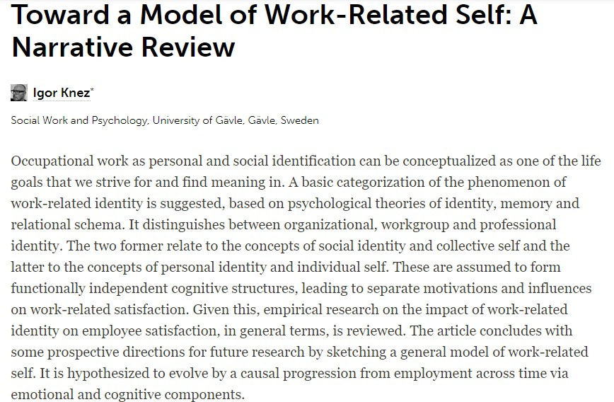
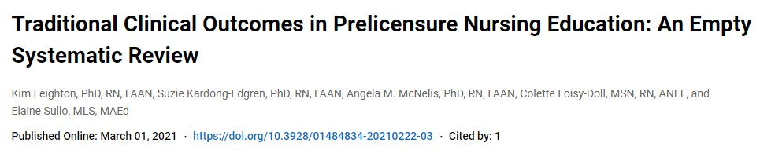
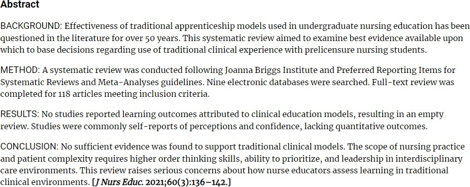

## Visão Geral da Aula {.smaller-text .lesson-slide}

::: {.columns}
::: {.column width="50%"}
### Tópicos

- [1]{.circle} Por que revisar a literatura
- [2]{.circle} Tipos de artigo e tipos de revisão
- [3]{.circle} Revisão sistemática
- [4]{.circle} Metanálise e outros procedimentos
- [5]{.circle} Metassíntese
- [6]{.circle} Scoping review
- [7]{.circle} Revisão integrativa e narrativa
- [8]{.circle} Planejamento de uma revisão (TREAD)
- [9]{.circle} Etapas de uma revisão
:::

::: {.column width="50%"}
::: {.info-box}
**Objetivo da Aula**

Apresentar os principais tipos de revisão da literatura e situar a revisão sistemática como método, demarcando os critérios que orientam a escolha entre revisão sistemática, metanálise, scoping review, revisão integrativa e revisão narrativa.
:::
:::
:::

# [1  -  POR QUE REVISAR]{.section-header}

## Produção científica em dois tempos {.smaller-text .lesson-slide}

::: {.columns}
::: {.column width="50%"}
### Antes do século XXI

- Menor quantidade de pesquisadores e menor produção científica
- Artigos com poucas referências
- Tecnologias de busca limitadas
- **Desafio:** obtenção da informação (pouca informação disponível)
:::

::: {.column width="50%"}
### No século XXI

- Maior volume de pesquisadores e maior produção científica
- Uso da internet e de computadores modernos
- Bases indexadas e busca remota
- **Desafio:** sintetizar a informação
:::
:::

## Revisão sistemática: origem {.smaller-text .lesson-slide}

::: {.columns}
::: {.column width="55%"}
### Da área da saúde

A revisão sistemática nasceu na área da saúde com o objetivo de **levantar e sintetizar evidências de práticas médicas**, apoiando decisões clínicas com base no conjunto da literatura disponível, e não em estudos isolados.

A pirâmide de evidências organiza essa lógica: revisões sistemáticas e metanálises ocupam o topo, acima dos delineamentos primários.
:::

::: {.column width="45%"}
{fig-alt="Pirâmide de evidências com revisão sistemática e metanálise no topo, seguida de ensaios controlados randomizados, estudos de coorte, caso-controle, levantamentos transversais e relatos de caso" width="85%"}

Pirâmide de evidências em saúde.
:::
:::

## Revisão da literatura: definição {.smaller-text .lesson-slide}

::: {.columns}
::: {.column width="55%"}
### O que é

Pesquisa de **fonte secundária** que descreve e sintetiza a produção científica relativa a uma questão de pesquisa.

| Natureza | Exemplos |
|----------|----------|
| **Fonte primária** | Artigos empíricos, dados originais |
| **Fonte secundária** | Revisões, sínteses, resumos críticos |

: {.striped .hover}

::: {.highlight-box}
**Artigo teórico ou artigo empírico?** A revisão da literatura é um artigo teórico, que analisa artigos empíricos previamente publicados.
:::
:::

::: {.column width="45%"}
{fig-alt="Funil filtrando documentos, com apenas um artigo aprovado na saída" width="85%"}

Filtragem progressiva do corpus até os estudos elegíveis.
:::
:::

# [2  -  TIPOS DE ARTIGO E DE REVISÃO]{.section-header}

## Tipos de artigo (APA, 2020) {.smaller-text .lesson-slide}

::: {.columns}
::: {.column width="55%"}
A American Psychological Association distingue oito categorias de artigos científicos:

- Artigos quantitativos
- Artigos qualitativos
- Artigos de métodos mistos
- Artigos de replicação
- Metanálises qualitativas e quantitativas
- Artigos de revisão da literatura (revisão narrativa)
- Artigos teóricos
- Artigos metodológicos
:::

::: {.column width="45%"}
::: {.info-box}
**Posição da revisão**

A revisão da literatura figura entre os tipos de artigo, e a metanálise é reconhecida como categoria própria, separada das revisões.
:::
:::
:::

## Tipos de artigo de revisão {.smaller-text .lesson-slide}

::: {.columns}
::: {.column width="50%"}
### Whittemore & Knafl (2005)

- Revisões integrativas
- Revisões sistemáticas
- Metanálises
- Revisões qualitativas
:::

::: {.column width="50%"}
### Grant & Booth (2009)

A taxonomia mais abrangente identifica quatorze tipos:

- Critical reviews
- Literature reviews
- Mapping reviews
- Meta-analyses
- Mixed studies reviews
- Overview
- Qualitative systematic reviews
- Rapid reviews
- Scoping reviews
- State-of-the-art reviews
- Systematic reviews
- Systematic searches and reviews
- Systematized reviews
- Umbrella reviews
:::
:::

## Foco deste curso {.smaller-text .lesson-slide}

::: {.columns}
::: {.column width="50%"}
### O que será trabalhado

- Revisões sistemáticas
- Metanálises (introdução)
- Scoping review e revisões integrativas
- Revisões narrativas
:::

::: {.column width="50%"}
::: {.info-box}
**Critério de escolha**

O tipo de revisão decorre da pergunta de pesquisa, do estado da arte da área e do tipo de evidência disponível. Cada modalidade será contrastada ao longo do curso.
:::
:::
:::

# [3  -  REVISÃO SISTEMÁTICA]{.section-header}

## Definição e objetivos {.smaller-text .lesson-slide}

::: {.columns}
::: {.column width="55%"}
### Definição (Cochrane Collaboration)

Uma revisão sistemática é uma visão geral de alto nível da pesquisa primária em relação a uma questão de pesquisa específica que tenta **identificar, selecionar, sintetizar e avaliar** todas as evidências de pesquisa de alta qualidade relevantes para essa questão, a fim de respondê-la.

### Objetivos (Munn et al., 2018)

- Identificar evidências empíricas relativas a uma questão específica
- Avaliar a qualidade metodológica dos estudos incluídos
- Descrever práticas correntes em determinada área
- Discutir resultados conflitantes
- Informar futuras pesquisas e práticas
:::

::: {.column width="45%"}
::: {.highlight-box}
**Ideia central**

A revisão sistemática substitui a seleção arbitrária de estudos por um **protocolo replicável**, com critérios explícitos e avaliação padronizada.
:::
:::
:::

## Características e exemplos {.smaller-text .lesson-slide}

::: {.columns}
::: {.column width="45%"}
### Características

- Restritiva (em geral, um único tipo de método)
- Qualitativa ou quantitativa
- Método sistemático de síntese e análise dos dados
- Método sistemático de avaliação de risco de viés
- Com ou sem metanálise; síntese qualitativa possível

### Exemplos

- Invariância de medidas de personalidade (Dong & Dumas, 2020)
- Perspectiva temporal futura em desfechos de saúde, educação e trabalho (Andre et al., 2018)
:::

::: {.column width="55%"}
{fig-alt="Página do artigo de Dong e Dumas sobre invariância de medição de medidas de personalidade" width="100%"}

Exemplo de revisão sistemática sem metanálise, com síntese via regressão logística ordinal.
:::
:::

# [4  -  METANÁLISE E OUTROS PROCEDIMENTOS]{.section-header}

## Metanálise: definição e características {.smaller-text .lesson-slide}

::: {.columns}
::: {.column width="50%"}
### Definição

Procedimento **estatístico** que visa a obtenção de um **tamanho de efeito geral** a partir da integração dos efeitos reportados por estudos primários.

### Características

- Restritiva; somente estudos quantitativos
- Hipóteses e métodos parecidos ou idênticos
- Características dos estudos tratadas como variáveis moderadoras
:::

::: {.column width="50%"}
### Variáveis moderadoras possíveis

| Moderador | Exemplo |
|-----------|---------|
| Risco de viés | baixo, moderado, alto |
| Idade da amostra | média, faixa etária |
| Nacionalidade da amostra | país ou cultura |
| Tipo de medida | geral ou específica |

: {.striped .hover}
:::
:::

## Metanálise: exemplo {.smaller-text .lesson-slide}

::: {.columns}
::: {.column width="50%"}
### Andre et al. (2018)

Impacto da **perspectiva temporal futura (FTP)** em desfechos de saúde, educação e trabalho.

Moderadores testados:

- Tipo de medida da FTP (geral ou específica)
- Complexidade do construto (cognitivo, cognitivo-intencional, cognitivo-afetivo, cognitivo-intencional-afetivo)
- Características da amostra (gênero, idade, cultura: individualismo, orientação futura, intolerância à incerteza, indulgência)
- Ano de publicação
- Tipo de desfecho (atitude, intenção, controle, comportamento)
:::

::: {.column width="50%"}
{fig-alt="Página do artigo de Andre e colaboradores sobre meta-análise da perspectiva temporal futura" width="100%"}

Meta-análise de três domínios de desfecho.
:::
:::

## Outros procedimentos estatísticos de comparação {.smaller-text .lesson-slide}

::: {.columns}
::: {.column width="50%"}
### Dong & Dumas (2020)

Avaliação de modelos de invariância de medidas de personalidade, com **regressão logística ordinal** como método de síntese.

Preditores testados:

- Grupo testado (idade, gênero ou nacionalidade)
- Número de itens
- Número de grupos
- Amostra clínica ou normativa

Desfecho ordenado:

- Nível de invariância (configural, métrica, escalar, estrita)
:::

::: {.column width="50%"}
::: {.info-box}
**Revisão sistemática sem metanálise**

Quando os estudos não compartilham uma métrica de efeito comum, a síntese pode ser conduzida por outros modelos estatísticos, como a regressão logística ordinal aplicada ao nível de invariância.
:::
:::
:::

# [5  -  METASSÍNTESE]{.section-header}

## Metassíntese (Finfgeld-Connett, 2003) {.smaller-text .lesson-slide}

::: {.columns}
::: {.column width="50%"}
### Definição

Procedimento de análise de dados que visa à **síntese de dados qualitativos** provenientes de diferentes pesquisas.

Abordagens de integração:

- Meta-etnografia
- Grounded formal theory
- Cross-case analysis
- Meta-estudo
:::

::: {.column width="50%"}
### Objetivos

| Objetivo | Produto |
|----------|---------|
| Construção de teoria | teoria nova |
| Explicação da teoria | aprofundamento |
| Descrição da teoria | síntese conceitual |

: {.striped .hover}

::: {.highlight-box}
**Função** - a metassíntese eleva temas e significados centrais dos estudos qualitativos ao plano teórico.
:::
:::
:::

# [6  -  SCOPING REVIEW]{.section-header}

## Scoping review: definição e objetivos {.smaller-text .lesson-slide}

::: {.columns}
::: {.column width="50%"}
### Definição

Scoping reviews **mapeiam rapidamente** os conceitos-chave que sustentam uma área de pesquisa e as principais fontes e tipos de evidências disponíveis (Arksey & O'Malley, 2005).

### Objetivos (Munn et al., 2018)

- Identificar tipos de evidências disponíveis
- Clarear conceitos e definições na literatura
- Examinar como a pesquisa tem sido conduzida na área
- Identificar características e fatores relacionados a um conceito
- Identificar lacunas
- Servir como precursora de uma revisão sistemática
:::

::: {.column width="50%"}
::: {.info-box}
**Quando usar**

A scoping review é indicada quando a área ainda é pouco conhecida e a pergunta é ampla, antecedendo decisões sobre a viabilidade de uma revisão sistemática.
:::
:::
:::

## Scoping review: características e exemplos {.smaller-text .lesson-slide}

::: {.columns}
::: {.column width="45%"}
### Características

- Ampla; permite estudos com diferentes métodos
- Síntese e análise narrativa dos dados
- Método flexível de avaliação de risco de viés
- Não inclui metanálises

### Exemplos

- Evidências de efetividade em intervenções de carreira embasadas no paradigma life-design (Lewis & Domene, 2021)
- Definições e temas relacionados a bem-estar e construções civis (Hanc & Ucci, 2019)
:::

::: {.column width="55%"}
{fig-alt="Página do artigo de Hanc e Ucci sobre abordagens conceituais do bem-estar em edifícios" width="100%"}

Scoping review sobre conceitos de bem-estar em edifícios.
:::
:::

## Revisão sistemática ou scoping review? {.smaller-text .lesson-slide}

| Critério | Revisão Sistemática | Scoping Review |
|----------|---------------------|----------------|
| Questões de pesquisa | Claras e específicas, com hipóteses | Amplas, sem hipóteses específicas |
| Objetivo | Identificar evidências e qualidade metodológica | Mapear conceitos, temas centrais, métodos e tipos de evidência |
| Delineamentos | Restrita a estudos com o mesmo método | Permite estudos com diferentes métodos |
| Área de estudo | Conhecida | Pouco conhecida |

: {.striped .hover}

# [7  -  REVISÃO INTEGRATIVA E NARRATIVA]{.section-header}

## Revisão integrativa {.smaller-text .lesson-slide}

::: {.columns}
::: {.column width="55%"}
### Definição (Whittemore & Knafl, 2005)

Uma revisão integrativa é um método de revisão específico que **resume a literatura empírica ou teórica prévia** a fim de fornecer uma compreensão mais abrangente de um determinado fenômeno.

### Objetivos

- Definir conceitos
- Identificar teorias
- Identificar evidências
- Analisar aspectos metodológicos
:::

::: {.column width="45%"}
::: {.highlight-box}
**Ênfase**

A revisão integrativa combina delineamentos e dá **ênfase a técnicas qualitativas de análise de dados**, integrando achados de naturezas distintas.
:::
:::
:::

## Revisão narrativa {.smaller-text .lesson-slide}

::: {.columns}
::: {.column width="50%"}
### Definição (APA, 2020)

Revisões narrativas fornecem índices narrativos e avaliação de achados e teorias numa determinada área do conhecimento **sem recorrer a procedimentos sistemáticos de análise**.

### Objetivos

- Descrever tendências
- Informar o estado da arte
- Identificar relações, contradições e lacunas
- Sugerir direções futuras

### Características

- Ampla; permite estudos com diferentes métodos
- Narrativa e flexível; o pesquisador seleciona o corpus
- Não inclui metanálises
:::

::: {.column width="50%"}
{fig-alt="Página do artigo de Knez sobre modelo do self relacionado ao trabalho" width="90%"}

Exemplo de revisão narrativa com proposição de modelo teórico (Knez, 2016).
:::
:::

## Resumindo os quatro tipos {.smaller-text .lesson-slide}

| Tipo | Objetivo | Análise | Busca sistemática | Risco de viés | Diferentes métodos | Estudos qualitativos | Estudos de revisão |
|------|----------|---------|:-----------------:|:-------------:|:------------------:|:--------------------:|:------------------:|
| **Metanálise** | Gerar tamanho de efeito geral | Estatística | Sim | Padronizado | Em geral, não | Não | Não |
| **Revisão sistemática** | Identificar evidências e qualidade metodológica | Síntese qualitativa de evidências | Sim | Padronizado | Em geral, não | Sim | Não |
| **Scoping review** | Mapear conceitos, evidências e temas | Síntese qualitativa por categorias | Sim | Opcional/flexível | Sim | Sim | Sim |
| **Revisão narrativa** | Variado; mapear literatura; gerar modelo teórico | Cronológica, conceitual, temática | Não | Opcional | Sim | Sim | Sim |

: {.striped .hover .small}

# [8  -  PLANEJAMENTO DE UMA REVISÃO]{.section-header}

## TREAD: tempo e recursos {.smaller-text .lesson-slide}

::: {.columns}
::: {.column width="50%"}
### T - Tempo

Cerca de **um ano e meio** entre a formulação da questão e a publicação da revisão.
:::

::: {.column width="50%"}
### R - Recursos

| Recurso | Composição |
|---------|-----------|
| **Materiais** | softwares de triagem, extração e síntese |
| **Humanos** | equipe de pelo menos **3 pesquisadores** |

: {.striped .hover}
:::
:::

## TREAD: especialidade, audiência e dados {.smaller-text .lesson-slide}

::: {.columns}
::: {.column width="50%"}
### E - Especialidade

- Gestão do processo de revisão
- Tema em investigação
- Método de pesquisa
- Informação (busca e bibliometria)
- Estatística (no caso de metanálises)

### A - Audiência

- Relevância do tema para a comunidade-alvo
:::

::: {.column width="50%"}
### D - Dados

Buscas preliminares para verificar se já existem outras revisões publicadas ou em execução.

| Tipo de revisão | Registro |
|-----------------|----------|
| Revisão sistemática | [PROSPERO](https://www.crd.york.ac.uk/prospero/) |
| Scoping review | [OSF](https://osf.io/) |

: {.striped .hover}
:::
:::

## Empty review {.smaller-text .lesson-slide}

::: {.columns}
::: {.column width="50%"}
### Definição

Revisão sistemática que **não encontra artigos elegíveis** após a aplicação dos critérios de inclusão.

Exemplo em educação em enfermagem: nenhum estudo reportou desfechos de aprendizagem atribuídos aos modelos de ensino clínico tradicional, resultando em uma empty review (Leighton et al., 2021).
:::

::: {.column width="50%"}
::: {.columns}
::: {.column width="48%"}
{fig-alt="Capa do artigo de Leighton e colaboradores sobre empty systematic review" width="100%"}
:::
::: {.column width="48%"}
{fig-alt="Resumo do artigo empty review de Leighton e colaboradores" width="100%"}
:::
:::
:::
:::

# [9  -  ETAPAS DE UMA REVISÃO]{.section-header}

## Etapas de uma revisão {.smaller-text .lesson-slide}

::: {.columns}
::: {.column width="55%"}
### Revisão sistemática e scoping review

A condução segue um encadeamento padronizado de oito etapas que se inicia na formulação das questões e se encerra na escrita da revisão, passando pela criação do protocolo, pela busca sistemática, pela seleção e avaliação dos estudos, pela extração dos dados e pela síntese dos estudos.

| # | Etapa |
|:-:|-------|
| 1 | Formulação de questões |
| 2 | Criação de protocolo |
| 3 | Busca sistemática |
| 4 | Seleção dos estudos |
| 5 | Avaliação dos estudos |
| 6 | Extração dos dados |
| 7 | Síntese dos estudos |
| 8 | Escrita da revisão |

: {.striped .hover}
:::

::: {.column width="45%"}
### Revisão narrativa

A sequência é mais curta e flexível, concentrando-se na seleção, sistematização e síntese dos estudos escolhidos, seguida da escrita.

| # | Etapa |
|:-:|-------|
| 1 | Seleção dos estudos |
| 2 | Formulação de questões |
| 3 | Sistematização dos estudos escolhidos |
| 4 | Síntese dos estudos |
| 5 | Escrita da revisão |

: {.striped .hover}
:::
:::

# [Referências]{.section-header}

## Bibliografia da aula {.smaller-text}

- American Psychological Association (APA). **Publication manual of the American Psychological Association**. 7. ed. Washington: APA, 2020.
- Andre, L.; van Vianen, A. E. M.; Peetsma, T. T. D.; Oort, F. J. Motivational power of future time perspective: meta-analyses in education, work, and health. **PLOS ONE**, v. 13, e0190492, 2018.
- Arksey, H.; O'Malley, L. Scoping studies: towards a methodological framework. **International Journal of Social Research Methodology**, v. 8, p. 19-32, 2005.
- Dong, Y.; Dumas, D. Are personality measures valid for different populations? A systematic review of measurement invariance across cultures, gender, and age. **Personality and Individual Differences**, v. 160, 109956, 2020.
- Finfgeld-Connett, D. Metasynthesis: the state of the art so far. **Qualitative Health Research**, v. 13, p. 893-904, 2003.
- Grant, M. J.; Booth, A. A typology of reviews: an analysis of 14 review types and associated methodologies. **Health Information & Libraries Journal**, v. 26, p. 91-108, 2009.
- Hanc, M.; McAndrew, C.; Ucci, M. Conceptual approaches to wellbeing in buildings: a scoping review. **Building Research & Information**, v. 47, p. 767-783, 2019.
- Knez, I. Toward a model of work-related self: a narrative review. **Frontiers in Psychology**, v. 7, 331, 2016.
- Leighton, K.; Kardong-Edgren, S.; McNelis, A. M.; Foisy-Doll, C.; Sullo, E. Traditional clinical outcomes in prelicensure nursing education: an empty systematic review. **Journal of Nursing Education**, v. 60, p. 136-142, 2021.
- Lewis, C. M.; Domene, J. F. Effectiveness of life-design interventions: a scoping review. **International Journal for Educational and Vocational Guidance**, 2021.
- Munn, Z.; Peters, M. D. J.; Stern, C.; Tufanaru, C.; McArthur, A.; Aromataris, E. Systematic review or scoping review? Guidance for authors when choosing between a systematic or scoping review approach. **BMC Medical Research Methodology**, v. 18, 143, 2018.
- Whittemore, R.; Knafl, K. The integrative review: updated methodology. **Journal of Advanced Nursing**, v. 52, p. 546-553, 2005.
