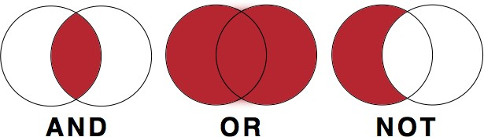

## Visão Geral da Aula {.smaller-text .lesson-slide}

::: {.columns}
::: {.column width="50%"}
### Tópicos

- [1]{.circle} Bases de dados e outras fontes
- [2]{.circle} Idioma e período da busca
- [3]{.circle} Critérios de inclusão e exclusão
- [4]{.circle} Termos booleanos e sintaxe de busca
- [5]{.circle} Exemplos de montagem de strings
- [6]{.circle} Linguagem controlada
- [7]{.circle} Sensibilidade e especificidade
- [8]{.circle} Itens do protocolo antes do registro
:::

::: {.column width="50%"}
::: {.info-box}
**Objetivo da Aula**

Construir estratégias de busca replicáveis, combinando fontes de informação, recortes objetivos de idioma e período, critérios explícitos de elegibilidade e sintaxe booleana, de modo a alimentar o protocolo da revisão antes do seu registro.
:::
:::
:::

# [1  -  BASES DE DADOS E OUTRAS FONTES]{.section-header}

## Bases de dados {.smaller-text .lesson-slide}

::: {.columns}
::: {.column width="50%"}
### Nacionais

- Scielo
- LILACS
- PePSIC
- Index Psi
- Redalyc

Além das bases, o **Google Acadêmico** e o **Portal CAPES** operam como agregadores de acesso.
:::

::: {.column width="50%"}
### Internacionais

- PsycNET
- Medline
- ERIC
- Sociological Abstracts / Social Service Abstracts
- Scopus
- Web of Science

::: {.highlight-box}
**Critério** - a escolha entre bases nacionais e internacionais decorre do recorte da revisão e da cobertura disciplinar de cada base.
:::
:::
:::

## Outras fontes {.smaller-text .lesson-slide}

::: {.columns}
::: {.column width="55%"}
A busca sistemática ultrapassa as bases indexadas. Complementam o levantamento:

- Referências dos artigos incluídos (busca reversa)
- Indicação de especialistas
- Literatura cinza (teses, relatórios, documentos institucionais)
- Preprints
:::

::: {.column width="45%"}
::: {.info-box}
**Por que diversificar?**

A restrição às bases indexadas pode introduzir viés de publicação e omitir literatura não convencional relevante para a questão.
:::
:::
:::

# [2  -  IDIOMA E PERÍODO]{.section-header}

## Idioma {.smaller-text .lesson-slide}

::: {.columns}
::: {.column width="50%"}
### Nacional ou internacional?

A escolha do idioma deve respeitar algum **critério objetivo**:

- Idiomas mais comuns na área de estudo
- Evento que ocorreu em determinado país
- Revisão de escopo nacional
:::

::: {.column width="50%"}
::: {.info-box}
**Pergunta de auditoria**

Por que português, inglês e espanhol? A justificativa deve ser explicitada no protocolo.
:::
:::
:::

## Período {.smaller-text .lesson-slide}

::: {.columns}
::: {.column width="50%"}
### Qual recorte temporal?

A escolha do período de publicação deve respeitar algum **critério objetivo**:

- Primeira vez que o termo foi cunhado
- Publicação da última revisão sistemática sobre o tema
- Ocorrência de determinado evento
:::

::: {.column width="50%"}
::: {.info-box}
**Pergunta de auditoria**

Por que os últimos 10 anos? O marco inicial precisa estar ancorado num evento ou publicação identificável.
:::
:::
:::

# [3  -  CRITÉRIOS DE INCLUSÃO E EXCLUSÃO]{.section-header}

## Critérios de inclusão e exclusão {.smaller-text .lesson-slide}

::: {.columns}
::: {.column width="50%"}
### Critérios de inclusão

- Tema central
- Tipo de pesquisa
- Método
- Participantes
- Instrumentos
- Teorias
:::

::: {.column width="50%"}
### Critérios de exclusão

- Qualidade metodológica insuficiente
- Amostra ou contexto de pesquisa muito específicos
- Idiomas desconhecidos
- Artigos indisponíveis
:::
:::

# [4  -  TERMOS BOOLEANOS E SINTAXE]{.section-header}

## Termos booleanos {.smaller-text .lesson-slide}

| Operador | Função |
|:--------:|--------|
| **AND** | relaciona (grupos de) conceitos diferentes |
| **OR** | reúne sinônimos, termos análogos e grafias distintas |
| **NOT** | exclui (grupos de) conceitos |
| **" "** | busca de palavras exatas |
| **( )** | organiza comandos por etapas |
| **\*** | efeito de truncagem |

: {.striped .hover}

::: {.highlight-box}
**Exemplos**

"meaning in life" AND (well-being OR wellbeing) AND (adolescen* OR teenage*)

("life project" OR "life projects") NOT ("real life project" OR "real life projects")

Development AND v*gotsk*
:::

## Diagrama dos operadores {.smaller-text .lesson-slide}

::: {.columns}
::: {.column width="45%"}
{fig-alt="Diagrama de Venn ilustrando os operadores booleanos AND, OR e NOT" width="100%"}
:::

::: {.column width="55%"}
### Leitura dos conjuntos

- **AND** restringe: mantém apenas a interseção entre os conceitos
- **OR** amplia: soma os dois conjuntos, com sobreposição
- **NOT** subtrai: elimina do primeiro conjunto o que pertence ao segundo

::: {.info-box}
**Ordem de montagem** - primeiro amplia-se cada bloco conceitual com OR, depois conectam-se os blocos com AND, aplicando NOT apenas quando houver colisão sistemática de resultados.
:::
:::
:::

# [5  -  EXEMPLOS DE MONTAGEM]{.section-header}

## Exemplo 1: perspectiva temporal futura e bem-estar {.smaller-text .lesson-slide}

| Elemento (PIDIC) | Conteúdo | Termos de busca |
|------------------|----------|-----------------|
| P - População | Adolescentes | adolescent OR adolescents OR teenager OR teenagers OR youth OR youths |
| I - VI | Perspectiva temporal futura | "time perspective" OR "time orientation" OR "time attitude" OR "future orientation" |
| D - VD | Bem-estar subjetivo | well-being OR wellbeing OR "life satisfaction" OR "satisfaction with life" OR "positive affects" |
| I - Interveniente | (sem restrição) | (sem restrição) |
| C - Contexto | (sem restrição) | (sem restrição) |

: {.striped .hover .small}

Em adolescentes, qual é a relação entre perspectiva temporal futura e bem-estar subjetivo?

## Exemplo 1: montagem da string {.smaller-text .lesson-slide}

Cada linha do quadro vira um bloco de busca, e os blocos são conectados por AND:

```text
(adolescent OR adolescents OR teenager OR teenagers OR youth OR youths)
AND
("time perspective" OR "time orientation" OR "time attitude" OR "future orientation")
AND
(well-being OR wellbeing OR "life satisfaction" OR "satisfaction with life" OR "positive affects")
```

A string completa, em uma única linha, segue o mesmo encadeamento:

```text
(adolescent OR adolescents OR teenager OR teenagers OR youth OR youths) AND ("time perspective" OR "time orientation" OR "time attitude" OR "future orientation") AND (well-being OR wellbeing OR "life satisfaction" OR "satisfaction with life" OR "positive affects")
```

## Exemplo 2: gravidez na adolescência rural {.smaller-text .lesson-slide}

| Elemento (PICo) | Conteúdo | Termos de busca |
|-----------------|----------|-----------------|
| P - População | Adolescentes | adolescente OR adolescentes OR jovem OR jovens |
| P - Recorte | Sexo feminino | feminino OR mulher OR mulheres OR menina OR meninas |
| I - Interesse | Gravidez | gravidez |
| Co - Contexto | Regiões rurais | interior OR rural OR rurais |

: {.striped .hover .small}

Qual a percepção de adolescentes brasileiros do sexo feminino residentes em regiões rurais sobre a gravidez na adolescência?

## Exemplo 2: montagem da string {.smaller-text .lesson-slide}

```text
(adolescente OR adolescentes OR jovem OR jovens)
AND
(feminino OR mulher OR mulheres OR menina OR meninas)
AND
gravidez
AND
(interior OR rural OR rurais)
```

Em uma única linha:

```text
(adolescente OR adolescentes OR jovem OR jovens) AND (feminino OR mulher OR mulheres OR menina OR meninas) AND gravidez AND (interior OR rural OR rurais)
```

::: {.highlight-box}
**Exercício** - monte a string da sua questão de revisão: identifique os elementos do acrônimo, liste sinônimos e grafias alternativas para cada bloco e conecte os blocos com AND.
:::

## Mãos à massa: sentido de vida e bem-estar {.smaller-text .lesson-slide}

| Elemento (PICOS adaptado) | Conteúdo | Papel na busca |
|----------------------------|----------|----------------|
| P - População | Adolescentes | adolescent OR adolescents OR teenager OR teenagers OR youth OR youths |
| I - VI | Sentido de vida | meaning OR purpose |
| C - Moderação | Gênero | informação complementar |
| O - VD | Bem-estar | well-being OR wellbeing |
| S - Delineamento | Levantamentos | critério de inclusão |

: {.striped .hover .small}

::: {.info-box}
**Leitura do quadro** - P, I e O alimentam diretamente a string de busca; C (gênero) entra como informação complementar na extração, e S (levantamentos) opera como critério de inclusão na triagem.
:::

# [6  -  LINGUAGEM CONTROLADA]{.section-header}

## Linguagem controlada {.smaller-text .lesson-slide}

::: {.columns}
::: {.column width="50%"}
### Vocabulários estruturados

- **APA Thesaurus** - termos padronizados da psicologia
- **BVS** - Descritores em Ciências da Saúde (DeCS)

Os vocabulários controlados atribuem descritores padronizados aos registros, permitindo recuperar documentos que usem palavras diferentes para o mesmo conceito.
:::

::: {.column width="50%"}
::: {.highlight-box}
**Uso combinado** - a estratégia completa combina linguagem controlada (descritores) e linguagem livre (título, resumo, palavras-chave), ampliando a cobertura sem perder especificidade.
:::
:::
:::

# [7  -  SENSIBILIDADE E ESPECIFICIDADE]{.section-header}

## Sensibilidade e especificidade {.smaller-text .lesson-slide}

::: {.columns}
::: {.column width="50%"}
### Sensibilidade

Capacidade da busca **encontrar artigos que de fato são importantes** para a revisão.

Uma busca sensível recupera quase tudo o que importa, ao custo de incluir ruído.
:::

::: {.column width="50%"}
### Especificidade

Capacidade da busca **ignorar artigos que não são relevantes**.

Uma busca específica retorna poucos resultados, ao custo de perder registros pertinentes.
:::
:::

::: {.info-box}
**Compromisso de projeto** - a busca de uma revisão sistemática prioriza a sensibilidade, transferindo a filtragem do ruído para a etapa de triagem por critérios explícitos.
:::

# [8  -  ANTES DO REGISTRO]{.section-header}

## Itens do protocolo antes do registro {.smaller-text .lesson-slide}

::: {.columns}
::: {.column width="50%"}
### Medidas de efeito

Obrigatórias para metanálise, definidas antes da busca.

### Extração dos dados

- Descrever o processo de inclusão de estudos
- Listar as informações a serem extraídas dos artigos
- Descrever como as informações serão extraídas
:::

::: {.column width="50%"}
### Avaliação do risco de viés

Informar qual método será utilizado e como será aplicado.

### Estratégia de síntese

Descrever em detalhes as análises que serão realizadas, podendo ou não incluir metanálises.
:::
:::

# [Referências]{.section-header}

## Bibliografia da aula {.smaller-text}

- Bramer, W. M.; Rethlefsen, M. L.; Kleijnen, J.; Franco, O. H. Optimal database combinations for literature searches in systematic reviews: a prospective exploratory study. **Systematic Reviews**, v. 6, 245, 2017.
- Higgins, J. P. T.; Thomas, J.; Chandler, J.; Cumpston, M.; Li, T.; Page, M. J.; Welch, V. A. (eds.). **Cochrane Handbook for Systematic Reviews of Interventions**. 2. ed. Chichester: Wiley, 2019.
- Lefebvre, C.; Glanville, J.; Briscoe, S.; Featherstone, R.; Littlewood, A.; Marshall, C.; Metzendorf, M. I.; Noel-Storr, A.; Paynter, R.; Rader, T.; Thomas, J.; Wieland, L. S. Searching for and selecting studies. In: **Cochrane Handbook for Systematic Reviews of Interventions**. 2. ed. Chichester: Wiley, 2019. cap. 4.
- McGowan, J.; Sampson, M.; Salzwedel, D. M.; Cogo, E.; Foerster, V.; Lefebvre, C. PRESS peer review of electronic search strategies: 2015 guideline statement. **Journal of Clinical Epidemiology**, v. 75, p. 40-46, 2016.
- Page, M. J.; McKenzie, J. E.; Bossuyt, P. M.; Boutron, I.; Hoffmann, T. C.; Mulrow, C. D. et al. The PRISMA 2020 statement: an updated guideline for reporting systematic reviews. **BMJ**, v. 372, n71, 2021.
- Tricco, A. C.; Lillie, E.; Zarin, W.; O'Brien, K. K.; Colquhoun, H.; Levac, D. et al. PRISMA extension for scoping reviews (PRISMA-ScR): checklist and explanation. **Annals of Internal Medicine**, v. 169, p. 467-473, 2018.
