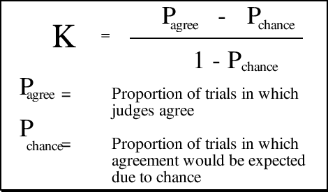
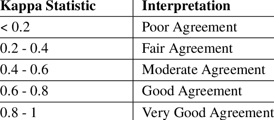

## Visão Geral da Aula {.smaller-text .lesson-slide}

::: {.columns}
::: {.column width="50%"}
### Tópicos

- [1]{.circle} Coeficiente Kappa: conceito e origem
- [2]{.circle} Exemplo de julgamento de artigos
- [3]{.circle} Cálculo da proporção de concordância observada
- [4]{.circle} Cálculo da concordância esperada ao acaso
- [5]{.circle} Cálculo e interpretação do Kappa
:::

::: {.column width="50%"}
::: {.info-box}
**Objetivo da Aula**

Calcular e interpretar o coeficiente Kappa de Cohen como medida de concordância entre juízes independentes na seleção de estudos, aplicando o procedimento passo a passo a um conjunto de julgamentos.
:::
:::
:::

# [1  -  CONCEITO]{.section-header}

## Coeficiente Kappa {.smaller-text .lesson-slide}

::: {.columns}
::: {.column width="50%"}
### Definição

- Criado por **Cohen**
- Medida de **concordância entre juízes**
- Aplicável a **variáveis categóricas**

O Kappa corrige a concordância observada pela concordância que seria esperada apenas pelo acaso.
:::

::: {.column width="50%"}
{fig-alt="Fórmula do coeficiente Kappa de Cohen" width="90%"}

Fórmula geral do coeficiente Kappa.
:::
:::

## Concordância entre juízes {.smaller-text .lesson-slide}

::: {.columns}
::: {.column width="50%"}
### O problema

Dois juízes avaliam independentemente se cada artigo atende aos critérios de inclusão. A concordância bruta superestima a qualidade do julgamento, pois parte dela ocorreria por simples acaso.
:::

::: {.column width="50%"}
::: {.info-box}
**Onde se aplica na revisão**

Seleção dos estudos (sim/não), avaliação do risco de viés e extração de dados categóricos, sempre com juízes independentes e um terceiro juiz para desempate.
:::
:::
:::

# [2  -  EXEMPLO]{.section-header}

## Dez artigos, dois juízes {.smaller-text .lesson-slide}

| Artigo | Juiz 1 | Juiz 2 |
|:------:|:------:|:------:|
| Artigo 1 | Sim | Sim |
| Artigo 2 | Não | Sim |
| Artigo 3 | Sim | Sim |
| Artigo 4 | Sim | Sim |
| Artigo 5 | Sim | Sim |
| Artigo 6 | Sim | Não |
| Artigo 7 | Não | Não |
| Artigo 8 | Não | Não |
| Artigo 9 | Sim | Sim |
| Artigo 10 | Sim | Sim |

: {.striped .hover}

## Matriz de concordância {.smaller-text .lesson-slide}

|  |  | Juiz 2 |  |
|--|--|:------:|:------:|
|  |  | Sim | Não |
| **Juiz 1** | **Sim** | 6 (A) | 1 (B) |
|  | **Não** | 1 (C) | 2 (D) |

: {.striped .hover .center-table}

A matriz organiza os julgamentos em quatro células: concordância em incluir (A), discordâncias cruzadas (B e C) e concordância em excluir (D).

# [3  -  CONCORDÂNCIA OBSERVADA]{.section-header}

## Proporção observada {.smaller-text .lesson-slide}

A concordância observada reúne as células de concordância sobre o total de julgamentos:

$$P_{observada} = \frac{A + D}{T} = \frac{6 + 2}{10} = 0{,}8$$

onde $T = A + B + C + D$ é o total de artigos julgados.

::: {.info-box}
**Leitura** - os juízes concordaram em 8 dos 10 artigos, o que corresponde a 80% de concordância bruta.
:::

# [4  -  CONCORDÂNCIA AO ACASO]{.section-header}

## Proporção esperada ao acaso {.smaller-text .lesson-slide}

A concordância ao acaso resulta do produto das proporções marginais de cada juiz:

$$P_{acaso} = P_{sim} + P_{n\tilde{a}o}$$

$$P_{sim} = \frac{A + C}{T} \times \frac{A + B}{T} = 0{,}7 \times 0{,}7 = 0{,}49$$

$$P_{n\tilde{a}o} = \frac{B + D}{T} \times \frac{C + D}{T} = 0{,}3 \times 0{,}3 = 0{,}09$$

$$P_{acaso} = 0{,}49 + 0{,}09 = 0{,}58$$

::: {.highlight-box}
**Interpretação** - mesmo sem qualquer critério comum, os juízes concordariam em 58% dos casos apenas pelo acaso.
:::

# [5  -  CÁLCULO E INTERPRETAÇÃO]{.section-header}

## Cálculo do Kappa {.smaller-text .lesson-slide}

O Kappa desconta a concordância esperada ao acaso:

$$K = \frac{P_{observada} - P_{acaso}}{1 - P_{acaso}} = \frac{0{,}8 - 0{,}58}{1 - 0{,}58} = \frac{0{,}22}{0{,}42}$$

$$K = 0{,}52$$

::: {.info-box}
**Leitura** - a concordância bruta de 0,80 reduz-se a 0,52 quando se desconta o acaso, indicando concordância moderada.
:::

## Interpretação (Landis & Koch, 1977) {.smaller-text .lesson-slide}

::: {.columns}
::: {.column width="50%"}
| Kappa | Interpretação |
|:-----:|---------------|
| < 0,2 | Concordância pobre |
| 0,2 a 0,4 | Concordância razoável |
| 0,4 a 0,6 | Concordância moderada |
| 0,6 a 0,8 | Concordância boa |
| 0,8 a 1,0 | Concordância muito boa |

: {.striped .hover}
:::

::: {.column width="50%"}
{fig-alt="Tabela de interpretação do coeficiente Kappa de Landis e Koch" width="90%"}

Tabela original de referência (Landis & Koch, 1977).
:::
:::

# [Referências]{.section-header}

## Bibliografia da aula {.smaller-text}

- Cohen, J. A coefficient of agreement for nominal scales. **Educational and Psychological Measurement**, v. 20, p. 37-46, 1960.
- Landis, J. R.; Koch, G. G. The measurement of observer agreement for categorical data. **Biometrics**, v. 33, p. 159-174, 1977.
- McHugh, M. L. Interrater reliability: the kappa statistic. **Biochemia Medica**, v. 22, p. 276-282, 2012.
- Page, M. J.; McKenzie, J. E.; Bossuyt, P. M.; Boutron, I.; Hoffmann, T. C.; Mulrow, C. D. et al. The PRISMA 2020 statement: an updated guideline for reporting systematic reviews. **BMJ**, v. 372, n71, 2021.
