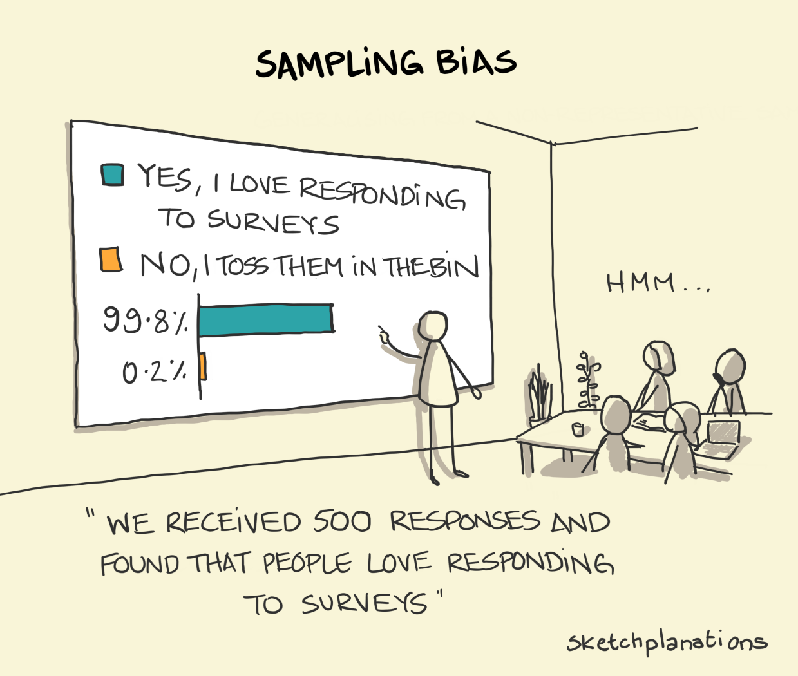
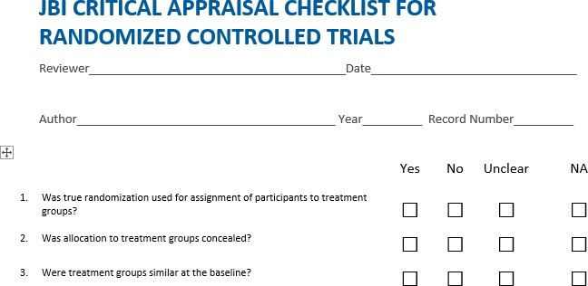

## Visão Geral da Aula {.smaller-text .lesson-slide}

::: {.columns}
::: {.column width="50%"}
### Tópicos

- [1]{.circle} Viés: definição
- [2]{.circle} Tipos de viés
- [3]{.circle} Check-lists e escalas de avaliação
- [4]{.circle} Passo a passo da avaliação
- [5]{.circle} Aplicação dos resultados na síntese
:::

::: {.column width="50%"}
::: {.info-box}
**Objetivo da Aula**

Aplicar métodos padronizados de avaliação do risco de viés aos estudos incluídos, com juízes independentes e cálculo de concordância, e integrar os resultados da avaliação à síntese da revisão.
:::
:::
:::

# [1  -  VIÉS]{.section-header}

## Viés: definição {.smaller-text .lesson-slide}

::: {.columns}
::: {.column width="50%"}
### Conceito

"Erro sistemático ou desvio da verdade".

O risco de viés refere-se à possibilidade de que as falhas metodológicas do estudo distorçam os seus resultados de forma sistemática, e não aleatória.
:::

::: {.column width="50%"}
{fig-alt="Cartum ilustrando viés de amostragem em pesquisas por questionário" width="90%"}

Viés de amostragem em questionários: quem responde não representa quem foi convidado.
:::
:::

# [2  -  TIPOS DE VIÉS]{.section-header}

## Tipos de viés {.smaller-text .lesson-slide}

::: {.columns}
::: {.column width="50%"}
### Viés de publicação

Resultados estatisticamente significativos têm maior chance de serem submetidos e aceitos para publicação.

### Viés de relato

Relato seletivo de desfechos e análises favoráveis às hipóteses.
:::

::: {.column width="50%"}
### Viés metodológico

Decorre de falhas no delineamento e na condução do estudo:

- Teórico-filosófico
- Recrutamento
- Procedimentos
- Medida
- Análise dos dados
:::
:::

# [3  -  INSTRUMENTOS DE AVALIAÇÃO]{.section-header}

## Check-lists e escalas específicas {.smaller-text .lesson-slide}

::: {.columns}
::: {.column width="50%"}
### Instrumentos por delineamento

A avaliação do risco de viés usa check-lists e escalas específicas para cada método:

- Ensaios clínicos: JBI, Cochrane Risk of Bias
- Estudos observacionais: Newcastle-Ottawa
- Estudos qualitativos: JBI, CASP

### Exemplos

- JBI Critical Appraisal Checklist for Randomized Controlled Trials
- JBI para estudos transversais e qualitativos
:::

::: {.column width="50%"}
{fig-alt="Check-list JBI de avaliação crítica para ensaios clínicos randomizados" width="90%"}

Check-list JBI para ensaios controlados randomizados.
:::
:::

# [4  -  PASSO A PASSO]{.section-header}

## Passo a passo da avaliação {.smaller-text .lesson-slide}

::: {.columns}
::: {.column width="50%"}
### Procedimento

- Selecionar o método de avaliação adequado ao delineamento
- Avaliar cada estudo por **dois juízes independentes**
- Calcular o **coeficiente Kappa** de concordância
- Resolver divergências por **voto de minerva do terceiro juiz**
- Interpretar os resultados da avaliação
:::

::: {.column width="50%"}
### Resultados da avaliação

- **Escore geral** do estudo
- **Vieses individuais** por domínio
:::
:::

# [5  -  APLICAÇÃO NA SÍNTESE]{.section-header}

## Aplicação dos resultados na síntese {.smaller-text .lesson-slide}

::: {.columns}
::: {.column width="50%"}
### Como critério de exclusão

Estudos com risco de viés muito alto podem ser excluídos da síntese, conforme decisão prévia registrada no protocolo.
:::

::: {.column width="50%"}
### Como variável moderadora

O escore de risco de viés pode entrar como moderador em metanálises, testando se o tamanho de efeito varia entre estudos de baixo e alto risco.
:::
:::

::: {.highlight-box}
**Regra de protocolo** - o uso do risco de viés (exclusão, análise de sensibilidade ou moderador) deve estar definido antes da coleta, evitando decisões oportunistas após conhecer os resultados.
:::

# [Referências]{.section-header}

## Bibliografia da aula {.smaller-text}

- Aromataris, E.; Munn, Z. (eds.). **JBI Manual for Evidence Synthesis**. Adelaide: JBI, 2020.
- Higgins, J. P. T.; Savović, J.; Page, M. J.; Elbers, R. G.; Sterne, J. A. C. Assessing risk of bias in a randomized trial. In: **Cochrane Handbook for Systematic Reviews of Interventions**. 2. ed. Chichester: Wiley, 2019. cap. 8.
- Page, M. J.; McKenzie, J. E.; Bossuyt, P. M.; Boutron, I.; Hoffmann, T. C.; Mulrow, C. D. et al. The PRISMA 2020 statement: an updated guideline for reporting systematic reviews. **BMJ**, v. 372, n71, 2021.
- Sterne, J. A. C.; Hernán, M. A.; Reeves, B. C.; Savović, J.; Berkman, N. D.; Viswanathan, M. et al. ROBINS-I: a tool for assessing risk of bias in non-randomised studies of interventions. **BMJ**, v. 355, i4919, 2016.
- Wells, G. A.; Shea, B.; O'Connell, D.; Peterson, J.; Welch, V.; Losos, M.; Tugwell, P. **The Newcastle-Ottawa Scale (NOS) for assessing the quality of nonrandomised studies in meta-analyses**. Ottawa: Ottawa Hospital Research Institute, 2014.
