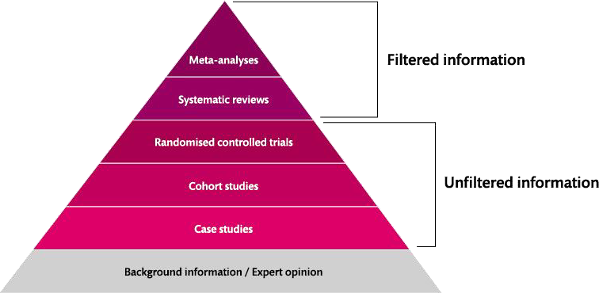
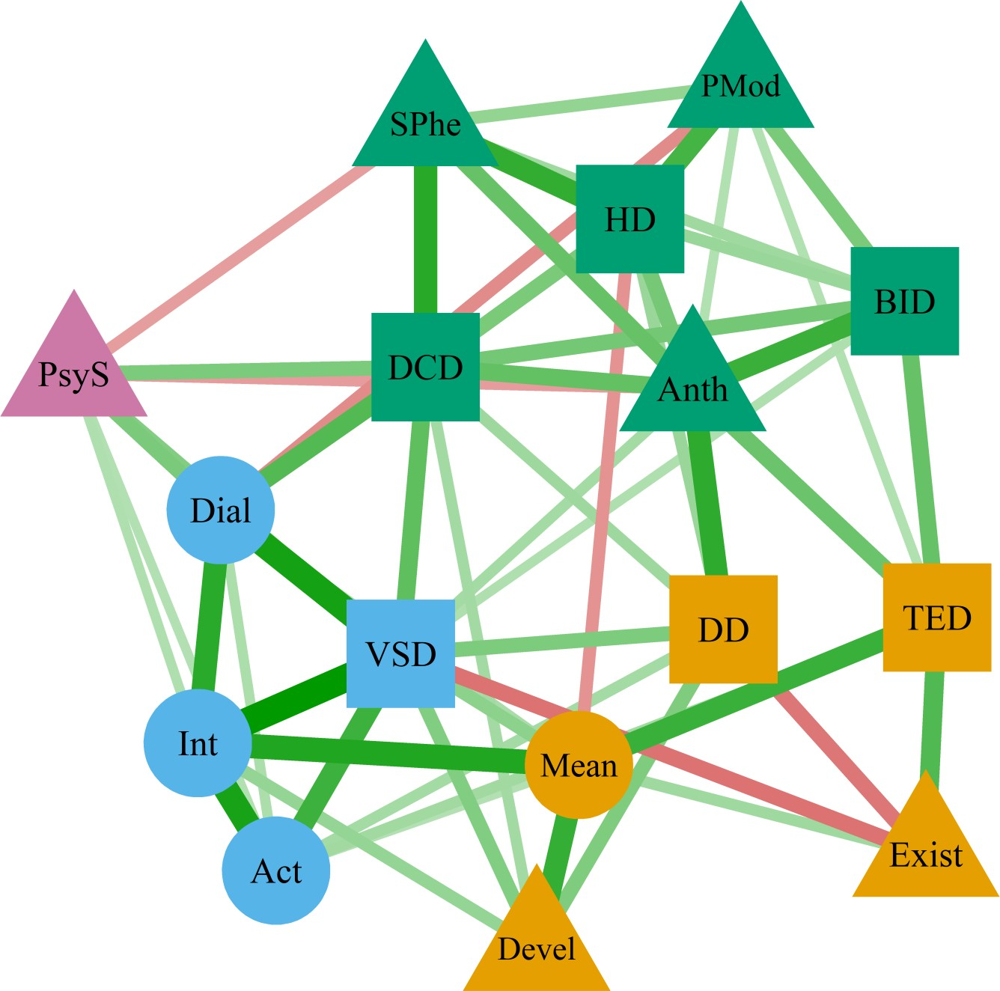

## Visão Geral da Aula {.smaller-text .lesson-slide}

::: {.columns}
::: {.column width="50%"}
### Tópicos

- [1]{.circle} O que define a estratégia de síntese
- [2]{.circle} Metanálise: tamanho de efeito geral
- [3]{.circle} Variáveis moderadoras
- [4]{.circle} Outros métodos estatísticos
- [5]{.circle} Metassíntese
- [6]{.circle} Síntese em scoping reviews
:::

::: {.column width="50%"}
::: {.info-box}
**Objetivo da Aula**

Selecionar e aplicar a estratégia de síntese adequada ao tipo de revisão e às características dos estudos incluídos, integrando metanálise, métodos estatísticos alternativos, metassíntese e mapeamento.
:::
:::
:::

# [1  -  ESCOLHA DA ESTRATÉGIA]{.section-header}

## A síntese depende de... {.smaller-text .lesson-slide}

::: {.columns}
::: {.column width="55%"}
A estratégia de síntese é definida por cinco fatores:

- Tipo de revisão
- Questões de pesquisa
- Características dos estudos incluídos
- Informações disponíveis nos estudos incluídos
- Quantidade de estudos incluídos
:::

::: {.column width="45%"}
{fig-alt="Pirâmide de evidências com informação filtrada no topo e não filtrada na base" width="90%"}

Informação filtrada e não filtrada na pirâmide de evidências.
:::
:::

# [2  -  METANÁLISE]{.section-header}

## Metanálise: tamanho de efeito geral {.smaller-text .lesson-slide}

::: {.columns}
::: {.column width="50%"}
### Conceito

Procedimento estatístico de obtenção de uma medida de **tamanho de efeito geral** a partir dos efeitos reportados pelos estudos incluídos.

### Exemplo numérico

Quatro estudos da relação entre presença de sentido e bem-estar subjetivo reportam correlações de 0,55, 0,60, 0,65 e 0,63; a metanálise integra esses efeitos em uma estimativa geral.
:::

::: {.column width="50%"}
{fig-alt="Ilustração de equipe analisando um gráfico de floresta com estudos e efeitos" width="95%"}

Integração dos efeitos dos estudos incluídos.
:::
:::

## Variáveis moderadoras {.smaller-text .lesson-slide}

::: {.columns}
::: {.column width="50%"}
### Por que analisar moderadores?

O efeito geral esconde heterogeneidade. A análise de moderadores testa se o tamanho de efeito varia em função de características dos estudos.

### Moderadores típicos

- Idade
- Gênero
- Cultura
- Tipo de desfecho
:::

::: {.column width="50%"}
::: {.highlight-box}
**Leitura do exemplo** - se o efeito geral é 0,63, a análise de moderadores pode revelar, por exemplo, que a relação entre presença de sentido e bem-estar é mais forte em amostras de certa faixa etária ou cultura.
:::
:::
:::

# [3  -  OUTROS MÉTODOS ESTATÍSTICOS]{.section-header}

## Síntese sem metanálise {.smaller-text .lesson-slide}

::: {.columns}
::: {.column width="50%"}
### Regressão logística binária/ordinal

Aplicada quando o desfecho é categórico ordenado, como o nível de invariância de medidas:

- Não há invariância
- Configural
- Métrica
- Escalar
:::

::: {.column width="50%"}
### Preditores e moderadores

- Tipo de invariância (gênero, idade ou cultura)
- Número de itens
- Número de grupos
- Condição clínica
- Parcelamento da amostra
- Idade e gênero
- Método de estimação
- Número de participantes
- Variáveis culturais
:::
:::

# [4  -  METASSÍNTESE]{.section-header}

## Metassíntese: dos temas à teoria {.smaller-text .lesson-slide}

::: {.columns}
::: {.column width="50%"}
### Conceito

Procedimento de análise de dados que **integra dados qualitativos** provenientes de diferentes pesquisas.

### Encadeamento

Temas identificados nos estudos primários (mudança, prevenção, medo, transformação, projeto de vida, família, conhecimento, escola, valência, apoio social, informação) são articulados até a **criação de teoria ou modelo teórico**.
:::

::: {.column width="50%"}
{fig-alt="Diagrama de rede conectando os temas identificados na metassíntese" width="95%"}

Rede de relações entre os temas da síntese qualitativa.
:::
:::

# [5  -  SCOPING REVIEW]{.section-header}

## Síntese em scoping reviews {.smaller-text .lesson-slide}

::: {.columns}
::: {.column width="50%"}
### Estratégias de síntese

- **Mapeamento** - frequências e criação de categorias
- **Técnicas qualitativas** - criação de temas
- **Análises estatísticas** - descrição e associação entre variáveis
:::

::: {.column width="50%"}
::: {.info-box}
**Produto típico**

A scoping review entrega mapas de evidências, categorizações de conceitos e métodos, e síntese temática, sem estimar tamanhos de efeito.
:::
:::
:::

# [Referências]{.section-header}

## Bibliografia da aula {.smaller-text}

- Borenstein, M.; Hedges, L. V.; Higgins, J. P. T.; Rothstein, H. R. **Introduction to meta-analysis**. Chichester: Wiley, 2009.
- Deeks, J. J.; Higgins, J. P. T.; Altman, D. G. (eds.). Analysing data and undertaking meta-analyses. In: **Cochrane Handbook for Systematic Reviews of Interventions**. 2. ed. Chichester: Wiley, 2019. cap. 10.
- Finfgeld-Connett, D. Metasynthesis: the state of the art so far. **Qualitative Health Research**, v. 13, p. 893-904, 2003.
- Page, M. J.; McKenzie, J. E.; Bossuyt, P. M.; Boutron, I.; Hoffmann, T. C.; Mulrow, C. D. et al. The PRISMA 2020 statement: an updated guideline for reporting systematic reviews. **BMJ**, v. 372, n71, 2021.
- Peters, M. D. J.; Godfrey, C. M.; Khalil, H.; McInerney, P.; Parker, D.; Soares, C. B. Guidance for conducting systematic scoping reviews. **International Journal of Evidence-Based Healthcare**, v. 13, p. 141-146, 2015.
- Tricco, A. C.; Lillie, E.; Zarin, W.; O'Brien, K. K.; Colquhoun, H.; Levac, D. et al. PRISMA extension for scoping reviews (PRISMA-ScR): checklist and explanation. **Annals of Internal Medicine**, v. 169, p. 467-473, 2018.
