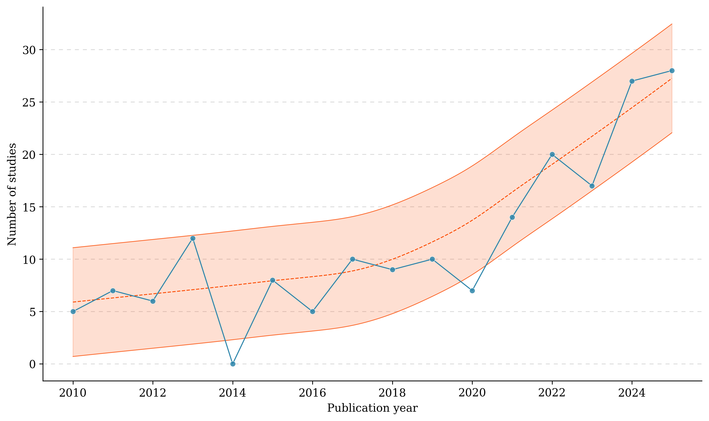
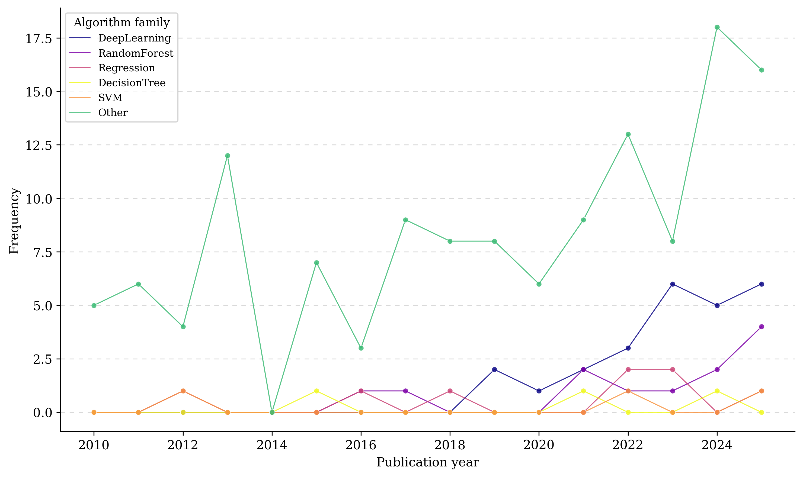
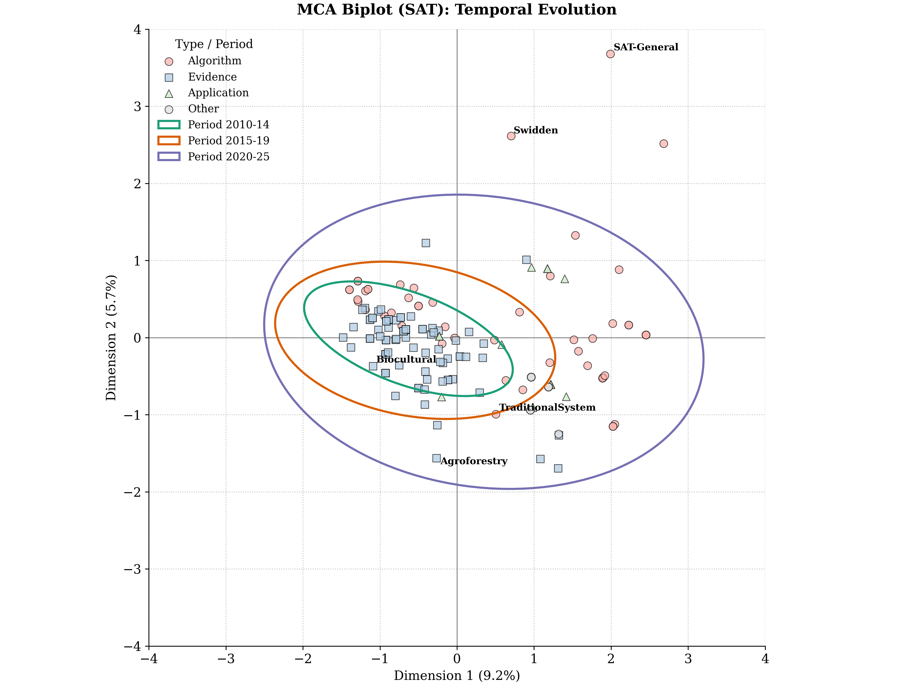
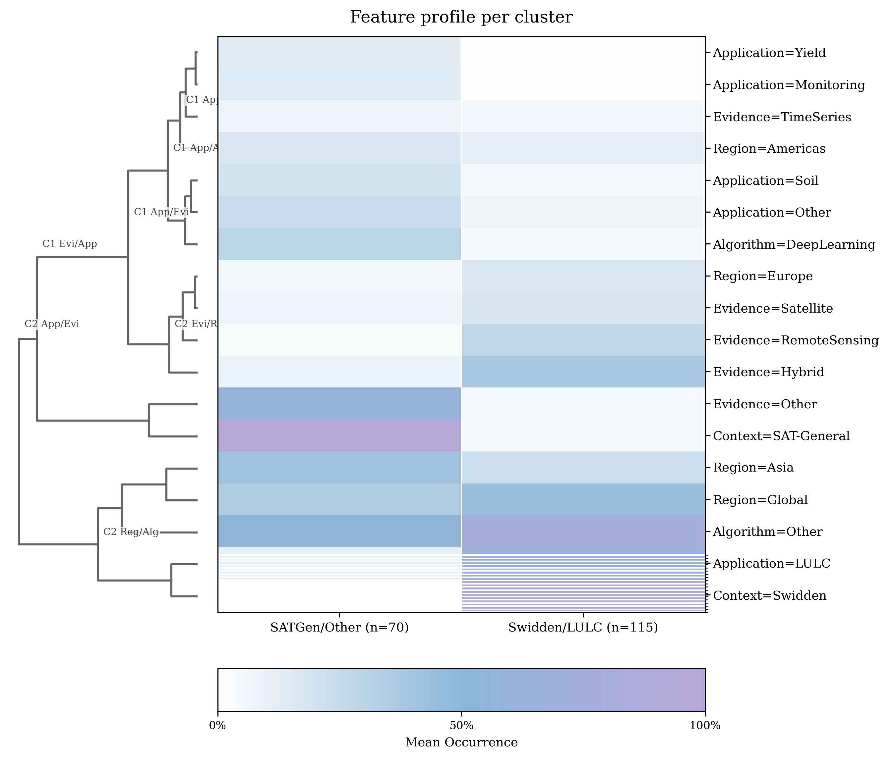
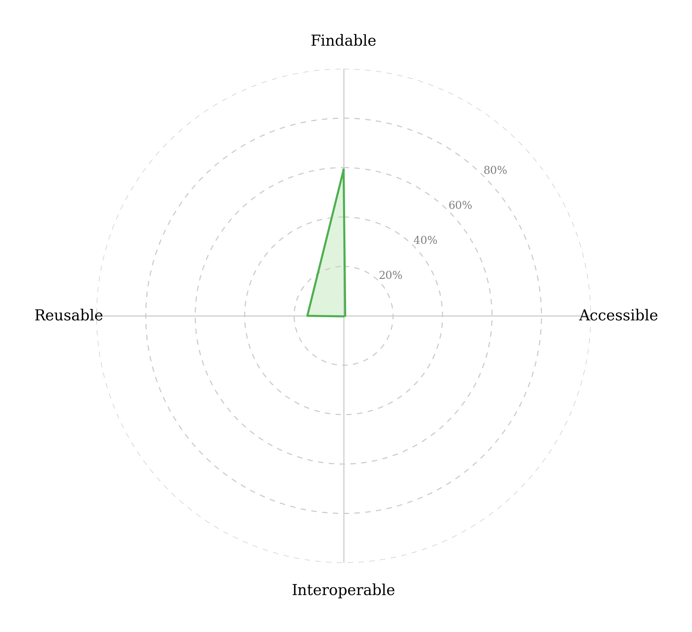
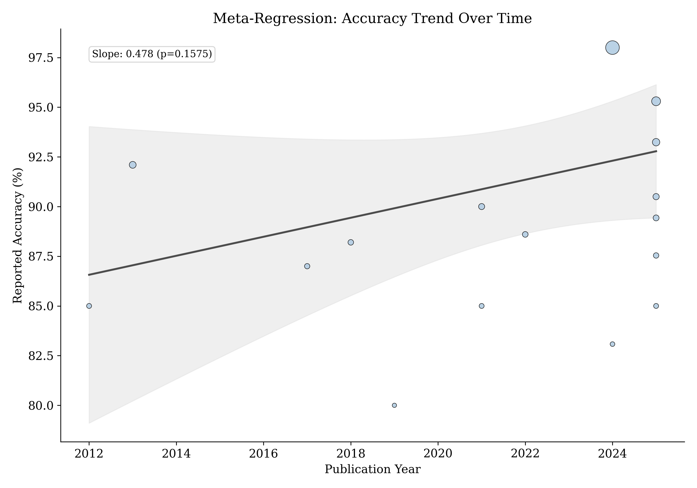
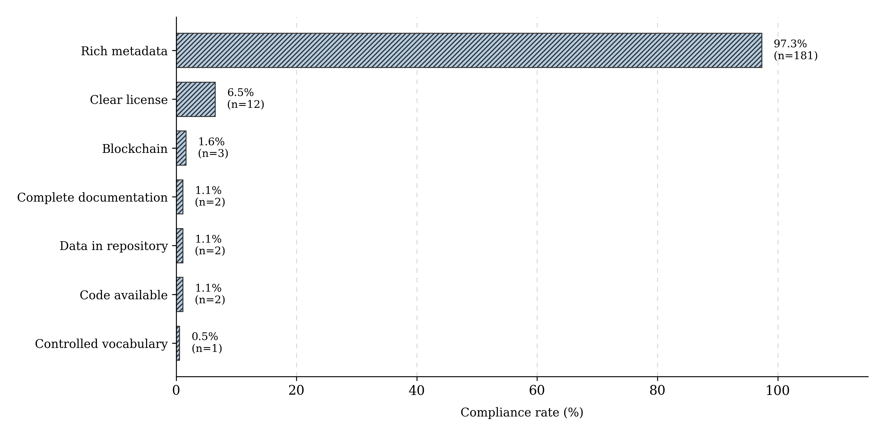

## Visão Geral da Atividade {.smaller-text .lesson-slide}

::: {.columns}
::: {.column width="50%"}
### Tópicos

- [1]{.circle} Do corpus elegível ao dataset categorizado
- [2]{.circle} Análise temporal da produção
- [3]{.circle} Rede de co-ocorrência e módulos temáticos
- [4]{.circle} Análise de correspondência múltipla e clusters
- [5]{.circle} Metanálise de efeitos aleatórios
- [6]{.circle} Conformidade FAIR e gabarito
:::

::: {.column width="50%"}
::: {.info-box}
**Objetivo da Atividade**

Transformar o corpus selecionado na atividade anterior em tabelas categorizadas e conduzir a síntese computacional, reproduzindo o pipeline de análise de dados do artigo de referência, com cada saída ancorada em um script e em um número do gabarito.
:::
:::
:::

# [1  -  DO CORPUS AO DATASET]{.section-header}

## O pipeline de síntese baseada em dados {.smaller-text .lesson-slide}

::: {.columns}
::: {.column width="100%"}
A síntese do exemplo opera sobre dados extraídos, e cada etapa consome a saída da anterior.

| Etapa | Entrada | Saída | Ferramenta |
|-------|---------|-------|------------|
| **Categorização** | BibTeX dos 244 estudos | CSV categorizado | Python |
| **Temporal** | CSV categorizado | Séries anuais | Python e R |
| **Rede** | CSV categorizado | Grafo de co-ocorrência | Python |
| **MCA** | CSV categorizado | Biplot fatorial | Python, prince |
| **Clusters** | Matriz one-hot | Perfis e heatmap | Python, scikit-learn |
| **Metanálise** | Acurácias extraídas | Forest plot e meta-regressão | R, metafor |
| **FAIR** | Metadados do corpus | Escore 0 a 100 | Python |

: {.striped .hover}

> Os scripts e os dados do exemplo estão depositados no Open Science Framework, junto com o protocolo.
:::
:::

## O dataset categorizado do exemplo {.smaller-text .lesson-slide}

::: {.columns}
::: {.column width="100%"}
Cada estudo recebe rótulos padronizados de algoritmo, evidência, contexto, aplicação e região.

| ID | Ano | Algoritmo | Evidencia | Contexto | Aplicacao | Regiao |
|:--:|:---:|:---------:|:---------:|:--------:|:---------:|:------:|
| 1 | 2025 | Other | RemoteSensing | Swidden | LULC | Global |
| 5 | 2024 | DeepLearning | Other | SAT-General | Classification | Europe |
| 14 | 2022 | SVM | Satellite | SAT-General | Soil | Europe |
| 15 | 2019 | DeepLearning | RemoteSensing | SAT-General | Classification | Asia |
| 34 | 2025 | DeepLearning | Other | SAT-General | Yield | Global |
| 42 | 2025 | DeepLearning | Satellite | Swidden | LULC | Americas |
| 53 | 2024 | DecisionTree | TimeSeries | SAT-General | Soil | Asia |
| 88 | 2020 | DeepLearning | Other | SAT-General | Monitoring | Asia |

: {.striped .hover}

> Os rótulos são atribuídos por regras explícitas de leitura de título, resumo e palavras-chave, registradas no script de categorização.
:::
:::

## Convenções de categorização {.smaller-text .lesson-slide}

::: {.columns}
::: {.column width="50%"}
### Variáveis e categorias

- **Algoritmo**, Random Forest, SVM, Deep Learning, árvores, regressão e outras
- **Evidência**, satélite, sensoriamento remoto, hiperespectral, VANT, séries temporais e híbrida
- **Contexto**, agricultura itinerante, sistema tradicional generalizado, biocultural e agrofloresta
- **Aplicação**, uso da terra, solo, produtividade, classificação e monitoramento
- **Região**, global, Américas, Ásia e Europa

> Cada categoria precisa de definição operacional antes da codificação, para que dois juízes produzam a mesma tabela.
:::

::: {.column width="50%"}
::: {.info-box}
**Regra de rastreabilidade**

A tabela categorizada é o elo entre a seleção e as análises. Qualquer valor de uma figura precisa ser reconstruível a partir de uma contagem da tabela.

> No exemplo, 186 observações categorizadas alimentaram a análise de correspondência múltipla.
:::
:::
:::

# [2  -  ANÁLISE TEMPORAL]{.section-header}

## Crescimento da produção científica {.smaller-text .lesson-slide}

::: {.columns}
::: {.column width="45%"}
A série anual mostra expansão de 10 publicações em 2010 para 33 em 2025, com o biênio 2024 a 2025 concentrando 65 estudos.

> A trajetória indica consolidação do monitoramento remoto como paradigma central na gestão de agroecossistemas.
:::

::: {.column width="55%"}
{fig-alt="Série temporal do volume de publicações de 2010 a 2025 com crescimento exponencial" width="100%"}
:::
:::

## Substituição tecnológica nos algoritmos {.smaller-text .lesson-slide}

::: {.columns}
::: {.column width="55%"}
A adoção de arquiteturas de aprendizado profundo cresceu de 4,8% no quadriênio 2015 a 2019 para 21,1% no período 2020 a 2025, ao passo que classificadores convencionais, como Random Forest e SVM, dominaram a fase inicial.

> O ponto de inflexão no triênio 2018 a 2020 separa duas fases metodológicas do campo.
:::

::: {.column width="45%"}
{fig-alt="Trajetória de substituição tecnológica dos algoritmos de 2010 a 2025" width="100%"}
:::
:::

# [3  -  REDE DE CO-OCORRÊNCIA]{.section-header}

## Módulos temáticos da rede {.smaller-text .lesson-slide}

::: {.columns}
::: {.column width="50%"}
### Estrutura identificada

| Métrica | Valor |
|---------|-------|
| Densidade | 0,345 |
| Modularidade (Louvain) | Q = 0,183 |
| Módulos | 2 |

: {.striped .hover}

O primeiro módulo reúne arquiteturas profundas, como CNN, LSTM e Transformer, acopladas a sensores de alta resolução, com forte presença na Ásia. O segundo agrega métodos clássicos, como Random Forest e SVM, associados a produtos multiespectrais de média resolução e ao mapeamento de uso da terra em agricultura itinerante.
:::

::: {.column width="50%"}
::: {.info-box}
**Leitura para a síntese**

A segregação modular indica partição funcional, com cada paradigma metodológico operando em nicho próprio, e não integração dos paradigmas.

> Palavras-chave dominantes, como sensoriamento remoto com 98 ocorrências e agricultura itinerante com 49, ancoram a leitura da rede.
:::
:::
:::

# [4  -  MCA E CLUSTERS]{.section-header}

## Análise de correspondência múltipla {.smaller-text .lesson-slide}

::: {.columns}
::: {.column width="50%"}
A projeção fatorial das cinco variáveis categoriais concentra 9,17% da inércia na primeira dimensão e 5,72% na segunda, com o deslocamento dos centróides de 2010 a 2015 para 2020 a 2025 marcando a reorganização temática do campo.

> A proximidade entre pontos indica associação estatística entre categorias, e o eixo temporal captura a evolução das associações.
:::

::: {.column width="50%"}
{fig-alt="Biplot temporal da análise de correspondência múltipla mostrando o deslocamento das associações temáticas de 2010 a 2025" width="100%"}
:::
:::

## Estrutura funcional por clusters {.smaller-text .lesson-slide}

::: {.columns}
::: {.column width="50%"}
### Dois grupos funcionais

| Perfil | n | Associação dominante |
|--------|:--:|----------------------|
| **Cluster 1** | 70 | Contexto geral com aprendizado profundo, Ásia |
| **Cluster 2** | 115 | Agricultura itinerante com uso da terra |

: {.striped .hover}

O ponto de corte foi escolhido maximizando a silhueta média, com k = 2 e silhueta 0,215, e a fidelidade hierárquica de Ward alcançou coeficiente cofenético de 0,89.
:::

::: {.column width="50%"}
{fig-alt="Heatmap hierárquico dos perfis dos dois clusters com dendrograma lateral" width="100%"}
:::
:::

# [5  -  METANÁLISE]{.section-header}

## Preparação dos efeitos e modelo de síntese {.smaller-text .lesson-slide}

::: {.columns}
::: {.column width="50%"}
### Preparação dos dados

- 148 estudos reportaram métricas de desempenho
- 129 apresentaram acurácia recuperável
- Proporções transformadas em logito para estabilizar a variância
- Amostra adotada em n = 100 quando o tamanho não foi reportado

> O modelo de efeitos aleatórios estima a heterogeneidade entre estudos por máxima verossimilhança restrita.
:::

::: {.column width="50%"}
::: {.highlight-box}
**Estimador combinado**

$$\hat{\theta} = \frac{\sum_{i=1}^{k} w_i \theta_i}{\sum_{i=1}^{k} w_i}$$

com pesos $w_i = 1/(\sigma_i^2 + \tau^2)$, em que $\tau^2$ representa a variância entre estudos.
:::
:::
:::

## Síntese combinada por algoritmo {.smaller-text .lesson-slide}

::: {.columns}
::: {.column width="50%"}
A acurácia combinada alcançou 90,66% (IC 95% 89,81 a 91,45), com heterogeneidade I² = 58,00% e teste Q = 309,71 (p = 4,36 × 10⁻¹⁷).

| Algoritmo | Acurácia | IC 95% | k |
|-----------|:--------:|:------:|:--:|
| Random Forest | 91,33 | 89,68 a 92,75 | 37 |
| SVM | 90,33 | 88,84 a 91,65 | 47 |
| Deep Learning | 90,51 | 87,08 a 93,09 | 15 |

: {.striped .hover}
:::

::: {.column width="50%"}
{fig-alt="Forest plot da metanálise de acurácias por algoritmo com estimativas combinadas" width="100%"}
:::
:::

## Viés de publicação e tendência temporal {.smaller-text .lesson-slide}

::: {.columns}
::: {.column width="55%"}
O teste de Egger indicou assimetria (β₀ = 1,87, SE 0,72, p = 0,009), e o ajuste trim-and-fill imputou quatro estudos, deslocando a estimativa para 89,12% (IC 95% 88,17 a 90,03), uma diferença de −1,54 ponto percentual.

> A meta-regressão por ano apontou coeficiente positivo (0,021, SE 0,012, p = 0,087), compatível com tendência de alta no desempenho reportado.
:::

::: {.column width="45%"}
{fig-alt="Meta-regressão do desempenho reportado ao longo dos anos de publicação" width="100%"}
:::
:::

# [6  -  CONFORMIDADE FAIR]{.section-header}

## O escore FAIR de 0 a 100 pontos {.smaller-text .lesson-slide}

::: {.columns}
::: {.column width="50%"}
### Indicadores e pesos

| Dimensão | Indicador | Pontos |
|----------|-----------|:------:|
| **F** | DOI disponível | 10 |
| **F** | Metadados ricos | 15 |
| **A** | Dados em repositório | 15 |
| **A** | Dados suplementares | 10 |
| **I** | Formato padronizado | 15 |
| **I** | Vocabulário controlado | 10 |
| **R** | Licença explícita | 8 |
| **R** | Código disponível | 10 |
| **R** | Documentação do método | 7 |

: {.striped .hover}

> Um estudo é considerado conforme quando alcança 50 pontos ou mais.
:::

::: {.column width="50%"}
::: {.info-box}
**Resultado do exemplo**

O escore médio do corpus ficou em 18,67 de 100, com aderência concentrada na dimensão localizável (59,14%) e valores próximos de zero nas dimensões acessível (0,65%) e interoperável (0,22%).

> Apenas 1,1% dos estudos compartilharam código ou dados, e 12,8% alcançaram o nível de conformidade.
:::
:::
:::

## Diagnóstico visual do FAIR {.smaller-text .lesson-slide}

::: {.columns}
::: {.column width="50%"}
O radar por dimensão expõe a assimetria entre localizabilidade e as demais dimensões, ao passo que o painel por indicador mostra metadados ricos em 97,31% dos estudos contra licença explícita em 6,45%.

> A leitura combinada dos dois painéis converte o escore agregado em um diagnóstico acionável de governança de dados.
:::

::: {.column width="50%"}
::: {.columns}
::: {.column width="50%"}
{fig-alt="Radar FAIR com as quatro dimensões e suas aderências médias" width="100%"}
:::
::: {.column width="50%"}
{fig-alt="Conformidade por indicador FAIR em barras" width="100%"}
:::
:::
:::
:::

# [7  -  ENTREGAS E GABARITO]{.section-header}

## Entregas da atividade {.smaller-text .lesson-slide}

::: {.columns}
::: {.column width="100%"}
| Entrega | Conteúdo | Peso |
|---------|----------|:----:|
| **Dataset categorizado** | CSV com as variáveis codificadas por regras explícitas | 2,5 |
| **Análise temporal** | Série anual e taxa de adoção por período | 2,0 |
| **Rede de co-ocorrência** | Grafo com módulos e métricas de estrutura | 1,5 |
| **Metanálise ou tabela de síntese** | Efeito combinado ou frequências por categoria | 2,0 |
| **Parágrafo de síntese** | Leitura dos resultados ancorada nos números gerados | 2,0 |

: {.striped .hover}

> Cada figura entregue precisa de script, dado de entrada e valor reproduzível no relatório.
:::
:::

## Gabarito de referência do exemplo {.smaller-text .lesson-slide}

::: {.columns}
::: {.column width="100%"}
Os valores abaixo são o ponto de chegada do pipeline do artigo de referência e servem para conferência da reprodução.

| Análise | Valor de referência |
|---------|---------------------|
| **Temporal** | 10 estudos em 2010 para 33 em 2025, 65 no biênio 2024 a 2025 |
| **Algoritmos** | Deep Learning de 4,8% (2015 a 2019) para 21,1% (2020 a 2025) |
| **Rede** | Densidade 0,345, modularidade Q = 0,183, dois módulos |
| **MCA** | Dim1 9,17% e Dim2 5,72% da inércia |
| **Clusters** | k = 2, silhueta 0,215, cofenético 0,89 |
| **Metanálise** | 90,66% (IC 95% 89,81 a 91,45), I² = 58,00% |
| **Egger** | β₀ = 1,87, p = 0,009, ajuste de −1,54 pp |
| **FAIR** | Escore médio 18,67/100, conformidade em 12,8% |

: {.striped .hover}

> Divergências entre o valor reproduzido e o gabarito precisam ser rastreadas até a decisão de categorização ou de extração que as originou.
:::
:::
