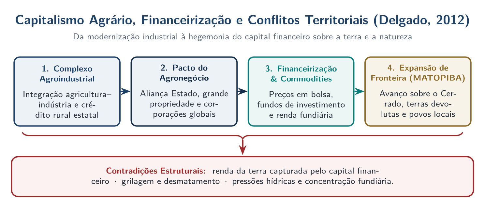
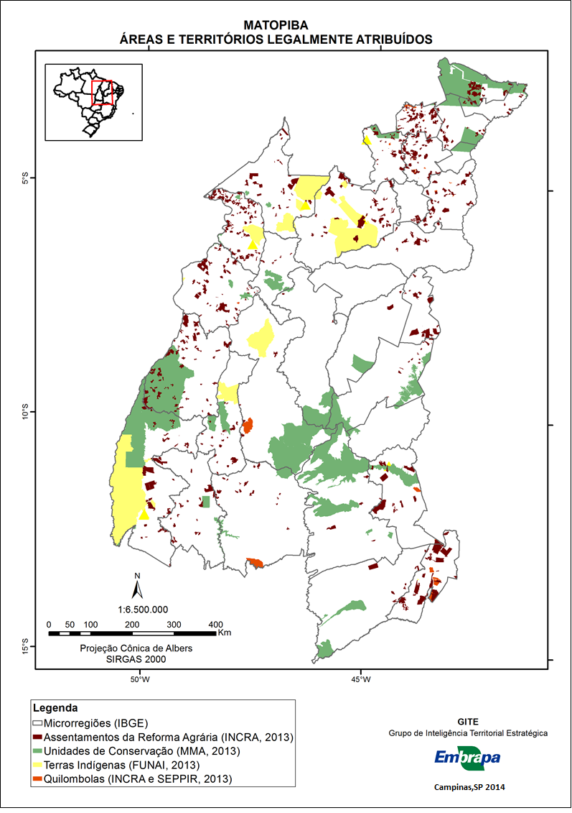
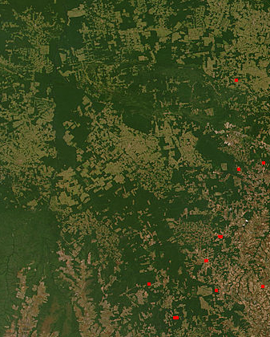

## [Abertura]{.pitch-tag .pitch-tag--alert} Visão Geral da Aula {#visao-geral .smaller-text .lesson-slide}

::: {.pitch-grid-50}
::: {.pitch-card}
[Roteiro da aula]{.pitch-card-index}
[Tópicos Principais]{.pitch-heading}

- [1]{.circle} Postulados de Marx e o Campo
- [2]{.circle} Formas do Capitalismo no Campo
- [3]{.circle} Revolução Verde
- [4]{.circle} Extensão Rural como Ferramenta
- [5]{.circle} Capital Estrangeiro e Consequências
:::

::: {.pitch-stack-2}
::: {.pitch-card .pitch-card--alert}
[Objetivo Central]{.pitch-card-index}
[Capital agrário e modernização]{.pitch-heading}

Compreender o desenvolvimento do capitalismo no campo brasileiro, desde a modernização agrícola até os impactos do capital estrangeiro na estrutura agrária.
:::

::: {.pitch-pill-row}
[Marx · Abramovay · Martins]{.pitch-pill}
[MATOPIBA · CPT 2023]{.pitch-pill .pitch-pill--gold}
[Financeirização]{.pitch-pill}
:::

::: {.pitch-band .pitch-band--navy}
Da modernização conservadora à hegemonia do capital financeiro sobre a terra, a água e os territórios.
:::
:::
:::

# 1 · Fundamentos e Formas do Capitalismo Agrário {.section-header rotulo="Fundamentos"}

## [Fundamentos]{.pitch-tag} O Capitalismo — Postulados de Marx {#postulados-marx .smaller-text .lesson-slide}

::: {.pitch-cards}
::: {.pitch-card}
[01 · Mais-valia]{.pitch-card-index}
[Exploração do trabalho]{.pitch-heading}

A **exploração da mais-valia** pelos donos dos meios de produção como motor da acumulação.
:::

::: {.pitch-card .pitch-card--gold}
[02 · Mercantilização]{.pitch-card-index}
[Objetificação]{.pitch-heading}

A **objetificação** de tudo — terra, natureza e trabalho — para posterior comercialização.
:::

::: {.pitch-card .pitch-card--alert}
[03 · Acumulação]{.pitch-card-index}
[Lucro e especulação]{.pitch-heading}

**Lucro** obtido pela exploração produtiva e pela especulação comercial do produto.
:::
:::

::: {.pitch-card}
[Schneider (2003)]{.pitch-card-index}
[Campo e crescimento econômico]{.pitch-heading}

Os debates sobre o capitalismo no campo sempre estiveram focados no envolvimento do rural frente ao **crescimento econômico** e sua exploração.
:::

::: {.pitch-formula}
> *"O meio rural quase nunca se beneficiou do capitalismo em sua essência"* (Martins, 2008).
:::

## [Conceito]{.pitch-tag .pitch-tag--teal} Meio Rural e Persistência da Agricultura Familiar {#meio-rural-debate .smaller-text .lesson-slide}

::: {.pitch-cards-2}
::: {.pitch-card .pitch-card--teal}
[Angela Kageyama (2008)]{.pitch-card-index}
[Especificidades do meio rural]{.pitch-heading}

- Espaço com maior presença de **áreas verdes ou naturais**
- Grandes distâncias entre residências e comércios
- Forte dependência de **recursos naturais** (água e terra)
- Representações **culturais e simbólicas** da ruralidade

Mesmo próximo do urbano (*rurbano*), o campo apresenta **características exclusivas** na atuação do capitalismo sobre residentes e trabalhadores.
:::

::: {.pitch-card .pitch-card--gold}
[Década de 1920 · Ricardo Abramovay (2007)]{.pitch-card-index}
[*Paradigmas do Capitalismo Agrário em Questão*]{.pitch-heading}

Desde a **década de 1920**, o debate concentra-se na **persistência** das unidades agrícolas familiares.

> A agricultura de base familiar ainda luta pela sua continuidade, sob constante expansão do sistema intensivo subvencionado pelo **capital financeiro especulativo**.
:::
:::

## [Estrutura]{.pitch-tag .pitch-tag--gold} Formas do Capitalismo no Campo {#formas-capitalismo .smaller-text .lesson-slide}

::: {.pitch-table-box}
| Forma | Descrição |
| --- | --- |
| **Latifúndio** | Concentração de grandes extensões de terra em poucos proprietários |
| **Agronegócio** | Integração agricultura + indústria + mercado globalizado; *commodities* em larga escala |
| **Agroindústria** | Transformação de produtos agrícolas (alimentos processados, biocombustíveis, cosméticos) |
:::

::: {.pitch-cards-2}
::: {.pitch-card .pitch-card--alert}
[Resistência organizada]{.pitch-card-index}
[Movimentos sociais rurais]{.pitch-heading}

Ligas Camponesas e Movimento dos Trabalhadores Rurais Sem Terra (**MST**) na disputa pela reforma agrária.
:::

::: {.pitch-card .pitch-card--forest}
[Territorialidades ancestrais]{.pitch-card-index}
[Populações tradicionais]{.pitch-heading}

Resistência de povos **indígenas, quilombolas e ribeirinhos** na defesa de seus modos de vida e territórios.
:::
:::

## [Síntese Visual]{.pitch-tag .pitch-tag--alert} Capitalismo Agrário, Financeirização e Conflitos {#diagrama-capitalismo .smaller-text .lesson-slide}

::: {.pitch-media-card .pitch-media-card--tall}

[Capitalismo Agrário, Financeirização e Conflitos Territoriais (Delgado, 2012)]{.pitch-caption}
[Da modernização industrial à hegemonia do capital financeiro sobre a terra, o Cerrado e os recursos hídricos]{.pitch-caption-sub}
:::

::: {.pitch-band .pitch-band--navy}
A captura da renda da terra pelo capital financeiro aprofunda grilagem, desmatamento, pressões hídricas e concentração fundiária.
:::

# 2 · Revolução Verde e Extensão Rural {.section-header rotulo="Revolução Verde"}

## [Modernização]{.pitch-tag .pitch-tag--gold} Revolução Verde e Fronteira Agrícola {#revolucao-verde .smaller-text .lesson-slide}

::: {.pitch-grid-55}
::: {.pitch-stack-2}
::: {.pitch-card}
[Definição e objetivos]{.pitch-card-index}
[Articulação agricultura–indústria]{.pitch-heading}

Conjunto de mudanças técnicas na produção agrícola voltado a implantar um **pacote tecnológico** na agricultura mundial, descartando as ruralidades existentes e suas peculiaridades.
:::

::: {.pitch-card .pitch-card--alert}
[Consequências políticas · Schneider (2010)]{.pitch-card-index}
[Agenda neoliberal]{.pitch-heading}

- Estatização das agendas **industrializantes neoliberais**
- Direcionamento aos interesses de **multinacionais**
- Efeitos concentradores que perduram até hoje
:::
:::

::: {.pitch-media-card .pitch-media-card--compact}

[MATOPIBA — áreas e territórios legalmente atribuídos]{.pitch-caption}
[Evaristomiranda / Embrapa (CC-BY-SA 4.0) · UC, TI, assentamentos e quilombos sob pressão de fronteira]{.pitch-caption-sub}
:::
:::

## [ATER]{.pitch-tag .pitch-tag--teal} Extensão e ATER como Ferramenta {#extensao-ferramenta .smaller-text .lesson-slide}

::: {.pitch-cards-2}
::: {.pitch-card .pitch-card--alert}
[Origens institucionais · Peixoto (2008)]{.pitch-card-index}
[AIA e EMBRATER (Lei 6.126/74)]{.pitch-heading}

As atividades iniciais das agências extensionistas serviram ao capital:

- **AIA (Agência Americana)** — promoção de métodos industrializantes
- **EMBRATER (Lei 6.126/74)** — extensão rural estatizada no Brasil
:::

::: {.pitch-card .pitch-card--teal}
[Modelo difusionista e pesquisa]{.pitch-card-index}
[Embrapa e assimetrias]{.pitch-heading}

- **Objetivo:** divulgação e incentivo de produtos próprios usando **técnicas difusionistas**
- A **Embrapa** aprimorou e potencializou a agropecuária brasileira, mas os resultados foram **assimétricos**
:::
:::

::: {.pitch-band}
O difusionismo vertical priorizou pacotes de insumos e grandes escalas produtivas em detrimento da diversidade camponesa.
:::

# 3 · Impactos, Capital Estrangeiro e Conflitos {.section-header rotulo="Impactos"}

## [Modernização]{.pitch-tag .pitch-tag--alert} Consequências da Modernização {#consequencias-modernizacao .smaller-text .lesson-slide}

::: {.pitch-grid-50}
::: {.pitch-stack-2}
::: {.pitch-card .pitch-card--forest}
[Lado positivo]{.pitch-card-index}
[Macroeconomia e exportação]{.pitch-heading}

- Decisivas na **balança comercial** brasileira
- Sucessivos **superávits** externos
:::

::: {.pitch-card .pitch-card--alert}
[Lado negativo]{.pitch-card-index}
[Passivos socioambientais]{.pitch-heading}

- Danos ambientais **irreparáveis**
- Reafirmação do caráter **concentrador** do desenvolvimento
- **Exclusão social** dos pequenos produtores
:::
:::

::: {.pitch-media-card .pitch-media-card--photo .pitch-media-card--compact}

[Desmatamento no Mato Grosso (ago. 2006)]{.pitch-caption}
[NASA FIRMS / LANCE · Domínio Público · Conversão de cobertura nativa pela expansão agropecuária]{.pitch-caption-sub}
:::
:::

## [Financeirização]{.pitch-tag .pitch-tag--alert} Capital Estrangeiro no Campo {#capital-estrangeiro .smaller-text .lesson-slide}

::: {.pitch-band}
A aquisição de terras por capital estrangeiro reconfigura o controle dos ativos naturais e o mercado de terras no país.
:::

::: {.pitch-grid-40}
::: {.pitch-card .pitch-card--teal}
[Efeitos positivos]{.pitch-card-index}
[Renda pontual]{.pitch-heading}

Distribuição de renda por trabalhadores contratados (em número reduzido e frequentemente **sazonais**).
:::

::: {.pitch-card .pitch-card--alert}
[Efeitos negativos]{.pitch-card-index}
[Assimetrias estruturais]{.pitch-heading}

- Quase nenhum **benefício social** — empresas rurais são as que menos tributam
- **Oligopolização** do sistema de produção
- Impacto na **segurança alimentar** — terras destinadas a *commodities* para exportação
- **Especulação imobiliária** dos ativos: água, clima tropical e terras produtivas
:::
:::

## [Conflitos]{.pitch-tag .pitch-tag--alert} Conflitos Agrários Contemporâneos {#conflitos-agrarios .smaller-text .lesson-slide}

::: {.pitch-grid-50}
::: {.pitch-card}
[Dimensões estruturais · CPT (2023)]{.pitch-card-index}
[Cenário de disputas]{.pitch-heading}

- Disputa por **terras devolutas e públicas** entre grileiros e comunidades tradicionais
- **Envenenamento de águas** por agrotóxicos em áreas limítrofes a monoculturas
- Assassinato de lideranças rurais e ambientalistas
- Expansão da soja e pecuária sobre **terras indígenas e quilombolas**
:::

::: {.pitch-card .pitch-card--alert}
[Registros de 2022 · CPT (2023)]{.pitch-card-index}
[Dados recentes]{.pitch-heading}

- **1.893 conflitos por terra** no Brasil
- **47 assassinatos** de trabalhadores rurais e lideranças
- Aumento de **grilagem digital** via CAR fraudulento
- Crescimento de conflitos hídricos no Nordeste e Centro-Oeste
:::
:::

::: {.pitch-band .pitch-band--navy}
O capitalismo no campo não eliminou os conflitos agrários — **aprofundou-os** sob novas formas jurídicas, digitais e territoriais.
:::

# 4 · Síntese e Referências {.section-header rotulo="Síntese"}

## [Síntese]{.pitch-tag} Conclusão {#conclusao .smaller-text .lesson-slide}

::: {.pitch-card}
[Caráter multifacetado]{.pitch-card-index}
[História, política, economia e sociologia]{.pitch-heading}

O desenvolvimento do capitalismo e a modernização da agricultura no Brasil é um tema **multifacetado** que demanda um projeto de desenvolvimento rural **sustentável** articulando:
:::

::: {.pitch-cards}
::: {.pitch-card .pitch-card--gold}
[01 · Equilíbrio]{.pitch-card-index}
[Três dimensões]{.pitch-heading}

Integração efetiva das dimensões **econômicas, sociais e ambientais**.
:::

::: {.pitch-card .pitch-card--forest}
[02 · Reconhecimento]{.pitch-card-index}
[Agricultura familiar]{.pitch-heading}

Relação estratégica e justa com a **agricultura familiar**.
:::

::: {.pitch-card .pitch-card--teal}
[03 · Emancipação]{.pitch-card-index}
[Autonomia]{.pitch-heading}

**Liberdade** e autonomia dos sujeitos do campo frente ao capital especulativo.
:::
:::

## [Referências]{.pitch-tag} Referências da Aula {#referencias .smaller-text .lesson-slide}

::: {.pitch-cards-2}
::: {.pitch-card}
[Bloco 1 · Capitalismo Agrário e Estado]{.pitch-card-index}
[Políticas e estrutura fundiária]{.pitch-heading}

- Abramovay, R. *Paradigmas do capitalismo agrário em questão* (2007).
- Alves, P. D. *Políticas Agrícolas para agricultura familiar* (2012).
- Brasil. *Lei 5.969/73 — PROAGRO* (1973).
- Kageyama, A. A. *Desenvolvimento rural* (2008).
:::

::: {.pitch-card .pitch-card--alert}
[Bloco 2 · Modernização e Sujeitos]{.pitch-card-index}
[Sociabilidade e desenvolvimento]{.pitch-heading}

- Martins, J. S. *A sociabilidade do homem simples* (2008).
- Navarro, Z. *Desenvolvimento rural no Brasil* (2001).
- Schneider, S. *Situando o desenvolvimento rural no Brasil* (2010).
- Veiga, J. E. *Desenvolvimento sustentável* (2010).
:::
:::

## {.center background-color="#2135A6"}

::: {style="text-align: center;"}
[Obrigado!]{.obrigado-fit-text style="color: white;"}

::: {style="color: white; font-size: 0.7em;"}
Luiz Diego Vidal Santos

Universidade Estadual de Feira de Santana (UEFS)
:::
:::
